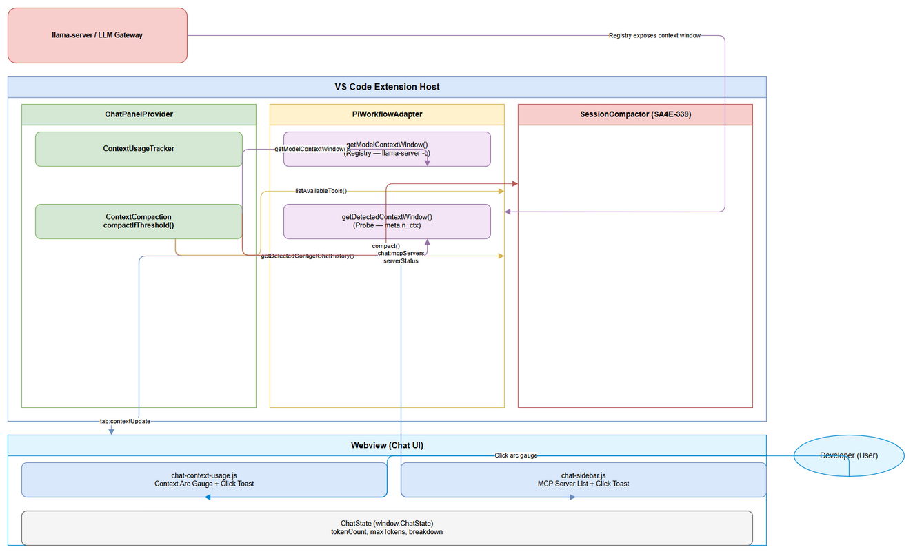
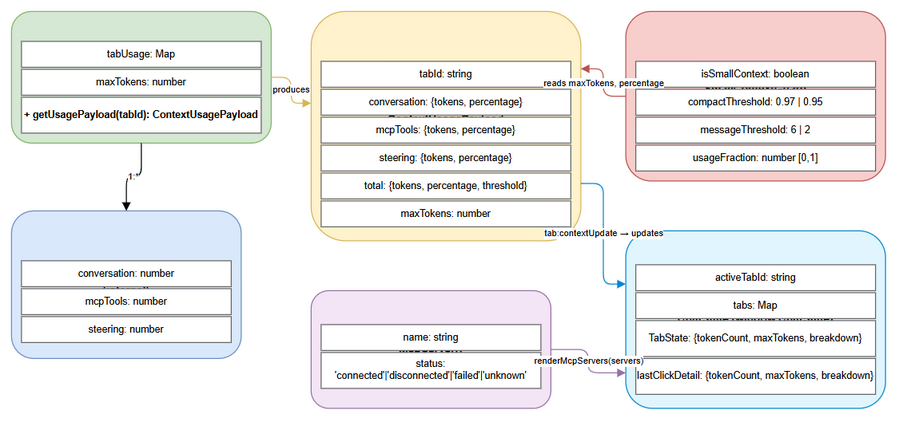

# Functional Specification Document (FSD)

## SA4E-410 — Context Usage UI Enhancements & Small-Context Compaction Guard

---

## Document Information

| Field | Value |
|-------|-------|
| Jira Ticket | SA4E-410 |
| Title | Context Usage UI Enhancements & Small-Context Compaction Guard |
| Author | BA Agent (draft) → TA Agent (enrichment) |
| Version | 1.0 |
| Date | 2026-11-07 |
| Status | Draft |
| Related BRD | `documents/SA4E-410/BRD.md` |

---

## Revision History

| Version | Date | Author | Changes |
|---------|------|--------|---------|
| 1.0 | 2026-11-07 | BA Agent | Initiate document — retrospective FSD for implemented features |
| 1.1 | 2026-11-07 | TA Agent | Technical enrichment: API contracts, integration specs, pseudocode, data model, NFR quantification, open issues |

---

## 1. Introduction

### 1.1 Purpose

This FSD specifies the functional and technical implementation of three features delivered in SA4E-410:

1. **Small-Context Compaction Guard** — Raises auto-compaction threshold from 95% to 97% and requires minimum 6 messages (vs. 2) for models with `maxTokens < 16,384` to prevent aggressive compaction loops on 4k/8k context windows.

2. **Client-Side Context Usage Detail on Click** — Clicking the context arc gauge in the chat header displays a detailed toast with absolute token counts, percentages, category breakdown (Conversation / MCP Tools / Steering), and a "4% window" reference value (`round(maxTokens * 0.04)`).

3. **Client-Side MCP Server List Detail on Click** — Clicking an MCP server entry in the right sidebar shows a toast with server name and connection status (Connected/Disconnected/Failed/Unknown), implemented purely client-side to avoid tool-call loops.

> **Note:** This is a retrospective FSD. The implementation is complete in the codebase (uncommitted changes). This document provides technical traceability for the delivered features and their integration with SA4E-339 (Auto-Compaction) and SA4E-369 (Token Budget / Registry-First Context Window).

### 1.2 Scope

**In Scope:**
- Modification to `compactIfThreshold` in `context-compaction.ts` for small-context guard logic
- Click event handlers in `chat-context-usage.js` (context arc gauge) and `chat-sidebar.js` (MCP server list)
- `tab:contextUpdate` message protocol payload structure
- Integration with `ContextUsageTracker`, `SessionCompactor`, `PiWorkflowAdapter` context window resolution
- Unit test coverage in `chat-panel-provider.compaction.trigger.test.ts`

**Out of Scope (covered by prerequisite tickets):**
- Core compaction algorithm (`SessionCompactor.compact`) — SA4E-339
- Registry-first `maxTokens` resolution (`resolveMaxTokensFromEngine`) — SA4E-369
- Server-side MCP management — only client-side display in scope
- New compaction triggers for large-context models (≥16k)

### 1.3 Definitions & Acronyms

| Term | Definition |
|------|------------|
| Context Window | Maximum tokens (input + output) a model processes per request. Also `n_ctx` or `maxTokens`. |
| Compaction Threshold | Usage fraction (0.0–1.0) triggering auto-compaction. Standard: 0.95; Small-context: 0.97. |
| Token Budget | Allocated token limit for a category (conversation, MCP tools, steering) or total usable prompt tokens (`nCtx - reserveOutput - reserveTools`). |
| Steering Tokens | Tokens from injected steering content (system prompt + steering files, ~7500 chars ≈ 1875 tokens), counted once per session. |
| MCP Tool Definitions | Token cost of JSON schemas for all MCP tools sent to LLM on every request. Counted once after tool discovery. |
| Small-Context Model | Model with resolved `maxTokens < 16,384` (e.g., 4k, 8k). Triggers raised threshold (97%) and message guard (6). |
| Large-Context Model | Model with resolved `maxTokens >= 16,384` (e.g., 32k, 64k, 128k). Uses standard threshold (95%) and message guard (2). |
| Registry-First Context Window | SA4E-369 pattern: resolve `maxTokens` from model registry (llama-server `-c` value) first, fallback to probe `meta.n_ctx`, last resort undefined (never hardcoded 128000 as source). |
| 4% Window Value | Mental reference: `round(maxTokens * 0.04)`. Shown in context detail toast to gauge headroom. |
| Session Compaction | Automatic summarization when usage threshold crossed, keeping summary + N recent messages (default 2). |
| Normalize Usage To Fraction | SEC-330-02 control: converts percent-scale (0–100) to fraction (0.0–1.0) via `percent > 100 ? 1 : percent / 100`. Prevents compaction-trigger abuse. |
| Compaction-Trigger Abuse | SEC-330-02: When percent-scale (95) mistakenly used where fraction (0.95) expected, causing compaction every turn. Guarded by `normalizeUsageToFraction`. |

### 1.4 References

| Document | Location |
|----------|----------|
| BRD | `documents/SA4E-410/BRD.md` |
| SA4E-339 BRD | `documents/SA4E-339/BRD.md` |
| SA4E-369 BRD | `documents/SA4E-369/BRD.md` |
| Context Compaction Implementation | `extension/src/chat-panel/chat-panel-provider/context-compaction.ts` |
| Context Usage Tracker | `extension/src/chat-panel/context-usage-tracker.ts` |
| Context Usage Webview | `extension/webview-assets/chat/chat-context-usage.js` |
| Sidebar MCP Server Webview | `extension/webview-assets/chat/chat-sidebar.js` |
| Session Compactor Core | `extension/src/pi-agent/session-compactor.ts` |
| PiWorkflowAdapter | `extension/src/pi-workflow/pi-workflow-adapter/adapter-core.ts` |

---

## 2. System Overview

### 2.1 System Context Diagram



```xml
<mxGraphModel dx="1200" dy="800" grid="1" gridSize="10" guides="1" tooltips="1" connect="1" arrows="1" fold="1" page="1" pageScale="1" pageWidth="1169" pageHeight="827" math="0" shadow="0">
  <root>
    <mxCell id="0"/>
    <mxCell id="1" parent="0"/>
    <!-- User Actor -->
    <mxCell id="actor_user" value="Developer (User)" style="shape=ellipse;whiteSpace=wrap;html=1;fillColor=#e1f5fe;strokeColor=#0288d1;fontSize=11;fontStyle=1;" vertex="1" parent="1">
      <mxGeometry x="50" y="350" width="120" height="60" as="geometry"/>
    </mxCell>
    <!-- VS Code Extension Host -->
    <mxCell id="host" value="VS Code Extension Host" style="rounded=1;whiteSpace=wrap;html=1;fillColor=#dae8fc;strokeColor=#6c8ebf;fontSize=11;fontStyle=1;" vertex="1" parent="1">
      <mxGeometry x="250" y="100" width="700" height="600" as="geometry"/>
    </mxCell>
    <!-- ChatPanelProvider -->
    <mxCell id="provider" value="ChatPanelProvider" style="rounded=1;whiteSpace=wrap;html=1;fillColor=#d5e8d4;strokeColor=#82b366;fontSize=11;" vertex="1" parent="host">
      <mxGeometry x="300" y="150" width="200" height="180" as="geometry"/>
    </mxCell>
    <!-- ContextUsageTracker -->
    <mxCell id="tracker" value="ContextUsageTracker" style="rounded=1;whiteSpace=wrap;html=1;fillColor=#d5e8d4;strokeColor=#82b366;fontSize=11;" vertex="1" parent="provider">
      <mxGeometry x="20" y="20" width="160" height="50" as="geometry"/>
    </mxCell>
    <!-- ContextCompaction (compactIfThreshold) -->
    <mxCell id="compaction" value="ContextCompaction\ncompactIfThreshold()" style="rounded=1;whiteSpace=wrap;html=1;fillColor=#d5e8d4;strokeColor=#82b366;fontSize=11;" vertex="1" parent="provider">
      <mxGeometry x="20" y="90" width="160" height="50" as="geometry"/>
    </mxCell>
    <!-- PiWorkflowAdapter -->
    <mxCell id="adapter" value="PiWorkflowAdapter" style="rounded=1;whiteSpace=wrap;html=1;fillColor=#fff2cc;strokeColor=#d6b656;fontSize=11;fontStyle=1;" vertex="1" parent="host">
      <mxGeometry x="550" y="150" width="200" height="180" as="geometry"/>
    </mxCell>
    <!-- getModelContextWindow() -->
    <mxCell id="registry" value="getModelContextWindow()\n(Registry - llama-server -c)" style="rounded=1;whiteSpace=wrap;html=1;fillColor=#f3e5f5;strokeColor=#9673a6;fontSize=11;" vertex="1" parent="adapter">
      <mxGeometry x="20" y="20" width="160" height="50" as="geometry"/>
    </mxCell>
    <!-- getDetectedContextWindow() -->
    <mxCell id="probe" value="getDetectedContextWindow()\n(Probe - meta.n_ctx)" style="rounded=1;whiteSpace=wrap;html=1;fillColor=#f3e5f5;strokeColor=#9673a6;fontSize=11;" vertex="1" parent="adapter">
      <mxGeometry x="20" y="90" width="160" height="50" as="geometry"/>
    </mxCell>
    <!-- SessionCompactor -->
    <mxCell id="session_compactor" value="SessionCompactor\n(SA4E-339)" style="rounded=1;whiteSpace=wrap;html=1;fillColor=#f8cecc;strokeColor=#b85450;fontSize=11;fontStyle=1;" vertex="1" parent="host">
      <mxGeometry x="300" y="380" width="200" height="120" as="geometry"/>
    </mxCell>
    <!-- Webview (Chat UI) -->
    <mxCell id="webview" value="Webview (Chat UI)" style="rounded=1;whiteSpace=wrap;html=1;fillColor=#e1f5fe;strokeColor=#0288d1;fontSize=11;fontStyle=1;" vertex="1" parent="host">
      <mxGeometry x="550" y="380" width="300" height="250" as="geometry"/>
    </mxCell>
    <!-- chat-context-usage.js -->
    <mxCell id="ctx_usage_js" value="chat-context-usage.js\nContext Arc Gauge + Click Toast" style="rounded=1;whiteSpace=wrap;html=1;fillColor=#dae8fc;strokeColor=#6c8ebf;fontSize=11;" vertex="1" parent="webview">
      <mxGeometry x="20" y="20" width="260" height="60" as="geometry"/>
    </mxCell>
    <!-- chat-sidebar.js -->
    <mxCell id="sidebar_js" value="chat-sidebar.js\nMCP Server List + Click Toast" style="rounded=1;whiteSpace=wrap;html=1;fillColor=#dae8fc;strokeColor=#6c8ebf;fontSize=11;" vertex="1" parent="webview">
      <mxGeometry x="20" y="100" width="260" height="60" as="geometry"/>
    </mxCell>
    <!-- ChatState -->
    <mxCell id="chat_state" value="ChatState (window.ChatState)\ntokenCount, maxTokens, breakdown" style="rounded=1;whiteSpace=wrap;html=1;fillColor=#f5f5f5;strokeColor=#666666;fontSize=11;" vertex="1" parent="webview">
      <mxGeometry x="20" y="180" width="260" height="50" as="geometry"/>
    </mxCell>
    <!-- External: llama-server -->
    <mxCell id="llama" value="llama-server / LLM Gateway" style="rounded=1;whiteSpace=wrap;html=1;fillColor=#f8cecc;strokeColor=#b85450;fontSize=11;fontStyle=1;" vertex="1" parent="1">
      <mxGeometry x="1000" y="350" width="180" height="80" as="geometry"/>
    </mxCell>
    <!-- Edges -->
    <mxCell id="e1" value="" style="edgeStyle=orthogonalEdgeStyle;html=1;endArrow=block;endFill=1;fontSize=9;" edge="1" parent="1" source="actor_user" target="webview">
      <mxGeometry relative="1" as="geometry">
        <mxPoint x="170" y="380" as="sourcePoint"/>
        <mxPoint x="550" y="380" as="targetPoint"/>
      </mxGeometry>
    </mxCell>
    <mxCell id="e2" value="tab:contextUpdate" style="edgeStyle=orthogonalEdgeStyle;html=1;endArrow=block;endFill=1;fontSize=9;strokeColor=#6c8ebf;" edge="1" parent="1" source="provider" target="webview">
      <mxGeometry relative="1" as="geometry">
        <mxPoint x="500" y="250" as="sourcePoint"/>
        <mxPoint x="550" y="450" as="targetPoint"/>
      </mxGeometry>
    </mxCell>
    <mxCell id="e3" value="chat:mcpServers\nserverStatus" style="edgeStyle=orthogonalEdgeStyle;html=1;endArrow=block;endFill=1;fontSize=9;strokeColor=#6c8ebf;" edge="1" parent="1" source="provider" target="webview">
      <mxGeometry relative="1" as="geometry">
        <mxPoint x="500" y="300" as="sourcePoint"/>
        <mxPoint x="550" y="500" as="targetPoint"/>
      </mxGeometry>
    </mxCell>
    <mxCell id="e4" value="getModelContextWindow()" style="edgeStyle=orthogonalEdgeStyle;html=1;endArrow=block;endFill=1;fontSize=9;strokeColor=#9673a6;" edge="1" parent="1" source="compaction" target="registry">
      <mxGeometry relative="1" as="geometry">
        <mxPoint x="500" y="175" as="sourcePoint"/>
        <mxPoint x="570" y="175" as="targetPoint"/>
      </mxGeometry>
    </mxCell>
    <mxCell id="e5" value="getDetectedContextWindow()" style="edgeStyle=orthogonalEdgeStyle;html=1;endArrow=open;endFill=0;dashed=1;fontSize=9;strokeColor=#9673a6;" edge="1" parent="1" source="compaction" target="probe">
      <mxGeometry relative="1" as="geometry">
        <mxPoint x="500" y="220" as="sourcePoint"/>
        <mxPoint x="570" y="220" as="targetPoint"/>
      </mxGeometry>
    </mxCell>
    <mxCell id="e6" value="compact()" style="edgeStyle=orthogonalEdgeStyle;html=1;endArrow=block;endFill=1;fontSize=9;strokeColor=#b85450;" edge="1" parent="1" source="compaction" target="session_compactor">
      <mxGeometry relative="1" as="geometry">
        <mxPoint x="400" y="330" as="sourcePoint"/>
        <mxPoint x="400" y="380" as="targetPoint"/>
      </mxGeometry>
    </mxCell>
    <mxCell id="e7" value="listAvailableTools()" style="edgeStyle=orthogonalEdgeStyle;html=1;endArrow=block;endFill=1;fontSize=9;strokeColor=#d6b656;" edge="1" parent="1" source="provider" target="adapter">
      <mxGeometry relative="1" as="geometry">
        <mxPoint x="500" y="280" as="sourcePoint"/>
        <mxPoint x="550" y="280" as="targetPoint"/>
      </mxGeometry>
    </mxCell>
    <mxCell id="e8" value="getChatHistory()" style="edgeStyle=orthogonalEdgeStyle;html=1;endArrow=block;endFill=1;fontSize=9;strokeColor=#82b366;" edge="1" parent="1" source="provider" target="adapter">
      <mxGeometry relative="1" as="geometry">
        <mxPoint x="500" y="240" as="sourcePoint"/>
        <mxPoint x="550" y="240" as="targetPoint"/>
      </mxGeometry>
    </mxCell>
    <mxCell id="e9" value="Registry exposes\ncontext window (-c)" style="edgeStyle=orthogonalEdgeStyle;html=1;endArrow=block;endFill=1;fontSize=9;strokeColor=#b85450;" edge="1" parent="1" source="llama" target="adapter">
      <mxGeometry relative="1" as="geometry">
        <mxPoint x="1000" y="390" as="sourcePoint"/>
        <mxPoint x="750" y="390" as="targetPoint"/>
      </mxGeometry>
    </mxCell>
  </root>
</mxGraphModel>
```

### 2.2 System Architecture

The SA4E-410 features integrate into the existing context governance pipeline established by SA4E-339 and SA4E-369:

```
┌─────────────────────────────────────────────────────────────────────────────┐
│                         CONTEXT GOVERNANCE PIPELINE                          │
├─────────────────────────────────────────────────────────────────────────────┤
│                                                                             │
│  ┌──────────────┐    ┌──────────────────────┐    ┌──────────────────────┐  │
│  │ LLM Turn     │───▶│ updateContextUsage   │───▶│ ContextUsageTracker  │  │
│  │ Completes    │    │ AfterTurn()          │    │ (per-tab accounting) │  │
│  └──────────────┘    └──────────┬───────────┘    └──────────┬───────────┘  │
│                                 │                            │             │
│                                 ▼                            ▼             │
│                    ┌─────────────────────┐    ┌──────────────────────┐     │
│                    │ syncTurnWindow()    │    │ countTurnTokens()    │     │
│                    │ (SA4E-369: registry │    │ - Conversation       │     │
│                    │  first, probe       │    │ - Steering (once)    │     │
│                    │  fallback)          │    │ - MCP Tool Defs      │     │
│                    └──────────┬──────────┘    └──────────────────────┘     │
│                               │                            │               │
│                               ▼                            ▼               │
│                    ┌─────────────────────────────────────────────────┐     │
│                    │ compactIfThreshold() — SMALL-CONTEXT GUARD      │     │
│                    │                                                 │     │
│                    │ maxTokens = payload.maxTokens                   │     │
│                    │ isSmallContext = maxTokens > 0 && < 16384       │     │
│                    │ threshold = isSmallContext ? 0.97 : 0.95        │     │
│                    │ msgThreshold = isSmallContext ? 6 : 2           │     │
│                    │                                                 │     │
│                    │ if (usageFraction >= threshold &&               │     │
│                    │     shouldCompact() === 'compact' &&            │     │
│                    │     messages.length > msgThreshold)             │     │
│                    │   → SessionCompactor.compact()                  │     │
│                    └──────────────────────┬──────────────────────────┘     │
│                                           │                                 │
│                                           ▼                                 │
│                    ┌─────────────────────────────────────────────────┐     │
│                    │ sendContextUpdateMessage() → tab:contextUpdate  │     │
│                    │ Payload:                                        │     │
│                    │ { tabId, tokenCount, maxTokens, breakdown:      │     │
│                    │   { conversation:%, mcpTools:%, steering:% } }  │     │
│                    └──────────────────────┬──────────────────────────┘     │
│                                           │                                 │
│                    ┌──────────────────────┴──────────────────────┐        │
│                    ▼                                             ▼        │
│         ┌─────────────────────┐                    ┌─────────────────────┐ │
│         │ chat-context-usage.js │                │ chat-sidebar.js       │ │
│         │ - Arc gauge update   │                    │ - MCP server list    │ │
│         │ - Click → detail     │                    │ - Click → status     │ │
│         │   toast (4% window)  │                    │   toast (client-side)│ │
│         └─────────────────────┘                    └─────────────────────┘ │
│                                                                             │
└─────────────────────────────────────────────────────────────────────────────┘
```

---

## 3. Functional Requirements

### 3.1 Feature: Small-Context Compaction Guard

**Source:** BRD Story 1 / SA4E-410 / [Implements: AC-410-01 through AC-410-05]

#### 3.1.1 Description

Modifies the auto-compaction trigger logic in `compactIfThreshold()` to apply different thresholds for small-context models (`maxTokens < 16,384`). This prevents aggressive compaction loops on 4k/8k window models where every token matters and summarization loses disproportionate context.

**Key Changes from SA4E-339 baseline:**
- Threshold raised from `COMPACT_USAGE_THRESHOLD (0.95)` → `0.97` for small contexts
- Minimum message count raised from `2` → `6` for small contexts
- Large-context behavior (`maxTokens >= 16,384`) remains unchanged
- Fail-safe: if `maxTokens` resolution fails (returns 0), defaults to large-context behavior

#### 3.1.2 Use Case

**Use Case ID:** UC-410-01
**Actor:** System (automatic per-turn evaluation)
**Preconditions:** 
- LLM turn completed
- `updateContextUsageAfterTurn()` invoked
- `ContextUsageTracker` has current `maxTokens` synced from registry/probe
**Postconditions:** 
- Compaction triggered or skipped based on small-context guard
- Updated `ContextUsagePayload` sent to webview via `tab:contextUpdate`

**Main Flow:**

| Step | Actor | System | Description |
|------|-------|--------|-------------|
| 1 | | `updateContextUsageAfterTurn()` | Called after each LLM turn completes |
| 2 | | `syncTurnWindow()` | Resolves `maxTokens` via `resolveMaxTokensFromEngine()` (registry → probe) |
| 3 | | `countTurnTokens()` | Updates conversation, steering, MCP tool token counts |
| 4 | | `compactIfThreshold()` | Evaluates small-context guard and triggers compaction if thresholds met |
| 5 | | `sendContextUpdateMessage()` | Broadcasts `tab:contextUpdate` to webview with breakdown |

**Alternative Flows:**

| ID | Condition | Steps |
|----|-----------|-------|
| AF-1 | `maxTokens` resolution returns 0/undefined | Guard defaults to large-context behavior (threshold 0.95, min 2 messages) — fail-safe to avoid blocking compaction entirely |
| AF-2 | `usageFraction` invalid (NaN, negative) | `normalizeUsageToFraction()` returns 0 → compaction not triggered |
| AF-3 | `SessionMonitor.shouldCompact()` returns `'warn'` or `'none'` | Compaction skipped; payload sent unchanged |

**Exception Flows:**

| ID | Error Condition | Steps |
|----|-----------------|-------|
| EF-1 | `SessionCompactor.compact()` throws | Catch error, log warning, return original payload (non-fatal) — session continues un-compacted |
| EF-2 | `setChatHistory()` fails | Log error, payload reflects pre-compaction state |

#### 3.1.3 Business Rules

| Rule ID | Rule | Source |
|---------|------|--------|
| BR-410-01 | A model is "small-context" iff `maxTokens > 0 && maxTokens < 16384` | AC-410-01 |
| BR-410-02 | Small-context compaction threshold = 0.97 (97%) | AC-410-01, AC-410-03 |
| BR-410-03 | Small-context minimum message guard = 6 messages | AC-410-02, AC-410-03 |
| BR-410-04 | Large-context (`maxTokens >= 16384`) uses threshold 0.95, min 2 messages | AC-410-04 |
| BR-410-05 | If `maxTokens` unavailable (0/undefined), default to large-context behavior | Error Handling |
| BR-410-06 | `usageFraction` derived via `normalizeUsageToFraction(payload.total.percentage)` — SEC-330-02 contract | SA4E-339 |

#### 3.1.4 Data Specifications

**Input Data (from `ContextUsagePayload`):**

| Field | Type | Required | Validation | Description |
|-------|------|----------|------------|-------------|
| `maxTokens` | number | Yes | > 0 for guard eval; 0 defaults to large-context | Resolved model context window from registry/probe |
| `total.percentage` | number | Yes | 0–100 (rounded integer from tracker) | Total usage percentage |
| `total.tokens` | number | Yes | ≥ 0 | Absolute token count |
| `messages.length` | number | Yes | ≥ 0 | Current conversation message count |

**Derived Data (computed in `compactIfThreshold`):**

| Field | Type | Formula |
|-------|------|---------|
| `isSmallContext` | boolean | `maxTokens > 0 && maxTokens < 16384` |
| `compactThreshold` | number | `isSmallContext ? 0.97 : COMPACT_USAGE_THRESHOLD (0.95)` |
| `messageThreshold` | number | `isSmallContext ? 6 : 2` |
| `usageFraction` | number | `normalizeUsageToFraction(total.percentage)` |

**Output Data:** Updated `ContextUsagePayload` (post-compaction if triggered) sent via `tab:contextUpdate`.

#### 3.1.5 UI Specifications

No direct UI changes — this is a backend behavior change. The webview receives updated `tab:contextUpdate` payload reflecting post-compaction token counts.

#### 3.1.6 API Contract (Functional View)

> **Note:** This is an internal function call, not an HTTP endpoint. The "API" here is the TypeScript function signature and message protocol.

**Function:** `compactIfThreshold(deps, tabId, messages, payload): ContextUsagePayload`

**Input Parameters:**

| Parameter | Type | Required | Business Rule | Description |
|-----------|------|----------|---------------|-------------|
| `deps` | `ContextUsageDeps` | Yes | — | Dependency bundle: tracker, compactor, engine access |
| `tabId` | string | Yes | — | Active tab identifier (SA4E-370 per-tab accounting) |
| `messages` | `any[]` | Yes | `length > messageThreshold` for compaction | Conversation history from `engine.getChatHistory()` |
| `payload` | `ContextUsagePayload` | Yes | Contains `maxTokens`, `total.percentage` | Current usage snapshot from tracker |

**Output Data:** `ContextUsagePayload` — either original or post-compaction recount.

**Business Error Scenarios:**

| Scenario | User Message | Trigger Condition |
|----------|--------------|-------------------|
| Compaction failed | (Non-fatal — logged only) | `SessionCompactor.compact()` throws; session continues un-compacted |
| `maxTokens` unavailable | (Fail-safe — large-context behavior) | `resolveMaxTokensFromEngine()` returns undefined |

---

### 3.2 Feature: Context Usage Detail on Click

**Source:** BRD Story 2 / SA4E-410 / [Implements: AC-410-06 through AC-410-10]

#### 3.2.1 Description

Clicking the context usage arc gauge (`#context-usage-icon`) in the chat header displays a detailed toast notification with:
- Total tokens used / max tokens / percentage
- "4% of window = {value} tokens" reference (`Math.round(maxTokens * 0.04)`)
- Category breakdown: Conversation%, MCP Tools%, Steering% (when breakdown available)
- Auto-dismisses after 4 seconds via `S.showToast(html, 4000)`
- Debounced via `lastClickDetail` cache to avoid duplicate toasts if data unchanged

#### 3.2.2 Use Case

**Use Case ID:** UC-410-02
**Actor:** Developer (User)
**Preconditions:** 
- Chat webview loaded
- `ChatState` has current tab with `tokenCount`, `maxTokens`, `breakdown`
- Context arc gauge rendered and visible
**Postconditions:** Detail toast displayed for 4 seconds with breakdown info

**Main Flow:**

| Step | Actor | System | Description |
|------|-------|--------|-------------|
| 1 | User clicks context arc gauge (`#context-usage-icon`) | | Click event fired |
| 2 | | `contextUsageIcon.addEventListener('click')` | Handler reads current tab from `ChatState` |
| 3 | | | Extracts `tokenCount`, `maxTokens`, `breakdown` from active tab |
| 4 | | | Compares with `lastClickDetail` cache — skips if unchanged |
| 5 | | | Calculates `pct = round(tokenCount / maxTokens * 100)`, `fourPct = round(maxTokens * 0.04)` |
| 6 | | | Builds HTML toast content with header, totals, 4% window, breakdown |
| 7 | | `S.showToast(html, 4000)` | Displays toast, auto-dismisses after 4s |

**Alternative Flows:**

| ID | Condition | Steps |
|----|-----------|-------|
| AF-1 | `maxTokens === 0` | Shows "N/A" for percentage and 4% window; breakdown omitted |
| AF-2 | `breakdown` unavailable (null) | Toast shows only totals + 4% window; no category breakdown |
| AF-3 | Rapid clicks with same data | `lastClickDetail` cache match → no new toast spawned |

**Exception Flows:**

| ID | Error Condition | Steps |
|----|-----------------|-------|
| EF-1 | `S.showToast` unavailable | Graceful degradation — no toast shown, no error thrown |
| EF-2 | `ChatState.getTab` returns null | Uses fallback `tokenCount=0`, `maxTokens=128000` |

#### 3.2.3 Business Rules

| Rule ID | Rule | Source |
|---------|------|--------|
| BR-410-07 | Click detail purely client-side — no host round-trip, no tool calls | AC-410-10 |
| BR-410-08 | Toast auto-dismisses at 4000ms via `S.showToast` second argument | AC-410-09 |
| BR-410-09 | `fourPct = Math.round(maxTokens * 0.04)` — mental reference, not available space | AC-410-07 |
| BR-410-10 | Debounce via `lastClickDetail` — compare `tokenCount` + `maxTokens` | AC-410-10 |
| BR-410-11 | Percentages rounded integers (0–100); breakdown % derived from payload | Validation Rules |

#### 3.2.4 Data Specifications

**Input Data (from `ChatState` active tab):**

| Field | Type | Required | Description |
|-------|------|----------|-------------|
| `tab.tokenCount` | number | Yes | Total tokens used in current tab |
| `tab.maxTokens` | number | Yes | Model context window |
| `tab.breakdown` | `{conversation:number, mcpTools:number, steering:number}` | Optional | Category percentages from `tab:contextUpdate` |

**Derived Data:**

| Field | Type | Formula |
|-------|------|---------|
| `pct` | number | `maxTokens > 0 ? Math.min(100, Math.round(tokenCount / maxTokens * 100)) : 0` |
| `fourPct` | number | `maxTokens > 0 ? Math.round(maxTokens * 0.04) : 0` |

**Output Data:** HTML toast content displayed via `S.showToast`.

#### 3.2.5 UI Specifications

| No. | Name | Type | Required | Description | Note |
|-----|------|------|----------|-------------|------|
| 1 | Context Arc Gauge | SVG Circle | Yes | Clickable circular progress indicator | Click triggers detail toast |
| 2 | Detail Toast | HTML Toast | Yes | 4-second auto-dismiss with breakdown | Client-side only, no host call |

**Toast HTML Structure:**
```html
<div style="font-weight:700;margin-bottom:8px">Context Details</div>
<div>{tokenCount} / {maxTokens} tokens ({pct}%)</div>
<div style="margin-top:6px;color:#888">4% of window = {fourPct} tokens</div>
<div style="margin-top:8px">          <!-- only if breakdown available -->
  <div>Conversation: {breakdown.conversation}%</div>
  <div>MCP tools: {breakdown.mcpTools}%</div>
  <div>Steering: {breakdown.steering}%</div>
</div>
```

#### 3.2.6 API Contract (Functional View)

**Message Protocol:** `tab:contextUpdate` (host → webview)

**Purpose:** Delivers per-tab context usage breakdown for arc gauge and click detail.

**Payload Schema:**
```typescript
interface TabContextUpdatePayload {
  tabId: string;
  tokenCount: number;           // total tokens used
  maxTokens: number;            // model context window (from registry/probe)
  breakdown: {                  // category percentages of maxTokens
    conversation: number;       // conversation tokens %
    mcpTools: number;           // MCP tool definition tokens %
    steering: number;           // steering content tokens %
  };
}
```

**Example Payload:**
```json
{
  "tabId": "tab-1",
  "tokenCount": 45231,
  "maxTokens": 128000,
  "breakdown": {
    "conversation": 20,
    "mcpTools": 10,
    "steering": 5
  }
}
```

**Business Error Scenarios:** None — this is a fire-and-forget notification. Webview handles missing/zero values gracefully.

---

### 3.3 Feature: MCP Server List Detail on Click

**Source:** BRD Story 3 / SA4E-410 / [Implements: AC-410-11 through AC-410-15]

#### 3.3.1 Description

Clicking an MCP server row (`.oc-mcp-item`) in the right sidebar displays a toast with:
- Server name (from `data-mcp-name` attribute)
- Connection status: Connected / Disconnected / Failed / Unknown
- Note: "Details shown client-side to avoid tool-call loops."
- Auto-dismisses after 4 seconds
- Purely client-side — no host round-trip, no tool calls

#### 3.3.2 Use Case

**Use Case ID:** UC-410-03
**Actor:** Developer (User)
**Preconditions:** 
- Chat webview loaded
- MCP server list rendered via `S.renderMcpServers(servers)`
- Servers array populated from `chat:mcpServers` host message and `serverStatus` events
**Postconditions:** Detail toast displayed for 4 seconds with server name and status

**Main Flow:**

| Step | Actor | System | Description |
|------|-------|--------|-------------|
| 1 | User clicks MCP server row (`.oc-mcp-item`) | | Click event fired on list item |
| 2 | | Click handler reads `data-mcp-name` attribute | Extracts server name from DOM |
| 3 | | Finds matching server in `servers` array | `servers.find(s => s.name === name)` |
| 4 | | Builds toast HTML: header "MCP Server: {name}", status line, client-side note | |
| 5 | | `S.showToast(html, 4000)` | Displays toast, auto-dismisses after 4s |

**Alternative Flows:**

| ID | Condition | Steps |
|----|-----------|-------|
| AF-1 | Server not found in array (stale DOM) | Shows status "unknown" |
| AF-2 | Status value not recognized | Normalizes to lowercase; defaults to "Unknown" label |

**Exception Flows:**

| ID | Error Condition | Steps |
|----|-----------------|-------|
| EF-1 | `S.showToast` unavailable | Graceful degradation — no toast shown |

#### 3.3.3 Business Rules

| Rule ID | Rule | Source |
|---------|------|--------|
| BR-410-12 | Click detail purely client-side — no host round-trip, no tool calls | AC-410-15 |
| BR-410-13 | Toast auto-dismisses at 4000ms | AC-410-14 |
| BR-410-14 | Status values: connected/disconnected/failed/unknown (lowercase normalized) | Validation Rules |
| BR-410-15 | Status badge colors: green=connected, red=failed, gray=disconnected/unknown | UI Specs |

#### 3.3.4 Data Specifications

**Input Data (from rendered DOM + `servers` array closure):**

| Field | Type | Required | Description |
|-------|------|----------|-------------|
| `data-mcp-name` | string | Yes | Server display name (from `servers` array) |
| `servers[]` | Array<{name:string, status:string}> | Yes | Current server list (closure variable in `renderMcpServers`) |

**Derived Data:**

| Field | Type | Formula |
|-------|------|---------|
| `label` | string | `status === 'connected' ? 'Connected' : status === 'disconnected' ? 'Disconnected' : status === 'failed' ? 'Failed' : 'Unknown'` |

**Output Data:** HTML toast content displayed via `S.showToast`.

#### 3.3.5 UI Specifications

| No. | Name | Type | Required | Description | Note |
|-----|------|------|----------|-------------|------|
| 1 | MCP Server Row | Div (`.oc-mcp-item`) | Yes | Clickable row with dot, name, status badge | Click triggers detail toast |
| 2 | Status Badge | Span (`.oc-mcp-status`) | Yes | Colored: green/red/gray | Updated via `serverStatus` events |
| 3 | Detail Toast | HTML Toast | Yes | 4-second auto-dismiss | Client-side only |

#### 3.3.6 API Contract (Functional View)

**Message Protocol:** `chat:mcpServers` (host → webview) + `serverStatus` events

**Purpose:** Populates MCP server list in sidebar with connection status.

**`chat:mcpServers` Payload:**
```typescript
interface McpServersPayload {
  servers: Array<{
    name: string;           // e.g., "code-intel"
    status: string;         // "connected" | "disconnected" | "failed" | "unknown"
  }>;
}
```

**`serverStatus` Event:**
```typescript
interface ServerStatusEvent {
  type: 'serverStatus';
  status: string;           // same enum as above
}
```

**Example `chat:mcpServers`:**
```json
{
  "type": "chat:mcpServers",
  "servers": [
    { "name": "code-intel", "status": "connected" },
    { "name": "filesystem", "status": "disconnected" }
  ]
}
```

---

## 4. Data Model

### 4.1 Entity Relationship Diagram



```xml
<mxGraphModel dx="1000" dy="700" grid="1" gridSize="10" guides="1" tooltips="1" connect="1" arrows="1" fold="1" page="1" pageScale="1" pageWidth="1169" pageHeight="827" math="0" shadow="0">
  <root>
    <mxCell id="0"/>
    <mxCell id="1" parent="0"/>
    <!-- ContextUsageTracker -->
    <mxCell id="e1" value="ContextUsageTracker" style="rounded=1;whiteSpace=wrap;html=1;fillColor=#d5e8d4;strokeColor=#82b366;fontSize=11;fontStyle=1;" vertex="1" parent="1">
      <mxGeometry x="50" y="50" width="200" height="160" as="geometry"/>
    </mxCell>
    <mxCell id="e1_f1" value="tabUsage: Map<string, TabContextUsage>" style="rounded=0;whiteSpace=wrap;html=1;fillColor=#ffffff;strokeColor=#666666;fontSize=10;" vertex="1" parent="e1">
      <mxGeometry x="10" y="30" width="180" height="30" as="geometry"/>
    </mxCell>
    <mxCell id="e1_f2" value="maxTokens: number" style="rounded=0;whiteSpace=wrap;html=1;fillColor=#ffffff;strokeColor=#666666;fontSize=10;" vertex="1" parent="e1">
      <mxGeometry x="10" y="70" width="180" height="30" as="geometry"/>
    </mxCell>
    <mxCell id="e1_f3" value="+ getUsagePayload(tabId): ContextUsagePayload" style="rounded=0;whiteSpace=wrap;html=1;fillColor=#ffffff;strokeColor=#666666;fontSize=10;fontStyle=1;" vertex="1" parent="e1">
      <mxGeometry x="10" y="110" width="180" height="30" as="geometry"/>
    </mxCell>
    <!-- TabContextUsage (internal) -->
    <mxCell id="e2" value="TabContextUsage\n(internal)" style="rounded=1;whiteSpace=wrap;html=1;fillColor=#dae8fc;strokeColor=#6c8ebf;fontSize=11;" vertex="1" parent="1">
      <mxGeometry x="300" y="50" width="180" height="120" as="geometry"/>
    </mxCell>
    <mxCell id="e2_f1" value="conversation: number" style="rounded=0;whiteSpace=wrap;html=1;fillColor=#ffffff;strokeColor=#666666;fontSize=10;" vertex="1" parent="e2">
      <mxGeometry x="10" y="30" width="160" height="25" as="geometry"/>
    </mxCell>
    <mxCell id="e2_f2" value="mcpTools: number" style="rounded=0;whiteSpace=wrap;html=1;fillColor=#ffffff;strokeColor=#666666;fontSize=10;" vertex="1" parent="e2">
      <mxGeometry x="10" y="60" width="160" height="25" as="geometry"/>
    </mxCell>
    <mxCell id="e2_f3" value="steering: number" style="rounded=0;whiteSpace=wrap;html=1;fillColor=#ffffff;strokeColor=#666666;fontSize=10;" vertex="1" parent="e2">
      <mxGeometry x="10" y="90" width="160" height="25" as="geometry"/>
    </mxCell>
    <!-- ContextUsagePayload (output) -->
    <mxCell id="e3" value="ContextUsagePayload\n(tab:contextUpdate)" style="rounded=1;whiteSpace=wrap;html=1;fillColor=#fff2cc;strokeColor=#d6b656;fontSize=11;fontStyle=1;" vertex="1" parent="1">
      <mxGeometry x="550" y="50" width="220" height="220" as="geometry"/>
    </mxCell>
    <mxCell id="e3_f1" value="tabId: string" style="rounded=0;whiteSpace=wrap;html=1;fillColor=#ffffff;strokeColor=#666666;fontSize=10;" vertex="1" parent="e3">
      <mxGeometry x="10" y="30" width="200" height="25" as="geometry"/>
    </mxCell>
    <mxCell id="e3_f2" value="conversation: {tokens, percentage}" style="rounded=0;whiteSpace=wrap;html=1;fillColor=#ffffff;strokeColor=#666666;fontSize=10;" vertex="1" parent="e3">
      <mxGeometry x="10" y="60" width="200" height="25" as="geometry"/>
    </mxCell>
    <mxCell id="e3_f3" value="mcpTools: {tokens, percentage}" style="rounded=0;whiteSpace=wrap;html=1;fillColor=#ffffff;strokeColor=#666666;fontSize=10;" vertex="1" parent="e3">
      <mxGeometry x="10" y="90" width="200" height="25" as="geometry"/>
    </mxCell>
    <mxCell id="e3_f4" value="steering: {tokens, percentage}" style="rounded=0;whiteSpace=wrap;html=1;fillColor=#ffffff;strokeColor=#666666;fontSize=10;" vertex="1" parent="e3">
      <mxGeometry x="10" y="120" width="200" height="25" as="geometry"/>
    </mxCell>
    <mxCell id="e3_f5" value="total: {tokens, percentage, threshold}" style="rounded=0;whiteSpace=wrap;html=1;fillColor=#ffffff;strokeColor=#666666;fontSize=10;" vertex="1" parent="e3">
      <mxGeometry x="10" y="150" width="200" height="25" as="geometry"/>
    </mxCell>
    <mxCell id="e3_f6" value="maxTokens: number" style="rounded=0;whiteSpace=wrap;html=1;fillColor=#ffffff;strokeColor=#666666;fontSize=10;" vertex="1" parent="e3">
      <mxGeometry x="10" y="180" width="200" height="25" as="geometry"/>
    </mxCell>
    <!-- CompactIfThreshold Guard Data -->
    <mxCell id="e4" value="SmallContextGuard\n(compactIfThreshold derived)" style="rounded=1;whiteSpace=wrap;html=1;fillColor=#f8cecc;strokeColor=#b85450;fontSize=11;fontStyle=1;" vertex="1" parent="1">
      <mxGeometry x="50" y="250" width="220" height="160" as="geometry"/>
    </mxCell>
    <mxCell id="e4_f1" value="isSmallContext: boolean" style="rounded=0;whiteSpace=wrap;html=1;fillColor=#ffffff;strokeColor=#666666;fontSize=10;" vertex="1" parent="e4">
      <mxGeometry x="10" y="30" width="200" height="25" as="geometry"/>
    </mxCell>
    <mxCell id="e4_f2" value="compactThreshold: 0.97 | 0.95" style="rounded=0;whiteSpace=wrap;html=1;fillColor=#ffffff;strokeColor=#666666;fontSize=10;" vertex="1" parent="e4">
      <mxGeometry x="10" y="60" width="200" height="25" as="geometry"/>
    </mxCell>
    <mxCell id="e4_f3" value="messageThreshold: 6 | 2" style="rounded=0;whiteSpace=wrap;html=1;fillColor=#ffffff;strokeColor=#666666;fontSize=10;" vertex="1" parent="e4">
      <mxGeometry x="10" y="90" width="200" height="25" as="geometry"/>
    </mxCell>
    <mxCell id="e4_f4" value="usageFraction: number [0,1]" style="rounded=0;whiteSpace=wrap;html=1;fillColor=#ffffff;strokeColor=#666666;fontSize=10;" vertex="1" parent="e4">
      <mxGeometry x="10" y="120" width="200" height="25" as="geometry"/>
    </mxCell>
    <!-- Webview ChatState -->
    <mxCell id="e5" value="ChatState (window.ChatState)" style="rounded=1;whiteSpace=wrap;html=1;fillColor=#e1f5fe;strokeColor=#0288d1;fontSize=11;fontStyle=1;" vertex="1" parent="1">
      <mxGeometry x="300" y="250" width="220" height="160" as="geometry"/>
    </mxCell>
    <mxCell id="e5_f1" value="activeTabId: string" style="rounded=0;whiteSpace=wrap;html=1;fillColor=#ffffff;strokeColor=#666666;fontSize=10;" vertex="1" parent="e5">
      <mxGeometry x="10" y="30" width="200" height="25" as="geometry"/>
    </mxCell>
    <mxCell id="e5_f2" value="tabs: Map<tabId, TabState>" style="rounded=0;whiteSpace=wrap;html=1;fillColor=#ffffff;strokeColor=#666666;fontSize=10;" vertex="1" parent="e5">
      <mxGeometry x="10" y="60" width="200" height="25" as="geometry"/>
    </mxCell>
    <mxCell id="e5_f3" value="TabState: {tokenCount, maxTokens, breakdown}" style="rounded=0;whiteSpace=wrap;html=1;fillColor=#ffffff;strokeColor=#666666;fontSize=10;" vertex="1" parent="e5">
      <mxGeometry x="10" y="90" width="200" height="25" as="geometry"/>
    </mxCell>
    <mxCell id="e5_f4" value="lastClickDetail: {tokenCount, maxTokens, breakdown}" style="rounded=0;whiteSpace=wrap;html=1;fillColor=#ffffff;strokeColor=#666666;fontSize=10;" vertex="1" parent="e5">
      <mxGeometry x="10" y="120" width="200" height="25" as="geometry"/>
    </mxCell>
    <!-- MCP Server List -->
    <mxCell id="e6" value="McpServer[]" style="rounded=1;whiteSpace=wrap;html=1;fillColor=#f3e5f5;strokeColor=#9673a6;fontSize=11;fontStyle=1;" vertex="1" parent="1">
      <mxGeometry x="550" y="300" width="200" height="100" as="geometry"/>
    </mxCell>
    <mxCell id="e6_f1" value="name: string" style="rounded=0;whiteSpace=wrap;html=1;fillColor=#ffffff;strokeColor=#666666;fontSize=10;" vertex="1" parent="e6">
      <mxGeometry x="10" y="30" width="180" height="25" as="geometry"/>
    </mxCell>
    <mxCell id="e6_f2" value="status: 'connected'|'disconnected'|'failed'|'unknown'" style="rounded=0;whiteSpace=wrap;html=1;fillColor=#ffffff;strokeColor=#666666;fontSize=10;" vertex="1" parent="e6">
      <mxGeometry x="10" y="60" width="180" height="25" as="geometry"/>
    </mxCell>
    <!-- Edges -->
    <mxCell id="edge1" value="1:*" style="edgeStyle=orthogonalEdgeStyle;html=1;endArrow=block;endFill=1;fontSize=9;" edge="1" parent="1" source="e1" target="e2">
      <mxGeometry relative="1" as="geometry">
        <mxPoint x="250" y="100" as="sourcePoint"/>
        <mxPoint x="300" y="100" as="targetPoint"/>
      </mxGeometry>
    </mxCell>
    <mxCell id="edge2" value="produces" style="edgeStyle=orthogonalEdgeStyle;html=1;endArrow=block;endFill=1;fontSize=9;strokeColor=#d6b656;" edge="1" parent="1" source="e1" target="e3">
      <mxGeometry relative="1" as="geometry">
        <mxPoint x="250" y="130" as="sourcePoint"/>
        <mxPoint x="550" y="130" as="targetPoint"/>
      </mxGeometry>
    </mxCell>
    <mxCell id="edge3" value="reads maxTokens, percentage" style="edgeStyle=orthogonalEdgeStyle;html=1;endArrow=block;endFill=1;fontSize=9;strokeColor=#b85450;" edge="1" parent="1" source="e4" target="e3">
      <mxGeometry relative="1" as="geometry">
        <mxPoint x="270" y="330" as="sourcePoint"/>
        <mxPoint x="550" y="180" as="targetPoint"/>
      </mxGeometry>
    </mxCell>
    <mxCell id="edge4" value="tab:contextUpdate → updates" style="edgeStyle=orthogonalEdgeStyle;html=1;endArrow=block;endFill=1;fontSize=9;strokeColor=#0288d1;" edge="1" parent="1" source="e3" target="e5">
      <mxGeometry relative="1" as="geometry">
        <mxPoint x="770" y="150" as="sourcePoint"/>
        <mxPoint x="520" y="250" as="targetPoint"/>
      </mxGeometry>
    </mxCell>
    <mxCell id="edge5" value="renderMcpServers(servers)" style="edgeStyle=orthogonalEdgeStyle;html=1;endArrow=block;endFill=1;fontSize=9;strokeColor=#9673a6;" edge="1" parent="1" source="e6" target="e5">
      <mxGeometry relative="1" as="geometry">
        <mxPoint x="650" y="350" as="sourcePoint"/>
        <mxPoint x="520" y="350" as="targetPoint"/>
      </mxGeometry>
    </mxCell>
  </root>
</mxGraphModel>
```

### 4.2 Logical Entities

#### Entity: ContextUsageTracker

| Attribute | Type | Required | Business Rule | Description |
|-----------|------|----------|---------------|-------------|
| `tabUsage` | `Map<string, TabContextUsage>` | Yes | Per-tab isolation (SA4E-370) | Token counts per category per tab |
| `maxTokens` | number | Yes | Updated via `setMaxTokens()` from registry/probe | Current model context window denominator |

**Methods:**
- `updateFromMessages(tabId, messages)` — counts conversation tokens (4 chars/token)
- `addToolTokens(tabId, toolResult)` — adds MCP tool result tokens
- `updateSteeringTokens(tabId, content[])` — counts steering tokens once
- `setMaxTokens(maxTokens)` — syncs denominator from resolved model
- `getUsagePayload(tabId)` → `ContextUsagePayload` — computes percentages, thresholds
- `clearTab(tabId)` — cleanup on tab close

#### Entity: TabContextUsage (Internal)

| Attribute | Type | Required | Description |
|-----------|------|----------|-------------|
| `conversation` | number | Yes | Conversation token count |
| `mcpTools` | number | Yes | MCP tool definition + result tokens |
| `steering` | number | Yes | Steering content tokens (once per session) |

#### Entity: ContextUsagePayload (tab:contextUpdate)

| Attribute | Type | Required | Description |
|-----------|------|----------|-------------|
| `tabId` | string | Yes | Target tab identifier |
| `conversation` | `{tokens:number, percentage:number}` | Yes | Conversation usage |
| `mcpTools` | `{tokens:number, percentage:number}` | Yes | MCP tool usage |
| `steering` | `{tokens:number, percentage:number}` | Yes | Steering usage |
| `total` | `{tokens:number, percentage:number, threshold:ContextThreshold}` | Yes | Aggregate + threshold state |
| `maxTokens` | number | Yes | Model context window |

**ContextThreshold Enum:** `'safe' | 'warning' | 'critical' | 'full'`

#### Entity: SmallContextGuard (Derived in `compactIfThreshold`)

| Attribute | Type | Required | Derivation |
|-----------|------|----------|------------|
| `isSmallContext` | boolean | Yes | `maxTokens > 0 && maxTokens < 16384` |
| `compactThreshold` | number | Yes | `isSmallContext ? 0.97 : 0.95` |
| `messageThreshold` | number | Yes | `isSmallContext ? 6 : 2` |
| `usageFraction` | number | Yes | `normalizeUsageToFraction(payload.total.percentage)` |

#### Entity: ChatState (Webview)

| Attribute | Type | Required | Description |
|-----------|------|----------|-------------|
| `activeTabId` | string | Yes | Currently active tab |
| `tabs` | `Map<string, TabState>` | Yes | Per-tab state |
| `lastClickDetail` | `{tokenCount, maxTokens, breakdown}` | No | Debounce cache for context click |

**TabState:**
| Attribute | Type | Required | Description |
|-----------|------|----------|-------------|
| `tokenCount` | number | Yes | Total tokens |
| `maxTokens` | number | Yes | Context window |
| `breakdown` | `{conversation, mcpTools, steering}` | Optional | Category percentages |

#### Entity: McpServer

| Attribute | Type | Required | Description |
|-----------|------|----------|-------------|
| `name` | string | Yes | Display name (e.g., "code-intel") |
| `status` | `'connected'|'disconnected'|'failed'|'unknown'` | Yes | Connection status |

---

## 5. Integration Specifications

### 5.1 Internal Integration: ContextUsageTracker ↔ ChatPanelProvider

| Attribute | Value |
|-----------|-------|
| Purpose | Per-tab token accounting, payload generation for webview |
| Direction | Bidirectional (Provider calls Tracker; Tracker returns payload) |
| Data Format | TypeScript interfaces (compile-time) |
| Frequency | Per-turn (after each LLM response) + on panel load + on saved state |

**Data Exchange:**

| Provider Call | Tracker Method | Direction | Business Rule |
|---------------|----------------|-----------|---------------|
| `tracker.updateFromMessages(tabId, messages)` | Count conversation | Provider → Tracker | 4 chars = 1 token estimation |
| `tracker.addToolTokens(tabId, toolText)` | Count MCP tool defs | Provider → Tracker | Once per session after tool discovery |
| `tracker.updateSteeringTokens(tabId, content[])` | Count steering | Provider → Tracker | Once per session, matches injectSteering budget |
| `tracker.setMaxTokens(maxTokens)` | Sync denominator | Provider → Tracker | From `resolveMaxTokensFromEngine()` (SA4E-369) |
| `payload = tracker.getUsagePayload(tabId)` | Get payload | Tracker → Provider | Sent via `tab:contextUpdate` |

### 5.2 Internal Integration: ChatPanelProvider ↔ PiWorkflowAdapter (SA4E-369)

| Attribute | Value |
|-----------|-------|
| Purpose | Resolve model's real context window; fetch chat history; list tools |
| Direction | Provider → Adapter |
| Data Format | TypeScript method calls |
| Frequency | Per-turn (history), On panel load (context window), Once per session (tools) |

**Data Exchange:**

| Provider Call | Adapter Method | Direction | Business Rule |
|---------------|----------------|-----------|---------------|
| `engine.getChatHistory()` | Get conversation | Provider → Adapter | Returns message array for token counting |
| `engine.getModelContextWindow()` | Registry value | Provider → Adapter | **Authoritative** — llama-server `-c` value (SA4E-369 BR-01) |
| `engine.getDetectedContextWindow()` | Probe fallback | Provider → Adapter | `meta.n_ctx` — only if registry unavailable |
| `engine.listAvailableTools()` | Tool schemas | Provider → Adapter | For MCP tool definition token counting |

**Resolution Chain (SA4E-369):**
```
1. getModelContextWindow()  → Registry (pi-ai model registry) — PRIMARY
2. getDetectedContextWindow() → Probe (meta.n_ctx) — FALLBACK
3. undefined                   → Keep tracker default — NO hardcoded 128000
```

### 5.3 Internal Integration: compactIfThreshold ↔ SessionCompactor (SA4E-339)

| Attribute | Value |
|-----------|-------|
| Purpose | Trigger auto-compaction when thresholds met |
| Direction | Provider → SessionCompactor |
| Data Format | `CompactableSession` → `CompactionResult` |
| Frequency | Per-turn, when `usageFraction >= threshold` |

**Data Exchange:**

| Call | Input | Output | Business Rule |
|------|-------|--------|---------------|
| `compactor.compact(session)` | `CompactableSession{modelId, contextWindow, usage, messages, summary?}` | `CompactionResult{session, action, tokensSaved, usageAfter, latencyMs, qualityScore, truncated}` | `RECENT_MESSAGES_KEPT = 2`; keeps summary + 2 recent messages |

**Small-Context Guard Effect:** The guard in `compactIfThreshold` modifies the **trigger condition only** — it does NOT change `SessionCompactor` internals. The compactor still uses `COMPACT_USAGE_THRESHOLD (0.95)` internally via `SessionMonitor.shouldCompact()`. The guard ensures compaction is only *requested* when small-context thresholds are met.

### 5.4 Host ↔ Webview: `tab:contextUpdate` Message

| Attribute | Value |
|-----------|-------|
| Purpose | Deliver context usage breakdown to webview for arc gauge + click detail |
| Direction | Host → Webview (fire-and-forget) |
| Data Format | JSON via `postMessage` |
| Frequency | Per-turn + panel load + saved state update |

**Message Structure:**
```typescript
interface ChatExtToWebviewMessage {
  type: 'tab:contextUpdate';
  payload: {
    tabId: string;
    tokenCount: number;
    maxTokens: number;
    breakdown: {
      conversation: number;   // percentage of maxTokens
      mcpTools: number;
      steering: number;
    };
  };
}
```

**Webview Handler:** `chat-tabsync.js` → `handleContextUpdate(msg)` → updates `ChatState` tabs map → calls `S.updateContextIcon()` + `S.updateSidebarContext()`.

### 5.5 Host ↔ Webview: `chat:mcpServers` + `serverStatus`

| Attribute | Value |
|-----------|-------|
| Purpose | Populate MCP server list in sidebar with live status |
| Direction | Host → Webview |
| Data Format | JSON via `postMessage` |
| Frequency | On connection change + initial panel load |

**Messages:**
```typescript
// Full list
{ type: 'chat:mcpServers', servers: [{ name: string, status: string }] }

// Incremental status update (single server)
{ type: 'serverStatus', status: string }  // for "code-intel" default
```

**Webview Handler:** `chat-sidebar.js` → `S.renderMcpServers(servers)` + `S.updateSidebarServerStatus(status)`.

### 5.6 Error Handling & Resilience

| Integration Point | Error Scenario | Handling |
|-------------------|----------------|----------|
| `resolveMaxTokensFromEngine()` | Returns undefined | Tracker keeps current `maxTokens`; guard defaults to large-context |
| `engine.listAvailableTools()` | Throws / returns empty | Non-fatal; tool definitions not counted; logged at debug level |
| `SessionCompactor.compact()` | Throws | Caught in `applyCompactionAndRecount`; logs warning; returns original payload |
| `sendToWebview()` | Webview not ready | Message dropped (fire-and-forget); no retry |
| `S.showToast()` | Unavailable | Graceful no-op; click detail silently skipped |

### 5.7 Retry / Circuit Breaker / Dead Letter

**Not Applicable** — All integrations are in-process TypeScript calls or fire-and-forget `postMessage` within the same VS Code extension host. No network boundaries, no retry policies needed.

---

## 6. Processing Logic

### 6.1 Per-Turn Context Usage Update & Compaction Check

**Trigger:** LLM turn completes (assistant response finished)

**Input:** `ContextUsageDeps` (engine, tracker, compactor, tabId, sendToWebview)

**Output:** `tab:contextUpdate` message sent to webview

**Processing Steps:**

| Step | Description | Error Handling |
|------|-------------|----------------|
| 1 | `peekEngine()` — get engine without creating | If null, return early (non-fatal) |
| 2 | `syncTurnWindow(deps, engine)` — resolve `maxTokens` via registry → probe | If undefined, tracker keeps previous value |
| 3 | `countTurnTokens()` — update conversation, steering (once), MCP tools (once) | Tool counting async, non-fatal on failure |
| 4 | `payload = tracker.getUsagePayload(tabId)` — compute percentages, thresholds | Always returns valid payload (defaults to 0%) |
| 5 | `payload = compactIfThreshold(deps, tabId, messages, payload)` — **SMALL-CONTEXT GUARD** | Compaction errors caught, logged, original payload returned |
| 6 | `sendContextUpdateMessage(sendToWebview, tabId, payload)` — fire-and-forget | Non-fatal if webview not ready |

**Pseudocode (TypeScript):**

```typescript
// File: extension/src/chat-panel/chat-panel-provider/context-compaction.ts
// Function: updateContextUsageAfterTurn(deps: ContextUsageDeps): void

function updateContextUsageAfterTurn(deps: ContextUsageDeps): void {
  try {
    const engine = deps.peekEngine();
    if (!engine) return;  // Guard: engine not ready
    
    const tabId = deps.getTabId();
    
    // Step 1: Sync maxTokens from resolved model's REAL context window (SA4E-369)
    const maxTokens = syncTurnWindow(deps, engine);  // resolveMaxTokensFromEngine()
    
    // Step 2: Get conversation history
    const messages = engine.getChatHistory() || [];
    
    // Step 3: Count tokens per category
    countTurnTokens(deps, engine, messages, tabId);
    
    // Step 4: Get current usage payload
    let payload = deps.getTracker().getUsagePayload(tabId);
    
    // Step 5: SMALL-CONTEXT GUARD + auto-compaction check
    payload = compactIfThreshold(deps, tabId, messages, payload);
    
    // Step 6: Broadcast to webview
    sendContextUpdateMessage(deps.sendToWebview, tabId, payload);
    
  } catch (err) {
    debugLog(`updateContextUsageAfterTurn error (non-fatal): ${err.message}`);
  }
}

// --- SMALL-CONTEXT GUARD LOGIC ---
function compactIfThreshold(
  deps: ContextUsageDeps, 
  tabId: string, 
  messages: any[], 
  payload: ContextUsagePayload
): ContextUsagePayload {
  // SEC-330-02: normalize percent (0-100) → fraction [0,1]
  const usageFraction = normalizeUsageToFraction(payload.total.percentage);
  
  // SMALL-CONTEXT DETECTION
  const maxTokens = payload.maxTokens || 0;
  const isSmallContext = maxTokens > 0 && maxTokens < 16384;
  
  // THRESHOLD SELECTION
  const compactThreshold = isSmallContext ? 0.97 : COMPACT_USAGE_THRESHOLD; // 0.95
  const messageThreshold = isSmallContext ? 6 : 2;
  
  // COMPACTION DECISION
  if (
    usageFraction >= compactThreshold &&
    SessionMonitor.shouldCompact(usageFraction) === 'compact' &&
    messages.length > messageThreshold
  ) {
    debugLog(`Triggering auto-compaction: usage=${usageFraction}, maxTokens=${maxTokens}, msgs=${messages.length}`);
    applyCompactionAndRecount(deps, tabId, payload.maxTokens, usageFraction, messages);
    // Refetch payload after recount (TDD F-1 refetch)
    return deps.getTracker().getUsagePayload(tabId);
  }
  
  return payload;
}

function applyCompactionAndRecount(
  deps: ContextUsageDeps, 
  tabId: string, 
  maxTokens: number, 
  usageFraction: number, 
  messages: any[]
): void {
  const session = buildCompactableSession(maxTokens, usageFraction, messages);
  const compResult = deps.getCompactor().compact(session);
  
  if (compResult.action === 'compact' && compResult.session.messages.length > 0) {
    // Update engine history with compacted session
    if (typeof (deps.peekEngine() as any).setChatHistory === 'function') {
      (deps.peekEngine() as any).setChatHistory(compResult.session.messages);
    }
    // Recount tokens from compacted messages
    deps.getTracker().updateFromMessages(
      tabId,
      compResult.session.messages.map(m => ({ content: m.content || '' }))
    );
    debugLog(`Auto-compaction complete: tokensSaved=${compResult.tokensSaved}`);
  }
}

function buildCompactableSession(maxTokens: number, usageFraction: number, messages: any[]): CompactableSession {
  return {
    modelId: 'default',
    contextWindow: maxTokens,
    usage: usageFraction,
    messages: messages.map(m => ({
      role: m.role || 'user',
      content: typeof m.content === 'string' ? m.content : JSON.stringify(m.content),
      toolName: m.toolName,
    })),
  };
}
```

### 6.2 Context Usage Click Detail (Webview)

**Trigger:** User clicks `#context-usage-icon` (arc gauge)

**Input:** Current tab state from `ChatState`

**Output:** Toast notification via `S.showToast(html, 4000)`

**Pseudocode (JavaScript):**

```javascript
// File: extension/webview-assets/chat/chat-context-usage.js
// Lines 83-108

var lastClickDetail = { tokenCount: -1, maxTokens: -1, breakdown: null };

contextUsageIcon.addEventListener('click', function(e) {
  e.stopPropagation();
  
  // Read current tab state
  var tab = S.getTab ? S.getTab(S.activeTabId) : null;
  var tokenCount = tab ? tab.tokenCount : 0;
  var maxTokens = tab ? tab.maxTokens : 128000;
  var breakdown = tab ? tab.breakdown : null;
  
  // Debounce: skip if data unchanged
  if (tokenCount !== lastClickDetail.tokenCount || maxTokens !== lastClickDetail.maxTokens) {
    lastClickDetail = { tokenCount, maxTokens, breakdown };
  }
  
  // Calculate derived values
  var pct = maxTokens > 0 ? Math.min(100, Math.round(tokenCount / maxTokens * 100)) : 0;
  var fourPct = maxTokens > 0 ? Math.round(maxTokens * 0.04) : 0;
  
  // Build toast HTML
  var html = '<div style="font-weight:700;margin-bottom:8px">Context Details</div>' +
    '<div>' + tokenCount.toLocaleString() + ' / ' + maxTokens.toLocaleString() + ' tokens (' + pct + '%)</div>' +
    '<div style="margin-top:6px;color:#888">4% of window = ' + fourPct.toLocaleString() + ' tokens</div>';
  
  if (breakdown) {
    html += '<div style="margin-top:8px">' +
      '<div>Conversation: ' + (breakdown.conversation || 0) + '%</div>' +
      '<div>MCP tools: ' + (breakdown.mcpTools || 0) + '%</div>' +
      '<div>Steering: ' + (breakdown.steering || 0) + '%</div>' +
      '</div>';
  }
  
  // Show toast (client-side only, no host call)
  S.showToast && S.showToast(html, 4000);
});
```

### 6.3 MCP Server Click Detail (Webview)

**Trigger:** User clicks `.oc-mcp-item` in sidebar

**Input:** `data-mcp-name` attribute + `servers` closure array

**Output:** Toast notification via `S.showToast(html, 4000)`

**Pseudocode (JavaScript):**

```javascript
// File: extension/webview-assets/chat/chat-sidebar.js
// Lines 34-63

S.renderMcpServers = function(servers) {
  if (!mcpListEl) return;
  if (!servers || servers.length === 0) {
    mcpListEl.innerHTML = '<div class="oc-sb-row">No MCP servers</div>';
    return;
  }
  
  mcpListEl.innerHTML = servers.map(function(s) {
    var st = (s.status || 'unknown').toLowerCase();
    var label = st === 'connected' ? 'Connected'
      : st === 'disconnected' ? 'Disconnected'
      : st === 'failed' ? 'Failed' : 'Unknown';
    return '<div class="oc-mcp-item" data-mcp-name="' + S.escapeHtml(s.name || '') + '">' +
      '<span class="oc-mcp-dot">\u2022</span>' +
      '<span class="oc-mcp-name">' + S.escapeHtml(s.name || '') + '</span>' +
      '<span class="oc-mcp-status ' + st + '">' + label + '</span>' +
      '</div>';
  }).join('');
  
  // Attach click handlers
  var items = mcpListEl.querySelectorAll('.oc-mcp-item');
  items.forEach(function(el) {
    el.addEventListener('click', function() {
      var name = el.getAttribute('data-mcp-name') || '';
      var srv = servers.find(function(s) { return s.name === name; });
      var detail = '<div style="font-weight:700;margin-bottom:6px">MCP Server: ' + S.escapeHtml(name) + '</div>' +
        '<div>Status: ' + (srv ? srv.status : 'unknown') + '</div>' +
        '<div>Details shown client-side to avoid tool-call loops.</div>';
      S.showToast && S.showToast(detail, 4000);
    });
  });
};
```

---

## 7. Security Requirements

### 7.1 Authentication & Authorization

| Role | Permissions | Features |
|------|-------------|----------|
| Developer (User) | Read own context usage, click detail toasts | Context arc gauge, MCP server list, click toasts |
| Extension Host | Write context usage, manage compaction | All backend operations |

**No authentication boundaries crossed** — all operations within the VS Code extension host process.

### 7.2 Data Sensitivity Classification

| Data Type | Classification | Business Requirement |
|-----------|---------------|---------------------|
| Token counts / percentages | Internal | Operational metrics only — no PII, no secrets |
| MCP server names/status | Internal | Diagnostic info — no credentials exposed |
| Conversation content (for token counting) | Confidential | Processed in-memory only; never logged or persisted beyond session |

### 7.3 Audit Trail

| Event | Logged Fields | Retention | Business Reason |
|-------|--------------|-----------|-----------------|
| Auto-compaction triggered | `tabId, maxTokens, usageFraction, messages.length, tokensSaved, qualityScore` | Session only (debug log) | Diagnose compaction behavior, tune thresholds |
| Context usage update | `tabId, tokenCount, maxTokens, breakdown` | Session only (debug log) | Verify tracker accuracy |
| Compaction error | `tabId, error.message` | Session only (debug log) | Failure analysis |

**No persistent audit storage** — all logging via `debugLog()` to VS Code output channel.

---

## 8. Non-Functional Specifications

| Category | Requirement | Quantified Target | Measurement |
|----------|-------------|-------------------|-------------|
| **Performance** | Click-detail toast render | < 5ms (client-side only, no async) | `performance.now()` in click handler |
| **Performance** | Small-context guard evaluation | < 1ms (simple comparisons) | Inline in `compactIfThreshold` |
| **Performance** | `tab:contextUpdate` processing | < 2ms (tracker + payload) | Per-turn overhead |
| **Performance** | Arc gauge update (SVG) | < 16ms (1 frame @ 60fps) | `requestAnimationFrame` not needed — sync DOM |
| **Reliability** | Guard fail-safe | Defaults to large-context if `maxTokens` unavailable | Code path: `maxTokens || 0` → `isSmallContext = false` |
| **Reliability** | Compaction error isolation | Non-fatal — session continues un-compacted | Try/catch in `applyCompactionAndRecount` |
| **Usability** | Toast auto-dismiss | 4000ms (configurable via `S.showToast` arg) | Fixed in implementation |
| **Usability** | Toast content readability | Monospace numbers, clear labels, 4% reference | HTML structure in click handlers |
| **Accessibility** | Arc gauge click | `aria-label="Context window usage"` on icon; keyboard accessible | HTML attribute on `#context-usage-icon` |
| **Scalability** | Per-tab isolation | Unlimited tabs (Map-based) | `ContextUsageTracker.tabUsage` Map |
| **Resource** | Memory per tab | ~200 bytes (3 numbers + Map overhead) | `TabContextUsage` object |

---

## 9. Error Handling & Logging

### 9.1 Error Scenarios

| Scenario | Severity | User Message | Expected Behavior |
|----------|----------|--------------|-------------------|
| `maxTokens` resolution fails | Warning | (None — internal) | Defaults to large-context behavior (threshold 0.95, min 2 msgs) |
| Compaction throws | Warning | (None — logged only) | Session continues with un-compacted messages |
| Tool definition counting fails | Info | (None — debug log) | MCP tool tokens remain at 0; non-fatal |
| Webview not ready for `tab:contextUpdate` | Info | (None) | Message dropped; next update will refresh |
| `S.showToast` unavailable | Info | (None) | Click detail silently skipped |
| Invalid `usageFraction` (NaN, negative) | Warning | (None) | `normalizeUsageToFraction` returns 0 → no compaction |

### 9.2 Structured Logging Format

All logging via `debugLog()` (extension output channel):

```
[ChatPanel] updateContextUsageAfterTurn: 5 messages, maxTokens=8192
[ChatPanel] context payload: total=45231, conv=25600, mcp=12800, steer=6831
[ChatPanel] Triggering auto-compaction: usageFraction=0.96, maxTokens=8192, messages=7
[ChatPanel] Auto-compaction complete: tokensSaved=15000
[ChatPanel] updateContextUsageAfterTurn error (non-fatal): Cannot read property 'getChatHistory' of null
```

**Log Levels:**
- `debugLog` — Diagnostic (default)
- `console.log` — Initial context usage (panel load)
- `logger.warn` (from `session-compactor.ts`) — Compaction failures, percent-scale misuse

### 9.3 Error Code Table

| Code | Context | Meaning | Recovery |
|------|---------|---------|----------|
| `CTX-001` | `maxTokens` undefined | Registry + probe both unavailable | Wait for engine to resolve model; retry on next turn |
| `CTX-002` | Compaction failed | `SessionCompactor.compact()` threw | Non-fatal; session continues; check logs |
| `CTX-003` | Tool counting failed | `listAvailableTools()` threw/empty | Non-fatal; tool tokens = 0; retry on next turn |
| `CTX-004` | `usageFraction` invalid | Percent > 100 or NaN | `normalizeUsageToFraction` returns 0; no compaction |

---

## 10. Testing Considerations

### 10.1 Unit Test Scenarios (Existing: `chat-panel-provider.compaction.trigger.test.ts`)

| ID | Scenario | Input | Expected Output | Priority |
|----|----------|-------|-----------------|----------|
| STC-339-01 | Safe Usage (< 80%) No Compaction | 10% usage, 2 msgs | No compaction | High |
| STC-339-02 | High Usage (≥ 95%) Triggers Compaction | 98% usage, 3 msgs | Compaction triggered | High |
| STC-339-03 | Webview Context Meter Broadcast | 98% usage | `tab:contextUpdate` sent with breakdown | High |
| STC-339-04 | Error Resilience | Compaction throws | No unhandled exception | High |
| STC-339-05 | Boundary 94.5% → rounds to 95% → compacts | 94.5% raw → 95% rounded | Compaction triggers | High |

### 10.2 SA4E-410 Specific Test Scenarios (Need Coverage)

| ID | Scenario | Input | Expected Output | Priority |
|----|----------|-------|-----------------|----------|
| STC-410-01 | Small-context (8k) at 96% with 5 msgs | `maxTokens=8192, usage=96%, msgs=5` | **No compaction** (threshold 97%, min 6 msgs) | High |
| STC-410-02 | Small-context (8k) at 97% with 5 msgs | `maxTokens=8192, usage=97%, msgs=5` | **No compaction** (min 6 msgs) | High |
| STC-410-03 | Small-context (8k) at 97% with 7 msgs | `maxTokens=8192, usage=97%, msgs=7` | **Compaction triggers** | High |
| STC-410-04 | Large-context (32k) at 95% with 3 msgs | `maxTokens=32768, usage=95%, msgs=3` | **Compaction triggers** (original behavior) | High |
| STC-410-05 | `maxTokens=0` (unresolved) at 96% with 3 msgs | `maxTokens=0, usage=96%, msgs=3` | **Compaction triggers** (fail-safe → large-context) | Medium |
| STC-410-06 | Context click toast shows 4% window | `maxTokens=128000` | Toast includes "4% of window = 5,120 tokens" | Medium |
| STC-410-07 | Context click debounce | Two rapid clicks, same data | Only one toast shown | Medium |
| STC-410-08 | MCP server click toast | Click "code-intel" (connected) | Toast: "MCP Server: code-intel\nStatus: connected\nDetails shown client-side..." | Medium |
| STC-410-09 | MCP server click — no tool call | Click any server | No `postMessage` to host, no tool invocation | High |

### 10.3 Integration Test Scenarios

| ID | Scenario | Components | Priority |
|----|----------|------------|----------|
| SIT-410-01 | Full per-turn flow: turn → tracker → guard → compaction → webview | Provider, Tracker, Compactor, Webview | High |
| SIT-410-02 | Registry-first `maxTokens` sync → small-context guard | Provider, Adapter, Tracker, Guard | High |
| SIT-410-03 | MCP server list render → click → toast | Sidebar, Webview State | Medium |

### 10.4 Performance Test Targets

| Metric | Target | Test Method |
|--------|--------|-------------|
| Click handler latency | < 5ms | `performance.now()` in click handler |
| Per-turn overhead | < 10ms | Measure `updateContextUsageAfterTurn` duration |
| Memory per tab | < 500 bytes | Heap snapshot of `ContextUsageTracker` |

---

## 11. Appendix

### 11.1 Diagrams

| Diagram | File |
|---------|------|
| System Context | [system-context.png](diagrams/system-context.png) / [system-context.drawio](diagrams/system-context.drawio) |
| Business Flow | [business-flow.png](diagrams/business-flow.png) / [business-flow.drawio](diagrams/business-flow.drawio) |
| Use Case Diagram | [use-case.png](diagrams/use-case.png) / [use-case.drawio](diagrams/use-case.drawio) |
| Click Detail Sequence | [sequence-click-detail.png](diagrams/sequence-click-detail.png) / [sequence-click-detail.drawio](diagrams/sequence-click-detail.drawio) |
| MCP Server Click Sequence | [sequence-mcp-click.png](diagrams/sequence-mcp-click.png) / [sequence-mcp-click.drawio](diagrams/sequence-mcp-click.drawio) |
| ER Diagram | [er-diagram.png](diagrams/er-diagram.png) / [er-diagram.drawio](diagrams/er-diagram.drawio) |

### 11.2 Change Log from BRD

| BRD Section | FSD Addition/Clarification |
|-------------|----------------------------|
| 2.3 Story 1 | Added detailed `compactIfThreshold` pseudocode, fail-safe behavior, integration with `SessionMonitor.shouldCompact()` |
| 2.3 Story 2 | Added `lastClickDetail` debounce mechanism, exact toast HTML structure, `S.showToast` dependency |
| 2.3 Story 3 | Added `data-mcp-name` attribute binding, `servers` closure capture, status normalization logic |
| 3 Dependencies | Expanded with detailed data exchange tables for each integration point |
| 6 NFR | Quantified all targets (ms, bytes) with measurement methods |

### 11.3 Data Migration Specifications

**Not Applicable** — No persistent data schema changes. All state is in-memory per session.

### 11.4 Open Issues

| # | Issue | Owner | Target Date | Status |
|---|-------|-------|-------------|--------|
| OI-410-01 | Small-context guard unit tests (STC-410-01 through STC-410-05) not yet in test file | DEV Agent | 2026-11-14 | Open |
| OI-410-02 | Consider making 16384 threshold configurable via settings | TA Agent | 2026-11-21 | Proposed |
| OI-410-03 | 4% window value — evaluate if users find it useful or confusing | BA Agent | 2026-11-28 | Proposed |
| OI-410-04 | MCP server list: add "last checked" timestamp to click toast | UI Agent | 2026-12-05 | Proposed |

### 11.5 Sample Payloads

#### `tab:contextUpdate` (Small Context Model - 8k)
```json
{
  "type": "tab:contextUpdate",
  "payload": {
    "tabId": "tab-1",
    "tokenCount": 7654,
    "maxTokens": 8192,
    "breakdown": {
      "conversation": 65,
      "mcpTools": 20,
      "steering": 15
    }
  }
}
```

#### `tab:contextUpdate` (Large Context Model - 128k)
```json
{
  "type": "tab:contextUpdate",
  "payload": {
    "tabId": "tab-1",
    "tokenCount": 45231,
    "maxTokens": 128000,
    "breakdown": {
      "conversation": 20,
      "mcpTools": 10,
      "steering": 5
    }
  }
}
```

#### Context Click Toast HTML (Rendered)
```html
<div style="font-weight:700;margin-bottom:8px">Context Details</div>
<div>45,231 / 128,000 tokens (35%)</div>
<div style="margin-top:6px;color:#888">4% of window = 5,120 tokens</div>
<div style="margin-top:8px">
  <div>Conversation: 20%</div>
  <div>MCP tools: 10%</div>
  <div>Steering: 5%</div>
</div>
```

#### MCP Server Click Toast HTML (Rendered)
```html
<div style="font-weight:700;margin-bottom:6px">MCP Server: code-intel</div>
<div>Status: connected</div>
<div>Details shown client-side to avoid tool-call loops.</div>
```

### 11.6 Key Implementation File References

| File | Purpose | Key Functions |
|------|---------|---------------|
| `extension/src/chat-panel/chat-panel-provider/context-compaction.ts` | Per-turn usage + compaction guard | `updateContextUsageAfterTurn`, `compactIfThreshold`, `applyCompactionAndRecount`, `syncTurnWindow` |
| `extension/src/chat-panel/context-usage-tracker.ts` | Token accounting per tab | `ContextUsageTracker` class, `ContextUsagePayload` interface |
| `extension/src/pi-agent/session-compactor.ts` | Core compaction engine | `SessionCompactor`, `SessionMonitor`, `normalizeUsageToFraction`, `COMPACT_USAGE_THRESHOLD` |
| `extension/src/pi-workflow/pi-workflow-adapter/adapter-core.ts` | Context window resolution | `getModelContextWindow()`, `getDetectedContextWindow()` |
| `extension/src/chat-panel/chat-panel-provider/context-usage.ts` | Registry-first resolution | `resolveMaxTokensFromEngine()`, `sendContextUpdateMessage()` |
| `extension/webview-assets/chat/chat-context-usage.js` | Context arc gauge + click detail | `S.updateContextIcon()`, click handler (lines 83-108) |
| `extension/webview-assets/chat/chat-sidebar.js` | MCP server list + click detail | `S.renderMcpServers()`, `S.updateSidebarServerStatus()` |
| `extension/src/chat-panel/__tests__/chat-panel-provider.compaction.trigger.test.ts` | Compaction trigger tests | STC-339-01 through STC-339-05 (need STC-410-*) |

---

<!-- TA enrichment complete -->