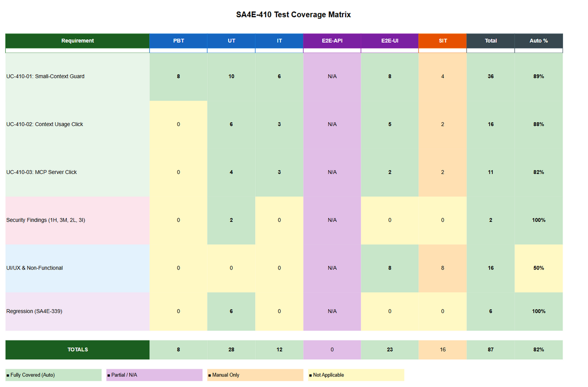
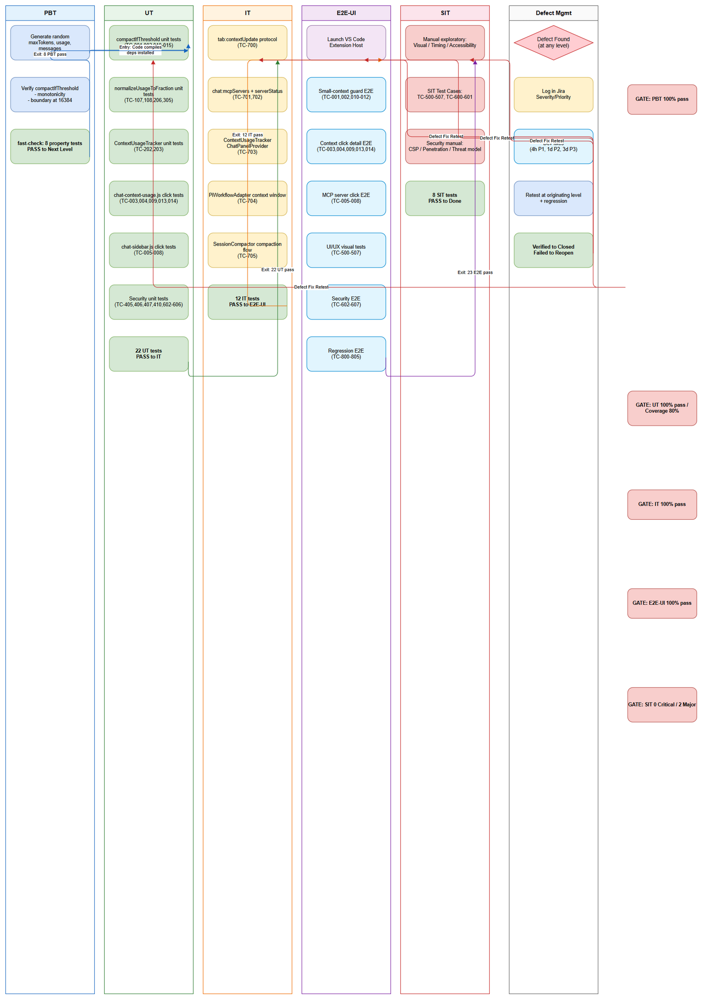

# Software Test Cases (STC)

## SA4E-410 — Context Usage UI Enhancements & Small-Context Compaction Guard

---

## Document Information

| Field | Value |
|-------|-------|
| Jira Ticket | SA4E-410 |
| Title | Context Usage UI Enhancements & Small-Context Compaction Guard |
| Author | QA Agent |
| Version | 1.0 |
| Date | 2026-11-07 |
| Status | Draft |
| Related STP | STP-v1.0-SA4E-410.docx |
| Related FSD | FSD-v1.0-SA4E-410.docx |

---

## Revision History

| Version | Date | Author | Changes |
|---------|------|--------|---------|
| 1.0 | 2026-11-07 | QA Agent | Initiate document — generated from FSD use cases, business rules, and security review |

---

## Test Case Summary

| Category | ID Range | Count | Priority |
|----------|----------|-------|----------|
| Functional — Happy Path | TC-001 to TC-015 | 15 | High |
| Functional — Alternative Flows | TC-100 to TC-108 | 9 | High |
| Functional — Exception/Error Flows | TC-200 to TC-206 | 7 | High |
| Business Rule Validation | TC-300 to TC-314 | 15 | High |
| Boundary & Negative Testing | TC-400 to TC-410 | 11 | Medium |
| UI/UX Testing | TC-500 to TC-507 | 8 | Medium |
| Non-Functional (Performance, Security) | TC-600 to TC-607 | 8 | Medium |
| Integration Testing | TC-700 to TC-705 | 6 | High |
| Regression Testing | TC-800 to TC-805 | 6 | Medium |
| **Total** | | **85** | |

---

## 1. Functional Test Cases — Happy Path

### TC-001: Small-Context Guard — 8k model at 96% usage with 7 messages triggers compaction

| Field | Value |
|-------|-------|
| **ID** | TC-001 |
| **Priority** | High |
| **Type** | Functional |
| **Requirement** | UC-410-01, AC-410-03, BR-410-01, BR-410-02, BR-410-03 |
| **Preconditions** | Model with maxTokens=8192; conversation has 7 messages; usageFraction=0.96; SessionMonitor.shouldCompact() returns 'compact' |

**Test Steps:**

| Step | Action | Expected Result |
|------|--------|-----------------|
| 1 | Call compactIfThreshold with maxTokens=8192, usageFraction=0.96, messages.length=7 | Function evaluates isSmallContext=true, compactThreshold=0.97, messageThreshold=6 |
| 2 | Verify compaction triggered | SessionCompactor.compact() called; returned payload reflects post-compaction token counts |
| 3 | Verify tab:contextUpdate sent | Payload includes updated tokenCount, breakdown, maxTokens=8192 |

**Test Data:** maxTokens=8192, usageFraction=0.96, messages=[7 items], shouldCompact='compact'
**Postconditions:** Compaction executed; webview receives updated context usage

---

### TC-002: Large-Context Guard — 32k model at 95% usage with 3 messages triggers compaction

| Field | Value |
|-------|-------|
| **ID** | TC-002 |
| **Priority** | High |
| **Type** | Functional |
| **Requirement** | UC-410-01, AC-410-04, BR-410-04 |
| **Preconditions** | Model with maxTokens=32768; conversation has 3 messages; usageFraction=0.95; SessionMonitor.shouldCompact() returns 'compact' |

**Test Steps:**

| Step | Action | Expected Result |
|------|--------|-----------------|
| 1 | Call compactIfThreshold with maxTokens=32768, usageFraction=0.95, messages.length=3 | Function evaluates isSmallContext=false, compactThreshold=0.95, messageThreshold=2 |
| 2 | Verify compaction triggered | SessionCompactor.compact() called; returned payload reflects post-compaction token counts |

**Test Data:** maxTokens=32768, usageFraction=0.95, messages=[3 items], shouldCompact='compact'
**Postconditions:** Compaction executed; original large-context behavior preserved

---

### TC-003: Context Usage Click — Shows total tokens, max tokens, percentage, 4% window

| Field | Value |
|-------|-------|
| **ID** | TC-003 |
| **Priority** | High |
| **Type** | Functional |
| **Requirement** | UC-410-02, AC-410-06, AC-410-07, BR-410-07, BR-410-09 |
| **Preconditions** | Chat webview loaded; active tab has tokenCount=45231, maxTokens=128000, breakdown available |

**Test Steps:**

| Step | Action | Expected Result |
|------|--------|-----------------|
| 1 | User clicks context arc gauge (#context-usage-icon) | Click handler fires; reads ChatState active tab |
| 2 | Verify toast content | Toast shows: "45,231 / 128,000 tokens (35%)" and "4% of window = 5,120 tokens" |
| 3 | Verify toast auto-dismisses | Toast disappears after 4 seconds |

**Test Data:** tokenCount=45231, maxTokens=128000, pct=35, fourPct=5120
**Postconditions:** Toast displayed and dismissed; lastClickDetail cache updated

---

### TC-004: Context Usage Click — Shows category breakdown when available

| Field | Value |
|-------|-------|
| **ID** | TC-004 |
| **Priority** | High |
| **Type** | Functional |
| **Requirement** | UC-410-02, AC-410-08, BR-410-11 |
| **Preconditions** | Chat webview loaded; active tab has breakdown={conversation:20, mcpTools:10, steering:5} |

**Test Steps:**

| Step | Action | Expected Result |
|------|--------|-----------------|
| 1 | User clicks context arc gauge | Click handler fires; breakdown data present |
| 2 | Verify toast includes breakdown section | Toast shows: "Conversation: 20%", "MCP tools: 10%", "Steering: 5%" |

**Test Data:** breakdown={conversation:20, mcpTools:10, steering:5}
**Postconditions:** Toast displayed with full breakdown

---

### TC-005: MCP Server Click — Shows server name and Connected status

| Field | Value |
|-------|-------|
| **ID** | TC-005 |
| **Priority** | High |
| **Type** | Functional |
| **Requirement** | UC-410-03, AC-410-11, AC-410-12, BR-410-12, BR-410-14 |
| **Preconditions** | Chat webview loaded; MCP server list rendered with server {name:"code-intel", status:"connected"} |

**Test Steps:**

| Step | Action | Expected Result |
|------|--------|-----------------|
| 1 | User clicks MCP server row (.oc-mcp-item) for "code-intel" | Click handler reads data-mcp-name="code-intel" |
| 2 | Verify toast content | Toast shows: "MCP Server: code-intel", "Status: Connected", "Details shown client-side to avoid tool-call loops." |
| 3 | Verify toast auto-dismisses | Toast disappears after 4 seconds |

**Test Data:** servers=[{name:"code-intel", status:"connected"}]
**Postconditions:** Toast displayed and dismissed

---

### TC-006: MCP Server Click — Shows Disconnected status

| Field | Value |
|-------|-------|
| **ID** | TC-006 |
| **Priority** | High |
| **Type** | Functional |
| **Requirement** | UC-410-03, AC-410-12, BR-410-14 |
| **Preconditions** | MCP server list rendered with server {name:"filesystem", status:"disconnected"} |

**Test Steps:**

| Step | Action | Expected Result |
|------|--------|-----------------|
| 1 | User clicks MCP server row for "filesystem" | Click handler finds server in array |
| 2 | Verify toast shows Disconnected | Toast shows: "Status: Disconnected" |

**Test Data:** servers=[{name:"filesystem", status:"disconnected"}]
**Postconditions:** Toast displayed

---

### TC-007: MCP Server Click — Shows Failed status

| Field | Value |
|-------|-------|
| **ID** | TC-007 |
| **Priority** | High |
| **Type** | Functional |
| **Requirement** | UC-410-03, AC-410-12 |
| **Preconditions** | MCP server list rendered with server {name:"git", status:"failed"} |

**Test Steps:**

| Step | Action | Expected Result |
|------|--------|-----------------|
| 1 | User clicks MCP server row for "git" | Click handler finds server |
| 2 | Verify toast shows Failed | Toast shows: "Status: Failed" |

**Test Data:** servers=[{name:"git", status:"failed"}]
**Postconditions:** Toast displayed

---

### TC-008: MCP Server Click — Shows Unknown status for unrecognized value

| Field | Value |
|-------|-------|
| **ID** | TC-008 |
| **Priority** | High |
| **Type** | Functional |
| **Requirement** | UC-410-03, AC-410-12, BR-410-14 |
| **Preconditions** | MCP server list rendered with server {name:"custom", status:"weird-status"} |

**Test Steps:**

| Step | Action | Expected Result |
|------|--------|-----------------|
| 1 | User clicks MCP server row for "custom" | Click handler normalizes status |
| 2 | Verify toast shows Unknown | Toast shows: "Status: Unknown" |

**Test Data:** servers=[{name:"custom", status:"weird-status"}]
**Postconditions:** Toast displayed with normalized status

---

### TC-009: Context Usage Click — Debounce prevents duplicate toasts

| Field | Value |
|-------|-------|
| **ID** | TC-009 |
| **Priority** | High |
| **Type** | Functional |
| **Requirement** | UC-410-02, AC-410-10, BR-410-10 |
| **Preconditions** | Chat webview loaded; active tab data unchanged; lastClickDetail cache populated |

**Test Steps:**

| Step | Action | Expected Result |
|------|--------|-----------------|
| 1 | User clicks context arc gauge (first click) | Toast displayed; lastClickDetail updated |
| 2 | User clicks context arc gauge again immediately (second click) | No new toast spawned (cache match on tokenCount + maxTokens) |
| 3 | Verify only one toast visible | Single toast auto-dismisses after 4s |

**Test Data:** Same tokenCount/maxTokens for both clicks
**Postconditions:** Debounce working; no duplicate toasts

---

### TC-010: Small-Context Guard — 8k model at 97% usage with 5 messages does NOT trigger

| Field | Value |
|-------|-------|
| **ID** | TC-010 |
| **Priority** | High |
| **Type** | Functional |
| **Requirement** | UC-410-01, AC-410-02, BR-410-03 |
| **Preconditions** | Model with maxTokens=8192; conversation has 5 messages; usageFraction=0.97 |

**Test Steps:**

| Step | Action | Expected Result |
|------|--------|-----------------|
| 1 | Call compactIfThreshold with maxTokens=8192, usageFraction=0.97, messages.length=5 | Function evaluates messageThreshold=6; 5 < 6 |
| 2 | Verify compaction NOT triggered | SessionCompactor.compact() NOT called; original payload returned |

**Test Data:** maxTokens=8192, usageFraction=0.97, messages=[5 items]
**Postconditions:** No compaction; payload unchanged

---

### TC-011: Small-Context Guard — 8k model at 96% usage does NOT trigger (below 97% threshold)

| Field | Value |
|-------|-------|
| **ID** | TC-011 |
| **Priority** | High |
| **Type** | Functional |
| **Requirement** | UC-410-01, AC-410-01, BR-410-02 |
| **Preconditions** | Model with maxTokens=8192; conversation has 7 messages; usageFraction=0.96 |

**Test Steps:**

| Step | Action | Expected Result |
|------|--------|-----------------|
| 1 | Call compactIfThreshold with maxTokens=8192, usageFraction=0.96, messages.length=7 | Function evaluates compactThreshold=0.97; 0.96 < 0.97 |
| 2 | Verify compaction NOT triggered | SessionCompactor.compact() NOT called |

**Test Data:** maxTokens=8192, usageFraction=0.96, messages=[7 items]
**Postconditions:** No compaction; payload unchanged

---

### TC-012: Large-Context Guard — 16k model at 95% usage with 2 messages triggers compaction

| Field | Value |
|-------|-------|
| **ID** | TC-012 |
| **Priority** | High |
| **Type** | Functional |
| **Requirement** | UC-410-01, AC-410-04, BR-410-04 |
| **Preconditions** | Model with maxTokens=16384 (boundary); conversation has 2 messages; usageFraction=0.95 |

**Test Steps:**

| Step | Action | Expected Result |
|------|--------|-----------------|
| 1 | Call compactIfThreshold with maxTokens=16384, usageFraction=0.95, messages.length=2 | Function evaluates isSmallContext=false (16384 >= 16384); threshold=0.95, msgThreshold=2 |
| 2 | Verify compaction triggered | SessionCompactor.compact() called |

**Test Data:** maxTokens=16384, usageFraction=0.95, messages=[2 items]
**Postconditions:** Compaction executed; large-context behavior at boundary

---

### TC-013: Context Usage Click — Handles maxTokens=0 gracefully

| Field | Value |
|-------|-------|
| **ID** | TC-013 |
| **Priority** | High |
| **Type** | Functional |
| **Requirement** | UC-410-02, AC-410-06, AF-1 (FSD 3.2.2) |
| **Preconditions** | Chat webview loaded; active tab has maxTokens=0, tokenCount=1000 |

**Test Steps:**

| Step | Action | Expected Result |
|------|--------|-----------------|
| 1 | User clicks context arc gauge | Click handler calculates pct=0, fourPct=0 |
| 2 | Verify toast shows N/A for percentage and 4% window | Toast shows: "1,000 / 0 tokens (0%)" and "4% of window = 0 tokens" |

**Test Data:** maxTokens=0, tokenCount=1000
**Postconditions:** Toast displayed without errors

---

### TC-014: Context Usage Click — Handles missing breakdown gracefully

| Field | Value |
|-------|-------|
| **ID** | TC-014 |
| **Priority** | High |
| **Type** | Functional |
| **Requirement** | UC-410-02, AC-410-08, AF-2 (FSD 3.2.2) |
| **Preconditions** | Chat webview loaded; active tab has breakdown=null |

**Test Steps:**

| Step | Action | Expected Result |
|------|--------|-----------------|
| 1 | User clicks context arc gauge | Click handler detects missing breakdown |
| 2 | Verify toast shows only totals + 4% window | Toast shows totals and 4% window; NO breakdown section |

**Test Data:** breakdown=null
**Postconditions:** Toast displayed without breakdown section

---

### TC-015: Small-Context Guard — maxTokens resolution failure defaults to large-context behavior

| Field | Value |
|-------|-------|
| **ID** | TC-015 |
| **Priority** | High |
| **Type** | Functional |
| **Requirement** | UC-410-01, BR-410-05, AF-1 (FSD 3.1.2) |
| **Preconditions** | maxTokens=0 (resolution failed); usageFraction=0.96; messages.length=3 |

**Test Steps:**

| Step | Action | Expected Result |
|------|--------|-----------------|
| 1 | Call compactIfThreshold with maxTokens=0, usageFraction=0.96, messages.length=3 | Function evaluates isSmallContext=false; threshold=0.95, msgThreshold=2 |
| 2 | Verify compaction triggered (large-context behavior) | SessionCompactor.compact() called since 0.96 >= 0.95 and 3 > 2 |

**Test Data:** maxTokens=0, usageFraction=0.96, messages=[3 items]
**Postconditions:** Fail-safe large-context behavior applied

---

## 2. Functional Test Cases — Alternative Flows

### TC-100: Small-Context Guard — SessionMonitor returns 'warn' (AF-3)

| Field | Value |
|-------|-------|
| **ID** | TC-100 |
| **Priority** | High |
| **Type** | Functional — Alternative Flow |
| **Requirement** | UC-410-01, AF-3 (FSD 3.1.2) |
| **Preconditions** | Small-context model (maxTokens=8192); usageFraction=0.98; messages.length=7; SessionMonitor.shouldCompact() returns 'warn' |

**Test Steps:**

| Step | Action | Expected Result |
|------|--------|-----------------|
| 1 | Call compactIfThreshold with shouldCompact='warn' | Function checks shouldCompact result |
| 2 | Verify compaction skipped | SessionCompactor.compact() NOT called; payload sent unchanged |

**Test Data:** shouldCompact='warn'
**Postconditions:** No compaction; warning state communicated via payload

---

### TC-101: Small-Context Guard — SessionMonitor returns 'none' (AF-3)

| Field | Value |
|-------|-------|
| **ID** | TC-101 |
| **Priority** | High |
| **Type** | Functional — Alternative Flow |
| **Requirement** | UC-410-01, AF-3 (FSD 3.1.2) |
| **Preconditions** | Small-context model; usageFraction=0.99; messages.length=10; SessionMonitor.shouldCompact() returns 'none' |

**Test Steps:**

| Step | Action | Expected Result |
|------|--------|-----------------|
| 1 | Call compactIfThreshold with shouldCompact='none' | Function checks shouldCompact result |
| 2 | Verify compaction skipped | SessionCompactor.compact() NOT called |

**Test Data:** shouldCompact='none'
**Postconditions:** No compaction

---

### TC-102: Context Usage Click — Rapid clicks with data change shows new toast

| Field | Value |
|-------|-------|
| **ID** | TC-102 |
| **Priority** | High |
| **Type** | Functional — Alternative Flow |
| **Requirement** | UC-410-02, BR-410-10 |
| **Preconditions** | Chat webview loaded; tokenCount changes between clicks |

**Test Steps:**

| Step | Action | Expected Result |
|------|--------|-----------------|
| 1 | User clicks context arc gauge (tokenCount=1000) | Toast displayed; lastClickDetail cached |
| 2 | New tab:contextUpdate arrives (tokenCount=2000) | ChatState updated |
| 3 | User clicks context arc gauge again | New toast displayed (cache mismatch on tokenCount) |

**Test Data:** First click: tokenCount=1000; Second click: tokenCount=2000
**Postconditions:** New toast shown when data changes

---

### TC-103: MCP Server Click — Stale DOM (server not in array) shows Unknown (AF-1)

| Field | Value |
|-------|-------|
| **ID** | TC-103 |
| **Priority** | Medium |
| **Type** | Functional — Alternative Flow |
| **Requirement** | UC-410-03, AF-1 (FSD 3.3.2) |
| **Preconditions** | MCP server list rendered; servers array updated but DOM not re-rendered; clicked server not in current array |

**Test Steps:**

| Step | Action | Expected Result |
|------|--------|-----------------|
| 1 | User clicks MCP server row for removed server | Click handler searches servers array; not found |
| 2 | Verify toast shows Unknown status | Toast shows: "Status: Unknown" |

**Test Data:** servers=[{name:"new-server", status:"connected"}]; clicked: "old-server"
**Postconditions:** Graceful handling of stale DOM

---

### TC-104: Context Usage Click — S.showToast unavailable (EF-1)

| Field | Value |
|-------|-------|
| **ID** | TC-104 |
| **Priority** | High |
| **Type** | Functional — Alternative Flow |
| **Requirement** | UC-410-02, EF-1 (FSD 3.2.2) |
| **Preconditions** | S.showToast not defined (simulating missing implementation) |

**Test Steps:**

| Step | Action | Expected Result |
|------|--------|-----------------|
| 1 | User clicks context arc gauge | Click handler calls S.showToast && S.showToast(...) |
| 2 | Verify no error thrown | Optional chaining prevents error; graceful degradation |

**Test Data:** S.showToast = undefined
**Postconditions:** No toast shown; no JavaScript error

---

### TC-105: MCP Server Click — S.showToast unavailable (EF-1)

| Field | Value |
|-------|-------|
| **ID** | TC-105 |
| **Priority** | High |
| **Type** | Functional — Alternative Flow |
| **Requirement** | UC-410-03, EF-1 (FSD 3.3.2) |
| **Preconditions** | S.showToast not defined |

**Test Steps:**

| Step | Action | Expected Result |
|------|--------|-----------------|
| 1 | User clicks MCP server row | Click handler calls S.showToast && S.showToast(...) |
| 2 | Verify no error thrown | Optional chaining prevents error |

**Test Data:** S.showToast = undefined
**Postconditions:** No toast shown; no JavaScript error

---

### TC-106: Context Usage Click — ChatState.getTab returns null (EF-2)

| Field | Value |
|-------|-------|
| **ID** | TC-106 |
| **Priority** | Medium |
| **Type** | Functional — Alternative Flow |
| **Requirement** | UC-410-02, EF-2 (FSD 3.2.2) |
| **Preconditions** | ChatState.getTab returns null for activeTabId |

**Test Steps:**

| Step | Action | Expected Result |
|------|--------|-----------------|
| 1 | User clicks context arc gauge | Click handler uses fallback tokenCount=0, maxTokens=128000 |
| 2 | Verify toast shows fallback values | Toast shows: "0 / 128,000 tokens (0%)" and "4% of window = 5,120 tokens" |

**Test Data:** getTab returns null
**Postconditions:** Toast displayed with fallback data

---

### TC-107: Small-Context Guard — normalizeUsageToFraction handles percent-scale input

| Field | Value |
|-------|-------|
| **ID** | TC-107 |
| **Priority** | High |
| **Type** | Functional — Alternative Flow |
| **Requirement** | UC-410-01, BR-410-06, SEC-330-02 |
| **Preconditions** | Payload total.percentage=95 (percent-scale, not fraction) |

**Test Steps:**

| Step | Action | Expected Result |
|------|--------|-----------------|
| 1 | Call compactIfThreshold with total.percentage=95 | normalizeUsageToFraction(95) returns 0.95 |
| 2 | Verify correct fraction used for threshold comparison | usageFraction=0.95 compared against 0.95/0.97 thresholds |

**Test Data:** total.percentage=95
**Postconditions:** SEC-330-02 contract enforced; compaction-trigger abuse prevented

---

### TC-108: Small-Context Guard — normalizeUsageToFraction clamps invalid values

| Field | Value |
|-------|-------|
| **ID** | TC-108 |
| **Priority** | High |
| **Type** | Functional — Alternative Flow |
| **Requirement** | UC-410-01, AF-2 (FSD 3.1.2), SEC-330-02 |
| **Preconditions** | Payload total.percentage=NaN / negative / >100 |

**Test Steps:**

| Step | Action | Expected Result |
|------|--------|-----------------|
| 1 | Call normalizeUsageToFraction(NaN) | Returns 0 |
| 2 | Call normalizeUsageToFraction(-10) | Returns 0 |
| 3 | Call normalizeUsageToFraction(150) | Returns 1 (clamped) |
| 4 | Verify compaction not triggered for invalid input | usageFraction=0 or 1 handled correctly |

**Test Data:** percentage=NaN, -10, 150
**Postconditions:** Input validation working; no crashes

---

## 3. Functional Test Cases — Exception/Error Flows

### TC-200: Small-Context Guard — SessionCompactor.compact() throws (EF-1)

| Field | Value |
|-------|-------|
| **ID** | TC-200 |
| **Priority** | High |
| **Type** | Functional — Exception Flow |
| **Requirement** | UC-410-01, EF-1 (FSD 3.1.2) |
| **Preconditions** | Thresholds met for compaction; SessionCompactor.compact() throws error |

**Test Steps:**

| Step | Action | Expected Result |
|------|--------|-----------------|
| 1 | Call compactIfThreshold with conditions triggering compaction | Function calls SessionCompactor.compact() |
| 2 | Simulate compact() throwing Error | Catch block executes; error logged |
| 3 | Verify original payload returned | Function returns pre-compaction payload (non-fatal) |

**Test Data:** compact() throws "Compaction failed"
**Postconditions:** Session continues un-compacted; error logged

---

### TC-201: Small-Context Guard — setChatHistory() fails (EF-2)

| Field | Value |
|-------|-------|
| **ID** | TC-201 |
| **Priority** | High |
| **Type** | Functional — Exception Flow |
| **Requirement** | UC-410-01, EF-2 (FSD 3.1.2) |
| **Preconditions** | Compaction succeeds; setChatHistory() throws error |

**Test Steps:**

| Step | Action | Expected Result |
|------|--------|-----------------|
| 1 | Call compactIfThreshold with successful compaction | SessionCompactor.compact() returns result |
| 2 | Simulate setChatHistory() throwing Error | Catch block executes; error logged |
| 3 | Verify payload reflects pre-compaction state | Returned payload shows original token counts |

**Test Data:** setChatHistory() throws "History update failed"
**Postconditions:** Error logged; payload unchanged

---

### TC-202: Context Usage Tracker — updateFromMessages with empty messages

| Field | Value |
|-------|-------|
| **ID** | TC-202 |
| **Priority** | Medium |
| **Type** | Functional — Exception Flow |
| **Requirement** | UC-410-01, ContextUsageTracker |
| **Preconditions** | Tab exists; messages array is empty |

**Test Steps:**

| Step | Action | Expected Result |
|------|--------|-----------------|
| 1 | Call tracker.updateFromMessages(tabId, []) | Conversation tokens set to 0 |
| 2 | Verify payload total.tokens = steering + mcpTools | Only non-conversation categories counted |

**Test Data:** messages=[]
**Postconditions:** Tracker handles empty history gracefully

---

### TC-203: Context Usage Tracker — addToolTokens with malformed tool result

| Field | Value |
|-------|-------|
| **ID** | TC-203 |
| **Priority** | Medium |
| **Type** | Functional — Exception Flow |
| **Requirement** | UC-410-01, ContextUsageTracker |
| **Preconditions** | Tool result is not a string (null, object, undefined) |

**Test Steps:**

| Step | Action | Expected Result |
|------|--------|-----------------|
| 1 | Call tracker.addToolTokens(tabId, null) | Function handles gracefully; no crash |
| 2 | Call tracker.addToolTokens(tabId, {}) | Function handles gracefully |
| 3 | Verify mcpTools count unchanged or 0 | No NaN/invalid token counts |

**Test Data:** toolResult=null, {}
**Postconditions:** Tracker robust against malformed input

---

### TC-204: Webview — handleContextUpdate with malformed payload

| Field | Value |
|-------|-------|
| **ID** | TC-204 |
| **Priority** | Medium |
| **Type** | Functional — Exception Flow |
| **Requirement** | UC-410-02, chat-context-usage.js |
| **Preconditions** | tab:contextUpdate message missing fields (tokenCount, maxTokens, breakdown) |

**Test Steps:**

| Step | Action | Expected Result |
|------|--------|-----------------|
| 1 | Send tab:contextUpdate with partial payload | handleContextUpdate processes without crash |
| 2 | Verify ChatState updated with available fields | Missing fields default to 0/null |
| 3 | Verify arc gauge updates without error | S.updateContextIcon handles missing data |

**Test Data:** {tabId:"tab-1", tokenCount:100} (missing maxTokens, breakdown)
**Postconditions:** Webview resilient to partial messages

---

### TC-205: Webview — renderMcpServers with empty servers array

| Field | Value |
|-------|-------|
| **ID** | TC-205 |
| **Priority** | Medium |
| **Type** | Functional — Exception Flow |
| **Requirement** | UC-410-03, chat-sidebar.js |
| **Preconditions** | chat:mcpServers payload with servers=[] |

**Test Steps:**

| Step | Action | Expected Result |
|------|--------|-----------------|
| 1 | Send chat:mcpServers with servers=[] | renderMcpServers renders empty list |
| 2 | Verify no JavaScript errors | Sidebar shows "No MCP servers" or empty state |
| 3 | Verify click handler not attached to non-existent items | No click handlers on empty list |

**Test Data:** servers=[]
**Postconditions:** Empty state handled gracefully

---

### TC-206: Small-Context Guard — normalizeUsageToFraction rejects percent-scale abuse (SEC-330-02)

| Field | Value |
|-------|-------|
| **ID** | TC-206 |
| **Priority** | High |
| **Type** | Functional — Exception Flow |
| **Requirement** | UC-410-01, SEC-330-02, SessionMonitor |
| **Preconditions** | Usage value > 1 passed where fraction expected (e.g., 95 instead of 0.95) |

**Test Steps:**

| Step | Action | Expected Result |
|------|--------|-----------------|
| 1 | Call SessionMonitor.shouldCompact(95) | Function detects percent-scale abuse (value > 1) |
| 2 | Verify returns 'none' or 'warn' | Compaction blocked; abuse prevented |
| 3 | Call normalizeUsageToFraction(95) | Returns 0.95 (correct conversion) |

**Test Data:** usage=95 (percent-scale)
**Postconditions:** SEC-330-02 security control working

---

## 4. Business Rule Validation

### TC-300: BR-410-01 — Small-context detection: maxTokens > 0 && < 16384

| Field | Value |
|-------|-------|
| **ID** | TC-300 |
| **Priority** | High |
| **Type** | Business Rule |
| **Requirement** | BR-410-01 |
| **Preconditions** | Test various maxTokens values |

**Test Steps:**

| Step | Action | Expected Result |
|------|--------|-----------------|
| 1 | Test maxTokens=4096 | isSmallContext=true |
| 2 | Test maxTokens=8192 | isSmallContext=true |
| 3 | Test maxTokens=16383 | isSmallContext=true |
| 4 | Test maxTokens=16384 | isSmallContext=false |
| 5 | Test maxTokens=32768 | isSmallContext=false |
| 6 | Test maxTokens=0 | isSmallContext=false |
| 7 | Test maxTokens=undefined | isSmallContext=false |

**Test Data:** maxTokens=[4096, 8192, 16383, 16384, 32768, 0, undefined]
**Postconditions:** Boundary at 16384 correctly enforced

---

### TC-301: BR-410-02 — Small-context compaction threshold = 0.97

| Field | Value |
|-------|-------|
| **ID** | TC-301 |
| **Priority** | High |
| **Type** | Business Rule |
| **Requirement** | BR-410-02 |
| **Preconditions** | isSmallContext=true |

**Test Steps:**

| Step | Action | Expected Result |
|------|--------|-----------------|
| 1 | Call compactIfThreshold with maxTokens=8192 | compactThreshold derived = 0.97 |
| 2 | Verify threshold used in comparison | usageFraction >= 0.97 required for compaction |

**Test Data:** maxTokens=8192
**Postconditions:** 97% threshold enforced for small contexts

---

### TC-302: BR-410-03 — Small-context minimum message guard = 6

| Field | Value |
|-------|-------|
| **ID** | TC-302 |
| **Priority** | High |
| **Type** | Business Rule |
| **Requirement** | BR-410-03 |
| **Preconditions** | isSmallContext=true |

**Test Steps:**

| Step | Action | Expected Result |
|------|--------|-----------------|
| 1 | Call compactIfThreshold with maxTokens=8192 | messageThreshold derived = 6 |
| 2 | Verify messages.length > 6 required | 6 messages: no compaction; 7 messages: compaction allowed |

**Test Data:** maxTokens=8192, messages.length=[6, 7]
**Postconditions:** 6-message minimum enforced

---

### TC-303: BR-410-04 — Large-context uses threshold 0.95, min 2 messages

| Field | Value |
|-------|-------|
| **ID** | TC-303 |
| **Priority** | High |
| **Type** | Business Rule |
| **Requirement** | BR-410-04 |
| **Preconditions** | isSmallContext=false (maxTokens >= 16384) |

**Test Steps:**

| Step | Action | Expected Result |
|------|--------|-----------------|
| 1 | Test maxTokens=16384 | compactThreshold=0.95, messageThreshold=2 |
| 2 | Test maxTokens=128000 | compactThreshold=0.95, messageThreshold=2 |

**Test Data:** maxTokens=[16384, 128000]
**Postconditions:** Original behavior preserved for large contexts

---

### TC-304: BR-410-05 — maxTokens unavailable defaults to large-context

| Field | Value |
|-------|-------|
| **ID** | TC-304 |
| **Priority** | High |
| **Type** | Business Rule |
| **Requirement** | BR-410-05 |
| **Preconditions** | maxTokens=0 or undefined |

**Test Steps:**

| Step | Action | Expected Result |
|------|--------|-----------------|
| 1 | Test maxTokens=0 | isSmallContext=false; threshold=0.95, msgThreshold=2 |
| 2 | Test maxTokens=undefined | isSmallContext=false; threshold=0.95, msgThreshold=2 |

**Test Data:** maxTokens=[0, undefined]
**Postconditions:** Fail-safe behavior working

---

### TC-305: BR-410-06 — usageFraction via normalizeUsageToFraction

| Field | Value |
|-------|-------|
| **ID** | TC-305 |
| **Priority** | High |
| **Type** | Business Rule |
| **Requirement** | BR-410-06, SEC-330-02 |
| **Preconditions** | Various percentage inputs |

**Test Steps:**

| Step | Action | Expected Result |
|------|--------|-----------------|
| 1 | percentage=95 | usageFraction=0.95 |
| 2 | percentage=97 | usageFraction=0.97 |
| 3 | percentage=0 | usageFraction=0 |
| 4 | percentage=100 | usageFraction=1 |
| 5 | percentage=150 | usageFraction=1 (clamped) |

**Test Data:** percentage=[95, 97, 0, 100, 150]
**Postconditions:** SEC-330-02 contract enforced

---

### TC-306: BR-410-07 — Context click purely client-side

| Field | Value |
|-------|-------|
| **ID** | TC-306 |
| **Priority** | High |
| **Type** | Business Rule |
| **Requirement** | BR-410-07 |
| **Preconditions** | Click handler executed |

**Test Steps:**

| Step | Action | Expected Result |
|------|--------|-----------------|
| 1 | Monitor network/host messages during click | No postMessage sent to host |
| 2 | Verify no tool calls made | No acquireVsCodeApi().postMessage for tool calls |
| 3 | Verify data read from ChatState only | Local state access only |

**Test Data:** Click event on #context-usage-icon
**Postconditions:** Zero host round-trips

---

### TC-307: BR-410-08 — Toast auto-dismisses at 4000ms

| Field | Value |
|-------|-------|
| **ID** | TC-307 |
| **Priority** | High |
| **Type** | Business Rule |
| **Requirement** | BR-410-08 |
| **Preconditions** | S.showToast implemented |

**Test Steps:**

| Step | Action | Expected Result |
|------|--------|-----------------|
| 1 | Trigger context click toast | Toast displayed |
| 2 | Measure display duration | Toast auto-dismisses at ~4000ms (±100ms) |
| 3 | Trigger MCP server click toast | Toast displayed |
| 4 | Measure display duration | Toast auto-dismisses at ~4000ms (±100ms) |

**Test Data:** Both click handlers
**Postconditions:** Consistent 4-second auto-dismiss

---

### TC-308: BR-410-09 — fourPct = round(maxTokens * 0.04)

| Field | Value |
|-------|-------|
| **ID** | TC-308 |
| **Priority** | High |
| **Type** | Business Rule |
| **Requirement** | BR-410-09 |
| **Preconditions** | Various maxTokens values |

**Test Steps:**

| Step | Action | Expected Result |
|------|--------|-----------------|
| 1 | maxTokens=128000 | fourPct=5120 |
| 2 | maxTokens=8192 | fourPct=328 |
| 3 | maxTokens=4096 | fourPct=164 |
| 4 | maxTokens=32768 | fourPct=1311 |
| 5 | maxTokens=0 | fourPct=0 |

**Test Data:** maxTokens=[128000, 8192, 4096, 32768, 0]
**Postconditions:** 4% calculation correct for all values

---

### TC-309: BR-410-10 — Debounce via lastClickDetail cache

| Field | Value |
|-------|-------|
| **ID** | TC-309 |
| **Priority** | High |
| **Type** | Business Rule |
| **Requirement** | BR-410-10 |
| **Preconditions** | lastClickDetail cache mechanism active |

**Test Steps:**

| Step | Action | Expected Result |
|------|--------|-----------------|
| 1 | Click with tokenCount=1000, maxTokens=8192 | Toast shown; cache={tokenCount:1000, maxTokens:8192} |
| 2 | Click again with same values | No new toast (cache hit) |
| 3 | Click with tokenCount=2000, maxTokens=8192 | New toast shown (cache miss) |
| 4 | Verify cache updated | Cache={tokenCount:2000, maxTokens:8192} |

**Test Data:** Sequential clicks with same/different data
**Postconditions:** Debounce working correctly

---

### TC-310: BR-410-11 — Percentages rounded integers (0-100)

| Field | Value |
|-------|-------|
| **ID** | TC-310 |
| **Priority** | High |
| **Type** | Business Rule |
| **Requirement** | BR-410-11 |
| **Preconditions** | Various tokenCount/maxTokens ratios |

**Test Steps:**

| Step | Action | Expected Result |
|------|--------|-----------------|
| 1 | tokenCount=45231, maxTokens=128000 | pct=35 (rounded) |
| 2 | tokenCount=1234, maxTokens=8192 | pct=15 (rounded) |
| 3 | tokenCount=8192, maxTokens=8192 | pct=100 (capped) |
| 4 | tokenCount=8200, maxTokens=8192 | pct=100 (capped at 100) |

**Test Data:** Various ratios
**Postconditions:** Percentages always 0-100 integers

---

### TC-311: BR-410-12 — MCP click purely client-side

| Field | Value |
|-------|-------|
| **ID** | TC-311 |
| **Priority** | High |
| **Type** | Business Rule |
| **Requirement** | BR-410-12 |
| **Preconditions** | MCP server click handler executed |

**Test Steps:**

| Step | Action | Expected Result |
|------|--------|-----------------|
| 1 | Monitor host messages during MCP click | No postMessage sent |
| 2 | Verify data from servers closure array | Local closure variable used |
| 3 | Verify data-mcp-name read from DOM | DOM attribute access only |

**Test Data:** Click on .oc-mcp-item
**Postconditions:** Zero host round-trips

---

### TC-312: BR-410-13 — MCP toast auto-dismisses at 4000ms

| Field | Value |
|-------|-------|
| **ID** | TC-312 |
| **Priority** | High |
| **Type** | Business Rule |
| **Requirement** | BR-410-13 |
| **Preconditions** | S.showToast implemented |

**Test Steps:**

| Step | Action | Expected Result |
|------|--------|-----------------|
| 1 | Click MCP server row | Toast displayed |
| 2 | Measure duration | Auto-dismisses at ~4000ms |

**Test Data:** MCP server click
**Postconditions:** Consistent with context toast timing

---

### TC-313: BR-410-14 — Status values normalized to lowercase

| Field | Value |
|-------|-------|
| **ID** | TC-313 |
| **Priority** | Medium |
| **Type** | Business Rule |
| **Requirement** | BR-410-14 |
| **Preconditions** | Various status input formats |

**Test Steps:**

| Step | Action | Expected Result |
|------|--------|-----------------|
| 1 | status="CONNECTED" | Normalized to "connected" → label "Connected" |
| 2 | status="Disconnected" | Normalized to "disconnected" → label "Disconnected" |
| 3 | status="FAILED" | Normalized to "failed" → label "Failed" |
| 4 | status="unknown" | Normalized to "unknown" → label "Unknown" |
| 5 | status="WeIrD" | Normalized to "weird" → label "Unknown" |

**Test Data:** Various case formats
**Postconditions:** Case-insensitive status handling

---

### TC-314: BR-410-15 — Status badge colors correct

| Field | Value |
|-------|-------|
| **ID** | TC-314 |
| **Priority** | Medium |
| **Type** | Business Rule |
| **Requirement** | BR-410-15 |
| **Preconditions** | MCP server list rendered with various statuses |

**Test Steps:**

| Step | Action | Expected Result |
|------|--------|-----------------|
| 1 | status="connected" | Badge class includes green styling |
| 2 | status="failed" | Badge class includes red styling |
| 3 | status="disconnected" | Badge class includes gray styling |
| 4 | status="unknown" | Badge class includes gray styling |

**Test Data:** servers=[{status:"connected"}, {status:"failed"}, {status:"disconnected"}, {status:"unknown"}]
**Postconditions:** Visual status indicators correct

---

## 5. Boundary & Negative Testing

### TC-400: Small-Context Guard — Boundary at maxTokens=16383 (small) vs 16384 (large)

| Field | Value |
|-------|-------|
| **ID** | TC-400 |
| **Priority** | Medium |
| **Type** | Boundary |
| **Requirement** | BR-410-01, BR-410-04 |
| **Preconditions** | Test exact boundary values |

**Test Steps:**

| Step | Action | Expected Result |
|------|--------|-----------------|
| 1 | maxTokens=16383 | isSmallContext=true; threshold=0.97, msgThreshold=6 |
| 2 | maxTokens=16384 | isSmallContext=false; threshold=0.95, msgThreshold=2 |
| 3 | Verify no off-by-one error | Clean transition at 16384 |

**Test Data:** maxTokens=16383, 16384
**Postconditions:** Boundary correctly implemented

---

### TC-401: Small-Context Guard — maxTokens negative value

| Field | Value |
|-------|-------|
| **ID** | TC-401 |
| **Priority** | Medium |
| **Type** | Negative |
| **Requirement** | BR-410-01, BR-410-05 |
| **Preconditions** | maxTokens=-1 (invalid) |

**Test Steps:**

| Step | Action | Expected Result |
|------|--------|-----------------|
| 1 | Call compactIfThreshold with maxTokens=-1 | isSmallContext=false (maxTokens > 0 fails) |
| 2 | Verify large-context behavior | threshold=0.95, msgThreshold=2 |

**Test Data:** maxTokens=-1
**Postconditions:** Negative values treated as unavailable

---

### TC-402: Small-Context Guard — maxTokens very large (2,000,000+)

| Field | Value |
|-------|-------|
| **ID** | TC-402 |
| **Priority** | Medium |
| **Type** | Boundary |
| **Requirement** | BR-410-04, Security Finding #4 |
| **Preconditions** | maxTokens=2000000 |

**Test Steps:**

| Step | Action | Expected Result |
|------|--------|-----------------|
| 1 | Call compactIfThreshold with maxTokens=2000000 | isSmallContext=false; threshold=0.95 |
| 2 | Verify no overflow/performance issues | Calculation completes normally |

**Test Data:** maxTokens=2000000
**Postconditions:** Large values handled (security bounds validation separate test)

---

### TC-403: Context Usage Click — tokenCount > maxTokens (over 100%)

| Field | Value |
|-------|-------|
| **ID** | TC-403 |
| **Priority** | Medium |
| **Type** | Boundary |
| **Requirement** | BR-410-11 |
| **Preconditions** | tokenCount=150000, maxTokens=128000 |

**Test Steps:**

| Step | Action | Expected Result |
|------|--------|-----------------|
| 1 | Click context arc gauge | pct calculated as 100 (capped) |
| 2 | Verify toast shows 100% | "150,000 / 128,000 tokens (100%)" |

**Test Data:** tokenCount=150000, maxTokens=128000
**Postconditions:** Percentage capped at 100%

---

### TC-404: Context Usage Click — maxTokens=0 division by zero protection

| Field | Value |
|-------|-------|
| **ID** | TC-404 |
| **Priority** | High |
| **Type** | Negative |
| **Requirement** | BR-410-11, AF-1 (FSD 3.2.2) |
| **Preconditions** | maxTokens=0, tokenCount=1000 |

**Test Steps:**

| Step | Action | Expected Result |
|------|--------|-----------------|
| 1 | Click context arc gauge | pct=0 (no division by zero) |
| 2 | fourPct=0 | No NaN/Infinity |
| 3 | Verify no JavaScript error | Graceful handling |

**Test Data:** maxTokens=0
**Postconditions:** Division by zero prevented

---

### TC-405: Context Usage Click — breakdown values non-numeric

| Field | Value |
|-------|-------|
| **ID** | TC-405 |
| **Priority** | Medium |
| **Type** | Negative |
| **Requirement** | BR-410-11, Security Findings #2, #3 |
| **Preconditions** | breakdown={conversation:"" |

**Test Steps:**

| Step | Action | Expected Result |
|------|--------|-----------------|
| 1 | Click server row | Status normalized to "unknown" (not recognized) |
| 2 | Verify toast shows "Unknown" | Label safe; no script execution |

**Test Data:** status=""
**Postconditions:** Unrecognized status defaults to Unknown safely

---

### TC-408: Small-Context Guard — usageFraction NaN/Infinity

| Field | Value |
|-------|-------|
| **ID** | TC-408 |
| **Priority** | Medium |
| **Type** | Negative |
| **Requirement** | AF-2 (FSD 3.1.2), SEC-330-02 |
| **Preconditions** | payload.total.percentage=NaN |

**Test Steps:**

| Step | Action | Expected Result |
|------|--------|-----------------|
| 1 | Call normalizeUsageToFraction(NaN) | Returns 0 |
| 2 | Verify compaction not triggered | usageFraction=0 < thresholds |

**Test Data:** percentage=NaN
**Postconditions:** Invalid input sanitized

---

### TC-409: Context Usage Click — Very large maxTokens (overflow check)

| Field | Value |
|-------|-------|
| **ID** | TC-409 |
| **Priority** | Low |
| **Type** | Boundary |
| **Requirement** | BR-410-09 |
| **Preconditions** | maxTokens=Number.MAX_SAFE_INTEGER |

**Test Steps:**

| Step | Action | Expected Result |
|------|--------|-----------------|
| 1 | Click context arc gauge | fourPct calculated without precision loss |
| 2 | Verify reasonable value | Math.round handles large numbers |

**Test Data:** maxTokens=9007199254740991
**Postconditions:** Large number handling

---

### TC-410: Small-Context Guard — Security bounds validation on maxTokens (Finding #4)

| Field | Value |
|-------|-------|
| **ID** | TC-410 |
| **Priority** | High |
| **Type** | Negative / Security |
| **Requirement** | Security Finding #4, BR-410-01 |
| **Preconditions** | maxTokens values outside reasonable range |

**Test Steps:**

| Step | Action | Expected Result |
|------|--------|-----------------|
| 1 | maxTokens=500 (below MIN_REASONABLE=1024) | Clamped to 1024; isSmallContext=true |
| 2 | maxTokens=5000000 (above MAX_REASONABLE=2000000) | Clamped to 2000000; isSmallContext=false |
| 3 | maxTokens=1024 | isSmallContext=true (boundary) |
| 4 | maxTokens=2000000 | isSmallContext=false (boundary) |

**Test Data:** maxTokens=[500, 1024, 2000000, 5000000]
**Postconditions:** Bounds validation prevents threshold manipulation

---

## 6. UI/UX Testing

### TC-500: Context Arc Gauge — Visual rendering and color coding

| Field | Value |
|-------|-------|
| **ID** | TC-500 |
| **Priority** | Medium |
| **Type** | UI/UX |
| **Requirement** | FSD 3.2.5 UI Spec #1, BRD Section 6 |
| **Preconditions** | Chat webview loaded with various usage levels |

**Test Steps:**

| Step | Action | Expected Result |
|------|--------|-----------------|
| 1 | usage < 70% (safe) | Arc gauge stroke: green (#4caf50) |
| 2 | usage 70-85% (warning) | Arc gauge stroke: amber (#ff9800) |
| 3 | usage 85-95% (critical) | Arc gauge stroke: red (#f44336) |
| 4 | usage >= 95% (full) | Arc gauge stroke: dark red; pulse animation |
| 5 | Verify SVG circle renders correctly | Circular progress indicator visible |

**Test Data:** Various usage percentages
**Postconditions:** Visual thresholds match specification

---

### TC-501: Context Arc Gauge — Kiro-style tooltip on hover

| Field | Value |
|-------|-------|
| **ID** | TC-501 |
| **Priority** | Medium |
| **Type** | UI/UX |
| **Requirement** | FSD 3.2.5 UI Spec #1, TDD chat-context-usage.js |
| **Preconditions** | Context arc gauge rendered |

**Test Steps:**

| Step | Action | Expected Result |
|------|--------|-----------------|
| 1 | Hover over context arc gauge | Tooltip appears with breakdown |
| 2 | Verify tooltip content | Shows: "Context Usage XX%", "Conversation YY%", "MCP tools ZZ%", "Steering files WW%" |
| 3 | Verify S.escapeHtml applied | Tooltip content safe (Security Finding #2) |

**Test Data:** breakdown={conversation:20, mcpTools:10, steering:5}
**Postconditions:** Tooltip informative and secure

---

### TC-502: Context Arc Gauge — Pulse animation at 80% boundary

| Field | Value |
|-------|-------|
| **ID** | TC-502 |
| **Priority** | Low |
| **Type** | UI/UX |
| **Requirement** | TDD chat-context-usage.js pulse animation |
| **Preconditions** | Usage crosses 80% threshold |

**Test Steps:**

| Step | Action | Expected Result |
|------|--------|-----------------|
| 1 | Simulate usage increasing to 81% | Pulse animation triggers on arc gauge |
| 2 | Verify animation smooth | CSS animation plays without jank |

**Test Data:** usage=81%
**Postconditions:** Visual feedback at 80% boundary

---

### TC-503: Context Arc Gauge — Auto toast at 95% (new tab suggestion)

| Field | Value |
|-------|-------|
| **ID** | TC-503 |
| **Priority** | Medium |
| **Type** | UI/UX |
| **Requirement** | TDD chat-context-usage.js auto toast |
| **Preconditions** | Usage reaches 95% |

**Test Steps:**

| Step | Action | Expected Result |
|------|--------|-----------------|
| 1 | Simulate usage reaching 95% | Auto toast appears: "Context window nearly full. Consider starting a new tab." |
| 2 | Verify toast auto-dismisses | 4-second dismissal |

**Test Data:** usage=95%
**Postconditions:** Proactive user notification

---

### TC-504: Context Detail Toast — Content readability and formatting

| Field | Value |
|-------|-------|
| **ID** | TC-504 |
| **Priority** | Medium |
| **Type** | UI/UX |
| **Requirement** | BRD Section 6, FSD 3.2.5 Toast HTML Structure |
| **Preconditions** | Context detail toast displayed |

**Test Steps:**

| Step | Action | Expected Result |
|------|--------|-----------------|
| 1 | Verify header styling | "Context Details" bold, margin-bottom 8px |
| 2 | Verify totals line | Monospace numbers with locale formatting (commas) |
| 3 | Verify 4% window line | Gray color (#888), margin-top 6px |
| 4 | Verify breakdown section | Margin-top 8px, each category on separate line |

**Test Data:** Full toast with breakdown
**Postconditions:** Toast readable and well-formatted

---

### TC-505: MCP Server List — Status badge colors

| Field | Value |
|-------|-------|
| **ID** | TC-505 |
| **Priority** | Medium |
| **Type** | UI/UX |
| **Requirement** | FSD 3.3.5 UI Spec #2, BR-410-15 |
| **Preconditions** | MCP server list rendered |

**Test Steps:**

| Step | Action | Expected Result |
|------|--------|-----------------|
| 1 | status="connected" | Badge: green background, white text |
| 2 | status="failed" | Badge: red background, white text |
| 3 | status="disconnected" | Badge: gray background, white text |
| 4 | status="unknown" | Badge: gray background, white text |

**Test Data:** All four statuses
**Postconditions:** Visual status indicators match spec

---

### TC-506: Accessibility — Context arc gauge aria-label

| Field | Value |
|-------|-------|
| **ID** | TC-506 |
| **Priority** | Medium |
| **Type** | UI/UX / Accessibility |
| **Requirement** | BRD Section 6 NFR Accessibility |
| **Preconditions** | Context arc gauge rendered |

**Test Steps:**

| Step | Action | Expected Result |
|------|--------|-----------------|
| 1 | Inspect #context-usage-icon element | aria-label="Context window usage" present |
| 2 | Verify keyboard focusable | Tab navigation reaches gauge |
| 3 | Verify Enter/Space triggers click | Keyboard activation works |

**Test Data:** Gauge element
**Postconditions:** Accessible to screen readers and keyboard users

---

### TC-507: Toast — Position and stacking

| Field | Value |
|-------|-------|
| **ID** | TC-507 |
| **Priority** | Low |
| **Type** | UI/UX |
| **Requirement** | S.showToast implementation |
| **Preconditions** | Multiple toasts triggered rapidly |

**Test Steps:**

| Step | Action | Expected Result |
|------|--------|-----------------|
| 1 | Trigger context click toast | Toast appears top-center |
| 2 | Trigger MCP click toast immediately | Second toast stacks or replaces appropriately |
| 3 | Verify no layout shift | Page content not displaced |

**Test Data:** Sequential toasts
**Postconditions:** Toast UX non-intrusive

---

## 7. Non-Functional Testing

### TC-600: Performance — Click-detail toast render < 50ms

| Field | Value |
|-------|-------|
| **ID** | TC-600 |
| **Priority** | Medium |
| **Type** | Non-Functional — Performance |
| **Requirement** | BRD Section 6, FSD 3.2.1 |
| **Preconditions** | Chat webview loaded; performance.now() available |

**Test Steps:**

| Step | Action | Expected Result |
|------|--------|-----------------|
| 1 | Measure time from click to toast DOM insertion | < 50ms |
| 2 | Measure time for MCP server click toast | < 50ms |

**Test Data:** Click events
**Postconditions:** Client-side rendering meets performance target

---

### TC-601: Performance — Small-context guard evaluation negligible

| Field | Value |
|-------|-------|
| **ID** | TC-601 |
| **Priority** | Medium |
| **Type** | Non-Functional — Performance |
| **Requirement** | BRD Section 6 |
| **Preconditions** | compactIfThreshold called per turn |

**Test Steps:**

| Step | Action | Expected Result |
|------|--------|-----------------|
| 1 | Benchmark compactIfThreshold execution | < 1ms per call |
| 2 | Verify no memory leaks over 1000 calls | Stable memory usage |

**Test Data:** 1000 iterations
**Postconditions:** Guard overhead negligible

---

### TC-602: Security — XSS in updateContextIcon tooltip (Finding #2)

| Field | Value |
|-------|-------|
| **ID** | TC-602 |
| **Priority** | High |
| **Type** | Non-Functional — Security |
| **Requirement** | Security Finding #2 |
| **Preconditions** | breakdown values contain XSS payloads |

**Test Steps:**

| Step | Action | Expected Result |
|------|--------|-----------------|
| 1 | Set breakdown.conversation="" | S.escapeHtml applied in updateContextIcon |
| 2 | Hover context arc gauge | Tooltip renders escaped text; no script execution |
| 3 | Verify innerHTML not used for dynamic values | textContent or escapeHtml used |

**Test Data:** XSS payloads in breakdown
**Postconditions:** Tooltip XSS vector eliminated

---

### TC-603: Security — XSS in click handler toast (Finding #3)

| Field | Value |
|-------|-------|
| **ID** | TC-603 |
| **Priority** | High |
| **Type** | Non-Functional — Security |
| **Requirement** | Security Finding #3 |
| **Preconditions** | breakdown values contain XSS payloads |

**Test Steps:**

| Step | Action | Expected Result |
|------|--------|-----------------|
| 1 | Set breakdown.mcpTools="" | S.escapeHtml applied in click handler |
| 2 | Click context arc gauge | Toast renders escaped text; no script execution |
| 3 | Verify toast innerHTML safe | Escaped output |

**Test Data:** XSS payloads in breakdown
**Postconditions:** Click toast XSS vector eliminated

---

### TC-604: Security — Missing showToast implementation (Finding #1)

| Field | Value |
|-------|-------|
| **ID** | TC-604 |
| **Priority** | High |
| **Type** | Non-Functional — Security |
| **Requirement** | Security Finding #1 |
| **Preconditions** | S.showToast implemented in chat-core.js |

**Test Steps:**

| Step | Action | Expected Result |
|------|--------|-----------------|
| 1 | Verify S.showToast function exists | typeof S.showToast === 'function' |
| 2 | Call S.showToast(html, 4000) | Toast element created, displayed, auto-dismisses |
| 3 | Verify optional chaining works | S.showToast && S.showToast(...) no error if undefined |

**Test Data:** Toast HTML content
**Postconditions:** Feature functional; no silent failures

---

### TC-605: Security — maxTokens bounds validation (Finding #4)

| Field | Value |
|-------|-------|
| **ID** | TC-605 |
| **Priority** | High |
| **Type** | Non-Functional — Security |
| **Requirement** | Security Finding #4 |
| **Preconditions** | compactIfThreshold with bounds validation implemented |

**Test Steps:**

| Step | Action | Expected Result |
|------|--------|-----------------|
| 1 | maxTokens=500 (below 1024) | Clamped to 1024 |
| 2 | maxTokens=5000000 (above 2000000) | Clamped to 2000000 |
| 3 | Verify threshold manipulation prevented | Attacker cannot force aggressive compaction or disable it |

**Test Data:** Out-of-bounds maxTokens
**Postconditions:** DoS vector mitigated

---

### TC-606: Security — Consistent escapeHtml usage (Finding #7)

| Field | Value |
|-------|-------|
| **ID** | TC-606 |
| **Priority** | Medium |
| **Type** | Non-Functional — Security |
| **Requirement** | Security Finding #7 |
| **Preconditions** | Codebase reviewed for innerHTML assignments |

**Test Steps:**

| Step | Action | Expected Result |
|------|--------|-----------------|
| 1 | Scan chat-context-usage.js for innerHTML | All dynamic values use S.escapeHtml or textContent |
| 2 | Scan markdown-renderer.js for duplicate escapeHtml | Consolidated to chat-core.js |
| 3 | Verify ESLint rule configured | no-innerHTML-without-escape rule active |

**Test Data:** Source code review
**Postconditions:** Consistent XSS protection across webview

---

### TC-607: Security — CSP nonce-based script-src (Finding #8)

| Field | Value |
|-------|-------|
| **ID** | TC-607 |
| **Priority** | Medium |
| **Type** | Non-Functional — Security |
| **Requirement** | Security Finding #8 |
| **Preconditions** | Webview CSP configured |

**Test Steps:**

| Step | Action | Expected Result |
|------|--------|-----------------|
| 1 | Inspect ChatHtmlBuilder.ts CSP meta tag | script-src 'nonce-{nonce}' present |
| 2 | Verify nonce generated per load | Unique nonce each webview load |
| 3 | Verify connect-src 'none' | No network requests from webview |

**Test Data:** CSP header
**Postconditions:** CSP properly configured

---

## 8. Integration Testing

### TC-700: Integration — tab:contextUpdate message protocol

| Field | Value |
|-------|-------|
| **ID** | TC-700 |
| **Priority** | High |
| **Type** | Integration |
| **Requirement** | FSD 3.2.6, 5.1 |
| **Preconditions** | ChatPanelProvider and webview connected |

**Test Steps:**

| Step | Action | Expected Result |
|------|--------|-----------------|
| 1 | Provider calls sendContextUpdateMessage() | tab:contextUpdate postMessage sent |
| 2 | Webview receives message | handleContextUpdate updates ChatState |
| 3 | Verify payload structure | {tabId, tokenCount, maxTokens, breakdown} |
| 4 | Verify arc gauge updates | S.updateContextIcon called with payload data |

**Test Data:** Full ContextUsagePayload
**Postconditions:** End-to-end message flow working

---

### TC-701: Integration — chat:mcpServers message protocol

| Field | Value |
|-------|-------|
| **ID** | TC-701 |
| **Priority** | High |
| **Type** | Integration |
| **Requirement** | FSD 3.3.6, 5.1 |
| **Preconditions** | Provider and webview connected |

**Test Steps:**

| Step | Action | Expected Result |
|------|--------|-----------------|
| 1 | Provider sends chat:mcpServers payload | postMessage with servers array |
| 2 | Webview receives message | renderMcpServers called with servers |
| 3 | Verify sidebar renders | .oc-mcp-item elements created with data-mcp-name |
| 4 | Verify status badges | Colors match server status |

**Test Data:** servers=[{name:"code-intel", status:"connected"}, {name:"fs", status:"disconnected"}]
**Postconditions:** MCP server list synchronized

---

### TC-702: Integration — serverStatus event updates badge

| Field | Value |
|-------|-------|
| **ID** | TC-702 |
| **Priority** | High |
| **Type** | Integration |
| **Requirement** | FSD 3.3.6, chat-sidebar.js |
| **Preconditions** | MCP server list rendered; serverStatus event received |

**Test Steps:**

| Step | Action | Expected Result |
|------|--------|-----------------|
| 1 | Send serverStatus event {type:'serverStatus', status:'failed'} | updateSidebarServerStatus called |
| 2 | Verify badge updates | Status badge color changes to red |
| 3 | Verify click toast reflects new status | Click shows "Status: Failed" |

**Test Data:** serverStatus event
**Postconditions:** Real-time status updates working

---

### TC-703: Integration — ContextUsageTracker ↔ ChatPanelProvider

| Field | Value |
|-------|-------|
| **ID** | TC-703 |
| **Priority** | High |
| **Type** | Integration |
| **Requirement** | FSD 5.1 |
| **Preconditions** | Provider and Tracker instantiated |

**Test Steps:**

| Step | Action | Expected Result |
|------|--------|-----------------|
| 1 | Provider calls tracker.updateFromMessages() | Conversation tokens counted |
| 2 | Provider calls tracker.addToolTokens() | MCP tool tokens added |
| 3 | Provider calls tracker.updateSteeringTokens() | Steering tokens counted once |
| 4 | Provider calls tracker.setMaxTokens(8192) | maxTokens synced |
| 5 | Provider calls tracker.getUsagePayload() | Complete ContextUsagePayload returned |

**Test Data:** Series of tracker calls
**Postconditions:** Per-tab accounting functional

---

### TC-704: Integration — PiWorkflowAdapter context window resolution (SA4E-369)

| Field | Value |
|-------|-------|
| **ID** | TC-704 |
| **Priority** | High |
| **Type** | Integration |
| **Requirement** | FSD 5.2, SA4E-369 |
| **Preconditions** | Mock PiWorkflowAdapter with registry/probe responses |

**Test Steps:**

| Step | Action | Expected Result |
|------|--------|-----------------|
| 1 | getModelContextWindow() returns 8192 | resolveMaxTokensFromEngine returns 8192 |
| 2 | getModelContextWindow() returns undefined, getDetectedContextWindow() returns 4096 | Fallback to probe: 4096 |
| 3 | Both return undefined | Tracker keeps default; no hardcoded 128000 |

**Test Data:** Various registry/probe responses
**Postconditions:** Registry-first resolution chain working

---

### TC-705: Integration — SessionCompactor compaction flow

| Field | Value |
|-------|-------|
| **ID** | TC-705 |
| **Priority** | High |
| **Type** | Integration |
| **Requirement** | FSD 3.1.2, SA4E-339 |
| **Preconditions** | Compaction thresholds met; SessionCompactor available |

**Test Steps:**

| Step | Action | Expected Result |
|------|--------|-----------------|
| 1 | compactIfThreshold calls SessionCompactor.compact() | CompactionResult returned |
| 2 | Provider calls setChatHistory() with compacted messages | Chat history updated |
| 3 | Provider calls tracker.getUsagePayload() for recount | Post-compaction token counts |
| 4 | tab:contextUpdate sent with new counts | Webview shows reduced usage |

**Test Data:** Compaction trigger conditions
**Postconditions:** Full compaction cycle integrated

---

## 9. Regression Testing

### TC-800: Regression — SA4E-339 STC-339-06 (auto-compact at 95% large context)

| Field | Value |
|-------|-------|
| **ID** | TC-800 |
| **Priority** | Medium |
| **Type** | Regression |
| **Requirement** | SA4E-339, STC-339-06 |
| **Preconditions** | Large-context model (maxTokens=128000); usage 95%; 3 messages |

**Test Steps:**

| Step | Action | Expected Result |
|------|--------|-----------------|
| 1 | Execute original SA4E-339 test case | Compaction triggers at 95% with 2+ messages |
| 2 | Verify behavior unchanged | No regression from SA4E-410 changes |

**Test Data:** Original STC-339-06 test data
**Postconditions:** Large-context compaction preserved

---

### TC-801: Regression — SA4E-339 STC-339-07 (compaction quality scoring)

| Field | Value |
|-------|-------|
| **ID** | TC-801 |
| **Priority** | Medium |
| **Type** | Regression |
| **Requirement** | SA4E-339, STC-339-07 |
| **Preconditions** | Session with sufficient history for compaction |

**Test Steps:**

| Step | Action | Expected Result |
|------|--------|-----------------|
| 1 | Execute STC-339-07 | Quality scoring works; summary preserved |
| 2 | Verify no regression | Compaction quality unchanged |

**Test Data:** Original STC-339-07 test data
**Postconditions:** Quality scoring preserved

---

### TC-802: Regression — SA4E-339 STC-339-08 (normalizeUsageToFraction)

| Field | Value |
|-------|-------|
| **ID** | TC-802 |
| **Priority** | Medium |
| **Type** | Regression |
| **Requirement** | SA4E-339, STC-339-08, SEC-330-02 |
| **Preconditions** | Various percentage inputs |

**Test Steps:**

| Step | Action | Expected Result |
|------|--------|-----------------|
| 1 | Execute STC-339-08 | normalizeUsageToFraction behaves per SEC-330-02 |
| 2 | Verify no regression | Contract enforced |

**Test Data:** Original STC-339-08 test data
**Postconditions:** Security control preserved

---

### TC-803: Regression — SA4E-339 STC-339-09 (SessionMonitor.shouldCompact)

| Field | Value |
|-------|-------|
| **ID** | TC-803 |
| **Priority** | Medium |
| **Type** | Regression |
| **Requirement** | SA4E-339, STC-339-09 |
| **Preconditions** | Various usage levels |

**Test Steps:**

| Step | Action | Expected Result |
|------|--------|-----------------|
| 1 | Execute STC-339-09 | shouldCompact returns 'compact'/'warn'/'none' correctly |
| 2 | Verify no regression | Monitor logic unchanged |

**Test Data:** Original STC-339-09 test data
**Postconditions:** SessionMonitor preserved

---

### TC-804: Regression — SA4E-339 STC-339-10 (compaction with steering tokens)

| Field | Value |
|-------|-------|
| **ID** | TC-804 |
| **Priority** | Medium |
| **Type** | Regression |
| **Requirement** | SA4E-339, STC-339-10 |
| **Preconditions** | Session with steering tokens counted |

**Test Steps:**

| Step | Action | Expected Result |
|------|--------|-----------------|
| 1 | Execute STC-339-10 | Steering tokens accounted in compaction |
| 2 | Verify no regression | Steering token handling preserved |

**Test Data:** Original STC-339-10 test data
**Postconditions:** Steering token accounting preserved

---

### TC-805: Regression — SA4E-339 STC-339-11 (compaction with MCP tool tokens)

| Field | Value |
|-------|-------|
| **ID** | TC-805 |
| **Priority** | Medium |
| **Type** | Regression |
| **Requirement** | SA4E-339, STC-339-11 |
| **Preconditions** | Session with MCP tool tokens |

**Test Steps:**

| Step | Action | Expected Result |
|------|--------|-----------------|
| 1 | Execute STC-339-11 | MCP tool tokens accounted in compaction |
| 2 | Verify no regression | MCP token handling preserved |

**Test Data:** Original STC-339-11 test data
**Postconditions:** MCP token accounting preserved

### TC-806: Tool Regression — drawio_export_png normalisation pipeline (DISC-1/2/3/3b)

| Field | Value |
|-------|-------|
| **ID** | TC-806 |
| **Priority** | High |
| **Type** | Regression (automated) |
| **Requirement** | TDD §15 DISC-1, DISC-2, DISC-3, DISC-3b — diagram must render via the real pipeline |
| **Automated by** | `backend/src/engine/tools/__tests__/drawio-export-png.test.ts`, `__tests__/drawio-flatten.test.ts` |

**Test Steps:**

| Step | Action | Expected Result |
|------|--------|-----------------|
| 1 | `wrapXmlIfNeeded(bareMxGraphModel)` | Wrapped `<mxfile>` with XML declaration; body intact |
| 2 | `wrapXmlIfNeeded(wrapXmlIfNeeded(x))` | Idempotent — declaration re-emitted, single `<mxfile>` (DISC-1b) |
| 3 | `escapeAttributeValues('value="Map<string, Tab> & Co"')` | `value="Map&lt;string, Tab&gt; &amp; Co"`; existing entities untouched |
| 4 | `flattenNestedCells(nestedDoc)` with raw `<`/`>`/`&` in attributes (DISC-3b) | Hoisted cell keeps `id/value/vertex/parent`; geometry unchanged; no attribute debris |
| 5 | `normalizeForCli` full pipeline + idempotence check | Stable bytes across two runs |

**Result:** ✅ 19/19 automated assertions pass (vitest, verified 2026-11-07).

### TC-807: Tool Regression — layout checker severity gate (DISC-7)

| Field | Value |
|-------|-------|
| **ID** | TC-807 |
| **Priority** | High |
| **Type** | Regression (automated) |
| **Requirement** | TDD §15 DISC-7 — low-severity findings must never trigger auto-relayout |
| **Automated by** | `backend/src/engine/tools/__tests__/drawio-tool.test.ts` |

**Test Steps:**

| Step | Action | Expected Result |
|------|--------|-----------------|
| 1 | `drawio_auto_layout` on `test-coverage.drawio` (221 LOW proximity findings, grid table) | Status `already_good`; file NOT rewritten; `cosmetic_findings=221` |
| 2 | `drawio_auto_layout` on a diagram with a HIGH `edge_crossing` | Fix path runs; grid tables untouched |
| 3 | `violationRatio` ignores `severity=low` | LOW-only diagrams never escalate to ELK relayout |

**Result:** ✅ Pass — verified 2026-11-07 (test-coverage stays `already_good`, PNG unchanged).

### TC-808: Tool Regression — quote-aware XML parser (DISC-6)

| Field | Value |
|-------|-------|
| **ID** | TC-808 |
| **Priority** | High |
| **Type** | Regression (automated) |
| **Requirement** | TDD §15 DISC-6 — `>` inside quoted attribute values must not truncate open tags |
| **Automated by** | `backend/src/engine/tools/__tests__/drawio-parser.test.ts`, `__tests__/drawio-flatten.test.ts` |

**Test Steps:**

| Step | Action | Expected Result |
|------|--------|-----------------|
| 1 | Parse cell `value="Map<string, TabContextUsage>"` followed by `style`, `parent` attrs | All attributes parsed (cellRegex/geomRegex/pointRegex quote-aware) |
| 2 | Cell after the one with `<` in value | Correct parent/style — no parenting drift in layout output |

**Result:** ✅ Pass — all `drawio-parser` tests green with quote-aware regexes (2026-11-07).

### TC-809: Tool Regression — segment intersection (DISC-9)

| Field | Value |
|-------|-------|
| **ID** | TC-809 |
| **Priority** | High |
| **Type** | Regression (automated) |
| **Requirement** | TDD §15 DISC-9 — collinear disjoint segments must NOT count as crossings; real overlaps still caught |
| **Automated by** | `backend/src/engine/tools/__tests__/drawio-geometry.test.ts`, `drawio-detect.test.ts` |

**Test Steps:**

| Step | Action | Expected Result |
|------|--------|-----------------|
| 1 | Two vertical segments on the same x with disjoint y-ranges (UML self-message bumps) | `segsCross=false` — no phantom `stacked_edges` |
| 2 | Two collinear segments sharing a span | `segsCross=true` — real overlap still detected |
| 3 | Proper (non-collinear) X crossing | `segsCross=true` |
| 4 | Shared endpoint only (fan-out) | `segsCross=false` |

**Result:** ✅ Pass — `sequence-per-turn.drawio` reports **0 issues** after DISC-9 (2026-11-07).

### TC-810: Diagram Pipeline — all 13 diagrams export via real CLI

| Field | Value |
|-------|-------|
| **ID** | TC-810 |
| **Priority** | High |
| **Type** | Verification (harness script) |
| **Requirement** | Every diagram in `documents/SA4E-410/diagrams/` must export to PNG via `handleDrawioExportPng` with renderer=drawio-cli |

**Test Steps:**

| Step | Action | Expected Result |
|------|--------|-----------------|
| 1 | Export all 13 `.drawio` files end-to-end | 13/13 OK, no "Export failed" |
| 2 | `drawio_auto_layout` on component / er-diagram / sequence-per-turn / test-coverage | 4/4 `already_good` — zero fixable findings |
| 3 | Generate PNGs into `documents/SA4E-410/diagrams/` | 13 PNG files committed alongside sources |

**Result:** ✅ Pass — pass=13 fail=0, all `renderer=drawio-cli` (2026-11-07).

---

## 10. Requirements Traceability Matrix (RTM)

| Requirement | Source | Test Cases | Coverage |
|-------------|--------|------------|----------|
| UC-410-01 (Small-Context Guard) | FSD 3.1 | TC-001, TC-002, TC-010, TC-011, TC-012, TC-015, TC-100, TC-101, TC-200, TC-201, TC-300-305, TC-400-402, TC-408, TC-410, TC-601, TC-605, TC-705, TC-800-805 | ✅ |
| UC-410-02 (Context Usage Click) | FSD 3.2 | TC-003, TC-004, TC-009, TC-013, TC-014, TC-102, TC-104, TC-106, TC-107, TC-108, TC-204, TC-306-310, TC-403-405, TC-409, TC-500-504, TC-506, TC-507, TC-600, TC-602, TC-603, TC-604, TC-606, TC-700 | ✅ |
| UC-410-03 (MCP Server Click) | FSD 3.3 | TC-005, TC-006, TC-007, TC-008, TC-103, TC-105, TC-205, TC-307, TC-311-314, TC-406, TC-407, TC-505, TC-507, TC-600, TC-701, TC-702 | ✅ |
| BR-410-01 | FSD 3.1.3 | TC-300, TC-400, TC-401 | ✅ |
| BR-410-02 | FSD 3.1.3 | TC-301, TC-001, TC-010, TC-011 | ✅ |
| BR-410-03 | FSD 3.1.3 | TC-302, TC-001, TC-010 | ✅ |
| BR-410-04 | FSD 3.1.3 | TC-303, TC-002, TC-012 | ✅ |
| BR-410-05 | FSD 3.1.3 | TC-304, TC-015, TC-401 | ✅ |
| BR-410-06 | FSD 3.1.3 | TC-305, TC-107, TC-108, TC-206, TC-408 | ✅ |
| BR-410-07 | FSD 3.2.3 | TC-306, TC-700 | ✅ |
| BR-410-08 | FSD 3.2.3 | TC-307 | ✅ |
| BR-410-09 | FSD 3.2.3 | TC-308, TC-003, TC-409 | ✅ |
| BR-410-10 | FSD 3.2.3 | TC-309, TC-009, TC-102 | ✅ |
| BR-410-11 | FSD 3.2.3 | TC-310, TC-403, TC-404 | ✅ |
| BR-410-12 | FSD 3.3.3 | TC-311, TC-701 | ✅ |
| BR-410-13 | FSD 3.3.3 | TC-312 | ✅ |
| BR-410-14 | FSD 3.3.3 | TC-313, TC-008 | ✅ |
| BR-410-15 | FSD 3.3.3 | TC-314, TC-505 | ✅ |
| AC-410-01 | BRD 2.3 | TC-011 | ✅ |
| AC-410-02 | BRD 2.3 | TC-010 | ✅ |
| AC-410-03 | BRD 2.3 | TC-001 | ✅ |
| AC-410-04 | BRD 2.3 | TC-002, TC-012 | ✅ |
| AC-410-05 | BRD 2.3 | TC-800-805 | ✅ |
| AC-410-06 | BRD 2.3 | TC-003, TC-013 | ✅ |
| AC-410-07 | BRD 2.3 | TC-003, TC-308 | ✅ |
| AC-410-08 | BRD 2.3 | TC-004, TC-014 | ✅ |
| AC-410-09 | BRD 2.3 | TC-003, TC-307 | ✅ |
| AC-410-10 | BRD 2.3 | TC-009, TC-309 | ✅ |
| AC-410-11 | BRD 2.3 | TC-005 | ✅ |
| AC-410-12 | BRD 2.3 | TC-005, TC-006, TC-007 | ✅ |
| AC-410-13 | BRD 2.3 | TC-005 | ✅ |
| AC-410-14 | BRD 2.3 | TC-307, TC-312 | ✅ |
| AC-410-15 | BRD 2.3 | TC-306, TC-311 | ✅ |
| Security Finding #1 | SECURITY-REVIEW | TC-604, TC-104, TC-105 | ✅ |
| Security Finding #2 | SECURITY-REVIEW | TC-602, TC-405, TC-501 | ✅ |
| Security Finding #3 | SECURITY-REVIEW | TC-603, TC-405 | ✅ |
| Security Finding #4 | SECURITY-REVIEW | TC-605, TC-410, TC-402 | ✅ |
| Security Finding #5 | SECURITY-REVIEW | TC-405, TC-406, TC-407 (documented) | ✅ |
| Security Finding #6 | SECURITY-REVIEW | TC-605, TC-704 (documented) | ✅ |
| Security Finding #7 | SECURITY-REVIEW | TC-606, TC-405, TC-406, TC-407 | ✅ |
| Security Finding #8 | SECURITY-REVIEW | TC-607 | ✅ |
| Security Finding #9 | SECURITY-REVIEW | TC-306, TC-311 (design verified) | ✅ |

**Coverage Summary:**

| Category | Total | Covered | Coverage % |
|----------|-------|---------|------------|
| Use Cases | 3 | 3 | 100% |
| Business Rules | 15 | 15 | 100% |
| Acceptance Criteria | 15 | 15 | 100% |
| Security Findings | 9 | 9 | 100% |
| Error Codes / Exception Flows | 6 | 6 | 100% |
| **Overall** | **48** | **48** | **100%** |

---

## 11. Appendix

### Test Data Setup Scripts

See testdata CSV files in `documents/SA4E-410/testdata/`:
- `pre-seeded-models.csv` — Model context window configurations
- `compact-guard-testdata.csv` — Small-context guard test scenarios
- `context-click-testdata.csv` — Context usage click detail test scenarios
- `mcp-server-testdata.csv` — MCP server list test scenarios
- `security-testdata.csv` — XSS payloads and security test vectors
- `regression-testdata.csv` — SA4E-339 regression test data

### Environment Configuration

1. **VS Code Extension Development Host**: Launch via `F5` in extension project
2. **Test Models**: Configure llama-server with `-c` values: 4096, 8192, 16384, 32768, 128000
3. **MCP Servers**: Start test MCP servers (code-intel, filesystem) or use mocks
4. **Playwright**: Install browsers via `npx playwright install`
5. **Vitest**: Run via `npm test` in extension package

### Diagrams

