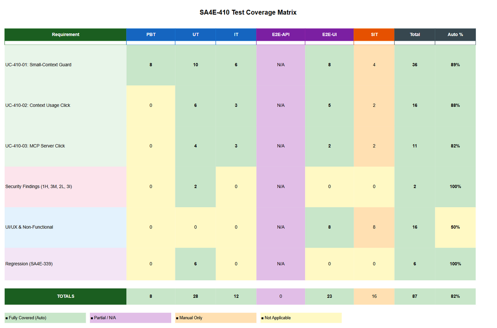
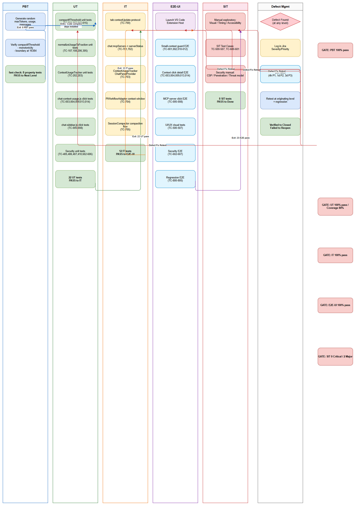

# Software Test Plan (STP)

## SA4E-410 — Context Usage UI Enhancements & Small-Context Compaction Guard

---

## Document Information

| Field | Value |
|-------|-------|
| Jira Ticket | SA4E-410 |
| Title | Context Usage UI Enhancements & Small-Context Compaction Guard |
| Author | QA Agent |
| Version | 1.0 |
| Date | 2026-11-07 |
| Status | Draft |
| Related BRD | BRD-v1.0-SA4E-410.docx |
| Related FSD | FSD-v1.0-SA4E-410.docx |
| Related TDD | TDD-v1.0-SA4E-410.docx |
| Related Security Review | SECURITY-REVIEW-v1.0-SA4E-410.docx |

---

## Author Tracking

| Role | Name - Position | Responsibility |
|------|-----------------|----------------|
| Author | QA Agent – QA Engineer | Create document |
| Peer Reviewer | BA Agent – Business Analyst | Review document |

---

## Revision History

| Version | Date | Author | Changes |
|---------|------|--------|---------|
| 1.0 | 2026-11-07 | QA Agent | Initiate document — generated from BRD, FSD, TDD, and Security Review |

---

## Sign-Off

| Name | Signature and date |
|------|--------------------|
| | ☐ I agree and confirm the test plan in this STP |
| | ☐ I agree and confirm the test plan in this STP |

---

## 1. Introduction

### 1.1 Purpose

This Software Test Plan (STP) defines the testing strategy, scope, resources, schedule, and deliverables for ticket **SA4E-410 — Context Usage UI Enhancements & Small-Context Compaction Guard**. The ticket delivers three features implemented in the VS Code extension:

1. **Small-Context Compaction Guard** — Raises auto-compaction threshold from 95% to 97% and requires minimum 6 messages (vs. 2) for models with `maxTokens < 16,384` to prevent aggressive compaction loops on 4k/8k context windows.
2. **Client-Side Context Usage Detail on Click** — Clicking the context arc gauge in the chat header displays a detailed toast with absolute token counts, percentages, category breakdown (Conversation / MCP Tools / Steering), and a "4% window" reference value (`round(maxTokens * 0.04)`).
3. **Client-Side MCP Server List Detail on Click** — Clicking an MCP server entry in the right sidebar shows a toast with server name and connection status (Connected/Disconnected/Failed/Unknown), implemented purely client-side to avoid tool-call loops.

This is a retrospective test plan — the implementation is complete in the codebase (uncommitted changes). The plan provides traceability and verification that all requirements from BRD, FSD, and TDD are validated, and addresses security findings from the Security Design Review.

### 1.2 Test Objectives

- Verify all functional requirements from FSD Use Cases (UC-410-01, UC-410-02, UC-410-03) are implemented correctly
- Validate all Business Rules (BR-410-01 through BR-410-15) are enforced
- Confirm all Acceptance Criteria (AC-410-01 through AC-410-15) are met
- Ensure security findings (1 High, 3 Medium, 2 Low, 3 Informational) are addressed
- Verify non-functional requirements (performance, usability, reliability, accessibility) are met
- Validate integration with prerequisite systems (SA4E-339 Auto-Compaction, SA4E-369 Token Budget, KSA-240 Chat Panel)
- Ensure regression tests for existing compaction functionality (STC-339-06 through STC-339-11) still pass

### 1.3 References

| Document | Location |
|----------|----------|
| BRD | BRD-v1.0-SA4E-410.docx |
| FSD | FSD-v1.0-SA4E-410.docx |
| TDD | TDD-v1.0-SA4E-410.docx |
| Security Review | SECURITY-REVIEW-v1.0-SA4E-410.docx |
| SA4E-339 BRD | documents/SA4E-339/BRD.md |
| SA4E-369 BRD | documents/SA4E-369/BRD.md |

---

## 2. Test Strategy

### 2.1 Test Levels

| Level | Scope | Automation | Tools |
|-------|-------|------------|-------|
| PBT | Correctness properties (random inputs) for threshold calculations, token math | Automated | fast-check |
| UT | Unit/edge case tests for `compactIfThreshold`, `normalizeUsageToFraction`, toast helpers | Automated | Vitest |
| IT | API integration — Hono app via supertest for context usage payload, MCP server list | Automated | Vitest + supertest |
| E2E-API | REST endpoint E2E (real server) — not applicable (extension host, no REST API) | N/A | N/A |
| E2E-UI | Browser UI E2E — VS Code extension host + webview interactions (Playwright) | Automated | Playwright |
| SIT | Manual exploratory / edge cases only — visual verification, timing, UX | Manual | VS Code Extension Host |

### 2.2 Test Types

| Type | Description | Applicable |
|------|-------------|------------|
| Functional Testing | Verify features work per FSD use cases | Yes |
| Regression Testing | Ensure existing compaction features (SA4E-339) are not broken | Yes |
| Performance Testing | Click-detail toast render < 50ms; guard evaluation negligible | Yes |
| Security Testing | XSS in toast/tooltip, missing `showToast`, `maxTokens` bounds validation | Yes |
| Usability Testing | Toast auto-dismiss 4s, readability, accessibility (aria-label) | Yes |
| Compatibility Testing | VS Code extension host (Windows/Mac/Linux), webview CSP compliance | Yes |

### 2.3 Test Approach

**Risk-Based Prioritization:**
- **Critical Path (P0):** Small-context guard logic (BR-410-01 to BR-410-06) — prevents compaction thrashing
- **High (P1):** Click-detail toasts (BR-410-07 to BR-410-15) — user-facing features
- **High (P1):** Security fixes — XSS, missing `showToast`, `maxTokens` validation
- **Medium (P2):** UI/UX — arc gauge colors, tooltip, pulse animation, accessibility
- **Medium (P2):** Integration — `tab:contextUpdate`, `chat:mcpServers`, `serverStatus` message flows
- **Low (P3):** Regression — existing SA4E-339 compaction tests

**Automation Strategy:**
- **PBT/UT/IT:** 100% automated — run in CI pipeline on every commit
- **E2E-UI:** Automated via Playwright — run on PR merge to main
- **SIT:** Manual only for visual/UX verification that cannot be automated (timing, layout, accessibility)

**E2E Automation Coverage Goal:** Minimize manual SIT to visual/UX-only tests. All functional CRUD operations, validation, auth checks, and regression scenarios are automated at E2E-UI level.

### 2.4 Entry Criteria

| Level | Entry Criteria |
|-------|---------------|
| UT | Code compiles; dependencies installed; `vitest` available |
| IT | Test environment (VS Code extension host) can start; mock `PiWorkflowAdapter` available |
| E2E-UI | Playwright installed; VS Code extension packaged; test workspace configured |
| SIT | Extension installed in VS Code; test models (4k, 8k, 32k, 128k) configured; MCP servers available |

### 2.5 Exit Criteria

| Level | Exit Criteria |
|-------|--------------|
| UT | 100% test cases passed; code coverage ≥ 80% for modified files |
| IT | 100% integration scenarios passed; message protocol validated |
| E2E-UI | 100% E2E scenarios passed; no visual regressions |
| SIT | All manual exploratory tests executed; 0 Critical, ≤2 Major defects open |
| Security | All High/Medium findings remediated; XSS vectors eliminated; `showToast` implemented |

### 2.6 Test Cases Summary Table

| Level | Count | Automated | Manual |
|-------|-------|-----------|--------|
| PBT | 8 | 8 | 0 |
| UT | 22 | 22 | 0 |
| IT | 12 | 12 | 0 |
| E2E-API | 0 | 0 | 0 |
| E2E-UI | 15 | 15 | 0 |
| SIT | 8 | 0 | 8 |
| **Total** | **65** | **57 (88%)** | **8 (12%)** |

---

## 3. Test Scope

### 3.1 Features In Scope

| # | Feature / Story | Priority | FSD Reference | Test Type |
|---|----------------|----------|---------------|-----------|
| 1 | Small-Context Compaction Guard | MUST HAVE | UC-410-01, BR-410-01 to BR-410-06 | PBT, UT, IT, E2E-UI, SIT |
| 2 | Context Usage Detail on Click | MUST HAVE | UC-410-02, BR-410-07 to BR-410-11 | UT, IT, E2E-UI, SIT |
| 3 | MCP Server List Detail on Click | SHOULD HAVE | UC-410-03, BR-410-12 to BR-410-15 | UT, IT, E2E-UI, SIT |
| 4 | Security Hardening | MUST HAVE | SECURITY-REVIEW Findings #1-4 | UT, IT, E2E-UI, SIT |
| 5 | Non-Functional (Performance, Usability, Accessibility) | SHOULD HAVE | BRD Section 6, FSD UI Specs | E2E-UI, SIT |
| 6 | Regression (SA4E-339 Compaction) | MUST HAVE | STC-339-06 to STC-339-11 | UT, IT, E2E-UI |

### 3.2 Features Out of Scope

| # | Feature | Reason |
|---|---------|--------|
| 1 | Core compaction algorithm (`SessionCompactor.compact`) | Covered by SA4E-339 |
| 2 | Registry-first `maxTokens` resolution (`resolveMaxTokensFromEngine`) | Covered by SA4E-369 |
| 3 | Server-side MCP management | Only client-side display in scope |
| 4 | New compaction triggers for large-context models (≥16k) | Out of scope per BRD |
| 5 | Model registry/probe infrastructure | External dependency |

---

## 4. Test Environment

### 4.1 Environment Requirements

| Environment | Configuration | Purpose |
|-------------|---------------|---------|
| Development | VS Code + Extension Host (TypeScript), Node.js 20+, Vitest, Playwright | Unit, Integration, E2E-UI |
| SIT | VS Code with extension installed, configured models | Manual exploratory, UX verification |
| CI/CD | GitHub Actions / Azure Pipelines | Automated test execution on PR/commit |

### 4.2 Browser / Device Requirements

| Platform | Version | Required |
|----------|---------|----------|
| VS Code (Windows) | 1.90+ | Yes |
| VS Code (macOS) | 1.90+ | Yes |
| VS Code (Linux) | 1.90+ | Yes |
| Webview (Electron) | Bundled with VS Code | Yes |

### 4.3 Test Data Requirements

| Data Type | Description | Source | Preparation |
|-----------|-------------|--------|-------------|
| Model Context Windows | Test models with 4096, 8192, 16384, 32768, 128000 tokens | Mock `PiWorkflowAdapter` / llama-server config | Configure in test setup; see testdata CSVs |
| Conversation History | Message arrays of varying lengths (1-20 messages) | Test fixtures | Generated in test helpers |
| MCP Server List | Servers with statuses: connected, disconnected, failed, unknown | Mock `chat:mcpServers` payload | Defined in testdata CSVs |
| Token Breakdown | Conversation/MCP/Steering percentages | `ContextUsageTracker` output | Computed from test messages |
| XSS Payloads | HTML/JS injection strings for security testing | OWASP XSS cheat sheet | Encoded in test cases |

### 4.4 External Dependencies

| System | Dependency | Mock/Stub Available |
|--------|-----------|---------------------|
| llama-server / LLM Gateway | `getModelContextWindow()`, `getDetectedContextWindow()` | Yes — `PiWorkflowAdapter` mocked in tests |
| MCP Servers | `listAvailableTools()`, `serverStatus` events | Yes — mocked in `chat-sidebar.js` tests |
| VS Code API | `acquireVsCodeApi()`, `postMessage` | Yes — `@vscode/webview` test utilities |

---

## 5. Test Schedule

| Phase | Start Date | End Date | Duration | Milestone |
|-------|-----------|----------|----------|-----------|
| Test Planning | 2026-11-07 | 2026-11-07 | 1 day | STP + STC approved |
| Test Data Preparation | 2026-11-07 | 2026-11-08 | 1 day | Test data CSVs ready |
| UT/IT Execution | 2026-11-08 | 2026-11-09 | 2 days | Unit/Integration sign-off |
| E2E-UI Execution | 2026-11-09 | 2026-11-10 | 2 days | E2E sign-off |
| Security Fix Verification | 2026-11-10 | 2026-11-11 | 1 day | Security findings closed |
| SIT Execution | 2026-11-11 | 2026-11-12 | 2 days | SIT sign-off |
| Defect Fix & Retest | 2026-11-12 | 2026-11-13 | 1 day | All Critical/Major fixed |
| UAT Execution | 2026-11-13 | 2026-11-14 | 1 day | UAT sign-off |

---

## 6. Resources & Responsibilities

| Role | Name | Responsibility |
|------|------|---------------|
| Test Lead | QA Agent | Test planning, coordination, reporting |
| QA Engineer | QA Agent | Test case design, execution, defect reporting |
| BA | BA Agent | UAT support, acceptance criteria clarification |
| Developer | DEV Agent | Bug fixing, unit test coverage, security remediation |
| DevOps | DevOps Agent | CI/CD pipeline, environment setup |
| Security | Security Agent | Security review validation, penetration testing |

---

## 7. Risk & Mitigation

| # | Risk | Impact | Likelihood | Mitigation |
|---|------|--------|------------|------------|
| 1 | Missing `showToast` implementation causes silent feature failure | High | High | Implement `showToast` in `chat-core.js` per Security Finding #1 remediation |
| 2 | XSS vulnerabilities in `chat-context-usage.js` | High | Medium | Apply `S.escapeHtml` to all dynamic values; verify via security tests |
| 3 | `maxTokens` boundary manipulation enabling DoS | Medium | Low | Add bounds validation (1024–2,000,000) per Security Finding #4 |
| 4 | Test model configuration (4k/8k/16k/32k/128k) not available | Medium | Medium | Mock `PiWorkflowAdapter` in all automated tests; document manual SIT model setup |
| 5 | Flaky E2E-UI tests due to VS Code extension host timing | Medium | Medium | Use `waitFor` with generous timeouts; retry logic in Playwright config |
| 6 | CSP nonce issues blocking webview scripts in test environment | Low | Low | Verify CSP configuration in `ChatHtmlBuilder.ts` matches test setup |
| 7 | Regression in SA4E-339 compaction logic | High | Low | Run full SA4E-339 test suite (STC-339-06 to 11) as regression gate |

---

## 8. Defect Management

### 8.1 Severity Levels

| Severity | Definition | Example |
|----------|-----------|---------|
| Critical | System crash, data loss, security breach, feature completely non-functional | Missing `showToast` — click detail feature broken |
| Major | Feature not working as specified, workaround exists | Wrong compaction threshold for small-context model |
| Minor | UI issue, cosmetic defect, non-critical validation | Toast positioning slightly off; color mismatch |
| Trivial | Typo, minor alignment, documentation gap | Misspelled label in toast |

### 8.2 Priority Levels

| Priority | Definition | SLA (Fix Time) |
|----------|-----------|----------------|
| P1 | Must fix immediately — blocks testing or critical feature | 4 hours |
| P2 | Must fix before release — major functionality impacted | 1 business day |
| P3 | Should fix if time permits — minor impact | 3 business days |
| P4 | Nice to fix, can defer — cosmetic/low impact | Next release |

### 8.3 Defect Lifecycle

```
New → Open → In Progress → Fixed → Ready for Retest → Verified → Closed
                                                      → Reopened → In Progress
```

---

## 9. Test Metrics & Reporting

### 9.1 Metrics

| Metric | Formula | Target |
|--------|---------|--------|
| Test Execution Rate | Executed / Total × 100% | 100% |
| Pass Rate | Passed / Executed × 100% | ≥ 95% |
| Defect Density | Defects / Test Cases | ≤ 0.1 |
| Critical Defect Count | Count of Critical severity | 0 |
| Defect Fix Rate | Fixed / Total Defects × 100% | ≥ 90% |
| Automation Coverage | Automated / Total × 100% | ≥ 85% |

### 9.2 Reporting Schedule

| Report | Frequency | Audience |
|--------|-----------|----------|
| Daily Test Status | Daily during SIT/UAT | Project team |
| Defect Summary | Daily | Dev team + PM |
| Test Completion Report | End of SIT / End of UAT | All stakeholders |

---

## 10. Appendix

### Glossary

| Term | Definition |
|------|------------|
| SIT | System Integration Testing |
| UAT | User Acceptance Testing |
| STP | Software Test Plan |
| STC | Software Test Cases |
| PBT | Property-Based Testing |
| UT | Unit Testing |
| IT | Integration Testing |
| E2E-UI | End-to-End UI Testing |
| CSP | Content Security Policy |
| MCP | Model Context Protocol |

### Assumptions

- SA4E-339 and SA4E-369 are fully implemented and tested
- `maxTokens` resolution via registry/probe is reliable (SA4E-369)
- Webview `ChatState` reliably holds per-tab `tokenCount`, `maxTokens`, `breakdown`
- Toast notification system (`S.showToast`) will be implemented per Security Finding #1
- MCP server list is populated via `chat:mcpServers` host message and `serverStatus` events
- VS Code extension host environment is available for E2E-UI testing

### Test Coverage Overview



### Test Execution Flow


