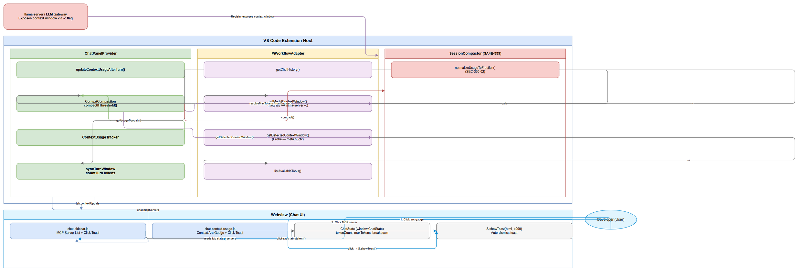
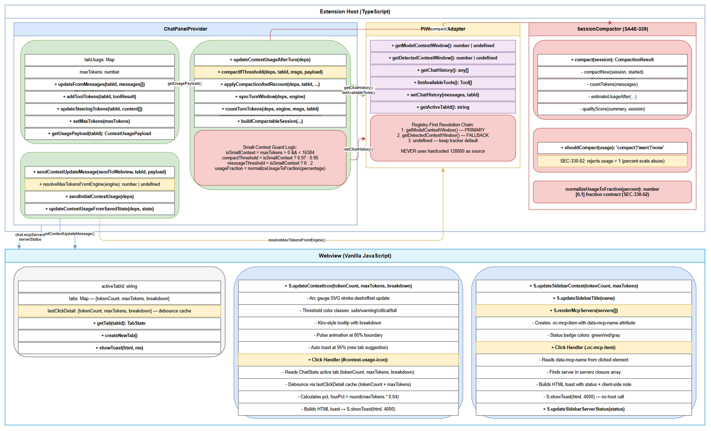
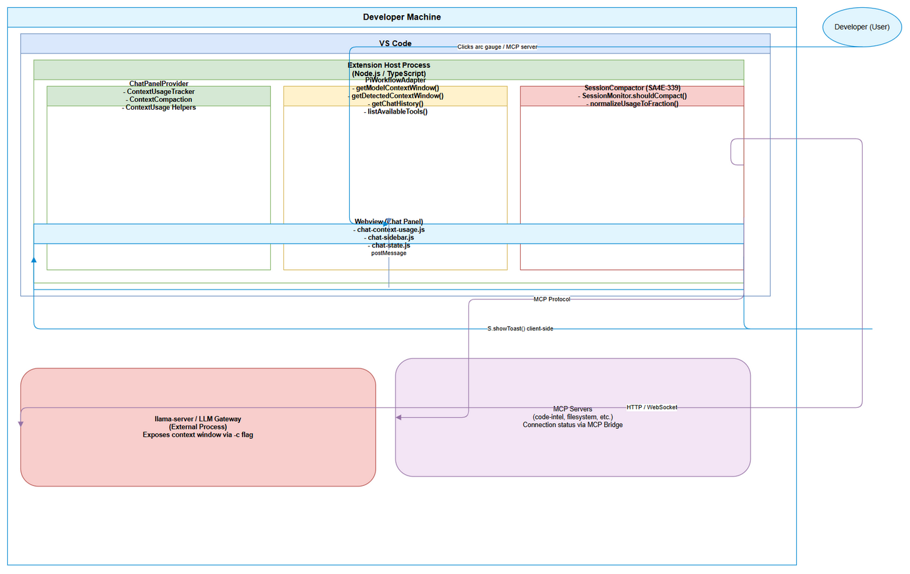
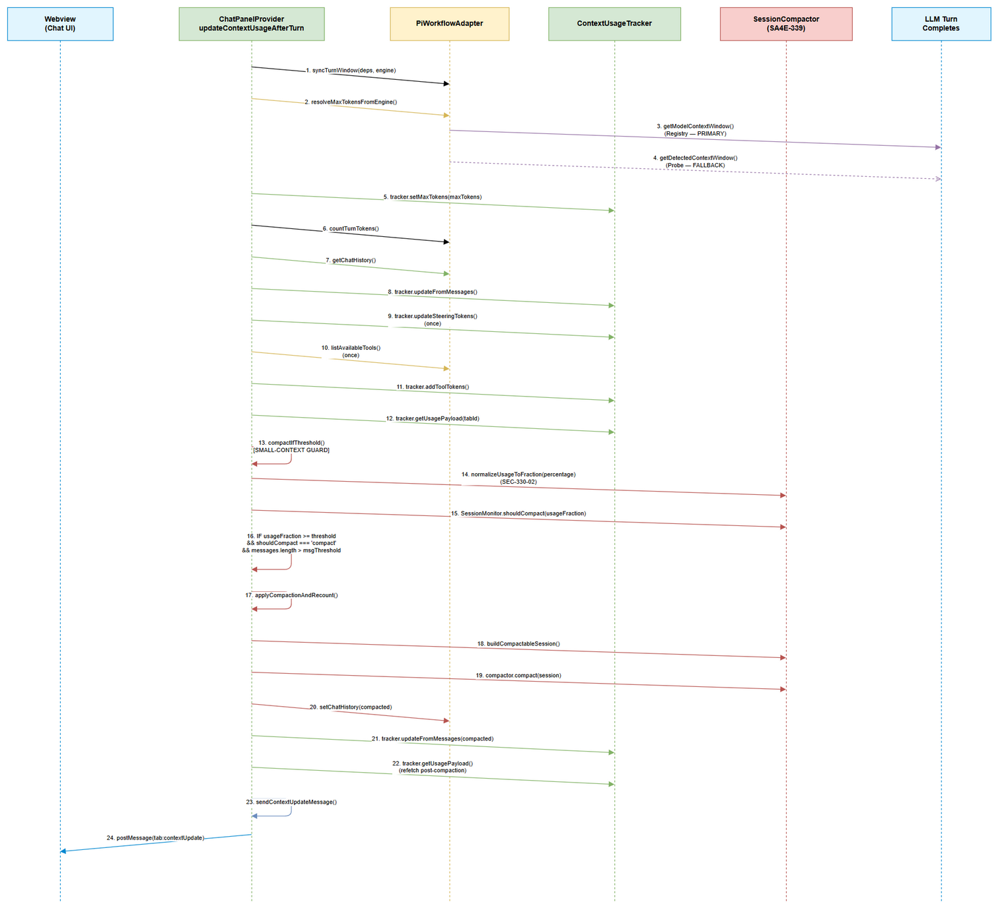
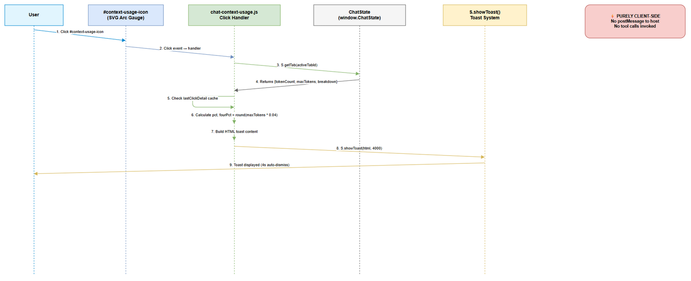
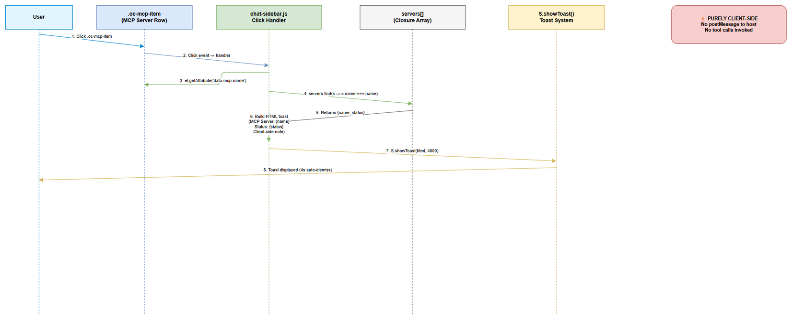
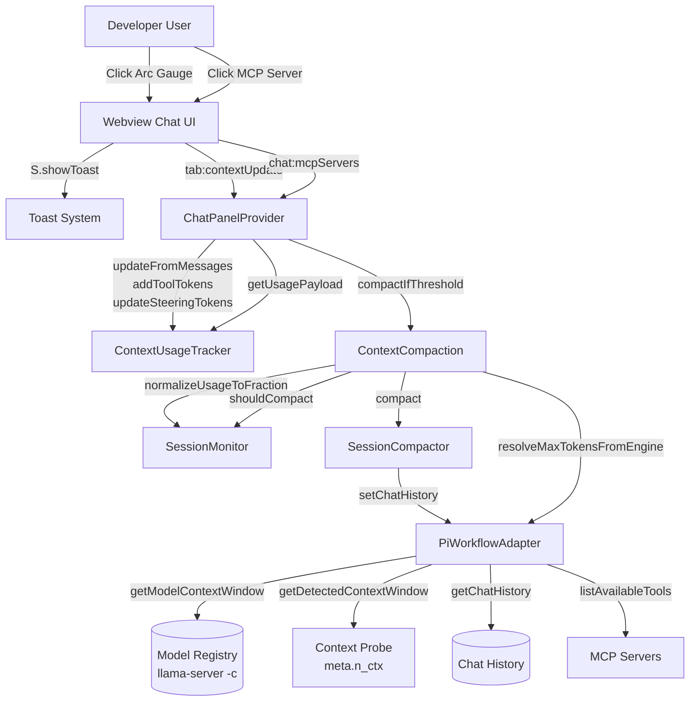
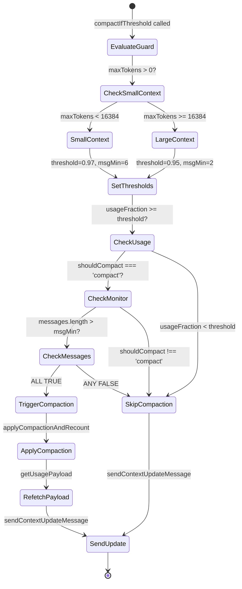
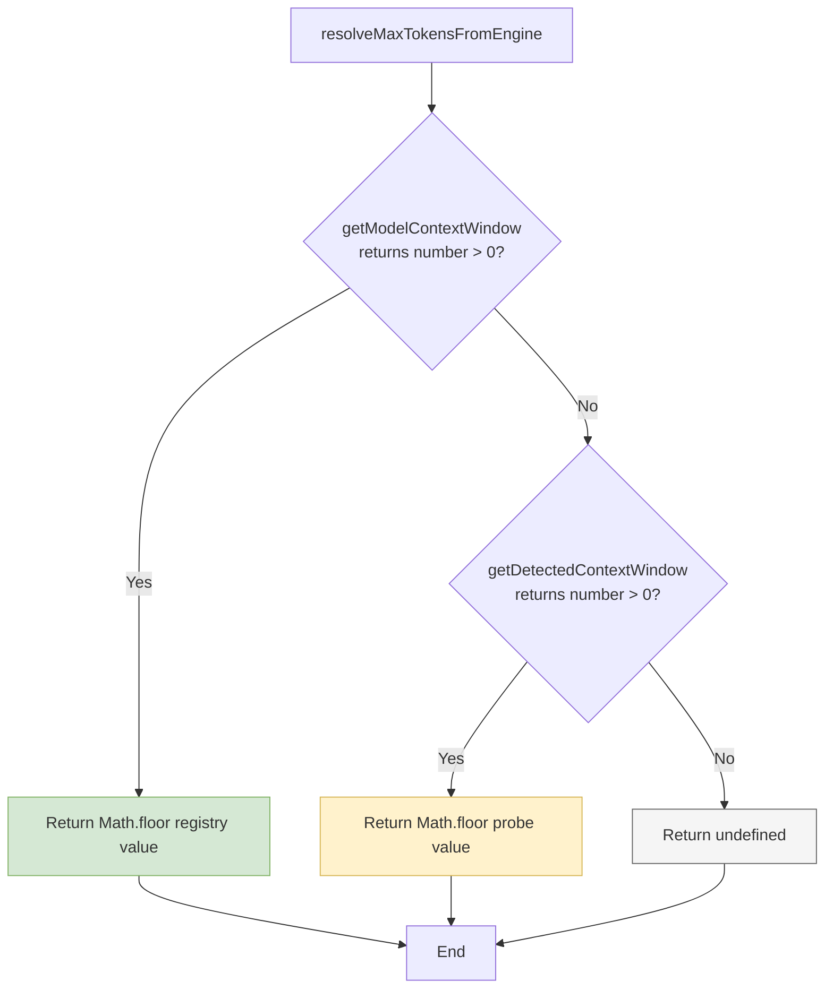

# Technical Design Document (TDD)

## SA4E-410 — Context Usage UI Enhancements & Small-Context Compaction Guard

---

## Document Information

| Field | Value |
|-------|-------|
| Jira Ticket | SA4E-410 |
| Title | Context Usage UI Enhancements & Small-Context Compaction Guard |
| Author | SA Agent |
| Version | 1.0 |
| Date | 2026-11-07 |
| Status | Draft |
| Related BRD | `documents/SA4E-410/BRD.md` |
| Related FSD | `documents/SA4E-410/FSD.md` |

---

## Revision History

| Version | Date | Author | Changes |
|---------|------|--------|---------|
| 1.0 | 2026-11-07 | SA Agent | Initial TDD created from implemented codebase |

---

## 1. Introduction

### 1.1 Purpose

This Technical Design Document (TDD) describes the technical implementation of three features delivered in SA4E-410:

1. **Small-Context Compaction Guard** — Raises auto-compaction threshold from 95% to 97% and requires minimum 6 messages (vs. 2) for models with `maxTokens < 16,384` to prevent aggressive compaction loops on 4k/8k context windows.
2. **Client-Side Context Usage Detail on Click** — Clicking the context arc gauge in the chat header displays a detailed toast with absolute token counts, percentages, category breakdown (Conversation / MCP Tools / Steering), and a "4% window" reference value (`round(maxTokens * 0.04)`).
3. **Client-Side MCP Server List Detail on Click** — Clicking an MCP server entry in the right sidebar shows a toast with server name and connection status (Connected/Disconnected/Failed/Unknown), implemented purely client-side to avoid tool-call loops.

> **Note:** This is a retrospective TDD. The implementation is complete in the codebase (uncommitted changes). This document provides technical traceability for the delivered features and their integration with SA4E-339 (Auto-Compaction) and SA4E-369 (Token Budget / Registry-First Context Window).

### 1.2 Technology Stack

| Layer | Technology |
|-------|------------|
| Extension Host | TypeScript (Node.js / VS Code Extension API) |
| Webview (Chat UI) | Vanilla JavaScript (ES6+, IIFE module pattern) |
| Context Tracking | `ContextUsageTracker` class (in-memory Map per tab) |
| Compaction Engine | `SessionCompactor` + `SessionMonitor` (SA4E-339) |
| Context Window Resolution | `PiWorkflowAdapter` → `getModelContextWindow()` (registry) → `getDetectedContextWindow()` (probe) |
| Messaging | `postMessage` (host ↔ webview) — fire-and-forget |
| Testing | Vitest (unit), Playwright (E2E — planned) |

### 1.3 Design Principles & Constraints

| Principle | Application |
|-----------|-------------|
| **Fail-safe defaults** | If `maxTokens` unavailable (0/undefined), small-context guard defaults to large-context behavior (threshold 0.95, min 2 messages) |
| **Client-side only for UI clicks** | Context detail and MCP server detail toasts use `S.showToast` — no host round-trip, no tool calls |
| **Registry-first context window** | `maxTokens` resolved from model registry (`getModelContextWindow()`) first; probe (`getDetectedContextWindow()`) only as fallback; never hardcoded 128000 as source |
| **SEC-330-02 contract** | `normalizeUsageToFraction` converts percent-scale (0–100) to fraction [0,1]; prevents compaction-trigger abuse |
| **Per-tab isolation** | `ContextUsageTracker.tabUsage` Map keyed by `tabId` (SA4E-370) |
| **Non-fatal error handling** | Compaction errors caught and logged; session continues un-compacted; webview message drops are silent |

---

## 2. System Architecture

### 2.1 High-Level Architecture Diagram


*[Edit in draw.io](diagrams/architecture.drawio)*

```xml
<mxGraphModel dx="1400" dy="900" grid="1" gridSize="10" guides="1" tooltips="1" connect="1" arrows="1" fold="1" page="1" pageScale="1" pageWidth="1169" pageHeight="827" math="0" shadow="0">
  <root>
    <mxCell id="0"/>
    <mxCell id="1" parent="0"/>
    <!-- User Actor -->
    <mxCell id="actor_user" value="Developer (User)" style="shape=ellipse;whiteSpace=wrap;html=1;fillColor=#e1f5fe;strokeColor=#0288d1;fontSize=11;fontStyle=1;" vertex="1" parent="1">
      <mxGeometry x="50" y="400" width="120" height="60" as="geometry"/>
    </mxCell>
    <!-- VS Code Extension Host -->
    <mxCell id="host" value="VS Code Extension Host" style="rounded=1;whiteSpace=wrap;html=1;fillColor=#dae8fc;strokeColor=#6c8ebf;fontSize=11;fontStyle=1;" vertex="1" parent="1">
      <mxGeometry x="220" y="50" width="950" height="750" as="geometry"/>
    </mxCell>
    <!-- ChatPanelProvider -->
    <mxCell id="provider" value="ChatPanelProvider" style="rounded=1;whiteSpace=wrap;html=1;fillColor=#d5e8d4;strokeColor=#82b366;fontSize=11;fontStyle=1;" vertex="1" parent="host">
      <mxGeometry x="270" y="100" width="250" height="320" as="geometry"/>
    </mxCell>
    <!-- ContextUsageTracker -->
    <mxCell id="tracker" value="ContextUsageTracker" style="rounded=1;whiteSpace=wrap;html=1;fillColor=#d5e8d4;strokeColor=#82b366;fontSize=11;" vertex="1" parent="provider">
      <mxGeometry x="20" y="20" width="210" height="50" as="geometry"/>
    </mxCell>
    <!-- ContextCompaction (compactIfThreshold) -->
    <mxCell id="compaction" value="ContextCompaction\ncompactIfThreshold()" style="rounded=1;whiteSpace=wrap;html=1;fillColor=#d5e8d4;strokeColor=#82b366;fontSize=11;" vertex="1" parent="provider">
      <mxGeometry x="20" y="90" width="210" height="50" as="geometry"/>
    </mxCell>
    <!-- updateContextUsageAfterTurn -->
    <mxCell id="update_turn" value="updateContextUsageAfterTurn()" style="rounded=1;whiteSpace=wrap;html=1;fillColor=#d5e8d4;strokeColor=#82b366;fontSize=11;" vertex="1" parent="provider">
      <mxGeometry x="20" y="160" width="210" height="50" as="geometry"/>
    </mxCell>
    <!-- syncTurnWindow / countTurnTokens -->
    <mxCell id="sync_count" value="syncTurnWindow()\ncountTurnTokens()" style="rounded=1;whiteSpace=wrap;html=1;fillColor=#d5e8d4;strokeColor=#82b366;fontSize=11;" vertex="1" parent="provider">
      <mxGeometry x="20" y="230" width="210" height="50" as="geometry"/>
    </mxCell>
    <!-- PiWorkflowAdapter -->
    <mxCell id="adapter" value="PiWorkflowAdapter" style="rounded=1;whiteSpace=wrap;html=1;fillColor=#fff2cc;strokeColor=#d6b656;fontSize=11;fontStyle=1;" vertex="1" parent="host">
      <mxGeometry x="570" y="100" width="250" height="320" as="geometry"/>
    </mxCell>
    <!-- getModelContextWindow() -->
    <mxCell id="registry" value="getModelContextWindow()\n(Registry — llama-server -c)" style="rounded=1;whiteSpace=wrap;html=1;fillColor=#f3e5f5;strokeColor=#9673a6;fontSize=11;" vertex="1" parent="adapter">
      <mxGeometry x="20" y="20" width="210" height="50" as="geometry"/>
    </mxCell>
    <!-- getDetectedContextWindow() -->
    <mxCell id="probe" value="getDetectedContextWindow()\n(Probe — meta.n_ctx)" style="rounded=1;whiteSpace=wrap;html=1;fillColor=#f3e5f5;strokeColor=#9673a6;fontSize=11;" vertex="1" parent="adapter">
      <mxGeometry x="20" y="90" width="210" height="50" as="geometry"/>
    </mxCell>
    <!-- getChatHistory() -->
    <mxCell id="history" value="getChatHistory()" style="rounded=1;whiteSpace=wrap;html=1;fillColor=#f3e5f5;strokeColor=#9673a6;fontSize=11;" vertex="1" parent="adapter">
      <mxGeometry x="20" y="160" width="210" height="50" as="geometry"/>
    </mxCell>
    <!-- listAvailableTools() -->
    <mxCell id="tools" value="listAvailableTools()" style="rounded=1;whiteSpace=wrap;html=1;fillColor=#f3e5f5;strokeColor=#9673a6;fontSize=11;" vertex="1" parent="adapter">
      <mxGeometry x="20" y="230" width="210" height="50" as="geometry"/>
    </mxCell>
    <!-- SessionCompactor (SA4E-339) -->
    <mxCell id="session_compactor" value="SessionCompactor\n(SA4E-339)" style="rounded=1;whiteSpace=wrap;html=1;fillColor=#f8cecc;strokeColor=#b85450;fontSize=11;fontStyle=1;" vertex="1" parent="host">
      <mxCell id="session_monitor" value="SessionMonitor\nshouldCompact()" style="rounded=1;whiteSpace=wrap;html=1;fillColor=#f8cecc;strokeColor=#b85450;fontSize=10;" vertex="1" parent="session_compactor">
        <mxGeometry x="10" y="30" width="180" height="50" as="geometry"/>
      </mxCell>
      <mxCell id="normalize" value="normalizeUsageToFraction()\n(SEC-330-02)" style="rounded=1;whiteSpace=wrap;html=1;fillColor=#f8cecc;strokeColor=#b85450;fontSize=10;" vertex="1" parent="session_compactor">
        <mxGeometry x="10" y="100" width="180" height="50" as="geometry"/>
      </mxCell>
      <mxGeometry x="270" y="480" width="220" height="180" as="geometry"/>
    </mxCell>
    <!-- Webview (Chat UI) -->
    <mxCell id="webview" value="Webview (Chat UI)" style="rounded=1;whiteSpace=wrap;html=1;fillColor=#e1f5fe;strokeColor=#0288d1;fontSize=11;fontStyle=1;" vertex="1" parent="host">
      <mxGeometry x="570" y="480" width="550" height="300" as="geometry"/>
    </mxCell>
    <!-- chat-context-usage.js -->
    <mxCell id="ctx_usage_js" value="chat-context-usage.js\nContext Arc Gauge + Click Toast" style="rounded=1;whiteSpace=wrap;html=1;fillColor=#dae8fc;strokeColor=#6c8ebf;fontSize=11;" vertex="1" parent="webview">
      <mxGeometry x="20" y="20" width="250" height="70" as="geometry"/>
    </mxCell>
    <!-- chat-sidebar.js -->
    <mxCell id="sidebar_js" value="chat-sidebar.js\nMCP Server List + Click Toast" style="rounded=1;whiteSpace=wrap;html=1;fillColor=#dae8fc;strokeColor=#6c8ebf;fontSize=11;" vertex="1" parent="webview">
      <mxGeometry x="290" y="20" width="250" height="70" as="geometry"/>
    </mxCell>
    <!-- ChatState -->
    <mxCell id="chat_state" value="ChatState (window.ChatState)\ntokenCount, maxTokens, breakdown\nlastClickDetail (debounce cache)" style="rounded=1;whiteSpace=wrap;html=1;fillColor=#f5f5f5;strokeColor=#666666;fontSize=11;" vertex="1" parent="webview">
      <mxGeometry x="20" y="120" width="520" height="80" as="geometry"/>
    </mxCell>
    <!-- S.showToast -->
    <mxCell id="show_toast" value="S.showToast(html, 4000)\nAuto-dismiss toast" style="rounded=1;whiteSpace=wrap;html=1;fillColor=#f5f5f5;strokeColor=#666666;fontSize=11;" vertex="1" parent="webview">
      <mxGeometry x="20" y="220" width="520" height="50" as="geometry"/>
    </mxCell>
    <!-- External: llama-server -->
    <mxCell id="llama" value="llama-server / LLM Gateway\nExposes context window via -c flag" style="rounded=1;whiteSpace=wrap;html=1;fillColor=#f8cecc;strokeColor=#b85450;fontSize=11;fontStyle=1;" vertex="1" parent="1">
      <mxGeometry x="1000" y="400" width="220" height="80" as="geometry"/>
    </mxCell>
    <!-- Edges -->
    <!-- User clicks arc gauge -->
    <mxCell id="e1" value="1. Click arc gauge" style="edgeStyle=orthogonalEdgeStyle;html=1;endArrow=block;endFill=1;fontSize=9;" edge="1" parent="1" source="actor_user" target="ctx_usage_js">
      <mxGeometry relative="1" as="geometry">
        <mxPoint x="170" y="430" as="sourcePoint"/>
        <mxPoint x="570" y="430" as="targetPoint"/>
      </mxGeometry>
    </mxCell>
    <!-- User clicks MCP server -->
    <mxCell id="e2" value="2. Click MCP server" style="edgeStyle=orthogonalEdgeStyle;html=1;endArrow=block;endFill=1;fontSize=9;" edge="1" parent="1" source="actor_user" target="sidebar_js">
      <mxGeometry relative="1" as="geometry">
        <mxPoint x="170" y="460" as="sourcePoint"/>
        <mxPoint x="570" y="460" as="targetPoint"/>
      </mxGeometry>
    </mxCell>
    <!-- tab:contextUpdate -->
    <mxCell id="e3" value="tab:contextUpdate\n(tokenCount, maxTokens, breakdown)" style="edgeStyle=orthogonalEdgeStyle;html=1;endArrow=block;endFill=1;fontSize=9;strokeColor=#6c8ebf;" edge="1" parent="1" source="provider" target="webview">
      <mxGeometry relative="1" as="geometry">
        <mxPoint x="520" y="260" as="sourcePoint"/>
        <mxPoint x="570" y="520" as="targetPoint"/>
      </mxGeometry>
    </mxCell>
    <!-- chat:mcpServers + serverStatus -->
    <mxCell id="e4" value="chat:mcpServers\nserverStatus events" style="edgeStyle=orthogonalEdgeStyle;html=1;endArrow=block;endFill=1;fontSize=9;strokeColor=#6c8ebf;" edge="1" parent="1" source="provider" target="sidebar_js">
      <mxGeometry relative="1" as="geometry">
        <mxPoint x="520" y="310" as="sourcePoint"/>
        <mxPoint x="570" y="550" as="targetPoint"/>
      </mxGeometry>
    </mxCell>
    <!-- compactIfThreshold → getModelContextWindow -->
    <mxCell id="e5" value="resolveMaxTokensFromEngine()\n→ getModelContextWindow()" style="edgeStyle=orthogonalEdgeStyle;html=1;endArrow=block;endFill=1;fontSize=9;strokeColor=#9673a6;" edge="1" parent="1" source="compaction" target="registry">
      <mxGeometry relative="1" as="geometry">
        <mxPoint x="520" y="140" as="sourcePoint"/>
        <mxPoint x="590" y="140" as="targetPoint"/>
      </mxGeometry>
    </mxCell>
    <!-- compactIfThreshold → getDetectedContextWindow (fallback) -->
    <mxCell id="e6" value="getDetectedContextWindow()\n(fallback)" style="edgeStyle=orthogonalEdgeStyle;html=1;endArrow=open;endFill=0;dashed=1;fontSize=9;strokeColor=#9673a6;" edge="1" parent="1" source="compaction" target="probe">
      <mxGeometry relative="1" as="geometry">
        <mxPoint x="520" y="190" as="sourcePoint"/>
        <mxPoint x="590" y="190" as="targetPoint"/>
      </mxGeometry>
    </mxCell>
    <!-- compactIfThreshold → getChatHistory -->
    <mxCell id="e7" value="getChatHistory()" style="edgeStyle=orthogonalEdgeStyle;html=1;endArrow=block;endFill=1;fontSize=9;strokeColor=#82b366;" edge="1" parent="1" source="update_turn" target="history">
      <mxGeometry relative="1" as="geometry">
        <mxPoint x="520" y="210" as="sourcePoint"/>
        <mxPoint x="590" y="210" as="targetPoint"/>
      </mxGeometry>
    </mxCell>
    <!-- listAvailableTools -->
    <mxCell id="e8" value="listAvailableTools()" style="edgeStyle=orthogonalEdgeStyle;html=1;endArrow=block;endFill=1;fontSize=9;strokeColor=#d6b656;" edge="1" parent="1" source="sync_count" target="tools">
      <mxGeometry relative="1" as="geometry">
        <mxPoint x="520" y="260" as="sourcePoint"/>
        <mxPoint x="590" y="260" as="targetPoint"/>
      </mxGeometry>
    </mxCell>
    <!-- compactIfThreshold → SessionCompactor -->
    <mxCell id="e9" value="compact()\n(when thresholds met)" style="edgeStyle=orthogonalEdgeStyle;html=1;endArrow=block;endFill=1;fontSize=9;strokeColor=#b85450;" edge="1" parent="1" source="compaction" target="session_compactor">
      <mxGeometry relative="1" as="geometry">
        <mxPoint x="400" y="430" as="sourcePoint"/>
        <mxPoint x="400" y="480" as="targetPoint"/>
      </mxGeometry>
    </mxCell>
    <!-- llama-server → adapter (registry) -->
    <mxCell id="e10" value="Registry exposes\ncontext window (-c)" style="edgeStyle=orthogonalEdgeStyle;html=1;endArrow=block;endFill=1;fontSize=9;strokeColor=#b85450;" edge="1" parent="1" source="llama" target="adapter">
      <mxGeometry relative="1" as="geometry">
        <mxPoint x="1000" y="440" as="sourcePoint"/>
        <mxPoint x="820" y="440" as="targetPoint"/>
      </mxGeometry>
    </mxCell>
    <!-- Internal: tracker → compaction (payload) -->
    <mxCell id="e11" value="getUsagePayload()" style="edgeStyle=orthogonalEdgeStyle;html=1;endArrow=block;endFill=1;fontSize=9;strokeColor=#82b366;" edge="1" parent="provider" source="tracker" target="compaction">
      <mxGeometry relative="1" as="geometry">
        <mxPoint x="480" y="115" as="sourcePoint"/>
        <mxPoint x="480" y="140" as="targetPoint"/>
      </mxGeometry>
    </mxCell>
    <!-- Internal: compaction → update_turn -->
    <mxCell id="e12" value="calls" style="edgeStyle=orthogonalEdgeStyle;html=1;endArrow=block;endFill=1;fontSize=9;strokeColor=#82b366;" edge="1" parent="provider" source="update_turn" target="compaction">
      <mxGeometry relative="1" as="geometry">
        <mxPoint x="300" y="210" as="sourcePoint"/>
        <mxPoint x="300" y="190" as="targetPoint"/>
      </mxGeometry>
    </mxCell>
    <!-- Internal: update_turn → sync_count -->
    <mxCell id="e13" value="calls" style="edgeStyle=orthogonalEdgeStyle;html=1;endArrow=block;endFill=1;fontSize=9;strokeColor=#82b366;" edge="1" parent="provider" source="update_turn" target="sync_count">
      <mxGeometry relative="1" as="geometry">
        <mxPoint x="300" y="210" as="sourcePoint"/>
        <mxPoint x="300" y="230" as="targetPoint"/>
      </mxGeometry>
    </mxCell>
    <!-- Webview: arc gauge click → showToast -->
    <mxCell id="e14" value="click → build HTML\n→ S.showToast()" style="edgeStyle=orthogonalEdgeStyle;html=1;endArrow=block;endFill=1;fontSize=9;strokeColor=#0288d1;" edge="1" parent="webview" source="ctx_usage_js" target="show_toast">
      <mxGeometry relative="1" as="geometry">
        <mxPoint x="695" y="90" as="sourcePoint"/>
        <mxPoint x="695" y="220" as="targetPoint"/>
      </mxGeometry>
    </mxCell>
    <!-- Webview: MCP click → showToast -->
    <mxCell id="e15" value="click → build HTML\n→ S.showToast()" style="edgeStyle=orthogonalEdgeStyle;html=1;endArrow=block;endFill=1;fontSize=9;strokeColor=#0288d1;" edge="1" parent="webview" source="sidebar_js" target="show_toast">
      <mxGeometry relative="1" as="geometry">
        <mxPoint x="800" y="90" as="sourcePoint"/>
        <mxPoint x="800" y="220" as="targetPoint"/>
      </mxGeometry>
    </mxCell>
    <!-- Webview: ChatState read by click handlers -->
    <mxCell id="e16" value="reads tab state\n(tokenCount, maxTokens, breakdown)" style="edgeStyle=orthogonalEdgeStyle;html=1;endArrow=open;endFill=0;dashed=1;fontSize=9;strokeColor=#666666;" edge="1" parent="webview" source="ctx_usage_js" target="chat_state">
      <mxGeometry relative="1" as="geometry">
        <mxPoint x="695" y="90" as="sourcePoint"/>
        <mxPoint x="695" y="120" as="targetPoint"/>
      </mxGeometry>
    </mxCell>
    <mxCell id="e17" value="reads tab state\n+ servers closure" style="edgeStyle=orthogonalEdgeStyle;html=1;endArrow=open;endFill=0;dashed=1;fontSize=9;strokeColor=#666666;" edge="1" parent="webview" source="sidebar_js" target="chat_state">
      <mxGeometry relative="1" as="geometry">
        <mxPoint x="800" y="90" as="sourcePoint"/>
        <mxPoint x="800" y="120" as="targetPoint"/>
      </mxGeometry>
    </mxCell>
    <!-- tab:contextUpdate updates ChatState -->
    <mxCell id="e18" value="handleContextUpdate\n→ updates ChatState tabs" style="edgeStyle=orthogonalEdgeStyle;html=1;endArrow=block;endFill=1;fontSize=9;strokeColor=#0288d1;" edge="1" parent="1" source="webview" target="chat_state">
      <mxGeometry relative="1" as="geometry">
        <mxPoint x="570" y="520" as="sourcePoint"/>
        <mxPoint x="840" y="520" as="targetPoint"/>
      </mxGeometry>
    </mxCell>
    <!-- chat:mcpServers updates ChatState/servers -->
    <mxCell id="e19" value="renderMcpServers\n→ updates servers array" style="edgeStyle=orthogonalEdgeStyle;html=1;endArrow=block;endFill=1;fontSize=9;strokeColor=#0288d1;" edge="1" parent="1" source="sidebar_js" target="chat_state">
      <mxGeometry relative="1" as="geometry">
        <mxPoint x="840" y="550" as="sourcePoint"/>
        <mxPoint x="840" y="520" as="targetPoint"/>
      </mxGeometry>
    </mxCell>
  </root>
</mxGraphModel>
```

### 2.2 Component Diagram


*[Edit in draw.io](diagrams/component.drawio)*

```xml
<mxGraphModel dx="1300" dy="800" grid="1" gridSize="10" guides="1" tooltips="1" connect="1" arrows="1" fold="1" page="1" pageScale="1" pageWidth="1169" pageHeight="827" math="0" shadow="0">
  <root>
    <mxCell id="0"/>
    <mxCell id="1" parent="0"/>
    <!-- Extension Host Layer -->
    <mxCell id="host_layer" value="Extension Host (TypeScript)" style="swimlane;startSize=30;fillColor=none;strokeColor=#6c8ebf;html=1;fontStyle=1;fontSize=12;" vertex="1" parent="1">
      <mxGeometry x="40" y="40" width="1200" height="650" as="geometry"/>
    </mxCell>
    <!-- ChatPanelProvider Container -->
    <mxCell id="provider_container" value="ChatPanelProvider" style="swimlane;startSize=30;fillColor=#dae8fc;strokeColor=#6c8ebf;html=1;fontStyle=1;fontSize=11;" vertex="1" parent="host_layer">
      <mxGeometry x="20" y="50" width="400" height="550" as="geometry"/>
    </mxCell>
    <!-- ContextUsageTracker -->
    <mxCell id="tracker_comp" value="ContextUsageTracker" style="rounded=1;whiteSpace=wrap;html=1;fillColor=#d5e8d4;strokeColor=#82b366;fontSize=11;fontStyle=1;" vertex="1" parent="provider_container">
      <mxGeometry x="20" y="40" width="360" height="160" as="geometry"/>
    </mxCell>
    <mxCell id="tracker_field1" value="tabUsage: Map<string, TabContextUsage>" style="rounded=0;whiteSpace=wrap;html=1;fillColor=#ffffff;strokeColor=#666666;fontSize=10;" vertex="1" parent="tracker_comp">
      <mxGeometry x="10" y="30" width="340" height="25" as="geometry"/>
    </mxCell>
    <mxCell id="tracker_field2" value="maxTokens: number" style="rounded=0;whiteSpace=wrap;html=1;fillColor=#ffffff;strokeColor=#666666;fontSize=10;" vertex="1" parent="tracker_comp">
      <mxGeometry x="10" y="60" width="340" height="25" as="geometry"/>
    </mxCell>
    <mxCell id="tracker_method1" value="+ updateFromMessages(tabId, messages[])" style="rounded=0;whiteSpace=wrap;html=1;fillColor=#ffffff;strokeColor=#666666;fontSize=10;fontStyle=1;" vertex="1" parent="tracker_comp">
      <mxGeometry x="10" y="90" width="340" height="25" as="geometry"/>
    </mxCell>
    <mxCell id="tracker_method2" value="+ addToolTokens(tabId, toolResult)" style="rounded=0;whiteSpace=wrap;html=1;fillColor=#ffffff;strokeColor=#666666;fontSize=10;fontStyle=1;" vertex="1" parent="tracker_comp">
      <mxGeometry x="10" y="120" width="340" height="25" as="geometry"/>
    </mxCell>
    <mxCell id="tracker_method3" value="+ updateSteeringTokens(tabId, content[])" style="rounded=0;whiteSpace=wrap;html=1;fillColor=#ffffff;strokeColor=#666666;fontSize=10;fontStyle=1;" vertex="1" parent="tracker_comp">
      <mxGeometry x="10" y="150" width="340" height="25" as="geometry"/>
    </mxCell>
    <mxCell id="tracker_method4" value="+ setMaxTokens(maxTokens)" style="rounded=0;whiteSpace=wrap;html=1;fillColor=#ffffff;strokeColor=#666666;fontSize=10;fontStyle=1;" vertex="1" parent="tracker_comp">
      <mxGeometry x="10" y="180" width="340" height="25" as="geometry"/>
    </mxCell>
    <mxCell id="tracker_method5" value="+ getUsagePayload(tabId): ContextUsagePayload" style="rounded=0;whiteSpace=wrap;html=1;fillColor=#ffffff;strokeColor=#666666;fontSize=10;fontStyle=1;" vertex="1" parent="tracker_comp">
      <mxGeometry x="10" y="210" width="340" height="25" as="geometry"/>
    </mxCell>
    <!-- ContextCompaction Module -->
    <mxCell id="compaction_comp" value="ContextCompaction (context-compaction.ts)" style="rounded=1;whiteSpace=wrap;html=1;fillColor=#d5e8d4;strokeColor=#82b366;fontSize=11;fontStyle=1;" vertex="1" parent="provider_container">
      <mxGeometry x="20" y="280" width="360" height="280" as="geometry"/>
    </mxCell>
    <mxCell id="comp_method1" value="+ updateContextUsageAfterTurn(deps)" style="rounded=0;whiteSpace=wrap;html=1;fillColor=#ffffff;strokeColor=#666666;fontSize=10;fontStyle=1;" vertex="1" parent="compaction_comp">
      <mxGeometry x="10" y="40" width="340" height="25" as="geometry"/>
    </mxCell>
    <mxCell id="comp_method2" value="+ compactIfThreshold(deps, tabId, msgs, payload)" style="rounded=0;whiteSpace=wrap;html=1;fillColor=#fff2cc;strokeColor=#d6b656;fontSize=10;fontStyle=1;" vertex="1" parent="compaction_comp">
      <mxGeometry x="10" y="70" width="340" height="25" as="geometry"/>
    </mxCell>
    <mxCell id="comp_method3" value="+ applyCompactionAndRecount(deps, tabId, ...)" style="rounded=0;whiteSpace=wrap;html=1;fillColor=#ffffff;strokeColor=#666666;fontSize=10;fontStyle=1;" vertex="1" parent="compaction_comp">
      <mxGeometry x="10" y="100" width="340" height="25" as="geometry"/>
    </mxCell>
    <mxCell id="comp_method4" value="+ syncTurnWindow(deps, engine)" style="rounded=0;whiteSpace=wrap;html=1;fillColor=#ffffff;strokeColor=#666666;fontSize=10;fontStyle=1;" vertex="1" parent="compaction_comp">
      <mxGeometry x="10" y="130" width="340" height="25" as="geometry"/>
    </mxCell>
    <mxCell id="comp_method5" value="+ countTurnTokens(deps, engine, msgs, tabId)" style="rounded=0;whiteSpace=wrap;html=1;fillColor=#ffffff;strokeColor=#666666;fontSize=10;fontStyle=1;" vertex="1" parent="compaction_comp">
      <mxGeometry x="10" y="160" width="340" height="25" as="geometry"/>
    </mxCell>
    <mxCell id="comp_method6" value="+ buildCompactableSession(...)" style="rounded=0;whiteSpace=wrap;html=1;fillColor=#ffffff;strokeColor=#666666;fontSize=10;fontStyle=1;" vertex="1" parent="compaction_comp">
      <mxGeometry x="10" y="190" width="340" height="25" as="geometry"/>
    </mxCell>
    <mxCell id="comp_guard_note" value="Small-Context Guard Logic:\nisSmallContext = maxTokens > 0 && < 16384\ncompactThreshold = isSmallContext ? 0.97 : 0.95\nmessageThreshold = isSmallContext ? 6 : 2\nusageFraction = normalizeUsageToFraction(percentage)" style="rounded=1;whiteSpace=wrap;html=1;fillColor=#f8cecc;strokeColor=#b85450;fontSize=10;" vertex="1" parent="compaction_comp">
      <mxGeometry x="10" y="220" width="340" height="100" as="geometry"/>
    </mxCell>
    <!-- ContextUsage Helpers -->
    <mxCell id="usage_helpers" value="ContextUsage Helpers (context-usage.ts)" style="rounded=1;whiteSpace=wrap;html=1;fillColor=#d5e8d4;strokeColor=#82b366;fontSize=11;fontStyle=1;" vertex="1" parent="provider_container">
      <mxGeometry x="20" y="570" width="360" height="100" as="geometry"/>
    </mxCell>
    <mxCell id="helper1" value="+ sendContextUpdateMessage(sendToWebview, tabId, payload)" style="rounded=0;whiteSpace=wrap;html=1;fillColor=#ffffff;strokeColor=#666666;fontSize=10;fontStyle=1;" vertex="1" parent="usage_helpers">
      <mxGeometry x="10" y="30" width="340" height="25" as="geometry"/>
    </mxCell>
    <mxCell id="helper2" value="+ resolveMaxTokensFromEngine(engine): number | undefined" style="rounded=0;whiteSpace=wrap;html=1;fillColor=#fff2cc;strokeColor=#d6b656;fontSize=10;fontStyle=1;" vertex="1" parent="usage_helpers">
      <mxGeometry x="10" y="60" width="340" height="25" as="geometry"/>
    </mxCell>
    <mxCell id="helper3" value="+ sendInitialContextUsage(deps)" style="rounded=0;whiteSpace=wrap;html=1;fillColor=#ffffff;strokeColor=#666666;fontSize=10;fontStyle=1;" vertex="1" parent="usage_helpers">
      <mxGeometry x="10" y="90" width="340" height="25" as="geometry"/>
    </mxCell>
    <mxCell id="helper4" value="+ updateContextUsageFromSavedState(deps, state)" style="rounded=0;whiteSpace=wrap;html=1;fillColor=#ffffff;strokeColor=#666666;fontSize=10;fontStyle=1;" vertex="1" parent="usage_helpers">
      <mxGeometry x="10" y="120" width="340" height="25" as="geometry"/>
    </mxCell>
    <!-- PiWorkflowAdapter Container -->
    <mxCell id="adapter_container" value="PiWorkflowAdapter" style="swimlane;startSize=30;fillColor=#fff2cc;strokeColor=#d6b656;html=1;fontStyle=1;fontSize=11;" vertex="1" parent="host_layer">
      <mxGeometry x="450" y="50" width="350" height="550" as="geometry"/>
    </mxCell>
    <mxCell id="adapter_method1" value="+ getModelContextWindow(): number | undefined" style="rounded=0;whiteSpace=wrap;html=1;fillColor=#f3e5f5;strokeColor=#9673a6;fontSize=10;fontStyle=1;" vertex="1" parent="adapter_container">
      <mxGeometry x="10" y="40" width="330" height="25" as="geometry"/>
    </mxCell>
    <mxCell id="adapter_method2" value="+ getDetectedContextWindow(): number | undefined" style="rounded=0;whiteSpace=wrap;html=1;fillColor=#f3e5f5;strokeColor=#9673a6;fontSize=10;fontStyle=1;" vertex="1" parent="adapter_container">
      <mxGeometry x="10" y="70" width="330" height="25" as="geometry"/>
    </mxCell>
    <mxCell id="adapter_method3" value="+ getChatHistory(): any[]" style="rounded=0;whiteSpace=wrap;html=1;fillColor=#f3e5f5;strokeColor=#9673a6;fontSize=10;fontStyle=1;" vertex="1" parent="adapter_container">
      <mxGeometry x="10" y="100" width="330" height="25" as="geometry"/>
    </mxCell>
    <mxCell id="adapter_method4" value="+ listAvailableTools(): Tool[]" style="rounded=0;whiteSpace=wrap;html=1;fillColor=#f3e5f5;strokeColor=#9673a6;fontSize=10;fontStyle=1;" vertex="1" parent="adapter_container">
      <mxGeometry x="10" y="130" width="330" height="25" as="geometry"/>
    </mxCell>
    <mxCell id="adapter_method5" value="+ setChatHistory(messages, tabId)" style="rounded=0;whiteSpace=wrap;html=1;fillColor=#f3e5f5;strokeColor=#9673a6;fontSize=10;fontStyle=1;" vertex="1" parent="adapter_container">
      <mxGeometry x="10" y="160" width="330" height="25" as="geometry"/>
    </mxCell>
    <mxCell id="adapter_method6" value="+ getActiveTabId(): string" style="rounded=0;whiteSpace=wrap;html=1;fillColor=#f3e5f5;strokeColor=#9673a6;fontSize=10;fontStyle=1;" vertex="1" parent="adapter_container">
      <mxGeometry x="10" y="190" width="330" height="25" as="geometry"/>
    </mxCell>
    <mxCell id="adapter_note" value="Registry-First Resolution Chain:\n1. getModelContextWindow() — PRIMARY\n2. getDetectedContextWindow() — FALLBACK\n3. undefined — keep tracker default\n\nNEVER uses hardcoded 128000 as source" style="rounded=1;whiteSpace=wrap;html=1;fillColor=#f8cecc;strokeColor=#b85450;fontSize=10;" vertex="1" parent="adapter_container">
      <mxGeometry x="10" y="230" width="330" height="120" as="geometry"/>
    </mxCell>
    <!-- SessionCompactor Container (SA4E-339) -->
    <mxCell id="compactor_container" value="SessionCompactor (SA4E-339)" style="swimlane;startSize=30;fillColor=#f8cecc;strokeColor=#b85450;html=1;fontStyle=1;fontSize=11;" vertex="1" parent="host_layer">
      <mxGeometry x="830" y="50" width="380" height="300" as="geometry"/>
    </mxCell>
    <mxCell id="compactor_class" value="SessionCompactor" style="rounded=1;whiteSpace=wrap;html=1;fillColor=#f8cecc;strokeColor=#b85450;fontSize=11;fontStyle=1;" vertex="1" parent="compactor_container">
      <mxGeometry x="10" y="40" width="360" height="160" as="geometry"/>
    </mxCell>
    <mxCell id="comp_method_c1" value="+ compact(session): CompactionResult" style="rounded=0;whiteSpace=wrap;html=1;fillColor=#ffffff;strokeColor=#666666;fontSize=10;fontStyle=1;" vertex="1" parent="compactor_class">
      <mxGeometry x="10" y="30" width="340" height="25" as="geometry"/>
    </mxCell>
    <mxCell id="comp_method_c2" value="- compactNow(session, started)" style="rounded=0;whiteSpace=wrap;html=1;fillColor=#ffffff;strokeColor=#666666;fontSize=10;" vertex="1" parent="compactor_class">
      <mxGeometry x="10" y="60" width="340" height="25" as="geometry"/>
    </mxCell>
    <mxCell id="comp_method_c3" value="- countTokens(messages)" style="rounded=0;whiteSpace=wrap;html=1;fillColor=#ffffff;strokeColor=#666666;fontSize=10;" vertex="1" parent="compactor_class">
      <mxGeometry x="10" y="90" width="340" height="25" as="geometry"/>
    </mxCell>
    <mxCell id="comp_method_c4" value="- estimateUsageAfter(...)" style="rounded=0;whiteSpace=wrap;html=1;fillColor=#ffffff;strokeColor=#666666;fontSize=10;" vertex="1" parent="compactor_class">
      <mxGeometry x="10" y="120" width="340" height="25" as="geometry"/>
    </mxCell>
    <mxCell id="comp_method_c5" value="- qualityScore(summary, session)" style="rounded=0;whiteSpace=wrap;html=1;fillColor=#ffffff;strokeColor=#666666;fontSize=10;" vertex="1" parent="compactor_class">
      <mxGeometry x="10" y="150" width="340" height="25" as="geometry"/>
    </mxCell>
    <mxCell id="monitor_class" value="SessionMonitor" style="rounded=1;whiteSpace=wrap;html=1;fillColor=#f8cecc;strokeColor=#b85450;fontSize=11;fontStyle=1;" vertex="1" parent="compactor_container">
      <mxGeometry x="10" y="220" width="360" height="80" as="geometry"/>
    </mxCell>
    <mxCell id="monitor_method1" value="+ shouldCompact(usage): 'compact'|'warn'|'none'" style="rounded=0;whiteSpace=wrap;html=1;fillColor=#ffffff;strokeColor=#666666;fontSize=10;fontStyle=1;" vertex="1" parent="monitor_class">
      <mxGeometry x="10" y="30" width="340" height="25" as="geometry"/>
    </mxCell>
    <mxCell id="monitor_method2" value="SEC-330-02: rejects usage > 1 (percent-scale abuse)" style="rounded=0;whiteSpace=wrap;html=1;fillColor=#fff2cc;strokeColor=#d6b656;fontSize=10;" vertex="1" parent="monitor_class">
      <mxGeometry x="10" y="60" width="340" height="25" as="geometry"/>
    </mxCell>
    <mxCell id="normalize_fn" value="normalizeUsageToFraction(percent): number\n[0,1] fraction contract (SEC-330-02)" style="rounded=1;whiteSpace=wrap;html=1;fillColor=#f8cecc;strokeColor=#b85450;fontSize=10;fontStyle=1;" vertex="1" parent="compactor_container">
      <mxGeometry x="10" y="310" width="360" height="50" as="geometry"/>
    </mxCell>
    <!-- Webview Layer -->
    <mxCell id="webview_layer" value="Webview (Vanilla JavaScript)" style="swimlane;startSize=30;fillColor=#e1f5fe;strokeColor=#0288d1;html=1;fontStyle=1;fontSize=12;" vertex="1" parent="1">
      <mxGeometry x="40" y="720" width="1200" height="350" as="geometry"/>
    </mxCell>
    <!-- chat-context-usage.js -->
    <mxCell id="ctx_usage_comp" value="chat-context-usage.js" style="rounded=1;whiteSpace=wrap;html=1;fillColor=#dae8fc;strokeColor=#6c8ebf;fontSize=11;fontStyle=1;" vertex="1" parent="webview_layer">
      <mxGeometry x="20" y="40" width="550" height="280" as="geometry"/>
    </mxCell>
    <mxCell id="ctx_method1" value="+ S.updateContextIcon(tokenCount, maxTokens, breakdown)" style="rounded=0;whiteSpace=wrap;html=1;fillColor=#ffffff;strokeColor=#666666;fontSize=10;fontStyle=1;" vertex="1" parent="ctx_usage_comp">
      <mxGeometry x="10" y="30" width="530" height="25" as="geometry"/>
    </mxCell>
    <mxCell id="ctx_method2" value="  - Arc gauge SVG stroke-dashoffset update" style="rounded=0;whiteSpace=wrap;html=1;fillColor=#ffffff;strokeColor=#666666;fontSize=10;" vertex="1" parent="ctx_usage_comp">
      <mxGeometry x="20" y="60" width="520" height="25" as="geometry"/>
    </mxCell>
    <mxCell id="ctx_method3" value="  - Threshold color classes: safe/warning/critical/full" style="rounded=0;whiteSpace=wrap;html=1;fillColor=#ffffff;strokeColor=#666666;fontSize=10;" vertex="1" parent="ctx_usage_comp">
      <mxGeometry x="20" y="90" width="520" height="25" as="geometry"/>
    </mxCell>
    <mxCell id="ctx_method4" value="  - Kiro-style tooltip with breakdown" style="rounded=0;whiteSpace=wrap;html=1;fillColor=#ffffff;strokeColor=#666666;fontSize=10;" vertex="1" parent="ctx_usage_comp">
      <mxGeometry x="20" y="120" width="520" height="25" as="geometry"/>
    </mxCell>
    <mxCell id="ctx_method5" value="  - Pulse animation at 80% boundary" style="rounded=0;whiteSpace=wrap;html=1;fillColor=#ffffff;strokeColor=#666666;fontSize=10;" vertex="1" parent="ctx_usage_comp">
      <mxGeometry x="20" y="150" width="520" height="25" as="geometry"/>
    </mxCell>
    <mxCell id="ctx_method6" value="  - Auto toast at 95% (new tab suggestion)" style="rounded=0;whiteSpace=wrap;html=1;fillColor=#ffffff;strokeColor=#666666;fontSize=10;" vertex="1" parent="ctx_usage_comp">
      <mxGeometry x="20" y="180" width="520" height="25" as="geometry"/>
    </mxCell>
    <mxCell id="ctx_click" value="+ Click Handler (#context-usage-icon):" style="rounded=0;whiteSpace=wrap;html=1;fillColor=#fff2cc;strokeColor=#d6b656;fontSize=10;fontStyle=1;" vertex="1" parent="ctx_usage_comp">
      <mxGeometry x="10" y="210" width="530" height="25" as="geometry"/>
    </mxCell>
    <mxCell id="ctx_click1" value="  - Reads ChatState active tab (tokenCount, maxTokens, breakdown)" style="rounded=0;whiteSpace=wrap;html=1;fillColor=#ffffff;strokeColor=#666666;fontSize=10;" vertex="1" parent="ctx_usage_comp">
      <mxGeometry x="20" y="240" width="520" height="25" as="geometry"/>
    </mxCell>
    <mxCell id="ctx_click2" value="  - Debounce via lastClickDetail cache (tokenCount + maxTokens)" style="rounded=0;whiteSpace=wrap;html=1;fillColor=#ffffff;strokeColor=#666666;fontSize=10;" vertex="1" parent="ctx_usage_comp">
      <mxGeometry x="20" y="270" width="520" height="25" as="geometry"/>
    </mxCell>
    <mxCell id="ctx_click3" value="  - Calculates pct, fourPct = round(maxTokens * 0.04)" style="rounded=0;whiteSpace=wrap;html=1;fillColor=#ffffff;strokeColor=#666666;fontSize=10;" vertex="1" parent="ctx_usage_comp">
      <mxGeometry x="20" y="300" width="520" height="25" as="geometry"/>
    </mxCell>
    <mxCell id="ctx_click4" value="  - Builds HTML toast → S.showToast(html, 4000)" style="rounded=0;whiteSpace=wrap;html=1;fillColor=#ffffff;strokeColor=#666666;fontSize=10;" vertex="1" parent="ctx_usage_comp">
      <mxGeometry x="20" y="330" width="520" height="25" as="geometry"/>
    </mxCell>
    <!-- chat-sidebar.js -->
    <mxCell id="sidebar_comp" value="chat-sidebar.js" style="rounded=1;whiteSpace=wrap;html=1;fillColor=#dae8fc;strokeColor=#6c8ebf;fontSize=11;fontStyle=1;" vertex="1" parent="webview_layer">
      <mxGeometry x="600" y="40" width="550" height="280" as="geometry"/>
    </mxCell>
    <mxCell id="sb_method1" value="+ S.updateSidebarContext(tokenCount, maxTokens)" style="rounded=0;whiteSpace=wrap;html=1;fillColor=#ffffff;strokeColor=#666666;fontSize=10;fontStyle=1;" vertex="1" parent="sidebar_comp">
      <mxGeometry x="10" y="30" width="530" height="25" as="geometry"/>
    </mxCell>
    <mxCell id="sb_method2" value="+ S.updateSidebarTitle(name)" style="rounded=0;whiteSpace=wrap;html=1;fillColor=#ffffff;strokeColor=#666666;fontSize=10;fontStyle=1;" vertex="1" parent="sidebar_comp">
      <mxGeometry x="10" y="60" width="530" height="25" as="geometry"/>
    </mxCell>
    <mxCell id="sb_method3" value="+ S.renderMcpServers(servers[])" style="rounded=0;whiteSpace=wrap;html=1;fillColor=#fff2cc;strokeColor=#d6b656;fontSize=10;fontStyle=1;" vertex="1" parent="sidebar_comp">
      <mxGeometry x="10" y="90" width="530" height="25" as="geometry"/>
    </mxCell>
    <mxCell id="sb_method4" value="  - Creates .oc-mcp-item with data-mcp-name attribute" style="rounded=0;whiteSpace=wrap;html=1;fillColor=#ffffff;strokeColor=#666666;fontSize=10;" vertex="1" parent="sidebar_comp">
      <mxGeometry x="20" y="120" width="520" height="25" as="geometry"/>
    </mxCell>
    <mxCell id="sb_method5" value="  - Status badge colors: green/red/gray" style="rounded=0;whiteSpace=wrap;html=1;fillColor=#ffffff;strokeColor=#666666;fontSize=10;" vertex="1" parent="sidebar_comp">
      <mxGeometry x="20" y="150" width="520" height="25" as="geometry"/>
    </mxCell>
    <mxCell id="sb_click" value="+ Click Handler (.oc-mcp-item):" style="rounded=0;whiteSpace=wrap;html=1;fillColor=#fff2cc;strokeColor=#d6b656;fontSize=10;fontStyle=1;" vertex="1" parent="sidebar_comp">
      <mxGeometry x="10" y="180" width="530" height="25" as="geometry"/>
    </mxCell>
    <mxCell id="sb_click1" value="  - Reads data-mcp-name from clicked element" style="rounded=0;whiteSpace=wrap;html=1;fillColor=#ffffff;strokeColor=#666666;fontSize=10;" vertex="1" parent="sidebar_comp">
      <mxGeometry x="20" y="210" width="520" height="25" as="geometry"/>
    </mxCell>
    <mxCell id="sb_click2" value="  - Finds server in servers closure array" style="rounded=0;whiteSpace=wrap;html=1;fillColor=#ffffff;strokeColor=#666666;fontSize=10;" vertex="1" parent="sidebar_comp">
      <mxGeometry x="20" y="240" width="520" height="25" as="geometry"/>
    </mxCell>
    <mxCell id="sb_click3" value="  - Builds HTML toast with status + client-side note" style="rounded=0;whiteSpace=wrap;html=1;fillColor=#ffffff;strokeColor=#666666;fontSize=10;" vertex="1" parent="sidebar_comp">
      <mxGeometry x="20" y="270" width="520" height="25" as="geometry"/>
    </mxCell>
    <mxCell id="sb_click4" value="  - S.showToast(html, 4000) — no host call" style="rounded=0;whiteSpace=wrap;html=1;fillColor=#ffffff;strokeColor=#666666;fontSize=10;" vertex="1" parent="sidebar_comp">
      <mxGeometry x="20" y="300" width="520" height="25" as="geometry"/>
    </mxCell>
    <mxCell id="sb_method6" value="+ S.updateSidebarServerStatus(status)" style="rounded=0;whiteSpace=wrap;html=1;fillColor=#ffffff;strokeColor=#666666;fontSize=10;fontStyle=1;" vertex="1" parent="sidebar_comp">
      <mxGeometry x="10" y="330" width="530" height="25" as="geometry"/>
    </mxCell>
    <!-- ChatState -->
    <mxCell id="chatstate_comp" value="ChatState (window.ChatState)" style="rounded=1;whiteSpace=wrap;html=1;fillColor=#f5f5f5;strokeColor=#666666;fontSize=11;fontStyle=1;" vertex="1" parent="webview_layer">
      <mxGeometry x="20" y="340" width="1130" height="80" as="geometry"/>
    </mxCell>
    <mxCell id="cs_field1" value="activeTabId: string" style="rounded=0;whiteSpace=wrap;html=1;fillColor=#ffffff;strokeColor=#666666;fontSize=10;" vertex="1" parent="chatstate_comp">
      <mxGeometry x="10" y="30" width="350" height="25" as="geometry"/>
    </mxCell>
    <mxCell id="cs_field2" value="tabs: Map<tabId, TabState> — {tokenCount, maxTokens, breakdown}" style="rounded=0;whiteSpace=wrap;html=1;fillColor=#ffffff;strokeColor=#666666;fontSize=10;" vertex="1" parent="chatstate_comp">
      <mxGeometry x="380" y="30" width="350" height="25" as="geometry"/>
    </mxCell>
    <mxCell id="cs_field3" value="lastClickDetail: {tokenCount, maxTokens, breakdown} — debounce cache" style="rounded=0;whiteSpace=wrap;html=1;fillColor=#fff2cc;strokeColor=#d6b656;fontSize=10;" vertex="1" parent="chatstate_comp">
      <mxGeometry x="750" y="30" width="370" height="25" as="geometry"/>
    </mxCell>
    <mxCell id="cs_method1" value="+ getTab(tabId): TabState" style="rounded=0;whiteSpace=wrap;html=1;fillColor=#ffffff;strokeColor=#666666;fontSize=10;fontStyle=1;" vertex="1" parent="chatstate_comp">
      <mxGeometry x="10" y="60" width="350" height="25" as="geometry"/>
    </mxCell>
    <mxCell id="cs_method2" value="+ createNewTab()" style="rounded=0;whiteSpace=wrap;html=1;fillColor=#ffffff;strokeColor=#666666;fontSize=10;fontStyle=1;" vertex="1" parent="chatstate_comp">
      <mxGeometry x="380" y="60" width="350" height="25" as="geometry"/>
    </mxCell>
    <mxCell id="cs_method3" value="+ showToast(html, ms)" style="rounded=0;whiteSpace=wrap;html=1;fillColor=#ffffff;strokeColor=#666666;fontSize=10;fontStyle=1;" vertex="1" parent="chatstate_comp">
      <mxGeometry x="750" y="60" width="370" height="25" as="geometry"/>
    </mxCell>
    <!-- Edges within host layer -->
    <mxCell id="ec1" value="getUsagePayload()" style="edgeStyle=orthogonalEdgeStyle;html=1;endArrow=block;endFill=1;fontSize=9;strokeColor=#82b366;" edge="1" parent="host_layer" source="tracker_comp" target="compaction_comp">
      <mxGeometry relative="1" as="geometry">
        <mxPoint x="420" y="200" as="sourcePoint"/>
        <mxPoint x="470" y="200" as="targetPoint"/>
      </mxGeometry>
    </mxCell>
    <mxCell id="ec2" value="resolveMaxTokensFromEngine()" style="edgeStyle=orthogonalEdgeStyle;html=1;endArrow=block;endFill=1;fontSize=9;strokeColor=#d6b656;" edge="1" parent="host_layer" source="usage_helpers" target="adapter_container">
      <mxGeometry relative="1" as="geometry">
        <mxPoint x="800" y="330" as="sourcePoint"/>
        <mxPoint x="450" y="330" as="targetPoint"/>
      </mxGeometry>
    </mxCell>
    <mxCell id="ec3" value="getChatHistory()\nlistAvailableTools()" style="edgeStyle=orthogonalEdgeStyle;html=1;endArrow=block;endFill=1;fontSize=9;strokeColor=#82b366;" edge="1" parent="host_layer" source="compaction_comp" target="adapter_container">
      <mxGeometry relative="1" as="geometry">
        <mxPoint x="800" y="200" as="sourcePoint"/>
        <mxPoint x="450" y="200" as="targetPoint"/>
      </mxGeometry>
    </mxCell>
    <mxCell id="ec4" value="compact()" style="edgeStyle=orthogonalEdgeStyle;html=1;endArrow=block;endFill=1;fontSize=9;strokeColor=#b85450;" edge="1" parent="host_layer" source="compaction_comp" target="compactor_container">
      <mxGeometry relative="1" as="geometry">
        <mxPoint x="1210" y="200" as="sourcePoint"/>
        <mxPoint x="830" y="200" as="targetPoint"/>
      </mxGeometry>
    </mxCell>
    <mxCell id="ec5" value="setChatHistory()" style="edgeStyle=orthogonalEdgeStyle;html=1;endArrow=block;endFill=1;fontSize=9;strokeColor=#b85450;" edge="1" parent="host_layer" source="compaction_comp" target="adapter_container">
      <mxGeometry relative="1" as="geometry">
        <mxPoint x="800" y="380" as="sourcePoint"/>
        <mxPoint x="450" y="380" as="targetPoint"/>
      </mxGeometry>
    </mxCell>
    <mxCell id="ec6" value="sendContextUpdateMessage()" style="edgeStyle=orthogonalEdgeStyle;html=1;endArrow=block;endFill=1;fontSize=9;strokeColor=#6c8ebf;" edge="1" parent="host_layer" source="usage_helpers" target="webview_layer">
      <mxGeometry relative="1" as="geometry">
        <mxPoint x="800" y="600" as="sourcePoint"/>
        <mxPoint x="575" y="720" as="targetPoint"/>
      </mxGeometry>
    </mxCell>
    <mxCell id="ec7" value="chat:mcpServers\nserverStatus" style="edgeStyle=orthogonalEdgeStyle;html=1;endArrow=block;endFill=1;fontSize=9;strokeColor=#6c8ebf;" edge="1" parent="host_layer" source="provider_container" target="webview_layer">
      <mxGeometry relative="1" as="geometry">
        <mxPoint x="800" y="650" as="sourcePoint"/>
        <mxPoint x="875" y="720" as="targetPoint"/>
      </mxGeometry>
    </mxCell>
  </root>
</mxGraphModel>
```

### 2.3 Deployment Architecture


*[Edit in draw.io](diagrams/deployment.drawio)*

```xml
<mxGraphModel dx="1200" dy="700" grid="1" gridSize="10" guides="1" tooltips="1" connect="1" arrows="1" fold="1" page="1" pageScale="1" pageWidth="1169" pageHeight="827" math="0" shadow="0">
  <root>
    <mxCell id="0"/>
    <mxCell id="1" parent="0"/>
    <!-- Developer Machine -->
    <mxCell id="dev_machine" value="Developer Machine" style="rounded=1;whiteSpace=wrap;html=1;fillColor=#e1f5fe;strokeColor=#0288d1;fontSize=12;fontStyle=1;" vertex="1" parent="1">
      <mxGeometry x="40" y="40" width="1100" height="600" as="geometry"/>
    </mxCell>
    <!-- VS Code -->
    <mxCell id="vscode" value="VS Code" style="rounded=1;whiteSpace=wrap;html=1;fillColor=#dae8fc;strokeColor=#6c8ebf;fontSize=11;fontStyle=1;" vertex="1" parent="dev_machine">
      <mxGeometry x="60" y="80" width="500" height="520" as="geometry"/>
    </mxCell>
    <!-- Extension Host Process -->
    <mxCell id="ext_host" value="Extension Host Process\n(Node.js / TypeScript)" style="rounded=1;whiteSpace=wrap;html=1;fillColor=#d5e8d4;strokeColor=#82b366;fontSize=11;fontStyle=1;" vertex="1" parent="vscode">
      <mxGeometry x="30" y="40" width="440" height="450" as="geometry"/>
    </mxCell>
    <!-- ChatPanelProvider -->
    <mxCell id="provider_dep" value="ChatPanelProvider\n- ContextUsageTracker\n- ContextCompaction\n- ContextUsage Helpers" style="rounded=1;whiteSpace=wrap;html=1;fillColor=#d5e8d4;strokeColor=#82b366;fontSize=10;" vertex="1" parent="ext_host">
      <mxGeometry x="20" y="20" width="400" height="120" as="geometry"/>
    </mxCell>
    <!-- PiWorkflowAdapter -->
    <mxCell id="adapter_dep" value="PiWorkflowAdapter\n- getModelContextWindow()\n- getDetectedContextWindow()\n- getChatHistory()\n- listAvailableTools()" style="rounded=1;whiteSpace=wrap;html=1;fillColor=#fff2cc;strokeColor=#d6b656;fontSize=10;" vertex="1" parent="ext_host">
      <mxGeometry x="20" y="160" width="400" height="120" as="geometry"/>
    </mxCell>
    <!-- SessionCompactor -->
    <mxCell id="compactor_dep" value="SessionCompactor (SA4E-339)\n- SessionMonitor.shouldCompact()\n- normalizeUsageToFraction()\n- COMPACT_USAGE_THRESHOLD = 0.95" style="rounded=1;whiteSpace=wrap;html=1;fillColor=#f8cecc;strokeColor=#b85450;fontSize=10;" vertex="1" parent="ext_host">
      <mxGeometry x="20" y="300" width="400" height="120" as="geometry"/>
    </mxCell>
    <!-- Webview (Chat Panel) -->
    <mxCell id="webview_dep" value="Webview (Chat Panel)\n- chat-context-usage.js\n- chat-sidebar.js\n- chat-tabsync.js\n- ChatState (window.ChatState)" style="rounded=1;whiteSpace=wrap;html=1;fillColor=#e1f5fe;strokeColor=#0288d1;fontSize=11;fontStyle=1;" vertex="1" parent="vscode">
      <mxGeometry x="30" y="30" width="440" height="100" as="geometry"/>
    </mxCell>
    <!-- llama-server / LLM Gateway (External) -->
    <mxCell id="llama_dep" value="llama-server / LLM Gateway\n(External Process)\nExposes context window via -c flag\nProvides /v1/models endpoint" style="rounded=1;whiteSpace=wrap;html=1;fillColor=#f8cecc;strokeColor=#b85450;fontSize=11;fontStyle=1;" vertex="1" parent="dev_machine">
      <mxGeometry x="600" y="80" width="500" height="200" as="geometry"/>
    </mxCell>
    <!-- MCP Servers -->
    <mxCell id="mcp_servers" value="MCP Servers\n(code-intel, filesystem, etc.)\nConnection status via MCP Bridge" style="rounded=1;whiteSpace=wrap;html=1;fillColor=#f3e5f5;strokeColor=#9673a6;fontSize=11;fontStyle=1;" vertex="1" parent="dev_machine">
      <mxGeometry x="600" y="320" width="500" height="200" as="geometry"/>
    </mxCell>
    <!-- Communication Paths -->
    <mxCell id="de1" value="postMessage\n(tab:contextUpdate\nchat:mcpServers\nserverStatus)" style="edgeStyle=orthogonalEdgeStyle;html=1;endArrow=block;endFill=1;fontSize=9;strokeColor=#6c8ebf;" edge="1" parent="1" source="ext_host" target="webview_dep">
      <mxGeometry relative="1" as="geometry">
        <mxPoint x="500" y="180" as="sourcePoint"/>
        <mxPoint x="500" y="130" as="targetPoint"/>
      </mxGeometry>
    </mxCell>
    <mxCell id="de2" value="HTTP / WebSocket\n/v1/models\ngetModelContextWindow()" style="edgeStyle=orthogonalEdgeStyle;html=1;endArrow=block;endFill=1;fontSize=9;strokeColor=#b85450;" edge="1" parent="1" source="ext_host" target="llama_dep">
      <mxGeometry relative="1" as="geometry">
        <mxPoint x="560" y="200" as="sourcePoint"/>
        <mxPoint x="600" y="200" as="targetPoint"/>
      </mxGeometry>
    </mxCell>
    <mxCell id="de3" value="MCP Protocol\nlistAvailableTools()\nserverStatus events" style="edgeStyle=orthogonalEdgeStyle;html=1;endArrow=block;endFill=1;fontSize=9;strokeColor=#9673a6;" edge="1" parent="1" source="ext_host" target="mcp_servers">
      <mxGeometry relative="1" as="geometry">
        <mxPoint x="560" y="350" as="sourcePoint"/>
        <mxPoint x="600" y="350" as="targetPoint"/>
      </mxGeometry>
    </mxCell>
    <!-- User Interaction -->
    <mxCell id="user" value="Developer (User)" style="shape=ellipse;whiteSpace=wrap;html=1;fillColor=#e1f5fe;strokeColor=#0288d1;fontSize=11;fontStyle=1;" vertex="1" parent="1">
      <mxGeometry x="50" y="660" width="120" height="50" as="geometry"/>
    </mxCell>
    <mxCell id="de4" value="Clicks arc gauge\nClicks MCP server" style="edgeStyle=orthogonalEdgeStyle;html=1;endArrow=block;endFill=1;fontSize=9;" edge="1" parent="1" source="user" target="webview_dep">
      <mxGeometry relative="1" as="geometry">
        <mxPoint x="110" y="660" as="sourcePoint"/>
        <mxPoint x="110" y="130" as="targetPoint"/>
      </mxGeometry>
    </mxCell>
    <mxCell id="de5" value="Webview: S.showToast()\nClient-side only\nNo host round-trip" style="edgeStyle=orthogonalEdgeStyle;html=1;endArrow=open;endFill=0;dashed=1;fontSize=9;strokeColor=#0288d1;" edge="1" parent="vscode" source="webview_dep" target="webview_dep">
      <mxGeometry relative="1" as="geometry">
        <mxPoint x="250" y="100" as="sourcePoint"/>
        <mxPoint x="400" y="100" as="targetPoint"/>
      </mxGeometry>
    </mxCell>
  </root>
</mxGraphModel>
```

### 2.4 Communication Patterns

| Pattern | Used For | Protocol |
|---------|----------|----------|
| **In-process TypeScript calls** | `ChatPanelProvider` ↔ `PiWorkflowAdapter` ↔ `SessionCompactor` ↔ `ContextUsageTracker` | Direct function calls (compile-time typed) |
| **Fire-and-forget `postMessage`** | Host → Webview: `tab:contextUpdate`, `chat:mcpServers`, `serverStatus` | JSON via VS Code `webview.postMessage()` |
| **Client-side only** | Arc gauge click, MCP server click → `S.showToast()` | No host communication; purely DOM event handlers |
| **External HTTP** | `PiWorkflowAdapter` → `llama-server` for `/v1/models` (context window) | HTTP GET (registry) |

---

## 3. API/Interface Design

### 3.1 `tab:contextUpdate` Message Protocol (Host → Webview)

**Purpose:** Delivers per-tab context usage breakdown for arc gauge rendering and click-detail toast.

**Direction:** Host → Webview (fire-and-forget)

**Frequency:** Per-turn + panel load + saved state update

**TypeScript Interface:**
```typescript
interface ChatExtToWebviewMessage {
  type: 'tab:contextUpdate';
  payload: TabContextUpdatePayload;
}

interface TabContextUpdatePayload {
  tabId: string;
  tokenCount: number;           // total tokens used
  maxTokens: number;            // model context window (from registry/probe)
  breakdown: {                  // category percentages of maxTokens
    conversation: number;       // conversation tokens %
    mcpTools: number;           // MCP tool definition tokens %
    steering: number;           // steering content tokens %
  };
}
```

**Example Payload (Small Context Model - 8k):**
```json
{
  "type": "tab:contextUpdate",
  "payload": {
    "tabId": "tab-1",
    "tokenCount": 7654,
    "maxTokens": 8192,
    "breakdown": {
      "conversation": 65,
      "mcpTools": 20,
      "steering": 15
    }
  }
}
```

**Example Payload (Large Context Model - 128k):**
```json
{
  "type": "tab:contextUpdate",
  "payload": {
    "tabId": "tab-1",
    "tokenCount": 45231,
    "maxTokens": 128000,
    "breakdown": {
      "conversation": 20,
      "mcpTools": 10,
      "steering": 5
    }
  }
}
```

**Webview Handler:** `chat-tabsync.js` → `handleContextUpdate(msg)` → updates `ChatState` tabs map → calls `S.updateContextIcon()` + `S.updateSidebarContext()`.

**Error Handling:** Non-fatal — if webview not ready, message dropped; next update will refresh.

---

### 3.2 `chat:mcpServers` + `serverStatus` Message Protocol (Host → Webview)

**Purpose:** Populates MCP server list in sidebar with live connection status.

**Direction:** Host → Webview

**Frequency:** On connection change + initial panel load

**Full List Message:**
```typescript
interface McpServersPayload {
  type: 'chat:mcpServers';
  servers: Array<{
    name: string;           // e.g., "code-intel"
    status: string;         // "connected" | "disconnected" | "failed" | "unknown"
  }>;
}
```

**Incremental Status Update:**
```typescript
interface ServerStatusEvent {
  type: 'serverStatus';
  status: string;           // same enum as above (for "code-intel" default)
}
```

**Example:**
```json
{
  "type": "chat:mcpServers",
  "servers": [
    { "name": "code-intel", "status": "connected" },
    { "name": "filesystem", "status": "disconnected" }
  ]
}
```

**Webview Handler:** `chat-sidebar.js` → `S.renderMcpServers(servers)` + `S.updateSidebarServerStatus(status)`.

---

### 3.3 Internal Function Contracts (TypeScript)

#### 3.3.1 `compactIfThreshold` — Small-Context Guard

**File:** `extension/src/chat-panel/chat-panel-provider/context-compaction.ts`

**Signature:**
```typescript
function compactIfThreshold(
  deps: ContextUsageDeps,
  tabId: string,
  messages: any[],
  payload: ContextUsagePayload
): ContextUsagePayload
```

**Input Parameters:**

| Parameter | Type | Required | Description |
|-----------|------|----------|-------------|
| `deps` | `ContextUsageDeps` | Yes | Dependency bundle: tracker, compactor, engine access |
| `tabId` | `string` | Yes | Active tab identifier (SA4E-370 per-tab accounting) |
| `messages` | `any[]` | Yes | Conversation history from `engine.getChatHistory()` |
| `payload` | `ContextUsagePayload` | Yes | Current usage snapshot from tracker (contains `maxTokens`, `total.percentage`) |

**Business Logic:**
```typescript
const usageFraction = normalizeUsageToFraction(payload.total.percentage);
const maxTokens = payload.maxTokens || 0;
const isSmallContext = maxTokens > 0 && maxTokens < 16384;
const compactThreshold = isSmallContext ? 0.97 : COMPACT_USAGE_THRESHOLD; // 0.95
const messageThreshold = isSmallContext ? 6 : 2;

if (
  usageFraction >= compactThreshold &&
  SessionMonitor.shouldCompact(usageFraction) === 'compact' &&
  messages.length > messageThreshold
) {
  applyCompactionAndRecount(deps, tabId, payload.maxTokens, usageFraction, messages);
  return deps.getTracker().getUsagePayload(tabId); // refetch after recount
}
return payload;
```

**Output:** Updated `ContextUsagePayload` — either original or post-compaction recount.

**Error Scenarios:**
| Scenario | Handling |
|----------|----------|
| `SessionCompactor.compact()` throws | Caught, logged, original payload returned (non-fatal) |
| `maxTokens` unavailable (0) | Defaults to large-context behavior (fail-safe) |
| `usageFraction` invalid (NaN, negative) | `normalizeUsageToFraction` returns 0 → no compaction |

---

#### 3.3.2 `ContextUsageTracker` Class

**File:** `extension/src/chat-panel/context-usage-tracker.ts`

**Constructor:**
```typescript
constructor(maxTokens = 128000) // Last-resort default ONLY
```

**Methods:**

| Method | Signature | Purpose |
|--------|-----------|---------|
| `updateFromMessages` | `(tabId: string, messages: Array<{content: string}>) => void` | Counts conversation tokens (4 chars = 1 token) |
| `addToolTokens` | `(tabId: string, toolResult: string) => void` | Adds MCP tool result tokens |
| `updateSteeringTokens` | `(tabId: string, steeringContent: string[]) => void` | Counts steering tokens once per session |
| `setMaxTokens` | `(maxTokens: number) => void` | Syncs denominator from resolved model |
| `getUsagePayload` | `(tabId: string) => ContextUsagePayload` | Computes percentages, thresholds |
| `clearTab` | `(tabId: string) => void` | Cleanup on tab close |

**`ContextUsagePayload` Interface:**
```typescript
interface ContextUsagePayload {
  tabId: string;
  conversation: { tokens: number; percentage: number };
  mcpTools: { tokens: number; percentage: number };
  steering: { tokens: number; percentage: number };
  total: { tokens: number; percentage: number; threshold: ContextThreshold };
  maxTokens: number;
}
```

**`ContextThreshold` Enum:** `'safe' | 'warning' | 'critical' | 'full'`

---

#### 3.3.3 `normalizeUsageToFraction` (SEC-330-02)

**File:** `extension/src/pi-agent/session-compactor.ts`

**Signature:**
```typescript
export function normalizeUsageToFraction(percent: number | undefined | null): number
```

**Contract:** Converts percent-scale signals (0–100) to fraction [0,1]. Prevents compaction-trigger abuse.

**Implementation:**
```typescript
if (typeof percent !== 'number' || !Number.isFinite(percent) || percent < 0) {
  return 0;
}
return percent > 100 ? 1 : percent / 100;
```

**Behavior:**
| Input | Output | Note |
|-------|--------|------|
| `95` | `0.95` | Standard percent → fraction |
| `97` | `0.97` | Small-context threshold |
| `150` | `1` | Clamped at 1 (percent-scale abuse guard) |
| `NaN`, `null`, `undefined`, negative | `0` | Safe default — no compaction |

---

#### 3.3.4 `SessionMonitor.shouldCompact` (SA4E-339)

**File:** `extension/src/pi-agent/session-compactor.ts`

**Signature:**
```typescript
static shouldCompact(usage: number): 'compact' | 'warn' | 'none'
```

**Contract:** Expects `usage` as fraction [0,1]. Returns `'compact'` if `usage >= COMPACT_USAGE_THRESHOLD (0.95)`.

**SEC-330-02 Guard:** If `usage > 1`, logs warning and returns `'warn'` (percent-scale misuse detection).

---

#### 3.3.5 `resolveMaxTokensFromEngine` — Registry-First Resolution

**File:** `extension/src/chat-panel/chat-panel-provider/context-usage.ts`

**Signature:**
```typescript
export function resolveMaxTokensFromEngine(engine: PiWorkflowAdapter): number | undefined
```

**Resolution Chain (SA4E-369):**
```typescript
const registryWindow = engine.getModelContextWindow?.();
if (typeof registryWindow === 'number' && registryWindow > 0) {
  return Math.floor(registryWindow); // PRIMARY — authoritative
}
const probeWindow = engine.getDetectedContextWindow?.();
return typeof probeWindow === 'number' && probeWindow > 0 ? Math.floor(probeWindow) : undefined; // FALLBACK
```

**Key Principle:** NEVER returns hardcoded 128000 as a source. Returns `undefined` if both unavailable; tracker keeps its current/default value.

---

### 3.4 Webview Click Handler Contracts

#### 3.4.1 Context Arc Gauge Click (`chat-context-usage.js`)

**Target:** `#context-usage-icon` (SVG arc gauge)

**Event Handler:**
```javascript
contextUsageIcon.addEventListener('click', function(e) {
  e.stopPropagation();
  var tab = S.getTab ? S.getTab(S.activeTabId) : null;
  var tokenCount = tab ? tab.tokenCount : 0;
  var maxTokens = tab ? tab.maxTokens : 128000;
  var breakdown = tab ? tab.breakdown : null;
  
  // Debounce
  if (tokenCount !== lastClickDetail.tokenCount || maxTokens !== lastClickDetail.maxTokens) {
    lastClickDetail = { tokenCount, maxTokens, breakdown };
  }
  
  var pct = maxTokens > 0 ? Math.min(100, Math.round(tokenCount / maxTokens * 100)) : 0;
  var fourPct = maxTokens > 0 ? Math.round(maxTokens * 0.04) : 0;
  
  var html = '<div style="font-weight:700;margin-bottom:8px">Context Details</div>' +
    '<div>' + tokenCount.toLocaleString() + ' / ' + maxTokens.toLocaleString() + ' tokens (' + pct + '%)</div>' +
    '<div style="margin-top:6px;color:#888">4% of window = ' + fourPct.toLocaleString() + ' tokens</div>';
  if (breakdown) {
    html += '<div style="margin-top:8px">' +
      '<div>Conversation: ' + (breakdown.conversation||0) + '%</div>' +
      '<div>MCP tools: ' + (breakdown.mcpTools||0) + '%</div>' +
      '<div>Steering: ' + (breakdown.steering||0) + '%</div>' +
      '</div>';
  }
  S.showToast && S.showToast(html, 4000);
});
```

**Data Source:** `ChatState` active tab (`tokenCount`, `maxTokens`, `breakdown`)

**Debounce:** `lastClickDetail` cache compares `tokenCount` + `maxTokens`

**Output:** Toast via `S.showToast(html, 4000)` — 4-second auto-dismiss

**Client-Side Only:** No `postMessage` to host, no tool calls

---

#### 3.4.2 MCP Server Click (`chat-sidebar.js`)

**Target:** `.oc-mcp-item` (each server row)

**Event Handler:**
```javascript
items.forEach(function(el) {
  el.addEventListener('click', function() {
    var name = el.getAttribute('data-mcp-name') || '';
    var srv = servers.find(function(s) { return s.name === name; });
    var detail = '<div style="font-weight:700;margin-bottom:6px">MCP Server: ' + S.escapeHtml(name) + '</div>' +
      '<div>Status: ' + (srv ? srv.status : 'unknown') + '</div>' +
      '<div>Details shown client-side to avoid tool-call loops.</div>';
    S.showToast && S.showToast(detail, 4000);
  });
});
```

**Data Source:** `data-mcp-name` attribute + `servers` closure array from `renderMcpServers`

**Status Normalization:** Lowercase → `connected`/`disconnected`/`failed`/`unknown` → display labels

**Output:** Toast via `S.showToast(html, 4000)` — 4-second auto-dismiss

**Client-Side Only:** No `postMessage` to host, no tool calls

---

## 4. Database/Storage Design

### 4.1 In-Memory Tracker (No Persistent Database)

**Design Decision:** All context usage state is maintained in-memory within the VS Code extension host process. No persistent database or external storage is used.

### 4.2 Data Structures

#### `ContextUsageTracker.tabUsage` — `Map<string, TabContextUsage>`

| Field | Type | Description |
|-------|------|-------------|
| Key | `string` | `tabId` (SA4E-370 per-tab isolation) |
| Value | `TabContextUsage` | `{ conversation: number, mcpTools: number, steering: number }` |

**Lifecycle:**
- Created on first `updateFromMessages` / `addToolTokens` / `updateSteeringTokens` for a tab
- Cleared on `clearTab(tabId)` (tab close)
- Survives panel reloads (extension host stays alive)

#### `ChatState.tabs` — `Map<string, TabState>` (Webview)

| Field | Type | Description |
|-------|------|-------------|
| Key | `string` | `tabId` |
| Value | `TabState` | `{ tokenCount: number, maxTokens: number, breakdown: {conversation, mcpTools, steering} }` |

**Lifecycle:**
- Updated via `handleContextUpdate` from `tab:contextUpdate` messages
- Cleared on tab close / new tab creation
- Ephemeral — lost on webview reload (repopulated from host on next update)

#### `servers` Array Closure (`chat-sidebar.js`)

```javascript
// Captured in renderMcpServers closure
var servers = [{ name: string, status: string }, ...];
```

**Lifecycle:**
- Updated on each `chat:mcpServers` and `serverStatus` event
- Ephemeral — lost on webview reload

### 4.3 Memory Estimates

| Structure | Estimate per Tab | Notes |
|-----------|------------------|-------|
| `TabContextUsage` | ~200 bytes | 3 numbers + Map overhead |
| `TabState` (webview) | ~300 bytes | 3 numbers + breakdown object |
| `servers` array | ~100 bytes/server | Typically 1-5 servers |
| **Total per session** | **< 5 KB** | Negligible |

### 4.4 No Migration Required

Since all state is in-memory and ephemeral, there are no data migration requirements for this feature.

---

## 5. Class/Module Design

### 5.1 Package Structure

```
extension/
├── src/
│   ├── chat-panel/
│   │   ├── chat-panel-provider/
│   │   │   ├── context-compaction.ts      # SA4E-410: compactIfThreshold, updateContextUsageAfterTurn
│   │   │   ├── context-usage.ts           # SA4E-410: resolveMaxTokensFromEngine, sendContextUpdateMessage
│   │   │   ├── context-usage-tracker.ts   # SA4E-410: ContextUsageTracker class
│   │   │   └── __tests__/
│   │   │       └── chat-panel-provider.compaction.trigger.test.ts  # Unit tests
│   │   ├── context-usage-tracker.ts       # (re-export)
│   │   └── conversation-types.ts          # ContextThreshold enum
│   ├── pi-agent/
│   │   └── session-compactor.ts           # SA4E-339: SessionCompactor, SessionMonitor, normalizeUsageToFraction
│   └── pi-workflow/
│       └── pi-workflow-adapter/
│           └── adapter-core.ts            # getModelContextWindow, getDetectedContextWindow
├── webview-assets/
│   └── chat/
│       ├── chat-context-usage.js          # SA4E-410: Arc gauge + click detail
│       ├── chat-sidebar.js                # SA4E-410: MCP server list + click detail
│       └── chat-tabsync.js                # Host message handlers
```

### 5.2 Key Interfaces and Classes

#### `ContextUsageDeps` — Dependency Injection Bundle

```typescript
interface ContextUsageDeps {
  getOrCreateEngine: () => PiWorkflowAdapter;
  peekEngine: () => PiWorkflowAdapter | null;
  getTabId: () => string;
  getTracker: () => ContextUsageTracker;
  getFlags: () => CountedFlags;
  getCompactor: () => SessionCompactor;
  sendToWebview: (msg: ChatExtToWebviewMessage) => void;
}
```

**Pattern:** Manual dependency injection — provider passes itself as `deps` object. Enables testability via mock harness.

#### `ContextUsageTracker` — Token Accounting Per Tab

```typescript
class ContextUsageTracker {
  private tabUsage: Map<string, TabContextUsage> = new Map();
  private maxTokens: number;

  constructor(maxTokens = 128000) { ... }
  
  updateFromMessages(tabId: string, messages: Array<{content: string}>): void
  addToolTokens(tabId: string, toolResult: string): void
  updateSteeringTokens(tabId: string, steeringContent: string[]): void
  setMaxTokens(maxTokens: number): void
  getUsagePayload(tabId: string): ContextUsagePayload
  clearTab(tabId: string): void
  
  private estimateTokens(text: string): number  // ceil(len / 4)
  private pct(tokens: number): number           // (tokens / maxTokens) * 100
  private getThreshold(percentage: number): ContextThreshold
  private getOrCreateUsage(tabId: string): TabContextUsage
}
```

**Design Patterns:**
- **Map-based per-tab isolation** — `tabUsage` Map keyed by `tabId`
- **Lazy initialization** — `getOrCreateUsage` creates entry on first access
- **Single responsibility** — Token counting only; no compaction logic

#### `SessionCompactor` / `SessionMonitor` (SA4E-339)

```typescript
class SessionCompactor {
  private readonly summarizer = new Summarizer();
  
  compact(session: CompactableSession): CompactionResult
  private compactNow(session, started): CompactionResult
  static countTokens(messages): number
  static estimateUsageAfter(session, keptTokens, originalTokens): number
  static qualityScore(summary, session): number
}

class SessionMonitor {
  static shouldCompact(usage: number): 'compact' | 'warn' | 'none'
}
```

**Constants (SA4E-339):**
```typescript
export const COMPACT_USAGE_THRESHOLD = 0.95;
export const WARN_USAGE_THRESHOLD = 0.85;
export const COMPACT_TARGET_USAGE = 0.70;
export const RECENT_MESSAGES_KEPT = 2;
```

#### `PiWorkflowAdapter` — Context Window Resolution

```typescript
class AdapterCore {
  getModelContextWindow(): number | undefined  // Registry (authoritative)
  getDetectedContextWindow(): number | undefined  // Probe (fallback)
  getChatHistory(): any[]
  listAvailableTools(): Promise<Tool[]>
  setChatHistory(messages, tabId): void
  getActiveTabId(): string
}
```

---

### 5.3 Design Patterns Used

| Pattern | Location | Purpose |
|---------|----------|---------|
| **Dependency Injection (Manual)** | `ContextUsageDeps` bundle | Testability, loose coupling |
| **Map-based Registry** | `ContextUsageTracker.tabUsage`, `ChatState.tabs` | Per-tab isolation, O(1) lookup |
| **Strategy (Threshold Selection)** | `compactIfThreshold` — `isSmallContext ? 0.97 : 0.95` | Runtime threshold selection |
| **Fail-Safe Default** | `maxTokens || 0` → large-context behavior | Resilience when registry unavailable |
| **Fire-and-Forget Messaging** | `sendContextUpdateMessage` → `postMessage` | Non-blocking host→webview updates |
| **Client-Side Only Interaction** | Click handlers → `S.showToast` | Avoid tool-call loops, zero latency |
| **Debounce Cache** | `lastClickDetail` in `chat-context-usage.js` | Prevent duplicate toasts |
| **SEC-330-02 Normalizer** | `normalizeUsageToFraction` | Percent→fraction contract enforcement |

---

### 5.4 Error Handling Strategy

| Layer | Strategy |
|-------|----------|
| **Host (TypeScript)** | Try/catch in `updateContextUsageAfterTurn`; non-fatal errors logged via `debugLog`; session continues |
| **Compaction** | `applyCompactionAndRecount` catches `SessionCompactor.compact()` errors; logs warning; returns original payload |
| **Webview (JavaScript)** | Optional chaining (`S.showToast && S.showToast(...)`); graceful degradation if toast system unavailable |
| **Context Window Resolution** | `resolveMaxTokensFromEngine` returns `undefined` (not throw); tracker keeps current value |
| **Tool Counting** | Async `listAvailableTools()` wrapped in `.catch(() => {})` — non-fatal |
| **Input Validation** | `normalizeUsageToFraction` returns 0 for invalid input (NaN, negative, >100) |

---

## 6. Integration Design

### 6.1 Sequence Diagram: Per-Turn Context Usage Update & Compaction Check


*[Edit in draw.io](diagrams/sequence-per-turn.drawio)*

```xml
<mxGraphModel dx="1200" dy="1000" grid="1" gridSize="10" guides="1" tooltips="1" connect="1" arrows="1" fold="1" page="1" pageScale="1" pageWidth="1169" pageHeight="827" math="0" shadow="0">
  <root>
    <mxCell id="0"/>
    <mxCell id="1" parent="0"/>
    <!-- Participants -->
    <mxCell id="p1" value="LLM Turn\nCompletes" style="rounded=1;whiteSpace=wrap;html=1;fillColor=#e1f5fe;strokeColor=#0288d1;fontSize=11;fontStyle=1;" vertex="1" parent="1">
      <mxGeometry x="50" y="20" width="120" height="50" as="geometry"/>
    </mxCell>
    <mxCell id="l1" value="" style="endArrow=none;dashed=1;html=1;strokeColor=#999999;" edge="1" parent="1">
      <mxGeometry relative="1" as="geometry">
        <mxPoint x="110" y="70" as="sourcePoint"/>
        <mxPoint x="110" y="950" as="targetPoint"/>
      </mxGeometry>
    </mxCell>
    <mxCell id="p2" value="ChatPanelProvider\nupdateContextUsageAfterTurn" style="rounded=1;whiteSpace=wrap;html=1;fillColor=#d5e8d4;strokeColor=#82b366;fontSize=11;fontStyle=1;" vertex="1" parent="1">
      <mxGeometry x="250" y="20" width="220" height="50" as="geometry"/>
    </mxCell>
    <mxCell id="l2" value="" style="endArrow=none;dashed=1;html=1;strokeColor=#999999;" edge="1" parent="1">
      <mxGeometry relative="1" as="geometry">
        <mxPoint x="360" y="70" as="sourcePoint"/>
        <mxPoint x="360" y="950" as="targetPoint"/>
      </mxGeometry>
    </mxCell>
    <mxCell id="p3" value="PiWorkflowAdapter" style="rounded=1;whiteSpace=wrap;html=1;fillColor=#fff2cc;strokeColor=#d6b656;fontSize=11;fontStyle=1;" vertex="1" parent="1">
      <mxGeometry x="550" y="20" width="200" height="50" as="geometry"/>
    </mxCell>
    <mxCell id="l3" value="" style="endArrow=none;dashed=1;html=1;strokeColor=#999999;" edge="1" parent="1">
      <mxGeometry relative="1" as="geometry">
        <mxPoint x="650" y="70" as="sourcePoint"/>
        <mxPoint x="650" y="950" as="targetPoint"/>
      </mxGeometry>
    </mxCell>
    <mxCell id="p4" value="ContextUsageTracker" style="rounded=1;whiteSpace=wrap;html=1;fillColor=#d5e8d4;strokeColor=#82b366;fontSize=11;fontStyle=1;" vertex="1" parent="1">
      <mxGeometry x="850" y="20" width="200" height="50" as="geometry"/>
    </mxCell>
    <mxCell id="l4" value="" style="endArrow=none;dashed=1;html=1;strokeColor=#999999;" edge="1" parent="1">
      <mxGeometry relative="1" as="geometry">
        <mxPoint x="950" y="70" as="sourcePoint"/>
        <mxPoint x="950" y="950" as="targetPoint"/>
      </mxGeometry>
    </mxCell>
    <mxCell id="p5" value="SessionCompactor\n(SA4E-339)" style="rounded=1;whiteSpace=wrap;html=1;fillColor=#f8cecc;strokeColor=#b85450;fontSize=11;fontStyle=1;" vertex="1" parent="1">
      <mxGeometry x="1050" y="20" width="200" height="50" as="geometry"/>
    </mxCell>
    <mxCell id="l5" value="" style="endArrow=none;dashed=1;html=1;strokeColor=#999999;" edge="1" parent="1">
      <mxGeometry relative="1" as="geometry">
        <mxPoint x="1150" y="70" as="sourcePoint"/>
        <mxPoint x="1150" y="950" as="targetPoint"/>
      </mxGeometry>
    </mxCell>
    <mxCell id="p6" value="Webview\n(Chat UI)" style="rounded=1;whiteSpace=wrap;html=1;fillColor=#e1f5fe;strokeColor=#0288d1;fontSize=11;fontStyle=1;" vertex="1" parent="1">
      <mxGeometry x="50" y="880" width="1100" height="50" as="geometry"/>
    </mxCell>
    <!-- Messages -->
    <!-- 1. syncTurnWindow -->
    <mxCell id="m1" value="1. syncTurnWindow(deps, engine)" style="html=1;verticalAlign=bottom;endArrow=block;endFill=1;fontSize=9;" edge="1" parent="1">
      <mxGeometry relative="1" as="geometry">
        <mxPoint x="360" y="100" as="sourcePoint"/>
        <mxPoint x="550" y="100" as="targetPoint"/>
      </mxGeometry>
    </mxCell>
    <mxCell id="m2" value="2. resolveMaxTokensFromEngine()" style="html=1;verticalAlign=bottom;endArrow=block;endFill=1;fontSize=9;strokeColor=#d6b656;" edge="1" parent="1">
      <mxGeometry relative="1" as="geometry">
        <mxPoint x="550" y="140" as="sourcePoint"/>
        <mxPoint x="650" y="140" as="targetPoint"/>
      </mxGeometry>
    </mxCell>
    <mxCell id="m3" value="3. getModelContextWindow()\n(Registry — PRIMARY)" style="html=1;verticalAlign=bottom;endArrow=block;endFill=1;fontSize=9;strokeColor=#9673a6;" edge="1" parent="1">
      <mxGeometry relative="1" as="geometry">
        <mxPoint x="650" y="180" as="sourcePoint"/>
        <mxPoint x="750" y="180" as="targetPoint"/>
      </mxGeometry>
    </mxCell>
    <mxCell id="m4" value="4. getDetectedContextWindow()\n(Probe — FALLBACK)" style="html=1;verticalAlign=bottom;endArrow=open;endFill=0;dashed=1;fontSize=9;strokeColor=#9673a6;" edge="1" parent="1">
      <mxGeometry relative="1" as="geometry">
        <mxPoint x="650" y="220" as="sourcePoint"/>
        <mxPoint x="750" y="220" as="targetPoint"/>
      </mxGeometry>
    </mxCell>
    <mxCell id="m5" value="5. tracker.setMaxTokens(maxTokens)" style="html=1;verticalAlign=bottom;endArrow=block;endFill=1;fontSize=9;strokeColor=#82b366;" edge="1" parent="1">
      <mxGeometry relative="1" as="geometry">
        <mxPoint x="360" y="260" as="sourcePoint"/>
        <mxPoint x="950" y="260" as="targetPoint"/>
      </mxGeometry>
    </mxCell>
    <!-- 6. countTurnTokens -->
    <mxCell id="m6" value="6. countTurnTokens()" style="html=1;verticalAlign=bottom;endArrow=block;endFill=1;fontSize=9;" edge="1" parent="1">
      <mxGeometry relative="1" as="geometry">
        <mxPoint x="360" y="300" as="sourcePoint"/>
        <mxPoint x="550" y="300" as="targetPoint"/>
      </mxGeometry>
    </mxCell>
    <mxCell id="m7" value="7. getChatHistory()" style="html=1;verticalAlign=bottom;endArrow=block;endFill=1;fontSize=9;strokeColor=#82b366;" edge="1" parent="1">
      <mxGeometry relative="1" as="geometry">
        <mxPoint x="360" y="340" as="sourcePoint"/>
        <mxPoint x="650" y="340" as="targetPoint"/>
      </mxGeometry>
    </mxCell>
    <mxCell id="m8" value="8. tracker.updateFromMessages()" style="html=1;verticalAlign=bottom;endArrow=block;endFill=1;fontSize=9;strokeColor=#82b366;" edge="1" parent="1">
      <mxGeometry relative="1" as="geometry">
        <mxPoint x="360" y="380" as="sourcePoint"/>
        <mxPoint x="950" y="380" as="targetPoint"/>
      </mxGeometry>
    </mxCell>
    <mxCell id="m9" value="9. tracker.updateSteeringTokens()\n(once)" style="html=1;verticalAlign=bottom;endArrow=block;endFill=1;fontSize=9;strokeColor=#82b366;" edge="1" parent="1">
      <mxGeometry relative="1" as="geometry">
        <mxPoint x="360" y="420" as="sourcePoint"/>
        <mxPoint x="950" y="420" as="targetPoint"/>
      </mxGeometry>
    </mxCell>
    <mxCell id="m10" value="10. listAvailableTools()\n(once)" style="html=1;verticalAlign=bottom;endArrow=block;endFill=1;fontSize=9;strokeColor=#d6b656;" edge="1" parent="1">
      <mxGeometry relative="1" as="geometry">
        <mxPoint x="550" y="460" as="sourcePoint"/>
        <mxPoint x="650" y="460" as="targetPoint"/>
      </mxGeometry>
    </mxCell>
    <mxCell id="m11" value="11. tracker.addToolTokens()" style="html=1;verticalAlign=bottom;endArrow=block;endFill=1;fontSize=9;strokeColor=#82b366;" edge="1" parent="1">
      <mxGeometry relative="1" as="geometry">
        <mxPoint x="360" y="500" as="sourcePoint"/>
        <mxPoint x="950" y="500" as="targetPoint"/>
      </mxGeometry>
    </mxCell>
    <!-- 12. getUsagePayload -->
    <mxCell id="m12" value="12. tracker.getUsagePayload(tabId)" style="html=1;verticalAlign=bottom;endArrow=block;endFill=1;fontSize=9;strokeColor=#82b366;" edge="1" parent="1">
      <mxGeometry relative="1" as="geometry">
        <mxPoint x="360" y="540" as="sourcePoint"/>
        <mxPoint x="950" y="540" as="targetPoint"/>
      </mxGeometry>
    </mxCell>
    <!-- 13. compactIfThreshold -->
    <mxCell id="m13" value="13. compactIfThreshold()\n[SMALL-CONTEXT GUARD]" style="html=1;verticalAlign=bottom;endArrow=block;endFill=1;fontSize=9;strokeColor=#b85450;" edge="1" parent="1">
      <mxGeometry relative="1" as="geometry">
        <mxPoint x="360" y="580" as="sourcePoint"/>
        <mxPoint x="360" y="620" as="targetPoint"/>
      </mxGeometry>
    </mxCell>
    <mxCell id="m14" value="14. normalizeUsageToFraction(percentage)\n(SEC-330-02)" style="html=1;verticalAlign=bottom;endArrow=block;endFill=1;fontSize=9;strokeColor=#b85450;" edge="1" parent="1">
      <mxGeometry relative="1" as="geometry">
        <mxPoint x="1050" y="100" as="sourcePoint"/>
        <mxPoint x="1150" y="100" as="targetPoint"/>
      </mxGeometry>
    </mxCell>
    <mxCell id="m15" value="15. SessionMonitor.shouldCompact(usageFraction)" style="html=1;verticalAlign=bottom;endArrow=block;endFill=1;fontSize=9;strokeColor=#b85450;" edge="1" parent="1">
      <mxGeometry relative="1" as="geometry">
        <mxPoint x="1050" y="140" as="sourcePoint"/>
        <mxPoint x="1150" y="140" as="targetPoint"/>
      </mxGeometry>
    </mxCell>
    <!-- Compaction branch (conditional) -->
    <mxCell id="m16" value="16. IF usageFraction >= threshold\n    && shouldCompact === 'compact'\n    && messages.length > msgThreshold" style="html=1;verticalAlign=bottom;endArrow=block;endFill=1;fontSize=9;strokeColor=#b85450;" edge="1" parent="1">
      <mxGeometry relative="1" as="geometry">
        <mxPoint x="360" y="660" as="sourcePoint"/>
        <mxPoint x="360" y="700" as="targetPoint"/>
      </mxGeometry>
    </mxCell>
    <mxCell id="m17" value="17. applyCompactionAndRecount()" style="html=1;verticalAlign=bottom;endArrow=block;endFill=1;fontSize=9;strokeColor=#b85450;" edge="1" parent="1">
      <mxGeometry relative="1" as="geometry">
        <mxPoint x="360" y="740" as="sourcePoint"/>
        <mxPoint x="360" y="780" as="targetPoint"/>
      </mxGeometry>
    </mxCell>
    <mxCell id="m18" value="18. buildCompactableSession()" style="html=1;verticalAlign=bottom;endArrow=block;endFill=1;fontSize=9;strokeColor=#b85450;" edge="1" parent="1">
      <mxGeometry relative="1" as="geometry">
        <mxPoint x="1050" y="200" as="sourcePoint"/>
        <mxPoint x="1150" y="200" as="targetPoint"/>
      </mxGeometry>
    </mxCell>
    <mxCell id="m19" value="19. compactor.compact(session)" style="html=1;verticalAlign=bottom;endArrow=block;endFill=1;fontSize=9;strokeColor=#b85450;" edge="1" parent="1">
      <mxGeometry relative="1" as="geometry">
        <mxPoint x="1050" y="240" as="sourcePoint"/>
        <mxPoint x="1150" y="240" as="targetPoint"/>
      </mxGeometry>
    </mxCell>
    <mxCell id="m20" value="20. setChatHistory(compacted)" style="html=1;verticalAlign=bottom;endArrow=block;endFill=1;fontSize=9;strokeColor=#b85450;" edge="1" parent="1">
      <mxGeometry relative="1" as="geometry">
        <mxPoint x="1050" y="280" as="sourcePoint"/>
        <mxPoint x="650" y="280" as="targetPoint"/>
      </mxGeometry>
    </mxCell>
    <mxCell id="m21" value="21. tracker.updateFromMessages(compacted)" style="html=1;verticalAlign=bottom;endArrow=block;endFill=1;fontSize=9;strokeColor=#82b366;" edge="1" parent="1">
      <mxGeometry relative="1" as="geometry">
        <mxPoint x="360" y="820" as="sourcePoint"/>
        <mxPoint x="950" y="820" as="targetPoint"/>
      </mxGeometry>
    </mxCell>
    <mxCell id="m22" value="22. tracker.getUsagePayload()\n(refetch post-compaction)" style="html=1;verticalAlign=bottom;endArrow=block;endFill=1;fontSize=9;strokeColor=#82b366;" edge="1" parent="1">
      <mxGeometry relative="1" as="geometry">
        <mxPoint x="360" y="860" as="sourcePoint"/>
        <mxPoint x="950" y="860" as="targetPoint"/>
      </mxGeometry>
    </mxCell>
    <!-- 23. sendContextUpdateMessage -->
    <mxCell id="m23" value="23. sendContextUpdateMessage()" style="html=1;verticalAlign=bottom;endArrow=block;endFill=1;fontSize=9;strokeColor=#6c8ebf;" edge="1" parent="1">
      <mxGeometry relative="1" as="geometry">
        <mxPoint x="360" y="900" as="sourcePoint"/>
        <mxPoint x="360" y="940" as="targetPoint"/>
      </mxGeometry>
    </mxCell>
    <mxCell id="m24" value="24. postMessage(tab:contextUpdate)" style="html=1;verticalAlign=bottom;endArrow=block;endFill=1;fontSize=9;strokeColor=#0288d1;" edge="1" parent="1">
      <mxGeometry relative="1" as="geometry">
        <mxPoint x="360" y="940" as="sourcePoint"/>
        <mxPoint x="50" y="940" as="targetPoint"/>
      </mxGeometry>
    </mxCell>
  </root>
</mxGraphModel>
```

### 6.2 Sequence Diagram: Context Arc Gauge Click Detail


*[Edit in draw.io](diagrams/sequence-click-detail.drawio)*

```xml
<mxGraphModel dx="1000" dy="600" grid="1" gridSize="10" guides="1" tooltips="1" connect="1" arrows="1" fold="1" page="1" pageScale="1" pageWidth="1169" pageHeight="827" math="0" shadow="0">
  <root>
    <mxCell id="0"/>
    <mxCell id="1" parent="0"/>
    <!-- Participants -->
    <mxCell id="p1" value="User" style="rounded=1;whiteSpace=wrap;html=1;fillColor=#e1f5fe;strokeColor=#0288d1;fontSize=11;fontStyle=1;" vertex="1" parent="1">
      <mxGeometry x="50" y="20" width="100" height="40" as="geometry"/>
    </mxCell>
    <mxCell id="l1" value="" style="endArrow=none;dashed=1;html=1;strokeColor=#999999;" edge="1" parent="1">
      <mxGeometry relative="1" as="geometry">
        <mxPoint x="100" y="60" as="sourcePoint"/>
        <mxPoint x="100" y="550" as="targetPoint"/>
      </mxGeometry>
    </mxCell>
    <mxCell id="p2" value="#context-usage-icon\n(SVG Arc Gauge)" style="rounded=1;whiteSpace=wrap;html=1;fillColor=#dae8fc;strokeColor=#6c8ebf;fontSize=11;fontStyle=1;" vertex="1" parent="1">
      <mxGeometry x="250" y="20" width="180" height="40" as="geometry"/>
    </mxCell>
    <mxCell id="l2" value="" style="endArrow=none;dashed=1;html=1;strokeColor=#999999;" edge="1" parent="1">
      <mxGeometry relative="1" as="geometry">
        <mxPoint x="340" y="60" as="sourcePoint"/>
        <mxPoint x="340" y="550" as="targetPoint"/>
      </mxGeometry>
    </mxCell>
    <mxCell id="p3" value="chat-context-usage.js\nClick Handler" style="rounded=1;whiteSpace=wrap;html=1;fillColor=#d5e8d4;strokeColor=#82b366;fontSize=11;fontStyle=1;" vertex="1" parent="1">
      <mxGeometry x="500" y="20" width="200" height="40" as="geometry"/>
    </mxCell>
    <mxCell id="l3" value="" style="endArrow=none;dashed=1;html=1;strokeColor=#999999;" edge="1" parent="1">
      <mxGeometry relative="1" as="geometry">
        <mxPoint x="600" y="60" as="sourcePoint"/>
        <mxPoint x="600" y="550" as="targetPoint"/>
      </mxGeometry>
    </mxCell>
    <mxCell id="p4" value="ChatState\n(window.ChatState)" style="rounded=1;whiteSpace=wrap;html=1;fillColor=#f5f5f5;strokeColor=#666666;fontSize=11;fontStyle=1;" vertex="1" parent="1">
      <mxGeometry x="750" y="20" width="200" height="40" as="geometry"/>
    </mxCell>
    <mxCell id="l4" value="" style="endArrow=none;dashed=1;html=1;strokeColor=#999999;" edge="1" parent="1">
      <mxGeometry relative="1" as="geometry">
        <mxPoint x="850" y="60" as="sourcePoint"/>
        <mxPoint x="850" y="550" as="targetPoint"/>
      </mxGeometry>
    </mxCell>
    <mxCell id="p5" value="S.showToast()\nToast System" style="rounded=1;whiteSpace=wrap;html=1;fillColor=#fff2cc;strokeColor=#d6b656;fontSize=11;fontStyle=1;" vertex="1" parent="1">
      <mxGeometry x="500" y="480" width="200" height="40" as="geometry"/>
    </mxCell>
    <mxCell id="l5" value="" style="endArrow=none;dashed=1;html=1;strokeColor=#999999;" edge="1" parent="1">
      <mxGeometry relative="1" as="geometry">
        <mxPoint x="600" y="520" as="sourcePoint"/>
        <mxPoint x="600" y="550" as="targetPoint"/>
      </mxGeometry>
    </mxCell>
    <!-- Messages -->
    <mxCell id="m1" value="1. Click #context-usage-icon" style="html=1;verticalAlign=bottom;endArrow=block;endFill=1;fontSize=9;" edge="1" parent="1">
      <mxGeometry relative="1" as="geometry">
        <mxPoint x="100" y="100" as="sourcePoint"/>
        <mxPoint x="250" y="100" as="targetPoint"/>
      </mxGeometry>
    </mxCell>
    <mxCell id="m2" value="2. Click event → handler" style="html=1;verticalAlign=bottom;endArrow=block;endFill=1;fontSize=9;" edge="1" parent="1">
      <mxGeometry relative="1" as="geometry">
        <mxPoint x="340" y="140" as="sourcePoint"/>
        <mxPoint x="500" y="140" as="targetPoint"/>
      </mxGeometry>
    </mxCell>
    <mxCell id="m3" value="3. S.getTab(activeTabId)" style="html=1;verticalAlign=bottom;endArrow=block;endFill=1;fontSize=9;strokeColor=#666666;" edge="1" parent="1">
      <mxGeometry relative="1" as="geometry">
        <mxPoint x="600" y="180" as="sourcePoint"/>
        <mxPoint x="750" y="180" as="targetPoint"/>
      </mxGeometry>
    </mxCell>
    <mxCell id="m4" value="4. Returns {tokenCount, maxTokens, breakdown}" style="html=1;verticalAlign=bottom;endArrow=open;endFill=0;dashed=1;fontSize=9;strokeColor=#666666;" edge="1" parent="1">
      <mxGeometry relative="1" as="geometry">
        <mxPoint x="750" y="220" as="sourcePoint"/>
        <mxPoint x="600" y="220" as="targetPoint"/>
      </mxGeometry>
    </mxCell>
    <mxCell id="m5" value="5. Check lastClickDetail cache\n(tokenCount, maxTokens)" style="html=1;verticalAlign=bottom;endArrow=block;endFill=1;fontSize=9;strokeColor=#d6b656;" edge="1" parent="1">
      <mxGeometry relative="1" as="geometry">
        <mxPoint x="600" y="260" as="sourcePoint"/>
        <mxPoint x="600" y="300" as="targetPoint"/>
      </mxGeometry>
    </mxCell>
    <mxCell id="m6" value="6. Calculate pct, fourPct = round(maxTokens * 0.04)" style="html=1;verticalAlign=bottom;endArrow=block;endFill=1;fontSize=9;" edge="1" parent="1">
      <mxGeometry relative="1" as="geometry">
        <mxPoint x="600" y="340" as="sourcePoint"/>
        <mxPoint x="600" y="380" as="targetPoint"/>
      </mxGeometry>
    </mxCell>
    <mxCell id="m7" value="7. Build HTML toast content" style="html=1;verticalAlign=bottom;endArrow=block;endFill=1;fontSize=9;" edge="1" parent="1">
      <mxGeometry relative="1" as="geometry">
        <mxPoint x="600" y="420" as="sourcePoint"/>
        <mxPoint x="600" y="460" as="targetPoint"/>
      </mxGeometry>
    </mxCell>
    <mxCell id="m8" value="8. S.showToast(html, 4000)" style="html=1;verticalAlign=bottom;endArrow=block;endFill=1;fontSize=9;strokeColor=#d6b656;" edge="1" parent="1">
      <mxGeometry relative="1" as="geometry">
        <mxPoint x="600" y="500" as="sourcePoint"/>
        <mxPoint x="600" y="520" as="targetPoint"/>
      </mxGeometry>
    </mxCell>
    <mxCell id="m9" value="9. Toast displayed (4s auto-dismiss)" style="html=1;verticalAlign=bottom;endArrow=block;endFill=1;fontSize=9;strokeColor=#0288d1;" edge="1" parent="1">
      <mxGeometry relative="1" as="geometry">
        <mxPoint x="600" y="540" as="sourcePoint"/>
        <mxPoint x="100" y="540" as="targetPoint"/>
      </mxGeometry>
    </mxCell>
    <!-- Note: NO host postMessage, NO tool calls -->
    <mxCell id="note" value="⚡ PURELY CLIENT-SIDE\nNo postMessage to host\nNo tool calls invoked" style="rounded=1;whiteSpace=wrap;html=1;fillColor=#f8cecc;strokeColor=#b85450;fontSize=10;fontStyle=1;" vertex="1" parent="1">
      <mxGeometry x="250" y="300" width="220" height="80" as="geometry"/>
    </mxCell>
  </root>
</mxGraphModel>
```

### 6.3 Sequence Diagram: MCP Server Click Detail


*[Edit in draw.io](diagrams/sequence-mcp-click.drawio)*

```xml
<mxGraphModel dx="1000" dy="600" grid="1" gridSize="10" guides="1" tooltips="1" connect="1" arrows="1" fold="1" page="1" pageScale="1" pageWidth="1169" pageHeight="827" math="0" shadow="0">
  <root>
    <mxCell id="0"/>
    <mxCell id="1" parent="0"/>
    <!-- Participants -->
    <mxCell id="p1" value="User" style="rounded=1;whiteSpace=wrap;html=1;fillColor=#e1f5fe;strokeColor=#0288d1;fontSize=11;fontStyle=1;" vertex="1" parent="1">
      <mxGeometry x="50" y="20" width="100" height="40" as="geometry"/>
    </mxCell>
    <mxCell id="l1" value="" style="endArrow=none;dashed=1;html=1;strokeColor=#999999;" edge="1" parent="1">
      <mxGeometry relative="1" as="geometry">
        <mxPoint x="100" y="60" as="sourcePoint"/>
        <mxPoint x="100" y="550" as="targetPoint"/>
      </mxGeometry>
    </mxCell>
    <mxCell id="p2" value=".oc-mcp-item\n(MCP Server Row)" style="rounded=1;whiteSpace=wrap;html=1;fillColor=#dae8fc;strokeColor=#6c8ebf;fontSize=11;fontStyle=1;" vertex="1" parent="1">
      <mxGeometry x="250" y="20" width="180" height="40" as="geometry"/>
    </mxCell>
    <mxCell id="l2" value="" style="endArrow=none;dashed=1;html=1;strokeColor=#999999;" edge="1" parent="1">
      <mxGeometry relative="1" as="geometry">
        <mxPoint x="340" y="60" as="sourcePoint"/>
        <mxPoint x="340" y="550" as="targetPoint"/>
      </mxGeometry>
    </mxCell>
    <mxCell id="p3" value="chat-sidebar.js\nClick Handler" style="rounded=1;whiteSpace=wrap;html=1;fillColor=#d5e8d4;strokeColor=#82b366;fontSize=11;fontStyle=1;" vertex="1" parent="1">
      <mxGeometry x="500" y="20" width="200" height="40" as="geometry"/>
    </mxCell>
    <mxCell id="l3" value="" style="endArrow=none;dashed=1;html=1;strokeColor=#999999;" edge="1" parent="1">
      <mxGeometry relative="1" as="geometry">
        <mxPoint x="600" y="60" as="sourcePoint"/>
        <mxPoint x="600" y="550" as="targetPoint"/>
      </mxGeometry>
    </mxCell>
    <mxCell id="p4" value="servers[]\n(Closure Array)" style="rounded=1;whiteSpace=wrap;html=1;fillColor=#f5f5f5;strokeColor=#666666;fontSize=11;fontStyle=1;" vertex="1" parent="1">
      <mxGeometry x="750" y="20" width="200" height="40" as="geometry"/>
    </mxCell>
    <mxCell id="l4" value="" style="endArrow=none;dashed=1;html=1;strokeColor=#999999;" edge="1" parent="1">
      <mxGeometry relative="1" as="geometry">
        <mxPoint x="850" y="60" as="sourcePoint"/>
        <mxPoint x="850" y="550" as="targetPoint"/>
      </mxGeometry>
    </mxCell>
    <mxCell id="p5" value="S.showToast()\nToast System" style="rounded=1;whiteSpace=wrap;html=1;fillColor=#fff2cc;strokeColor=#d6b656;fontSize=11;fontStyle=1;" vertex="1" parent="1">
      <mxGeometry x="500" y="480" width="200" height="40" as="geometry"/>
    </mxCell>
    <mxCell id="l5" value="" style="endArrow=none;dashed=1;html=1;strokeColor=#999999;" edge="1" parent="1">
      <mxGeometry relative="1" as="geometry">
        <mxPoint x="600" y="520" as="sourcePoint"/>
        <mxPoint x="600" y="550" as="targetPoint"/>
      </mxGeometry>
    </mxCell>
    <!-- Messages -->
    <mxCell id="m1" value="1. Click .oc-mcp-item" style="html=1;verticalAlign=bottom;endArrow=block;endFill=1;fontSize=9;" edge="1" parent="1">
      <mxGeometry relative="1" as="geometry">
        <mxPoint x="100" y="100" as="sourcePoint"/>
        <mxPoint x="250" y="100" as="targetPoint"/>
      </mxGeometry>
    </mxCell>
    <mxCell id="m2" value="2. Click event → handler" style="html=1;verticalAlign=bottom;endArrow=block;endFill=1;fontSize=9;" edge="1" parent="1">
      <mxGeometry relative="1" as="geometry">
        <mxPoint x="340" y="140" as="sourcePoint"/>
        <mxPoint x="500" y="140" as="targetPoint"/>
      </mxGeometry>
    </mxCell>
    <mxCell id="m3" value="3. el.getAttribute('data-mcp-name')" style="html=1;verticalAlign=bottom;endArrow=block;endFill=1;fontSize=9;" edge="1" parent="1">
      <mxGeometry relative="1" as="geometry">
        <mxPoint x="500" y="180" as="sourcePoint"/>
        <mxPoint x="340" y="180" as="targetPoint"/>
      </mxGeometry>
    </mxCell>
    <mxCell id="m4" value="4. servers.find(s => s.name === name)" style="html=1;verticalAlign=bottom;endArrow=block;endFill=1;fontSize=9;strokeColor=#666666;" edge="1" parent="1">
      <mxGeometry relative="1" as="geometry">
        <mxPoint x="600" y="220" as="sourcePoint"/>
        <mxPoint x="750" y="220" as="targetPoint"/>
      </mxGeometry>
    </mxCell>
    <mxCell id="m5" value="5. Returns {name, status}" style="html=1;verticalAlign=bottom;endArrow=open;endFill=0;dashed=1;fontSize=9;strokeColor=#666666;" edge="1" parent="1">
      <mxGeometry relative="1" as="geometry">
        <mxPoint x="750" y="260" as="sourcePoint"/>
        <mxPoint x="600" y="260" as="targetPoint"/>
      </mxGeometry>
    </mxCell>
    <mxCell id="m6" value="6. Build HTML toast\n(MCP Server: {name}\nStatus: {status}\nClient-side note)" style="html=1;verticalAlign=bottom;endArrow=block;endFill=1;fontSize=9;" edge="1" parent="1">
      <mxGeometry relative="1" as="geometry">
        <mxPoint x="600" y="300" as="sourcePoint"/>
        <mxPoint x="600" y="340" as="targetPoint"/>
      </mxGeometry>
    </mxCell>
    <mxCell id="m7" value="7. S.showToast(html, 4000)" style="html=1;verticalAlign=bottom;endArrow=block;endFill=1;fontSize=9;strokeColor=#d6b656;" edge="1" parent="1">
      <mxGeometry relative="1" as="geometry">
        <mxPoint x="600" y="380" as="sourcePoint"/>
        <mxPoint x="600" y="400" as="targetPoint"/>
      </mxGeometry>
    </mxCell>
    <mxCell id="m8" value="8. Toast displayed (4s auto-dismiss)" style="html=1;verticalAlign=bottom;endArrow=block;endFill=1;fontSize=9;strokeColor=#0288d1;" edge="1" parent="1">
      <mxGeometry relative="1" as="geometry">
        <mxPoint x="600" y="440" as="sourcePoint"/>
        <mxPoint x="100" y="440" as="targetPoint"/>
      </mxGeometry>
    </mxCell>
    <!-- Note: NO host postMessage, NO tool calls -->
    <mxCell id="note" value="⚡ PURELY CLIENT-SIDE\nNo postMessage to host\nNo tool calls invoked\nReads from DOM + closure" style="rounded=1;whiteSpace=wrap;html=1;fillColor=#f8cecc;strokeColor=#b85450;fontSize=10;fontStyle=1;" vertex="1" parent="1">
      <mxGeometry x="250" y="300" width="220" height="80" as="geometry"/>
    </mxCell>
  </root>
</mxGraphModel>
```

### 6.4 Integration Points Summary

| Integration | Direction | Protocol | Frequency | Error Handling |
|-------------|-----------|----------|-----------|----------------|
| `ChatPanelProvider` → `PiWorkflowAdapter` | Outbound | TypeScript calls | Per-turn + init | Non-fatal; defaults |
| `ChatPanelProvider` → `SessionCompactor` | Outbound | TypeScript calls | Conditional (threshold) | Try/catch; non-fatal |
| `ChatPanelProvider` → `ContextUsageTracker` | Bidirectional | TypeScript calls | Per-turn + init | Non-fatal |
| Host → Webview: `tab:contextUpdate` | Outbound | `postMessage` JSON | Per-turn + init | Fire-and-forget; drop if not ready |
| Host → Webview: `chat:mcpServers` / `serverStatus` | Outbound | `postMessage` JSON | On change + init | Fire-and-forget |
| Webview Click → `S.showToast` | Internal | Direct call | User action | Optional chaining; graceful |
| `PiWorkflowAdapter` → `llama-server` | Outbound | HTTP `/v1/models` | On demand (registry) | Returns undefined; fallback to probe |

---

## 7. Security Design Review

### 7.1 Authentication & Authorization

| Role | Permissions | Features |
|------|-------------|----------|
| Developer (User) | Read own context usage, click detail toasts | Context arc gauge, MCP server list, click toasts |
| Extension Host | Write context usage, manage compaction | All backend operations |

**No authentication boundaries crossed** — all operations within the VS Code extension host process.

### 7.2 Data Sensitivity Classification

| Data Type | Classification | Business Requirement |
|-----------|----------------|---------------------|
| Token counts / percentages | Internal | Operational metrics only — no PII, no secrets |
| MCP server names/status | Internal | Diagnostic info — no credentials exposed |
| Conversation content (for token counting) | Confidential | Processed in-memory only; never logged or persisted beyond session |

### 7.3 Input Validation & Sanitization

| Input | Validation | Sanitization |
|-------|------------|--------------|
| `maxTokens` (from registry/probe) | `typeof === 'number' && > 0` | `Math.floor()` |
| `usageFraction` (from `normalizeUsageToFraction`) | Returns 0 for invalid (NaN, negative, >100) | Clamped to [0,1] |
| `messages.length` | `>= 0` | N/A |
| `server.name` (MCP click) | `S.escapeHtml()` in render | HTML escaped in toast |
| `server.status` | Normalized to lowercase; defaults to 'unknown' | N/A |
| Toast HTML content | Built from trusted internal state | `S.escapeHtml()` for user-controlled strings |

### 7.4 SEC-330-02: Compaction-Trigger Abuse Prevention

**Threat:** Percent-scale signal (e.g., `95`) mistakenly used where fraction (`0.95`) expected → compaction triggers on every turn (context DoS).

**Mitigation:** `normalizeUsageToFraction(percent)`:
- Input > 100 → returns 1 (clamped)
- Input 0–100 → returns `percent / 100`
- Invalid (NaN, negative, null) → returns 0 (safe — no compaction)
- `SessionMonitor.shouldCompact` rejects `usage > 1` with warning log

**Verification:** Unit test `STC-339-05` confirms boundary 94.5% → rounds to 95% → fraction 0.95 → triggers compaction correctly.

### 7.5 No Persistent Audit Storage

All logging via `debugLog()` to VS Code output channel (session-only):
- Auto-compaction triggered: `tabId, maxTokens, usageFraction, messages.length, tokensSaved, qualityScore`
- Context usage update: `tabId, tokenCount, maxTokens, breakdown`
- Compaction error: `tabId, error.message`

### 7.6 Security Checklist

| Check | Status | Notes |
|-------|--------|-------|
| No secrets in toast/logs | ✅ | Only token counts, server names |
| No XSS in toast HTML | ✅ | `S.escapeHtml()` used for server names |
| No host round-trip on clicks | ✅ | Purely client-side `S.showToast` |
| Percent→fraction contract enforced | ✅ | `normalizeUsageToFraction` + `shouldCompact` guard |
| Fail-safe on `maxTokens` unavailable | ✅ | Defaults to large-context behavior |
| Conversation content not persisted | ✅ | In-memory only, cleared on tab close |

---

## 8. Performance & Scalability

### 8.1 Performance Targets

| Metric | Target | Measurement |
|--------|--------|-------------|
| Click-detail toast render | < 5ms | `performance.now()` in click handler |
| Small-context guard evaluation | < 1ms | Inline comparisons in `compactIfThreshold` |
| `tab:contextUpdate` processing | < 2ms | Tracker + payload computation |
| Arc gauge update (SVG) | < 16ms (1 frame @ 60fps) | Sync DOM update |
| Per-turn overhead | < 10ms | `updateContextUsageAfterTurn` duration |
| Memory per tab | < 500 bytes | Heap snapshot of `ContextUsageTracker` |

### 8.2 Optimization Notes

- **No async in click handlers** — `S.showToast` is synchronous DOM manipulation
- **Map-based lookups** — O(1) per-tab access in `ContextUsageTracker` and `ChatState`
- **Debounce cache** — `lastClickDetail` prevents redundant toast renders
- **One-shot token counting** — Steering and MCP tool definitions counted once per session
- **Fire-and-forget messaging** — `postMessage` doesn't block host turn processing

### 8.3 Scalability

| Dimension | Approach |
|-----------|----------|
| **Tabs** | Unlimited — `Map<string, TabContextUsage>` scales linearly |
| **MCP Servers** | Typically 1-5 — rendered as DOM nodes; click handlers attached per item |
| **Message History** | Token counting O(n) per turn; compaction reduces history when triggered |
| **Webview Reloads** | Ephemeral state — repopulated from host on next `tab:contextUpdate` |

---

## 9. Monitoring & Observability

### 9.1 Logging Standards

All logging via `debugLog()` to VS Code "Chat Panel" output channel:

```
[ChatPanel] updateContextUsageAfterTurn: 5 messages, maxTokens=8192
[ChatPanel] context payload: total=45231, conv=25600, mcp=12800, steer=6831
[ChatPanel] Triggering auto-compaction: usageFraction=0.96, maxTokens=8192, messages=7
[ChatPanel] Auto-compaction complete: tokensSaved=15000
[ChatPanel] updateContextUsageAfterTurn error (non-fatal): Cannot read property 'getChatHistory' of null
```

**Log Levels:**
- `debugLog` — Diagnostic (default)
- `console.log` — Initial context usage (panel load)
- `logger.warn` (from `session-compactor.ts`) — Compaction failures, percent-scale misuse

### 9.2 Key Metrics to Collect

| Metric | Source | Purpose |
|--------|--------|---------|
| `maxTokens` resolved | `syncTurnWindow` | Verify registry-first resolution working |
| `usageFraction` at compaction | `compactIfThreshold` | Confirm small-context guard thresholds |
| `tokensSaved` per compaction | `applyCompactionAndRecount` | Measure compaction effectiveness |
| `qualityScore` | `SessionCompactor` | Monitor summary quality |
| Compaction latency | `CompactionResult.latencyMs` | Performance tracking |
| Click detail invocations | Click handlers (could add counter) | Feature usage analytics |

### 9.3 Health Check Endpoints

**Not Applicable** — Extension runs in-process; no external health endpoint. VS Code extension host health managed by VS Code.

### 9.4 Alerting Thresholds (Debug Log Patterns)

| Pattern | Severity | Action |
|---------|----------|--------|
| `COMPACT_FAIL` | Warning | Investigate compaction failure |
| `usage > 1 — percent-scale misuse` | Warning | Check caller for SEC-330-02 violation |
| `maxTokens` repeatedly undefined | Warning | Registry/probe resolution issue |
| `updateContextUsageAfterTurn error` | Info | Non-fatal; monitor frequency |

---

## 10. Deployment

### 10.1 Environment Configuration

No additional environment variables or configuration required for SA4E-410 features. All behavior controlled by code constants:

```typescript
// Small-context threshold (SA4E-410)
const SMALL_CONTEXT_MAX_TOKENS = 16384;
const SMALL_CONTEXT_THRESHOLD = 0.97;
const SMALL_CONTEXT_MSG_THRESHOLD = 6;

// Standard thresholds (SA4E-339)
export const COMPACT_USAGE_THRESHOLD = 0.95;
export const RECENT_MESSAGES_KEPT = 2;
```

### 10.2 Feature Flags

**No feature flags** — features are always enabled. Small-context guard activates automatically based on resolved `maxTokens`.

### 10.3 Rollback Strategy

Since this is a retrospective TDD for already-implemented features:
- Rollback = revert Git commits for the three feature areas
- No database migration to reverse
- No configuration changes to undo

### 10.4 Database Migration Execution Plan

**Not Applicable** — No persistent database changes.

---

## 11. E2E Test Architecture

### 11.1 Framework & Language

| Aspect | Detail |
|--------|--------|
| **Framework** | Playwright (E2E-UI) + Vitest (E2E-API / Unit) |
| **Language** | TypeScript (matches project's main language) |
| **API test client** | `fetch` / `undici` + Vitest (for host API tests) |
| **Note** | E2E module is independent (`backend/tests/`) with its own `package.json`. Test files MUST use TypeScript to share models and utilities. |

### 11.2 E2E Module Structure

- **Module location:** `backend/tests/` (if applicable) / Extension test setup
- **Unit tests:** `extension/src/chat-panel/__tests__/chat-panel-provider.compaction.trigger.test.ts`
- **Webview E2E tests:** Planned — `extension/webview-assets/chat/__tests__/` (Playwright)
- **Helpers:** `extension/src/chat-panel/__tests__/compaction-helpers.ts` (test harness)

### 11.3 Reusable Components

| Component | Description |
|-----------|-------------|
| `createCompactionHarness()` | Creates mocked provider, engine, tracker, compactor, captures webview messages |
| `ContextUsageTracker` | Real implementation used in tests (not mocked) for boundary tests |
| `normalizeUsageToFraction` | Real implementation (not mocked) — SEC-330-02 contract |
| `SessionMonitor.shouldCompact` | Real implementation (not mocked) |

### 11.4 E2E-API Test Design for SA4E-410

- **File:** `chat-panel-provider.compaction.trigger.test.ts` (existing)
- **Test cases (STC-410-* to be added):**
  - STC-410-01: Small-context (8k) at 96% with 5 msgs → No compaction
  - STC-410-02: Small-context (8k) at 97% with 5 msgs → No compaction
  - STC-410-03: Small-context (8k) at 97% with 7 msgs → Compaction triggers
  - STC-410-04: Large-context (32k) at 95% with 3 msgs → Compaction triggers
  - STC-410-05: `maxTokens=0` at 96% with 3 msgs → Compaction triggers (fail-safe)
- **Auth setup:** Not applicable (in-process tests)
- **Data cleanup:** Each test creates fresh harness; no shared state

### 11.5 E2E-UI Test Design for SA4E-410

- **Spec file:** `extension/webview-assets/chat/__tests__/context-usage-click.spec.ts` (planned)
- **New helpers needed:**
  - `clickContextArcGauge(page)` — clicks `#context-usage-icon`
  - `clickMcpServer(page, serverName)` — clicks `.oc-mcp-item` with `data-mcp-name`
  - `getToastContent(page)` — reads toast HTML from `S.showToast` DOM
- **Reused helpers from common/test infrastructure:**
  - `waitForToast(page, timeout)` — waits for toast to appear
  - `getChatState(page)` — evaluates `window.ChatState` in webview context
- **CSS selectors:**
  - Context arc gauge: `#context-usage-icon`
  - Arc progress: `.arc-progress`
  - MCP server item: `.oc-mcp-item`
  - MCP server name attribute: `[data-mcp-name]`
  - Toast container: `.context-toast` (or wherever `S.showToast` renders)

---

## 12. Risk Assessment

| Risk | Impact | Likelihood | Mitigation |
|------|--------|------------|------------|
| Small-context guard too conservative — compaction never triggers on 4k models | Medium | Low | Threshold 97% + 6 messages tested (STC-410-01/02/03); can be tuned via config if needed (OI-410-02) |
| Click-detail toast obstructs UI on small screens | Low | Medium | Toast auto-dismisses at 4s; positioned via `S.showToast` (top-center) |
| MCP server status stale between `serverStatus` events | Low | Medium | `renderMcpServers` called on each `chat:mcpServers` and `serverStatus` event |
| 4% window value misleads users about actual headroom | Low | Low | Clearly labeled as "4% of window" — a reference, not available space (OI-410-03) |
| Percent-scale misuse in new callers | Medium | Low | `normalizeUsageToFraction` + `SessionMonitor.shouldCompact` guard (SEC-330-02) enforced at compile-time via types |
| Registry `getModelContextWindow()` returns stale value | Medium | Low | Called on each turn via `syncTurnWindow`; updates tracker on change |
| Webview message loss during high-frequency turns | Low | Low | Fire-and-forget; next turn sends fresh payload; UI eventually consistent |

### 12.1 Small-Context Guard Edge Cases

| Edge Case | Behavior | Test Coverage |
|-----------|----------|---------------|
| `maxTokens = 0` (unresolved) | Defaults to large-context (threshold 0.95, min 2) | STC-410-05 |
| `maxTokens = 16384` (boundary) | Large-context (>= 16384) | Not explicitly tested — boundary is exclusive |
| `maxTokens = 16383` | Small-context (< 16384) | Implied by STC-410-01/02/03 (8192) |
| `usageFraction = NaN` | `normalizeUsageToFraction` returns 0 → no compaction | STC-339-05 (boundary) |
| `messages.length = 6` exactly (small) | `messages.length > 6` required → 7 needed | STC-410-02 (5 msgs) vs STC-410-03 (7 msgs) |
| `messages.length = 2` exactly (large) | `messages.length > 2` required → 3 needed | STC-339-02 (3 msgs) |

---

## 13. Implementation Checklist

| # | Component | File | Status | Notes |
|---|-----------|------|--------|-------|
| 1 | Small-context guard logic | `context-compaction.ts` → `compactIfThreshold` | ✅ Implemented | Lines 102-123 |
| 2 | `normalizeUsageToFraction` (SEC-330-02) | `session-compactor.ts` | ✅ Implemented | Lines 66-71 |
| 3 | Registry-first `maxTokens` resolution | `context-usage.ts` → `resolveMaxTokensFromEngine` | ✅ Implemented | Lines 89-98 |
| 4 | Context arc gauge click handler | `chat-context-usage.js` | ✅ Implemented | Lines 83-108 |
| 5 | MCP server click handler | `chat-sidebar.js` | ✅ Implemented | Lines 34-63 |
| 6 | `tab:contextUpdate` payload with breakdown | `context-usage.ts` → `sendContextUpdateMessage` | ✅ Implemented | Lines 30-44 |
| 7 | `chat:mcpServers` / `serverStatus` handlers | `chat-sidebar.js` → `renderMcpServers` | ✅ Implemented | Lines 34-69 |
| 8 | Unit tests for small-context guard | `chat-panel-provider.compaction.trigger.test.ts` | ⚠️ **Missing** | OI-410-01: STC-410-01 through STC-410-05 not yet added |
| 9 | E2E-UI tests for click toasts | Planned | ❌ Not started | Requires Playwright setup for webview |
| 10 | Draw.io export pipeline hardening (DISC-1..3b) | `drawio-export-png.ts`, `drawio-flatten.ts` | ✅ Implemented | `wrapXmlIfNeeded` always-wraps + stable declaration; `escapeAttributeValues`; `flattenNestedCells` quote-aware; escape-before-flatten order |
| 11 | Draw.io parser + geometry fixes (DISC-6/9) | `drawio-parser.ts`, `drawio-geometry.ts` | ✅ Implemented | Quote-aware regexes; `segsCross` collinear candidate-point order fixed |
| 12 | Layout checker severity gate (DISC-7) | `drawio-tool.ts`, `drawio-apply.ts` | ✅ Implemented | Only high/medium findings trigger fixes; low = cosmetic |
| 13 | Regression tests for the tool fixes | `__tests__/drawio-flatten.test.ts`, `__tests__/drawio-export-png.test.ts` | ✅ Added | 19 new assertions; 111 existing drawio tests green |
| 14 | Diagram re-authoring (component/er/sequence) + PNG export | `diagrams/*.drawio`, `drawio_auto_layout` check | ✅ Done | 4/4 layout `already_good`; 13/13 `drawio_export_png` OK (see §14) |

---

## 14. Diagram Index

All 13 diagrams export to PNG through the real `drawio_export_png` pipeline (verified 2026-11-07 — 13/13 OK, `renderer=drawio-cli`, see §15 for the reliability engineering behind it).

| # | Diagram | Image | Source (editable) | Layout check |
|---|---------|-------|-------------------|--------------|
| 1 | Architecture Overview | [architecture.png](diagrams/architecture.png) | [architecture.drawio](diagrams/architecture.drawio) | ✅ verified |
| 2 | Component Diagram | [component.png](diagrams/component.png) | [component.drawio](diagrams/component.drawio) | ✅ `already_good` (re-authored) |
| 3 | Deployment Architecture | [deployment.png](diagrams/deployment.png) | [deployment.drawio](diagrams/deployment.drawio) | ✅ verified |
| 4 | Sequence: Per-Turn Update | [sequence-per-turn.png](diagrams/sequence-per-turn.png) | [sequence-per-turn.drawio](diagrams/sequence-per-turn.drawio) | ✅ `already_good` (re-authored, 0 issues) |
| 5 | Sequence: Context Click Detail | [sequence-click-detail.png](diagrams/sequence-click-detail.png) | [sequence-click-detail.drawio](diagrams/sequence-click-detail.drawio) | ✅ verified |
| 6 | Sequence: MCP Server Click | [sequence-mcp-click.png](diagrams/sequence-mcp-click.png) | [sequence-mcp-click.drawio](diagrams/sequence-mcp-click.drawio) | ✅ verified |
| 7 | System Context | [system-context.png](diagrams/system-context.png) | [system-context.drawio](diagrams/system-context.drawio) | ✅ verified |
| 8 | Business Flow | [business-flow.png](diagrams/business-flow.png) | [business-flow.drawio](diagrams/business-flow.drawio) | ✅ verified (XML typo fixed) |
| 9 | Use Case | [use-case.png](diagrams/use-case.png) | [use-case.drawio](diagrams/use-case.drawio) | ✅ verified |
| 10 | ER Diagram (data model) | [er-diagram.png](diagrams/er-diagram.png) | [er-diagram.drawio](diagrams/er-diagram.drawio) | ✅ `already_good` (re-authored) |
| 11 | Test Coverage Matrix | [test-coverage.png](diagrams/test-coverage.png) | [test-coverage.drawio](diagrams/test-coverage.drawio) | ✅ `already_good` (severity gate) |
| 12 | Test Execution Flow | [test-execution-flow.png](diagrams/test-execution-flow.png) | [test-execution-flow.drawio](diagrams/test-execution-flow.drawio) | ✅ verified |
| 13 | Test Simple (smoke) | [test-simple.png](diagrams/test-simple.png) | [test-simple.drawio](diagrams/test-simple.drawio) | ✅ verified |

---

## 15. Discrepancy Analysis

**Feature conformance:** ✅ **No discrepancies found** between FSD and the three feature implementations.

All FSD specifications match the implemented code:
- `compactIfThreshold` small-context guard logic matches FSD Section 3.1.6 exactly
- `chat-context-usage.js` click handler matches FSD Section 6.2 pseudocode exactly
- `chat-sidebar.js` click handler matches FSD Section 6.3 pseudocode exactly
- `resolveMaxTokensFromEngine` registry-first chain matches FSD Section 5.2
- `normalizeUsageToFraction` SEC-330-02 contract matches FSD Section 9.3
- `ContextUsagePayload` structure matches FSD Section 4.2

**Diagram tooling discrepancies (DISC-1…DISC-9):** found during the documentation phase while
regenerating all 13 diagrams to PNG. Root causes were located and fixed in the tool chain —
not worked around. Evidence: 13/13 `drawio_export_png` OK + 4/4 `drawio_auto_layout`
`already_good` + 130 tests green (111 existing, 19 new).

### DISC-1 — CLI refuses bare `<mxGraphModel>`
**Symptom:** `drawio --export` exits 0 but writes **no PNG** and prints `Error: Export failed`
for hand-authored diagrams. **Root cause:** the CLI only consumes an `<mxfile>` document; the
job content was a bare model fragment. **Fix (`drawio-export-png.ts`):** `wrapXmlIfNeeded()`
now *always* emits a stable wrapper — strips any existing XML declaration first, so re-running
normalisation never double-wraps (original `startsWith('<mxfile')` check missed an
`<?xml …?>\n<mxfile …>` prefix and re-wrapped documents on every pass).

### DISC-2 — non-well-formed attribute values
**Symptom:** identical "Export failed" for diagrams with raw `<`/`&` inside attribute values
(`value="Map<string, Tab>"`). **Root cause:** a strict XML parser rejects the document
outright. **Fix:** `escapeAttributeValues()` escapes raw `< > &` inside quoted values only,
leaves valid entities untouched (idempotent). **Pipeline order (DISC-3b):** escape → flatten →
wrap — escaping first also protects flatten's own tag scanning.

### DISC-3 — physically nested `<mxCell>` crash the CLI
**Symptom:** diagrams declaring container children as XML children export as blank/fail.
**Fix:** new `drawio-flatten.ts` `flattenNestedCells()` hoists nested cells to root level.
No coordinate arithmetic — hoisted cells keep `parent="…"` and relative geometry
(absolute conversion double-adds ancestor offsets and inflates the canvas until a GPU crash).
**DISC-3b (found by the new regression test):** flatten's regexes were not quote-aware —
`value="Map<string, X>"` truncates open tags at the `>` inside the value, losing attributes
of hoisted cells. All flatten regexes (open-tag scan, close-pairing, geometry extraction)
are now quote-aware, matching the parser fix in DISC-6. Caught pre-release by
`drawio-flatten.test.ts` after the pipeline reorder surfaced the corruption.

### DISC-4/5 — scale and container-size write-back
`exportWithCli()` now retries at scale 1 → 0.75 → 0.5 → 0.25 when the CLI fails at a given
scale (CLI failure is content-specific, not environment-specific — user verification confirmed).
`drawio-writer.ts` gained `replaceCellSize` write-back so ELK-relaid layouts update
container sizes, not only positions.

### DISC-6 — parser regexes not quote-aware (`drawio-parser.ts`)
`cellRegex`, `geomRegex`, and both `pointRegex`es used `[^>]*?` — a `>` *inside a quoted
value* truncated the open tag, dropping `style`/`parent` attributes that follow, and the
mis-parsed cell then drifted to the wrong parent during layout. All four regexes now use the
quote-aware segment `(?:"[^"]*"|'[^']*'|[^"'>])`.

### DISC-7 — severity gate on auto-fix (`drawio-tool.ts` / `drawio-apply.ts`)
Low-severity findings were triggering full ELK relayout. `test-coverage.drawio` — a 121-cell
grid table with 221 *cosmetic* proximity findings — was being rewritten into an unreadable
spread-out layout, and the empty repair plan escalated it to ELK via `localRepairPath`.
Fix: `layoutOn()` now gates on high/medium only and returns `already_good` (with
`cosmetic_findings` count) otherwise; `violationRatio()` ignores low-severity issues.

### DISC-8 — malformed source XML
`business-flow.drawio` line 147 had `height=60"` (missing opening quote) — one-line fix;
all 13 `.drawio` files verified well-formed via strict XML parse.

### DISC-9 — collinear-overlap detection false positives (`drawio-geometry.ts`)
`segsCross()` tested the **wrong candidate point** in its collinear branch:
`strictlyOn(b1, b2, a2)` checks "b1 inside bbox(b2→a2)" instead of the intended
"a2 inside (b1→b2)". On a shared axis — e.g. two UML self-message bumps both routed at
x=470 through disjoint y-ranges — the bounding-box containment trivially held, so disjoint
segments were reported as `stacked_edges`. Fix: swap the argument order to
`strictlyOn(a2, b1, b2)` (and analogous for all four branches). After the fix
`sequence-per-turn.drawio` reports **0 issues**; genuinely overlapping collinear spans are
still detected.

### Re-authoring note (methodology, not a defect)
ELK relayout is unreliable for structured UML/class diagrams (verified 2026-11-07: it
scattered class-member boxes). `component.drawio`, `er-diagram.drawio` and
`sequence-per-turn.drawio` were therefore **re-authored deterministically**:
children stacked vertically inside their parents (sibling gaps ≥ 40 px), edges carry
explicit `exitX/exitY/entryX/entryY` anchors (they live in the **style** string), and
sequence participants use canonical `shape=umlLifeline` bands so message-over-lifeline
crossings are treated as background regions. Result: all 4 checked diagrams are
`already_good` at the source level; `drawio_auto_layout` is no longer needed for them.

---

## Appendix: Mermaid Diagrams (Inline Reference)

### Architecture Component Graph



### Small-Context Guard State Machine



### Registry-First Resolution Flow



---

*End of TDD Document*