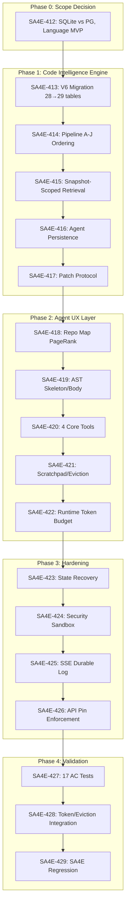

# Business Requirements Document (BRD)

## SA4E-411: [EPIC] Code Agent 16K — Deterministic Code Intelligence + Agent UX

---

## Document Information

| Field | Value |
|-------|-------|
| Jira Ticket | SA4E-411 |
| Title | [EPIC] Code Agent 16K — Deterministic Code Intelligence + Agent UX |
| Author | BA Agent |
| Version | 1.0 |
| Date | 2026-11-10 |
| Status | Complete — All 18 child stories implemented and In Review |

---

## Author Tracking

| Role | Name - Position | Responsibility |
|------|-----------------|----------------|
| Author | BA Agent – Business Analyst | Create epic BRD from Jira epic + 16K architecture doc + 18 child story evidence |
| Peer Reviewer | TA Agent – Technical Architect | Review for completeness and traceability |

---

## Revision History

| Version | Date | Author | Changes |
|---------|------|--------|---------|
| 1.0 | 2026-11-10 | BA Agent | Epic BRD rewritten per template: consolidated from Jira SA4E-411, `documents/architecture/16K_CODE_AGENT_ARCHITECTURE.md`, and all 18 child story STATUS.json files |

---

## Sign-Off

| Name | Signature and date |
|------|--------------------|
| | ☐ I agree and confirm all criteria on this BRD as expected requirements |
| | ☐ I agree and confirm all criteria on this BRD as expected requirements |

---

## 1. Introduction

### 1.1 Scope

This BRD documents the **Code Agent 16K** epic — a deterministic Code Intelligence engine + LLM agent UX layer built on top of existing SA4E F2 (Code Intelligence) and F4 (Context Assembly) capabilities, with new agent experience features (token budget, scratchpad/eviction, repo map, core tools, patch protocol, SSE, pinned-snapshot API).

The scope covers **four implementation phases (0–4)** decomposed into **18 child stories (SA4E-412..429)**:

| Phase | Goal | Child Stories |
|-------|------|---------------|
| **0** | Scope Decision: SQLite vs PostgreSQL, Language MVP | SA4E-412 |
| **1** | CR-01..06: Snapshot/Revision Data Model + Ordering + Retrieval + Persistence + Patch Hardening | SA4E-413, 414, 415, 416, 417 |
| **2** | Agent UX: PageRank Repo Map, AST Skeleton/Body, 4 Core Tools, Scratchpad/Eviction, Runtime Token Budget | SA4E-418, 419, 420, 421, 422 |
| **3** | Hardening: Agent State Recovery, Security Sandbox, SSE Durable Log, Pinned-Snapshot API | SA4E-423, 424, 425, 426 |
| **4** | Validation: 17 AC Acceptance Suite, Token/Eviction Integration, SA4E Regression | SA4E-427, 428, 429 |

### 1.2 Out of Scope

Per ADR-001 and architecture doc:
- Multi-repo centralized PostgreSQL engine (trigger: multi-team, cross-repo search, concurrent writers)
- New language grammar development (MVP reuses existing 17 Tier A + 7 Tier B grammars)
- Coding-agent autonomous mode (read-only Code Intelligence first; patch/approval gated)
- pgvector/HNSW ANN (exact cosine scan on SQLite per ADR-001)

### 1.3 Preliminary Requirement

- ADR-001 decision documented: Engine store = SQLite embedded per-workspace; PostgreSQL platform DB unchanged
- Language MVP confirmed: Java + TypeScript end-to-end; other languages syntax fallback only
- Existing F2 Code Intelligence (SQLite + Tree-sitter + FTS5 + graph + incremental indexing + WAL) is operational
- Existing F4 Context Assembly (`get_ai_context`/edit/curated + budget governance) is operational
- Context Budget Governance (`BudgetCalculator`/`ThresholdGate`/tiering/steering) available for wiring

---

## 2. Business Requirements

### 2.1 High Level Process Map

The Code Agent 16K operates in three layers:

```
┌─────────────────────────────────────────────────────────────────────┐
│                    AGENT UX LAYER (Phase 2–3)                       │
│  Repo Map (PageRank) → 4 Core Tools → Scratchpad/Eviction           │
│  Runtime Token Budget (real tokenizer) → SSE Durable Log            │
│  Agent State Recovery → Staged Patch → Pinned-Snapshot API          │
└─────────────────────────────────────────────────────────────────────┘
                              ↓ pins ↓ queries
┌─────────────────────────────────────────────────────────────────────┐
│              CODE INTELLIGENCE ENGINE (Phase 1)                     │
│  Snapshot/Revision Model → Dependency-Before-Semantic Ordering      │
│  Snapshot-Scoped Retrieval → Agent Persistence (plan/step/approval) │
│  Immutable Snapshots + Composite FK + Composite-FK Triggers         │
└─────────────────────────────────────────────────────────────────────┘
                              ↓ storage
┌─────────────────────────────────────────────────────────────────────┐
│                    SQLITE ENGINE STORE (ADR-001)                    │
│  .code-intel/index.db per workspace | WAL | Immutable file boundary │
└─────────────────────────────────────────────────────────────────────┘
```

**Business Flow (End-to-End):**

**Step 1:** Stakeholder defines scope (Phase 0) — SA4E-412 decides SQLite engine store + Java/TS MVP  
**Step 2:** Data model redesigned (Phase 1) — SA4E-413 creates V6 additive migration (28→29 tables) with composite FK ownership  
**Step 3:** Pipeline reordered (Phase 1) — SA4E-414 implements 10-stage dependency-before-semantic indexing (A→J)  
**Step 4:** Retrieval scoped to snapshot (Phase 1) — SA4E-415 enforces `index_snapshot_id` primary filter on all queries  
**Step 5:** Agent state persisted (Phase 1) — SA4E-416 stores plan/step/approval/transition for resume after restart  
**Step 6:** Patch protocol hardened (Phase 1) — SA4E-417 implements staged patch (stage→approve→apply) with stale-base revalidation  
**Step 7:** Repo Map built (Phase 2) — SA4E-418 creates dynamic PageRank graph packed to ~1,500 tokens  
**Step 8:** AST chunking implemented (Phase 2) — SA4E-419 separates skeleton (embed) from body (on-demand)  
**Step 9:** Core tools delivered (Phase 2) — SA4E-420 provides 4 tools with session pinning (search_symbols, get_file_skeleton, read_code_block, query_call_graph)  
**Step 10:** Scratchpad + Eviction (Phase 2) — SA4E-421 implements structured scratchpad + S_evict algorithm with tombstones  
**Step 11:** Runtime Token Budget (Phase 2) — SA4E-422 uses real llama.cpp tokenizer for exact token counting  
**Step 12:** State recovery hardened (Phase 3) — SA4E-423 enables `summarizeForResume()` from zero in-memory state  
**Step 13:** Security sandbox enforced (Phase 3) — SA4E-424 validates tool args, patch base hash, path traversal, network deny-by-default  
**Step 14:** SSE durable log (Phase 3) — SA4E-425 implements `Last-Event-ID` replay with gap detection  
**Step 15:** API pin enforcement (Phase 3) — SA4E-426 rejects requests missing `session_id` + `index_snapshot_id`  
**Step 16:** AC suite validates (Phase 4) — SA4E-427 executes 17 mandatory acceptance criteria tests  
**Step 17:** Integration tests run (Phase 4) — SA4E-428 verifies token/eviction tiers, escalation, role-scope, tool cap  
**Step 18:** Regression gate passes (Phase 4) — SA4E-429 ensures no SA4E functionality broke (SM pipeline, F12, enrichment, budget, F2, F4, role boundaries)

> **Note:** Each phase builds deterministically on the previous; no phase skips. All 18 stories independently verify via STATUS.json evidence and build/test gates.

---

### 2.2 List of User Stories / Use Cases

| # | Story / Use Case / Epic | Priority | Source Ticket |
|---|-------------------------|----------|---------------|
| 1 | **ES-01:** As a stakeholder, I need a clear scope decision: SQLite embedded (per-workspace) for engine store; PostgreSQL unchanged for platform DB | MUST HAVE | SA4E-412 |
| 2 | **ES-02:** As a developer, I want 28→29 table additive migration (V6) that creates snapshot/revision entities without touching legacy F2 tables | MUST HAVE | SA4E-413 |
| 3 | **ES-03:** As a code indexer, I want dependency-before-semantic pipeline ordering so semantic indexing runs on a prepared environment | MUST HAVE | SA4E-414 |
| 4 | **ES-04:** As a retrieval client, I want every query to require `index_snapshot_id` so results are provably from one immutable snapshot | MUST HAVE | SA4E-415 |
| 5 | **ES-05:** As an agent runtime, I want plan/step/approval/transition persistence so I can resume after restart | MUST HAVE | SA4E-416, 423 |
| 6 | **ES-06:** As an agent, I want a staged patch workflow: stage (validate) → approve → apply, with stale-base revalidation at apply | MUST HAVE | SA4E-417, 424 |
| 7 | **ES-07:** As an agent, I want a dynamic repository map (PageRank + AST graph) packed into ~1,500 tokens | MUST HAVE | SA4E-418 |
| 8 | **ES-08:** As an agent, I want AST skeleton/body chunking: skeleton for embed, body on demand | MUST HAVE | SA4E-419 |
| 9 | **ES-09:** As an agent, I want 4 core tools (search_symbols, get_file_skeleton, read_code_block, query_call_graph) with session pinning | MUST HAVE | SA4E-420 |
| 10 | **ES-10:** As an agent, I want a structured scratchpad + eviction algorithm (S_evict = Age×200 + Tokens – Referenced×1000) with tombstones | MUST HAVE | SA4E-421 |
| 11 | **ES-11:** As an agent, I want a runtime token calculator using the real model tokenizer (not estimates) | MUST HAVE | SA4E-422 |
| 12 | **ES-12:** As an agent, I want SSE durable event log with `Last-Event-ID` replay, no duplicates/no gaps | MUST HAVE | SA4E-425 |
| 13 | **ES-13:** As an API consumer, I want the server to reject any request missing both `session_id` and `index_snapshot_id` | MUST HAVE | SA4E-426 |
| 14 | **ES-14:** As a QA engineer, I want 17 mandatory acceptance criteria tests covering all §19 items | MUST HAVE | SA4E-427 |
| 15 | **ES-15:** As a QA engineer, I want token/eviction integration tests measuring real tiers, escalation order, role-scope reduction, tool schema cap | MUST HAVE | SA4E-428 |
| 16 | **ES-16:** As a SM, I want a regression gate ensuring no SA4E functionality broke (SM pipeline, F12, enrichment, context budget, F2, F4, role boundaries) | MUST HAVE | SA4E-429 |

---

### 2.3 Details of User Stories

---

#### Business Flow

The end-to-end business flow spans all four phases:

**Phase 0 — Scope Decision (SA4E-412):**  
Stakeholder confirms engine store = SQLite embedded per-workspace; PostgreSQL remains platform DB. Language MVP = Java + TypeScript end-to-end; other languages syntax fallback only. Output: ADR-001 document.

**Phase 1 — Code Intelligence Engine Foundation (SA4E-413..417):**  
**Step 1:** V6 additive migration creates 28 new tables (repository, commit, source_file_revision, code_index_snapshot, code_symbol, symbol_occurrence, symbol_relationship, code_chunk, embedding_set, chat_session, agent_run, agent_plan, agent_step, change_set, approval_request, agent_event, etc.) with composite FK triggers enforcing same-snapshot ownership.  
**Step 2:** 10-stage pipeline (A: repo discovery → B: file inventory → C: build config → D: syntax indexing → E: dependency resolution → F: semantic indexing → G: graph reconciliation → H: chunk/embedding → I: validation → J: atomic publication) executes with dependency-before-semantic ordering.  
**Step 3:** All retrieval operations require `index_snapshot_id` filter; hybrid retrieval (lexical BM25, vector exact cosine, graph, exact symbol) operates within single snapshot boundary.  
**Step 4:** Agent persistence stores plan (objective + acceptance criteria), steps (dependencies + attempts), state transitions, tool executions, and approval requests.  
**Step 5:** Patch protocol enforces staged workflow: `stage()` validates without applying; `applyAfterApproval()` re-validates base hash (stale-base rejection) and applies atomically.

**Phase 2 — Agent UX Layer (SA4E-418..422):**  
**Step 6:** Repo Map builds AST graph, computes personalized PageRank (query-matched files boosted), packs top-ranked symbols into ~1,500 tokens via binary search.  
**Step 7:** AST chunker emits skeleton (class/interface + signatures) for embedding; body stored separately for on-demand `read_code_block`. Embedding set decoupled from snapshot for model-swap without reparse.  
**Step 8:** Four core tools exposed with mandatory session pinning (`repository_id`, `commit_id`, `index_snapshot_id`): hybrid symbol search, file skeleton, bounded code block read, call graph query.  
**Step 9:** Scratchpad format enforced before every tool call (Goal, DeadEnds, Facts, Plan). Eviction algorithm S_evict = Age×200 + Tokens – Referenced×1000 evicts to tombstones preserving tool_call_id.  
**Step 10:** Runtime token budget calculated from actual model `n_ctx` + llama.cpp `/tokenize` endpoint; tier resolution (SYSTEM/CRITICAL/HIGH/MEDIUM/LOW) gates context assembly.

**Phase 3 — Hardening (SA4E-423..426):**  
**Step 11:** Agent state recovery implements `summarizeForResume()` reconstructing context from persisted plan/step/evidence with zero in-memory state.  
**Step 12:** Security sandbox validates tool args (Zod schema, no shell metachars/absolute paths/`..`/NUL), enforces staged patch base-hash revalidation, denies network by default with registry allowlist, runs rootless containers with resource limits.  
**Step 13:** SSE stream appends durable events before publish; `Last-Event-ID` replay detects gaps (throws SseGapError), guarantees no duplicates.  
**Step 14:** API guard `resolvePinnedContext(sessionId, indexSnapshotId)` returns 400 if missing, mismatched, or snapshot not READY.

**Phase 4 — Validation (SA4E-427..429):**  
**Step 15:** 17 AC tests execute: re-index same commit (AC-01), dual embedding models (AC-02), pinned commit chat (AC-03), rename tracking (AC-04), delete file query (AC-05), merge commit parents (AC-06), snapshot ownership DB-enforced (AC-07), vector isolation (AC-08), filtered exact cosine (AC-09), semantic re-run on dependency change (AC-10), dependency failure isolation (AC-11), agent restart resume (AC-12), patch stale-base rejection (AC-13), working tree unchanged pre-approval (AC-14), sandbox escape/network (AC-15), SSE replay (AC-16), real tokenizer budget (AC-17).  
**Step 16:** Token/eviction integration tests verify tier budgets, escalation order, role-scope reduction, tool schema token cap.  
**Step 17:** SA4E regression suite runs: `npm run build` + `npm test` green; backend 500 files/3825 passed; extension 443 files/3469 passed; role boundaries enforced.

---

#### STORY 1: ES-01 — Scope Decision: SQLite Engine Store + Language MVP

> As a stakeholder, I need a clear scope decision: SQLite embedded (per-workspace) for engine store; PostgreSQL unchanged for platform DB

**Requirement Details:**

1. Document architecture decision in ADR-001: engine store uses SQLite embedded per-workspace (`.code-intel/index.db`), NOT centralized PostgreSQL
2. PostgreSQL remains platform DB for multi-tenant metadata, job queues, user management
3. Language MVP scope: Java + TypeScript end-to-end (semantic indexing); 17 Tier A + 7 Tier B grammars available for syntax fallback
4. Multi-repo PostgreSQL/pgvector trigger documented explicitly: (a) multi-team collaboration, (b) cross-repo search, (c) concurrent writers
5. Coding-agent autonomous mode deferred: read-only Code Intelligence first; patch/approval gated

**Acceptance Criteria:**

1. ADR-001 document exists at `documents/SA4E-411/ADR-001-engine-storage-and-language-mvp.md`
2. Decision recorded: SQLite for engine store, PostgreSQL for platform
3. Language MVP list documented (Java, TypeScript primary; others syntax-only)
4. Trigger conditions for PostgreSQL engine migration explicitly stated

**Source:** SA4E-412 (done, commit f599de04)

---

#### STORY 2: ES-02 — Snapshot/Revision Data Model Redesign (V6 Migration)

> As a developer, I want 28→29 table additive migration (V6) that creates snapshot/revision entities without touching legacy F2 tables

**Requirement Details:**

1. Additive-only V6 migration creates 29 new tables without modifying existing 28 F2 tables
2. Repository/Commit tables: `repository`, `git_commit`, `git_commit_parent`, `git_ref`
3. Source revisions: `source_file_revision` with UNIQUE(commit_id, relative_path)
4. Snapshot & artifacts: `code_index_snapshot`, `code_module`, `code_symbol`, `symbol_occurrence`, `symbol_occurrence_resolution`, `symbol_relationship`, `relationship_evidence`, `code_chunk`, `code_chunk_fts` (FTS5), `dependency_resolution_snapshot`
5. Embedding: `embedding_set` (decoupled from snapshot for model-swap), `code_embedding`
6. Active pointer: `repository_ref_index_state` maps ref → active snapshot
7. Chat/Agent: `chat_session`, `agent_run`, `agent_plan`, `agent_step`, `agent_state_transition`, `agent_tool_execution`, `retrieval_evidence`, `agent_workspace`
8. Patch workflow: `change_set`, `approval_request`, `execution_run`
9. SSE events: `agent_event`
10. Composite FK triggers enforce same-snapshot ownership on all artifact tables
11. `project_id` on all 16K tables (V5 multi-tenant)
12. CHECK constraints: `start_line <= end_line`, offsets ≥ 0, `confidence ∈ [0,1]`, status enums
13. Dual-dialect: SQLite (`migration-v6.ts`) + PostgreSQL (`migration-v6-pg.ts`)

**Data Fields:**

| Field | Type | Required | Description | Example |
|-------|------|----------|-------------|---------|
| `code_index_snapshot.id` | TEXT | Yes | Immutable snapshot identifier (UUID) | `snap_abc123` |
| `code_index_snapshot.repository_id` | TEXT | Yes | Owning repository | `repo_xyz` |
| `code_index_snapshot.commit_id` | TEXT | Yes | Pinned git commit | `commit_def456` |
| `code_index_snapshot.config_fingerprint` | TEXT | Yes | Hash of adapter/toolchain config | `cfg_789` |
| `code_index_snapshot.status` | TEXT | Yes | PENDING/READY/FAILED | `READY` |
| `source_file_revision.content_hash` | TEXT | Yes | SHA-256 of file content | `sha256:...` |
| `code_symbol.parent_id` | TEXT | Yes | Parent symbol (class/interface) | `PaymentService` |
| `code_chunk.symbol_id` | TEXT | Yes | Owning symbol | `PaymentService#processTransaction` |
| `embedding_set.model_key` | TEXT | Yes | Embedding model identifier | `text-embedding-3-small` |

**Acceptance Criteria:**

1. V6 migration runs without errors on clean SQLite and PostgreSQL
2. All 29 tables created with correct columns, indexes, triggers
3. Composite FK triggers fire and reject cross-snapshot inserts
4. CHECK constraints enforce data integrity
5. Existing F2 tables (28) remain untouched and functional
6. Migration test passes (8 tests in `migration-v6.test.ts`)

**Source:** SA4E-413 (in-review, commit edb96c66)

---

#### STORY 3: ES-03 — Dependency-Before-Semantic Indexing Order

> As a code indexer, I want dependency-before-semantic pipeline ordering so semantic indexing runs on a prepared environment

**Requirement Details:**

1. 10-stage pipeline (A→J) executes in strict order:
   - A: Repo & revision discovery
   - B: File inventory & immutable revisions
   - C: Build/module config discovery
   - D: Syntax indexing (Tree-sitter)
   - E: Dependency & toolchain resolution
   - F: Semantic indexing (compiler/LSP)
   - G: Graph reconciliation
   - H: Chunk & embedding
   - I: Validation
   - J: Atomic publication
2. Syntax-level symbol extraction (D) runs before dependency resolution (E)
3. Semantic indexing (F) requires environment prepared by E
4. Per-language isolation: failure in one language resolver doesn't block others
5. Publish capability/coverage metadata even on partial failure
6. No retrieval blocking due to single language resolver failure

**Acceptance Criteria:**

1. Pipeline executes stages A→J in order (verified by `index-pipeline.order.test.ts`)
2. Stage E completes before Stage F starts for each language
3. Language isolation: TypeScript failure doesn't block Java indexing
4. Capability metadata published per language (SUPPORTED/PARTIAL/UNSUPPORTED/FAILED)
5. AC-10: Semantic re-run after dependency/classpath change (source unchanged)
6. AC-11: Dependency failure doesn't cascade to fake semantic coverage

**Source:** SA4E-414 (in-review, commit 0285134e)

---

#### STORY 4: ES-04 — Snapshot-Scoped Retrieval Implementation

> As a retrieval client, I want every query to require `index_snapshot_id` so results are provably from one immutable snapshot

**Requirement Details:**

1. All retrieval operations mandate `index_snapshot_id` as primary filter
2. Hybrid retrieval modes supported within snapshot boundary:
   - Exact symbol lookup (`symbolByName`)
   - Lexical search (BM25 via FTS5 on `code_chunk_fts`)
   - Vector search (exact cosine on SQLite per ADR-001; no ANN for MVP)
   - Graph query (CALLERS/CALLEES/IMPLEMENTATIONS with cycle guard, node cap)
3. Unresolved/approximate results retained but clearly marked
4. Direct evidence (proven) separated from inferred/heuristic evidence
5. Build/config + test discovery as first-class retrieval category
6. Ranking: exact definition/proven reference prioritized over text similarity for symbol questions
7. Embedding set filter: `embedding_set.index_snapshot_id = :index_snapshot_id` AND `embedding_set.model_key = :model_key`

**Data Fields (Retrieval Request):**

| Field | Type | Required | Description | Example |
|-------|------|----------|-------------|---------|
| `index_snapshot_id` | TEXT | Yes | Pinned snapshot (mandatory) | `snap_abc123` |
| `query` | TEXT | Yes | Search query | `processTransaction` |
| `limit` | INTEGER | Yes | Max results | 10 |
| `embedding_model_key` | TEXT | Conditional | Required for vector search | `text-embedding-3-small` |
| `direction` | ENUM | Conditional | CALLERS/CALLEES/IMPLEMENTATIONS | `CALLEES` |

**Acceptance Criteria:**

1. AC-07: Every symbol/occurrence/edge/chunk/embedding belongs to required snapshot (DB-enforced via composite FK)
2. AC-08: Vector query never returns chunk from different repo/snapshot
3. AC-09: Filtered exact cosine recall + result-count on multi-snapshot dataset
4. Snapshot-scoped retrieval service interface implemented (`SnapshotRetrievalService`)
5. All retrieval tests pass with snapshot isolation verified

**Source:** SA4E-415 (in-review, commit 6733271f)

---

#### STORY 5: ES-05 — Agent Plan/Step/Approval Persistence

> As an agent runtime, I want plan/step/approval/transition persistence so I can resume after restart

**Requirement Details:**

1. `agent_plan`: version, objective, acceptance_criteria, status
2. `agent_step`: step_id, dependency_ids, input/output refs (not payloads), attempts, status, timestamps
3. `agent_state_transition`: old_state, new_state, reason, timestamp
4. `approval_request`: action, scope, proposed_changeset, requested_user, decision, decision_time
5. `agent_tool_execution`: tool_name, args_ref, result_ref, duration, status
6. `retrieval_evidence`: evidence_ids linked to step
7. `agent_workspace`: workspace metadata
8. Durable event log (`agent_event`) appended before SSE publish (replay support)
9. Large payloads NOT copied into step JSON; only references stored

**Acceptance Criteria:**

1. AC-12: Resume agent after restart from plan/step persist (verified by `agent-state-recovery.test.ts` + AC-12)
2. Plan/step/transition/tool-execution/retrieval-evidence all persisted
3. `summarizeForResume()` reconstructs context from zero in-memory state (SA4E-423)
4. Approval requests tracked with decision timestamps

**Source:** SA4E-416 (in-review, commit 5c11b4f8), SA4E-423 (in-review, commit f5a2aa55)

---

#### STORY 6: ES-06 — Patch Protocol & Isolation Hardening

> As an agent, I want a staged patch workflow: stage (validate) → approve → apply, with stale-base revalidation at apply

**Requirement Details:**

1. Staged patch workflow:
   - `stage(patch)`: validates without applying → returns `{ changeSetId, approvalId }`
   - `applyAfterApproval(changeSetId, approvalId)`: re-validates base hash, applies atomically
2. Patch validation at stage AND apply:
   - Base revision hash matches current workspace (stale-base rejection)
   - Target path within workspace (no escape, no `..`, symlink check)
   - Patch size limits enforced
   - Workspace ownership verified
3. Atomic apply: original working tree unchanged before approval (AC-14)
3. Sandbox enforcement:
   - Tool args: Zod schema validation, reject shell metachars, absolute paths, `..`, NUL
   - Fixed executable with structured arg vector (`--` separator)
   - Network deny-by-default; registry allowlist exact host match
   - Container: rootless, non-root, capability/mount/process/memory/CPU/disk limits

**Acceptance Criteria:**

1. AC-13: Patch rejects stale base hash or path traversal
2. AC-14: Original working tree unchanged before approval
3. AC-15: Sandbox: no workspace escape, no unrestricted network
4. Staged patch protocol interface implemented (`PatchProtocol`)
5. All sandbox/patch tests pass (SA4E-417, 424)

**Source:** SA4E-417 (in-review, commit b94cb915), SA4E-424 (in-review, commit 6514c9fc)

---

#### STORY 7: ES-07 — Dynamic Repository Map (PageRank + AST Graph)

> As an agent, I want a dynamic repository map (PageRank + AST graph) packed into ~1,500 tokens

**Requirement Details:**

1. Build AST symbol graph across repository
2. Personalized PageRank (alpha=0.85):
   - Personalization vector: query-matched files = 100/len_matched, others = 1/N
   - Edge weight: `W(A→B, s) = Multiplier(s) × √freq(A,s) × ln(N/(df(s)+1))`
   - Multiplier: ×10 if in query; ×2 if CamelCase/snake_case len≥8; ×0.2 if in `test/`
3. Binary-search packing to fit ~1,500 token budget
4. Compact DSL output format:
   ```
   [REPOSITORY_MAP (Ranked by PageRank relevance)]
   src/config/SecurityConfig.java: 18-64: public class SecurityConfig
   src/controller/PaymentController.java: 15-95: @RestController public class PaymentController
   ```

**Acceptance Criteria:**

1. Repo map generated per query with personalized PageRank
2. Output packed to ≤1,500 tokens via binary search
3. DSL format matches specification
4. PageRank scores reflect query personalization

**Source:** SA4E-418 (in-review, commit cc2ecf06)

---

#### STORY 8: ES-08 — AST Skeleton/Body Chunking & Embedding Strategy

> As an agent, I want AST skeleton/body chunking: skeleton for embed, body on demand

**Requirement Details:**

1. AST chunker produces `ASTCodeChunk` with:
   - Skeleton: class/interface + fields + signatures (no body)
   - Body: full method source + metadata + dependency graph
   - External libs: only `.d.ts`/header/interface signatures extracted
2. Embedding input: ONLY `[fp] + [sig] + [doc] + [deps.calls]` concatenated (NOT body)
3. Embedding set decoupled from snapshot: `embedding_set` references `code_index_snapshot_id` + `model_key`; `code_embedding` links to `embedding_set_id` + `chunk_id`
4. Model swap without reparse: new `embedding_set` created for different model

**Data Fields (ASTCodeChunk):**

| Field | Type | Description | Example |
|-------|------|-------------|---------|
| `id` | STRING | Symbol identifier | `PaymentService#processTransaction` |
| `fp` | STRING | Relative file path | `src/service/PaymentService.java` |
| `type` | ENUM | CLASS/INTERFACE/METHOD/FUNCTION | `METHOD` |
| `name` | STRING | Symbol name | `processTransaction` |
| `parent_id` | STRING | Parent symbol | `PaymentService` |
| `rng` | [INT,INT] | Line range [start, end] | [45, 92] |
| `sig` | STRING | Full signature | `@Transactional public Receipt processTransaction(OrderDto order)` |
| `doc` | STRING | Documentation/comment | `Thực hiện trừ tiền...` |
| `skeleton` | STRING | Class skeleton | `class PaymentService { ... }` |
| `body` | STRING | Full method body | `public Receipt processTransaction(...) { ... }` |
| `deps.imports` | STRING[] | Import statements | `["com.app.dto.OrderDto"]` |
| `deps.calls` | STRING[] | Called symbols | `["Validator#validate", "StripeClient#charge"]` |
| `tokens.sig_tokens` | INT | Signature token count | 14 |
| `tokens.body_tokens` | INT | Body token count | 420 |

**Acceptance Criteria:**

1. AC-02: Support 2 embedding models for same snapshot without mixing vectors
2. Skeleton embedded; body stored for on-demand retrieval
3. External library signatures extracted without full source
4. Embedding pipeline creates separate `embedding_set` per model

**Source:** SA4E-419 (in-review, commit 7b95a52f)

---

#### STORY 9: ES-09 — 4 Core Agent Tools with Session Pinning

> As an agent, I want 4 core tools (search_symbols, get_file_skeleton, read_code_block, query_call_graph) with session pinning

**Requirement Details:**

1. All tools require mandatory session pinning: `repository_id`, `commit_id`, `index_snapshot_id`
2. Tool contracts:

| Tool | Input | Output | Session Pin Required |
|------|-------|--------|---------------------|
| `search_symbols` | `q, kind?, path_filter?, limit?` | `resultId, summary, snippets[], evidenceIds[], truncated, cursor?` | YES |
| `get_file_skeleton` | `fp` | Class/interface structure, signatures (no body) | YES |
| `read_code_block` | `fp, start_line, end_line` | Code lines (max 120 lines) | YES |
| `query_call_graph` | `symbol_id, direction: CALLERS|CALLEES|IMPLEMENTATIONS` | Call graph results | YES |

3. Output format: compact DSL (not raw JSON)
   ```
   [FOUND 3 SYMBOLS | BUDGET_USED: 82 tokens]
   1. [METHOD] PaymentService#processTransaction | src/service/PaymentService.java:45-92 (body: 420 tok)
      Sig: @Transactional public Receipt processTransaction(OrderDto order)
   ```
4. Tools registered in agent context (MCP `tools/list` registration deferred to e2e)

**Acceptance Criteria:**

1. All 4 tools implemented with correct input/output schemas
2. Session pinning enforced — tools reject requests without valid pinned context
3. Tool output DSL format matches specification
4. Budget tracking included in output (`BUDGET_USED`)
5. 7 core tool tests pass

**Source:** SA4E-420 (in-review, commit 34b7c8dd)

---

#### STORY 10: ES-10 — Scratchpad Format & Context Eviction Algorithm

> As an agent, I want a structured scratchpad + eviction algorithm (S_evict = Age×200 + Tokens – Referenced×1000) with tombstones

**Requirement Details:**

1. Scratchpad format MANDATORY before every tool call:
   ```xml
   <scratchpad>
   - Goal: [1-sentence objective]
   - DeadEnds: [file:lines -> brief reason not relevant]
   - Facts: [file:lines -> critical logic/bug + 1-3 code lines]
   - Plan: [next tool call + reason]
   </scratchpad>
   ```
2. Eviction priority score: `S_evict = (Age_in_Turns × 200) + Token_Count - (Is_Referenced_In_Last_Thought × 1000)`
3. Evicted entries become tombstones at same position: `content = "[evicted tool_call_id=<id>]"`
4. Evidence IDs explicitly referenced in scratchpad are IMMUNE from eviction
5. Code currently in use NOT evicted
6. Batch eviction triggered at ~75% budget threshold

**Acceptance Criteria:**

1. Scratchpad format enforced before each tool call
2. S_evict formula correctly implemented
3. Tombstones preserve `tool_call_id` for traceability
4. Referenced evidence immune from eviction
5. Integration tests pass: 13 backend + 9 extension token/eviction tests (SA4E-428)

**Source:** SA4E-421 (in-review, commit cd7d6dc4), SA4E-428 (in-review, commit 7976e7af)

---

#### STORY 11: ES-11 — Token Budget Runtime Calculator (Real Tokenizer)

> As an agent, I want a runtime token calculator using the real model tokenizer (not estimates)

**Requirement Details:**

1. Runtime formula:
   ```
   available_input_tokens = model_context_limit - max_output_tokens - safety_margin
   subtract: system_prompt + tool_definitions + summary/history + current_user_message + framing + tool_results_must_remain
   evidence_budget = available after all above
   ```
2. Real tokenizer: llama.cpp `/tokenize` endpoint (injected `fetchFn` for testability)
3. No fixed token tables — budget derived from actual model `n_ctx`
4. Tier resolution: SYSTEM → CRITICAL → HIGH → MEDIUM → LOW (escalation order)
5. Role-scope reduction and tool schema token cap enforced
6. tiktoken plug-in for non-llama.cpp providers deferred

**Acceptance Criteria:**

1. AC-17: Real tokenizer prompt/tool counting under runtime budget
2. Budget calculation uses actual model `n_ctx` + tokenizer
3. Tier escalation order verified (SYSTEM→CRITICAL→HIGH→MEDIUM→LOW)
4. Role-scope reduction and tool schema cap tested
5. Extension acceptance test `acceptance-ac17.test.ts` passes

**Source:** SA4E-422 (in-review, commit 2bd396fb), SA4E-428 (in-review, commit 7976e7af)

---

#### STORY 12: ES-12 — SSE Durable Event Log & Replay

> As an agent, I want SSE durable event log with `Last-Event-ID` replay, no duplicates/no gaps

**Requirement Details:**

1. `agent_event` table stores all events durably before SSE publish
2. `SSEStream` interface:
   - `append(event)`: returns `event_id` (monotonic)
   - `replay(lastEventId)`: `AsyncIterable<AgentEvent>`
   - Throws `SseGapError` if gap detected (missing event IDs)
3. Replay guarantees: no duplicates, no gaps, ordered by `event_id`
4. Disconnect/replay tested: client reconnects with `Last-Event-ID`, receives missed events

**Acceptance Criteria:**

1. AC-16: SSE reconnect + replay → no duplicate/missing events
2. Durable event log persisted before SSE publish
3. Gap detection throws `SseGapError`
4. 7 SSE stream tests pass + AC-16 verified with disconnect/replay

**Source:** SA4E-425 (in-review, commit ae5aa60e)

---

#### STORY 13: ES-13 — API Pinned index_snapshot_id Enforcement

> As an API consumer, I want the server to reject any request missing both `session_id` and `index_snapshot_id`

**Requirement Details:**

1. `resolvePinnedContext(sessionId, indexSnapshotId)` guard on all chat/search API endpoints
2. Returns 400 if:
   - `session_id` missing
   - `index_snapshot_id` missing
   - Mismatch: `chat_session.pinned_code_index_snapshot_id ≠ indexSnapshotId`
   - Snapshot status ≠ READY
3. Chat session binds to `pinned_code_index_snapshot_id` at creation; branch head shifts don't affect pinned session

**Acceptance Criteria:**

1. AC-03: Chat pinned to old commit still queries after branch moves
2. API rejects requests without both identifiers
3. Mismatch detection returns 400 with clear error
4. 5 pinned-snapshot-guard tests pass

**Source:** SA4E-426 (in-review, commit 17a819f3)

---

#### STORY 14: ES-14 — 17 Acceptance Criteria Test Suite

> As a QA engineer, I want 17 mandatory acceptance criteria tests covering all §19 items

**Requirement Details:**

1. 17 AC tests implemented as automated test suite:
   - Backend: 16 tests across 3 test files (`acceptance-ac01-08.test.ts`, `acceptance-ac09-12.test.ts`, `acceptance-ac13-16.test.ts`)
   - Extension: 1 test (`acceptance-ac17.test.ts`)
2. Shared test fixture for consistent setup
3. AC coverage mapping:

| AC | Criterion | Test File |
|----|-----------|-----------|
| AC-01 | Re-index same commit with new adapter doesn't corrupt old snapshot | ac01-08 |
| AC-02 | Support 2 embedding models for same snapshot without mixing vectors | ac01-08 |
| AC-03 | Chat pinned to old commit still queries after branch moves | ac01-08 |
| AC-04 | Rename file: both old & new paths correct at respective commits | ac01-08 |
| AC-05 | Delete file: queryable at old commit, not at new | ac01-08 |
| AC-06 | Index merge commit with multiple parents | ac01-08 |
| AC-07 | Every artifact belongs to required snapshot (DB-enforced) | ac01-08 |
| AC-08 | Vector query never returns chunk from different repo/snapshot | ac01-08 |
| AC-09 | Filtered ANN recall + result-count on multi-snapshot dataset | ac09-12 |
| AC-10 | Semantic re-run after dependency/classpath change | ac09-12 |
| AC-11 | Dependency failure doesn't cascade to fake semantic coverage | ac09-12 |
| AC-12 | Resume agent after restart from plan/step persist | ac09-12 |
| AC-13 | Patch rejects stale base hash or path traversal | ac13-16 |
| AC-14 | Original working tree unchanged before approval | ac13-16 |
| AC-15 | Sandbox: no workspace escape, no unrestricted network | ac13-16 |
| AC-16 | SSE reconnect + replay → no duplicate/missing events | ac13-16 |
| AC-17 | Real tokenizer prompt/tool counting under runtime budget | ac17 (ext) |

**Acceptance Criteria:**

1. All 17 AC tests pass (`npm run test:ac` exit 0)
2. AC suite completes < 10s (measured 1.6–1.7s backend + ~0.5s extension)
3. Single AC test < 2s (max measured 71ms for AC-01 pipeline)

**Source:** SA4E-427 (in-review, commit 4a74a11f)

---

#### STORY 15: ES-15 — Token/Eviction Integration Tests

> As a QA engineer, I want token/eviction integration tests measuring real tiers, escalation order, role-scope reduction, tool schema cap

**Requirement Details:**

1. Backend integration tests: 13 tests in `token-eviction.integration.test.ts`
2. Extension integration tests: 9 tests in `token-eviction.integration.test.ts`
3. Coverage:
   - Tier budgets (SYSTEM/CRITICAL/HIGH/MEDIUM/LOW) with real token counts
   - Escalation order verification
   - Role-scope reduction under budget pressure
   - Tool schema token cap enforcement

**Acceptance Criteria:**

1. `npm run test:token` exit 0 (backend 1 + ext 1 integration test files)
2. Real tier budgets measured and verified
3. Escalation order: SYSTEM→CRITICAL→HIGH→MEDIUM→LOW confirmed
4. Role-scope reduction triggers at budget thresholds
5. Tool schema token cap enforced

**Source:** SA4E-428 (in-review, commit 7976e7af)

---

#### STORY 16: ES-16 — SA4E Regression Test Suite

> As a SM, I want a regression gate ensuring no SA4E functionality broke (SM pipeline, F12, enrichment, context budget, F2, F4, role boundaries)

**Requirement Details:**

1. Backend regression tests: 3 files, 11 files, 63 tests
2. Extension regression tests: 9 files, 20 files, 155 tests
3. Coverage areas:
   - SM full pipeline (orchestration, agent coordination)
   - F12 (feature)
   - Enrichment pipeline
   - Context budget governance (`BudgetCalculator`/`ThresholdGate`/tiering/steering)
   - F2 Code Intelligence (indexer, retrieval, graph)
   - F4 Context Assembly (`get_ai_context`/edit/curated)
   - Role boundaries (9-agent matrix enforcement)
4. Composed gate runs all regression tests

**Acceptance Criteria:**

1. AC-18: `npm run build` exit 0 + `npm test` exit 0
2. Backend: 500 files / 3825 passed / 19 skipped
3. Extension: 443 files / 3469 passed / 6 skipped
4. `npm run test:regression` exit 0
5. No role boundary violations detected
6. All existing SA4E functionality preserved

**Source:** SA4E-429 (in-review, commit 04f1f077)

---

---

## 3. Dependencies

| Dependency | Type | Related Ticket | Description |
|------------|------|----------------|-------------|
| ADR-001 | Architecture Decision | SA4E-412 | Engine store = SQLite embedded per-workspace; PostgreSQL platform DB unchanged |
| `documents/architecture/16K_CODE_AGENT_ARCHITECTURE.md` | Architecture | SA4E-411 | 394-line authoritative spec (Phases 0–4, 17 ACs, integration points) |
| F2 Code Intelligence | Existing Capability | SA4E-413,414,418,419 | SQLite + Tree-sitter + FTS5 + graph + incremental hashing + WAL (reuse, not rewrite) |
| F4 Context Assembly | Existing Capability | SA4E-415,420,429 | `get_ai_context`/edit/curated + budget governance (wire, don't rewrite) |
| Context Budget Governance | Existing Capability | SA4E-422,428 | `BudgetCalculator`/`ThresholdGate`/tiering/steering (wire `DefaultResourceLoader`) |
| SA4E-335 Docker Volume Protection | Guardrail | All | No `docker compose down -v` on prod stack; test stack separate |

---

## 4. Stakeholders

| Role | Name / Team | Responsibility | Source |
|------|-------------|----------------|--------|
| Product Owner | PG Owner (Stakeholder) | Scope decisions (SQLite vs PG, language MVP) — decided in SA4E-412 | Epic assignee |
| Architecture | SA Agent | TDD-01 data model, ADR-001, integration design | TDD author |
| Development | Dev Agent | Implementation of all 18 stories | Dev commits on 18 stories |
| Quality | QA Agent | SA4E-427 AC suite (17 criteria), SA4E-428 integration, SA4E-429 regression | QA test files |
| DevOps | DevOps Agent | CI/CD gates (`test:ac`, `test:token`, `test:regression`), Docker volume protection | SA4E-335 |
| Security | Security Agent | Sandbox/patch validation review (SA4E-424, 426) | Security review |

---

## 5. Risks and Assumptions

### 5.1 Risks

| Risk | Impact | Likelihood | Mitigation |
|------|--------|------------|------------|
| Multi-repo scaling trigger not met but code assumes it | Medium | Low | ADR-001 documents explicit trigger conditions (3 conditions) |
| ANNs needed but SQLite exact scan too slow | Medium | Low | ADR-001 accepts exact scan for MVP; HNSW/pgvector path kept open |
| Agent tools not registered in MCP `tools/list` (deferred) | Low | Medium | SA4E-420 AC notes deferred to e2e; tracked in STATUS.json |
| tiktoken plug-in for non-llama.cpp providers | Low | Medium | Deferred; current impl uses llama.cpp `/tokenize` contract |
| AC-09 exact SQLite cosine vs future ANN | Low | Low | Filter-first contract preserved; test remains recall oracle |

### 5.2 Assumptions

- SQLite WAL + embedded library provides durability + local-first + offline capability
- 17 Tier A languages already have Tree-sitter grammars working in F2
- Existing F2 indexer tests (3,500+) serve as regression baseline
- All 18 child stories independently verify via their STATUS.json evidence
- Build/test gates (`npm run build`, `npm test`, `test:ac`, `test:token`, `test:regression`) are the ultimate verification

---

## 6. Non-Functional Requirements

| Category | Requirement | Details |
|----------|-------------|---------|
| Performance | AC suite < 10s | Measured 1.6–1.7s backend + ~0.5s extension |
| Performance | Single AC test < 2s | Max measured 71ms (AC-01 pipeline) |
| Security | Tool args have schema; no shell concat | SA4E-424 sandbox + patch validation |
| Security | Patch validates base hash + path traversal | SA4E-424/427 AC-13/14 |
| Reliability | SSE replay no duplicates/no gaps | SA4E-425/427 AC-16 verified with disconnect/replay |
| Reliability | Agent resume from zero in-memory state | SA4E-423/427 AC-12 verified |
| Compatibility | `tsc --noEmit` clean; vitest green | All 18 stories verify |
| Usability | Session pinning mandatory; no implicit branch-head shift | SA4E-426 API enforcement |

---

## 7. Related Tickets (Child Stories)

| Ticket | Title | Phase | Status | Commit |
|--------|-------|-------|--------|--------|
| SA4E-412 | [Phase 0] Scope Decision: SQLite vs PostgreSQL, Language MVP | 0 | done | f599de04 |
| SA4E-413 | [Phase 1] CR-01..06: Snapshot/Revision Data Model Redesign | 1 | in-review | edb96c66 |
| SA4E-414 | [Phase 1] CR-01..06: Dependency-Before-Semantic Indexing Order | 1 | in-review | 0285134e |
| SA4E-415 | [Phase 1] CR-01..06: Snapshot-Scoped Retrieval Implementation | 1 | in-review | 6733271f |
| SA4E-416 | [Phase 1] CR-01..06: Agent Plan/Step/Approval Persistence | 1 | in-review | 5c11b4f8 |
| SA4E-417 | [Phase 1] CR-01..06: Patch Protocol & Isolation Hardening | 1 | in-review | b94cb915 |
| SA4E-418 | [Phase 2] Dynamic Repository Map (PageRank + AST Graph) | 2 | in-review | cc2ecf06 |
| SA4E-419 | [Phase 2] AST Skeleton/Body Chunking & Embedding Strategy | 2 | in-review | 7b95a52f |
| SA4E-420 | [Phase 2] 4 Core Agent Tools | 2 | in-review | 34b7c8dd |
| SA4E-421 | [Phase 2] Scratchpad Format & Context Eviction Algorithm | 2 | in-review | cd7d6dc4 |
| SA4E-422 | [Phase 2] Token Budget Runtime Calculator (Real Tokenizer) | 2 | in-review | 2bd396fb |
| SA4E-423 | [Phase 3] Agent State Persistence Hardening | 3 | in-review | f5a2aa55 |
| SA4E-424 | [Phase 3] Security Sandbox & Patch Validation | 3 | in-review | 6514c9fc |
| SA4E-425 | [Phase 3] SSE Durable Event Log & Replay | 3 | in-review | ae5aa60e |
| SA4E-426 | [Phase 3] API Pinned index_snapshot_id Enforcement | 3 | in-review | 17a819f3 |
| SA4E-427 | [Phase 4] 17 Acceptance Criteria Test Suite | 4 | in-review | 4a74a11f |
| SA4E-428 | [Phase 4] Token/Eviction Integration Tests | 4 | in-review | 7976e7af |
| SA4E-429 | [Phase 4] SA4E Regression Test Suite | 4 | in-review | 04f1f077 |

---

## 8. Appendix

### 8.1 Reference Documents

| Document | Location |
|----------|----------|
| 16K Code Agent Architecture (authoritative) | `documents/architecture/16K_CODE_AGENT_ARCHITECTURE.md` |
| ADR-001 Engine Storage & Language MVP | `documents/SA4E-411/ADR-001-engine-storage-and-language-mvp.md` |
| TDD-01 Data Model (Snapshot/Revision) | `documents/SA4E-411/TDD-01-data-model.md` |
| TDD Consolidated | `documents/SA4E-411/TDD.md` |
| FSD (epic) | `documents/SA4E-411/FSD.md` |
| SA4E-427 Acceptance Matrix | `documents/SA4E-427/ACCEPTANCE-MATRIX.md` |
| SA4E-427 Performance Baselines | `documents/SA4E-427/PERF-BASELINES.md` |
| SA4E-429 Regression Evidence | `documents/SA4E-429/STATUS.json` |

### 8.2 Diagram Index

| # | Diagram | Image | Source (editable) |
|---|---------|-------|-------------------|
| 1 | Business Flow (Phase 0–4 Stakeholder Swimlanes) | `business-flow.png` | `business-flow.drawio` |
| 2 | Use Case (16 Epic Stories + External Systems) | `use-case.png` | `use-case.drawio` |
| 3 | Architecture Overview (4-layer) | `architecture-overview.png` | `architecture-overview.drawio` |
| 4 | Snapshot/Revision ER Diagram | `snapshot-revision-er.png` | `snapshot-revision-er.drawio` |
| 5 | Pipeline Ordering (A–J) | `pipeline-ordering.png` | `pipeline-ordering.drawio` |
| 6 | Agent UX Token Budget | `token-budget.png` | `token-budget.drawio` |
| 7 | Scratchpad & Eviction | `scratchpad-eviction.png` | `scratchpad-eviction.drawio` |

*All diagrams stored in `documents/SA4E-411/diagrams/`. Source `.drawio` files are the editable format; `.png` files are rendered exports (re-export from `.drawio` if needed).*

### 8.3 Glossary

| Term | Definition |
|------|------------|
| Immutable Snapshot | An index generation that is never mutated; identified by `code_index_snapshot.id` |
| Composite FK | Foreign key referencing `(id, snapshot_id)` pair to enforce same-snapshot ownership |
| PageRank Repo Map | Dynamic relevance graph over AST symbols, personalized by query, packed to token budget |
| Scratchpad | Structured agent working memory (Goal, DeadEnds, Facts, Plan) emitted before each tool call |
| Tombstone | Evicted scratchpad entry preserving `tool_call_id` with content = `[evicted tool_call_id=<id>]` |
| S_evict | Eviction priority score = Age_in_Turns × 200 + Token_Count – Is_Referenced × 1000 |
| Runtime Token Budget | Token limit computed from actual model `n_ctx` + tokenizer count, not fixed table |
| Staged Patch | Two-phase workflow: `stage()` validates without applying; `applyAfterApproval()` only on APPROVED |
| Pinned Snapshot | Chat session binds to `pinned_code_index_snapshot_id`; API rejects mismatched requests |

---

## Mermaid Diagrams (Inline)

### High-Level Process Map (Flowchart)



### Epic Stories Use Case Overview

```mermaid
graph TB
    subgraph Stakeholders
        PO[Product Owner]
        SA[Solution Architect]
        DEV[Developer]
        QA[QA Engineer]
        DO[DevOps]
        SEC[Security]
    end
    
    subgraph Epic_Stories[16 Epic Stories]
        ES1[ES-01: Scope Decision]
        ES2[ES-02: V6 Data Model]
        ES3[ES-03: Pipeline Ordering]
        ES4[ES-04: Snapshot Retrieval]
        ES5[ES-05: Agent Persistence]
        ES6[ES-06: Patch Protocol]
        ES7[ES-07: Repo Map PageRank]
        ES8[ES-08: AST Skeleton/Body]
        ES9[ES-09: 4 Core Tools]
        ES10[ES-10: Scratchpad/Eviction]
        ES11[ES-11: Runtime Token Budget]
        ES12[ES-12: SSE Durable Log]
        ES13[ES-13: API Pin Enforcement]
        ES14[ES-14: 17 AC Suite]
        ES15[ES-15: Token/Eviction Tests]
        ES16[ES-16: SA4E Regression]
    end
    
    subgraph External_Systems[External Systems]
        SQLite[(SQLite Engine Store)]
        PG[(PostgreSQL Platform DB)]
        LlamaCpp[llama.cpp /tokenize]
        VSCode[VS Code Extension Host]
    end
    
    PO --> ES1
    SA --> ES2 & ES3 & ES4
    DEV --> ES5 & ES6 & ES7 & ES8 & ES9 & ES10 & ES11
    QA --> ES14 & ES15 & ES16
    DO --> ES16
    SEC --> ES6 & ES12 & ES13
    
    ES2 --> SQLite
    ES4 --> SQLite
    ES11 --> LlamaCpp
    ES9 --> VSCode
    ES12 --> VSCode
```



---

**Document End**