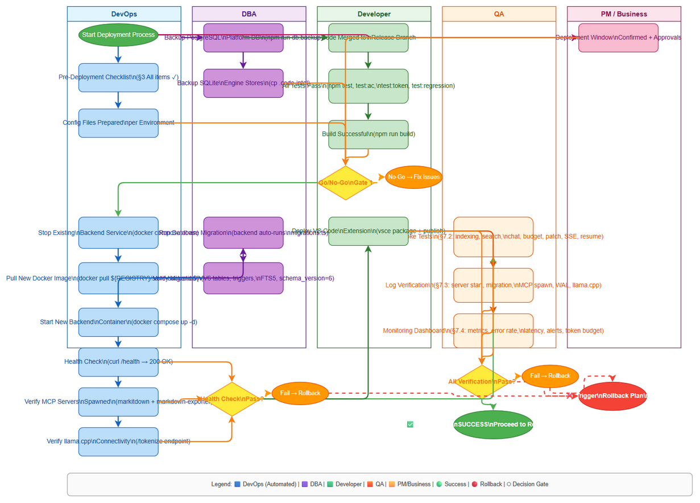
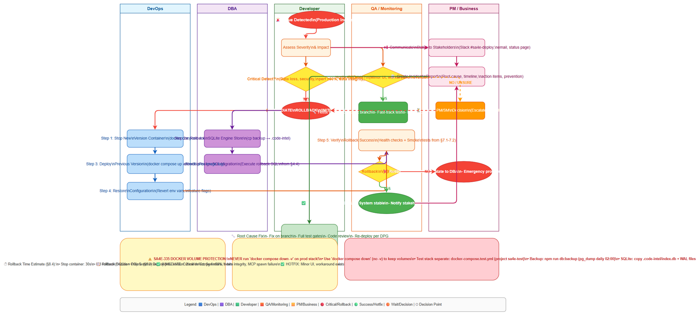

# Deployment Guide (DPG)

## SA4E-411 — [EPIC] Code Agent 16K — Deterministic Code Intelligence + Agent UX

---

## Document Information

| Field | Value |
|-------|-------|
| Jira Ticket | SA4E-411 |
| Title | [EPIC] Code Agent 16K — Deterministic Code Intelligence + Agent UX |
| Author | DevOps Agent |
| Version | 1.0 |
| Date | 2026-11-10 |
| Status | Draft |
| Related TDD | TDD-v2.0-SA4E-411.docx |

---

## Revision History

| Version | Date | Author | Changes |
|---------|------|--------|---------|
| 1.0 | 2026-11-10 | DevOps Agent | Initiate document — auto-generated from TDD and project context |

---

## Sign-Off

| Name | Role | Signature and date |
|------|------|--------------------|
| | Dev Lead | ☐ Approved for deployment |
| | QA Lead | ☐ Testing completed |
| | Ops Lead | ☐ Infrastructure ready |

---

## 1. Overview

### 1.1 Feature Summary

This epic delivers the **Code Agent 16K** — a deterministic Code Intelligence engine and LLM Agent UX layer built on top of existing SA4E F2 (Code Intelligence) and F4 (Context Assembly) capabilities. The implementation spans four phases across 18 child stories (SA4E-412..429):

- **Phase 0**: Scope Decision — SQLite embedded per-workspace engine store; PostgreSQL platform DB unchanged; 17 Tier A + 7 Tier B language grammars
- **Phase 1**: CR-01..06 — V6 additive migration (28→29 tables), 10-stage dependency-before-semantic pipeline, snapshot-scoped retrieval, agent persistence, staged patch protocol
- **Phase 2**: Agent UX — PageRank Repository Map, AST skeleton/body chunking, 4 core tools with session pinning, structured scratchpad with S_evict eviction, runtime token budget with real llama.cpp tokenizer
- **Phase 3**: Hardening — Agent state recovery (summarizeForResume), security sandbox (Zod validation, path traversal, network deny-by-default, rootless containers), SSE durable log with Last-Event-ID replay, API pinned-snapshot enforcement
- **Phase 4**: Validation — 17 AC acceptance suite, token/eviction integration tests, SA4E regression gate (SM pipeline, F12, enrichment, context budget, F2, F4, role boundaries)

### 1.2 Deployment Scope

| Item | Type | Description |
|------|------|-------------|
| Backend Service | Modified | Node.js 22.23.4 Hono/MCP server with 18 new modules (migration-v6, index-pipeline, snapshot-retrieval, agent-persistence, patch-protocol, repo-map, core-tools, scratchpad, token-budget, agent-state-recovery, sandbox, SSE, API-guard) |
| VS Code Extension | Modified | Extension host integration for agent tools, chat, SSE stream, budget gate, steering loader |
| SQLite Engine Store | New | `.code-intel/index.db` per workspace (WAL mode, immutable snapshot files) — embedded better-sqlite3/sqlite-wasm |
| Database Migration | New | V6 dual-dialect migration (SQLite + PostgreSQL) — 29 new tables with composite FK triggers |
| PostgreSQL Platform DB | Unchanged | Existing multi-tenant platform DB — no schema changes for engine store |
| MCP Child Servers | New | markitdown-mcp (0.0.1a7) and markdown-exporter-mcp-local (GitHub source) built as isolated Python venvs |
| llama.cpp | External Dependency | Runtime tokenizer endpoint (/tokenize) — injected via fetchFn for testability |
| Test Gates | New | CI/CD gates: `npm run test:ac`, `npm run test:token`, `npm run test:regression` |

### 1.3 Target Environments

| Environment | URL | Deploy Order | Approval Required |
|-------------|-----|-------------|-------------------|
| DEV | http://localhost:48721 | 1st | No |
| SIT | http://sit.sa4e.internal:48721 | 2nd | No |
| UAT | http://uat.sa4e.internal:48721 | 3rd | QA Sign-off |
| PROD | https://api.sa4e.enterprise:48721 | 4th | PM + Business Sign-off |

---

## 2. Prerequisites

### 2.1 Infrastructure

| Requirement | Status | Notes |
|-------------|--------|-------|
| Node.js 22.23.4 runtime | Ready | Pinned by digest in Dockerfile (sha256:de170b39439eb0e5a3444ad7d60b015614a381e10fecae2e30ec9e735122f38d) |
| PostgreSQL 15+ (platform DB) | Ready | Existing sa4e-postgres (DEV/Prod), pg_dump backup 02:00 daily |
| Docker Engine 24+ | Ready | Multi-stage Dockerfile (7 stages: base, deps, build, mcp-python, production, development, test) |
| llama.cpp server | Required | Must expose /tokenize endpoint; URL injected via `LLAMA_CPP_URL` env var |
| VS Code Extension Host | Required | For extension deployment; MCP stdio transport |
| Workspace storage | Ready | `.code-intel/` directory per workspace (SQLite index.db + WAL) |
| Network access | Ready | Backend port 48721; llama.cpp port; PostgreSQL 5432 |

### 2.2 Software Dependencies

| Dependency | Version | Status |
|-----------|---------|--------|
| Node.js | 22.23.4 | Pinned by digest |
| TypeScript | 5.5.0 | Compiled to dist/ |
| better-sqlite3 / @sqlite.org/sqlite-wasm | 3.53.0-build1 | Embedded in backend |
| PostgreSQL (pg) | 8.23.0 | Platform DB client |
| @modelcontextprotocol/sdk | 1.32.1 | MCP server framework |
| hono | 4.13.14 | HTTP framework |
| llama.cpp | Latest compatible | External service for /tokenize |
| Python 3.11+ | For MCP child servers | markitdown-mcp, markdown-exporter-mcp-local |
| vitest | 4.1.9 | Test runner |

### 2.3 Access Requirements

| Access | Type | Who Needs It |
|--------|------|-------------|
| Docker registry | Credentials | CI/CD pipeline (production image push) |
| PostgreSQL admin | Credentials | DBA (migration execution, backup/restore) |
| llama.cpp endpoint | Network | Backend service (runtime tokenizer) |
| VS Code Marketplace | Publisher token | Extension release (vsce) |
| Git repository | SSH/HTTPS | CI/CD (source checkout, commit SHA) |
| CI/CD pipeline | Service account | Automated build/test/deploy |

### 2.4 Backup Requirements

- [ ] PostgreSQL platform DB backup completed (pg_dump — daily 02:00 Task Scheduler `SA4E-PG-Backup`)
- [ ] SQLite engine store backup (copy `.code-intel/index.db` + WAL files per workspace)
- [ ] Application artifact backup (previous Docker image tag retained)
- [ ] Configuration backup (environment files, docker-compose overrides)
- [ ] Extension package backup (previous .vsix retained)

---

## 3. Pre-Deployment Checklist

| # | Item | Responsible | Status |
|---|------|-------------|--------|
| 1 | Code merged to release branch (`dnguyenminh/SA4E-411`) | Developer | ☐ |
| 2 | All unit tests passed (`npm test`) | Developer | ☐ |
| 3 | All integration tests passed | QA | ☐ |
| 4 | AC suite passed (`npm run test:ac` < 10s) | QA | ☐ |
| 5 | Token/Eviction integration passed (`npm run test:token`) | QA | ☐ |
| 6 | Regression suite passed (`npm run test:regression`) | QA | ☐ |
| 7 | Build successful (`npm run build` exit 0) | Developer | ☐ |
| 8 | Database backup completed | DBA | ☐ |
| 9 | Configuration files prepared per environment | DevOps | ☐ |
| 10 | Feature flags configured (if applicable) | Developer | ☐ |
| 11 | Monitoring/alerting configured | DevOps | ☐ |
| 12 | Rollback plan reviewed | Team | ☐ |
| 13 | Deployment window confirmed | PM | ☐ |
| 14 | llama.cpp endpoint verified reachable | DevOps | ☐ |
| 15 | MCP child server venvs built and tested | DevOps | ☐ |

---

## 4. Database Migration

### 4.1 Migration Scripts

| Order | Script | Description | Estimated Time |
|-------|--------|-------------|----------------|
| 1 | `backend/src/engine/db/migration-v6.ts` | SQLite V6 additive migration (29 new tables, composite FK triggers, FTS5) | ~30s |
| 2 | `backend/src/engine/db/migration-v6-pg.ts` | PostgreSQL V6 dual-dialect migration (via ddl-translator.ts) | ~45s |
| 3 | `backend/src/engine/db/migrations.ts` | Migration runner — registers schema version 6, idempotent per-table | ~5s |

### 4.2 Execution Steps

```bash
# Step 1: Backup PostgreSQL platform DB (if not already done by daily scheduler)
npm run db:backup

# Step 2: Backup SQLite engine stores (per workspace)
cp -r .code-intel .code-intel.backup.$(date +%Y%m%d_%H%M%S)

# Step 3: Run SQLite migration (embedded in backend startup)
# Migration runs automatically on backend start via migrations.ts
# For manual execution:
node -e "require('./dist/engine/db/migrations').runMigrations()"

# Step 4: Run PostgreSQL migration (if platform DB needs V6 tables)
# Uses dual-dialect translator; executes via same migration runner
DATABASE_URL=postgresql://... node -e "require('./dist/engine/db/migrations').runMigrations()"

# Step 5: Verify migration
```

### 4.3 Verification Queries

```sql
-- SQLite: Verify V6 tables created
SELECT name FROM sqlite_master WHERE type='table' AND name LIKE '%code_index%' OR name LIKE '%agent_%' OR name LIKE '%embedding%' OR name LIKE '%snapshot%' OR name LIKE '%repository%' OR name LIKE '%git_%' OR name LIKE '%source_file%' ORDER BY name;

-- Verify composite FK triggers exist
SELECT name FROM sqlite_master WHERE type='trigger' AND (name LIKE 'ai_%' OR name LIKE 'au_%') ORDER BY name;

-- Verify FTS5 shadow table
SELECT name FROM sqlite_master WHERE name = 'code_chunk_fts';

-- PostgreSQL: Verify V6 tables
SELECT table_name FROM information_schema.tables WHERE table_schema='public' AND table_name LIKE '%code_index%' OR table_name LIKE '%agent_%' OR table_name LIKE '%embedding%' OR table_name LIKE '%snapshot%' OR table_name LIKE '%repository%' OR table_name LIKE '%git_%' OR table_name LIKE '%source_file%' ORDER BY table_name;

-- Verify schema version
SELECT * FROM schema_version WHERE version = 6;
```

### 4.4 Rollback Scripts

```sql
-- SQLite: Drop V6 tables (reverse order due to FKs)
DROP TRIGGER IF EXISTS ai_code_symbol_parent;
DROP TRIGGER IF EXISTS au_code_symbol_parent;
-- ... drop all ai_* and au_* triggers for V6 tables
DROP TABLE IF EXISTS agent_event;
DROP TABLE IF EXISTS execution_run;
DROP TABLE IF EXISTS approval_request;
DROP TABLE IF EXISTS change_set;
DROP TABLE IF EXISTS agent_workspace;
DROP TABLE IF EXISTS retrieval_evidence;
DROP TABLE IF EXISTS agent_tool_execution;
DROP TABLE IF EXISTS agent_state_transition;
DROP TABLE IF EXISTS agent_step;
DROP TABLE IF EXISTS agent_plan;
DROP TABLE IF EXISTS agent_run;
DROP TABLE IF EXISTS chat_session;
DROP TABLE IF EXISTS repository_ref_index_state;
DROP TABLE IF EXISTS embedding_set;
DROP TABLE IF EXISTS code_embedding;
DROP TABLE IF EXISTS code_chunk_fts;
DROP TABLE IF EXISTS code_chunk;
DROP TABLE IF EXISTS dependency_resolution_snapshot;
DROP TABLE IF EXISTS relationship_evidence;
DROP TABLE IF EXISTS symbol_relationship;
DROP TABLE IF EXISTS symbol_occurrence_resolution;
DROP TABLE IF EXISTS symbol_occurrence;
DROP TABLE IF EXISTS code_symbol;
DROP TABLE IF EXISTS code_module;
DROP TABLE IF EXISTS code_index_snapshot;
DROP TABLE IF EXISTS source_file_revision;
DROP TABLE IF EXISTS git_ref;
DROP TABLE IF EXISTS git_commit_parent;
DROP TABLE IF EXISTS git_commit;
DROP TABLE IF EXISTS repository;

-- PostgreSQL: Same drop order via information_schema
```

---

## 5. Application Deployment

### 5.1 Deployment Flow



### 5.2 Deployment Steps

| Step | Action | Command | Verification |
|------|--------|---------|-------------|
| 1 | Stop existing backend service | `docker compose -f docker-compose.yml -f docker-compose.{env}.yml down` | `docker ps` shows no sa4e-backend container |
| 2 | Pull new Docker image | `docker pull ${REGISTRY}/sa4e-backend:${VERSION}` | Image present in `docker images` |
| 3 | Run database migration | Backend auto-runs migration on startup via `migrations.ts` | Health check `GET /health` returns 200; V6 tables verified |
| 4 | Start new backend container | `docker compose -f docker-compose.yml -f docker-compose.{env}.yml up -d` | Container running; logs show "Server listening on port 48721" |
| 5 | Verify health check | `curl -f http://localhost:48721/health` | 200 OK, JSON: `{"status":"ok"}` |
| 6 | Verify MCP servers spawned | `docker logs sa4e-backend | grep -E "(markitdown-mcp|markdown-exporter-mcp-local)"` | Both MCP child servers started successfully |
| 7 | Verify llama.cpp connectivity | `curl -f ${LLAMA_CPP_URL}/health` | llama.cpp responds; tokenizer endpoint reachable |
| 8 | Run smoke tests | `npm run test:ac` (subset) | All AC tests pass |
| 9 | Deploy VS Code Extension | `vsce package` → publish to marketplace / distribute .vsix | Extension installs; MCP tools registered |

### 5.3 Docker Deployment

```bash
# Production deployment (using production target)
docker build --target production -t ${REGISTRY}/sa4e-backend:${VERSION} .
docker push ${REGISTRY}/sa4e-backend:${VERSION}

# On target environment:
docker compose -f docker-compose.yml -f docker-compose.prod.yml pull
docker compose -f docker-compose.yml -f docker-compose.prod.yml down
docker compose -f docker-compose.yml -f docker-compose.prod.yml up -d

# Verify
docker logs sa4e-backend --tail 100
curl -f http://localhost:48721/health
```

### 5.4 Environment-Specific Docker Compose Overrides

**DEV** (`docker-compose.dev.yml`):
- Target: `development` (hot reload via tsx watch)
- Ports: 48721:48721
- Volumes: source code mounted for live editing
- `NODE_ENV=development`

**SIT/UAT** (`docker-compose.sit.yml`, `docker-compose.uat.yml`):
- Target: `production`
- Ports: 48721:48721 (SIT), 48721:48721 (UAT)
- `NODE_ENV=production`
- Read-only rootfs, non-root user
- Resource limits: CPU 2, Memory 4G

**PROD** (`docker-compose.prod.yml`):
- Target: `production`
- Ports: 48721:48721 (internal), TLS termination at LB
- `NODE_ENV=production`
- Read-only rootfs, non-root user (sa4e:1001)
- Resource limits: CPU 4, Memory 8G
- Health check configured (30s interval, 5s timeout)
- Restart: unless-stopped
- Logs: structured JSON to centralized logging

---

## 6. Configuration Changes

### 6.1 New Environment Variables

| Variable | Description | DEV | SIT | UAT | PROD |
|----------|-------------|-----|-----|-----|------|
| `LLAMA_CPP_URL` | llama.cpp /tokenize endpoint URL | http://localhost:8080 | http://sit-llama:8080 | http://uat-llama:8080 | ${SECRET_LLAMA_CPP_URL} |
| `CODE_INTEL_ENABLED` | Enable code intelligence engine | true | true | true | true |
| `CODE_INTEL_MAX_BATCH_SIZE` | Max batch size for indexing | 50 | 100 | 100 | 200 |
| `INDEX_CONCURRENCY_LIMIT` | Max concurrent index uploads | 3 | 8 | 8 | 16 |
| `TRANSFORMERS_CACHE` | ONNX embedding model cache path | /app/models-cache | /app/models-cache | /app/models-cache | /app/models-cache |
| `DATABASE_URL` | PostgreSQL platform DB connection | postgresql://... | postgresql://... | postgresql://... | ${SECRET_DATABASE_URL} |
| `MCP_SERVERS_CONFIG` | Path to MCP servers DB config | ./mcp_servers.db | ./mcp_servers.db | ./mcp_servers.db | ./mcp_servers.db |
| `SERVER_WORKSPACES_ROOT` | Root directory for workspaces | /workspaces | /workspaces | /workspaces | /workspaces |

### 6.2 Application Properties Changes

| Property | Old Value | New Value | File |
|----------|-----------|-----------|------|
| `engine.store` | N/A (new) | sqlite | `config/engine.json` |
| `engine.sqlite.path` | N/A | `.code-intel/index.db` | `config/engine.json` |
| `engine.sqlite.wal` | N/A | true | `config/engine.json` |
| `migration.version` | 5 | 6 | `config/migration.json` |
| `migration.dual_dialect` | false | true | `config/migration.json` |
| `agent.tools.pinning_required` | N/A | true | `config/agent.json` |
| `agent.scratchpad.format` | N/A | canonical_xml | `config/agent.json` |
| `agent.eviction.algorithm` | N/A | S_evict | `config/agent.json` |
| `agent.token_budget.tokenizer` | estimate | llama.cpp | `config/agent.json` |
| `api.pinned_snapshot.enforcement` | N/A | strict | `config/api.json` |
| `sse.durable_log` | N/A | true | `config/sse.json` |
| `sandbox.network_policy` | N/A | deny_by_default | `config/sandbox.json` |
| `sandbox.container_limits` | N/A | cpu:2,mem:4g,procs:100 | `config/sandbox.json` |

### 6.3 Feature Flags

| Flag | DEV | SIT | UAT | PROD |
|------|-----|-----|-----|------|
| `code_intel_v6` | true | true | true | false — enable after verification |
| `agent_scratchpad` | true | true | true | false — enable after verification |
| `agent_token_budget` | true | true | true | false — enable after verification |
| `patch_protocol` | true | true | true | false — enable after verification |
| `sse_durable_log` | true | true | true | false — enable after verification |
| `api_pinned_snapshot` | true | true | true | false — enable after verification |

---

## 7. Post-Deployment Verification

### 7.1 Health Checks

| Check | Endpoint/Command | Expected Result | Timeout |
|-------|-----------------|-----------------|---------|
| Application health | `GET /health` | 200 OK, `{"status":"ok"}` | 30s |
| MCP servers | `docker logs sa4e-backend | grep "MCP server started"` | Both markitdown-mcp and markdown-exporter-mcp-local started | 30s |
| SQLite engine store | `ls -la .code-intel/index.db` | File exists, WAL mode active | 10s |
| PostgreSQL connectivity | `SELECT 1` via platform DB | 1 row returned | 10s |
| llama.cpp tokenizer | `POST ${LLAMA_CPP_URL}/tokenize` | Valid token count returned | 15s |
| SSE endpoint | `GET /events/stream` (with Last-Event-ID) | SSE connection established | 10s |
| API pin guard | `POST /api/chat` without session_id | 400 Bad Request | 5s |

### 7.2 Smoke Tests

| # | Scenario | Steps | Expected Result |
|---|----------|-------|-----------------|
| 1 | Index a repository | Trigger indexing via `POST /api/index/source`; wait for completion | Snapshot status = READY; `code_index_snapshot` row created |
| 2 | Search symbols | Call `search_symbols` tool with valid session pin | Results returned with DSL format; budget tracking included |
| 3 | Agent chat turn | Send chat message via extension; verify scratchpad emitted | Scratchpad XML with Goal/DeadEnds/Facts/Plan; tool call executed |
| 4 | Token budget gate | Exceed token budget; verify escalation | Escalation 1→2→3 triggered correctly; minLoadout flag set |
| 5 | Staged patch | Stage a patch; approve; apply | Patch applied atomically; working tree unchanged before approval |
| 6 | SSE replay | Disconnect SSE; reconnect with Last-Event-ID | Missed events replayed; no duplicates, no gaps |
| 7 | Agent resume | Restart agent; call `summarizeForResume()` | Objective, approved plan, next step index, pending approval reconstructed |

### 7.3 Log Verification

| Log Entry | Level | Expected | Location |
|-----------|-------|----------|----------|
| Server started | INFO | Within 30s of container start | `docker logs sa4e-backend` |
| Migration completed | INFO | V6 tables created, triggers installed | `docker logs sa4e-backend` |
| MCP servers spawned | INFO | Both venv console scripts executed | `docker logs sa4e-backend` |
| SQLite WAL mode | INFO | `PRAGMA journal_mode=WAL` confirmed | `docker logs sa4e-backend` |
| llama.cpp connected | INFO | Tokenizer endpoint reachable | `docker logs sa4e-backend` |
| Feature flags loaded | INFO | All flags shown with values | `docker logs sa4e-backend` |
| Agent run started | INFO | `agent_run` row created | `agent_event` table + logs |
| Scratchpad emitted | DEBUG | Before each tool call | `docker logs sa4e-backend` |

### 7.4 Monitoring Dashboard

- [ ] Application metrics visible in dashboard (request latency, error rate, throughput)
- [ ] Error rate within normal range (< 1%)
- [ ] Response time within SLA (p95 < 500ms)
- [ ] No unexpected alerts triggered
- [ ] SQLite disk usage monitored (per workspace `.code-intel/index.db`)
- [ ] MCP child server health (process count, restart rate)
- [ ] Token budget utilization per session
- [ ] Agent run success/failure rates

---

## 8. Rollback Plan

### 8.1 Rollback Flow



### 8.2 Rollback Decision Criteria

| Condition | Action |
|-----------|--------|
| Critical defect found in production (data loss, security breach) | Immediate rollback |
| Performance degradation > 50% (p95 latency, error rate) | Immediate rollback |
| Data integrity issue (corrupt snapshots, FK violations) | Immediate rollback + DBA investigation |
| MCP child servers failing to spawn | Rollback to previous image |
| llama.cpp tokenizer unavailable causing agent failures | Rollback or disable `agent_token_budget` flag |
| Minor UI issue in extension | Hotfix — no rollback |
| Single AC test failure in production smoke test | Assess impact; rollback if core functionality affected |

### 8.3 Rollback Steps

| Step | Action | Command | Verification |
|------|--------|---------|-------------|
| 1 | Stop new version container | `docker compose -f docker-compose.yml -f docker-compose.{env}.yml down` | Container stopped |
| 2 | Rollback database (if migration ran) | Execute rollback SQL from §4.4; restore `.code-intel/index.db` from backup | V6 tables dropped; V5 schema intact |
| 3 | Deploy previous version | `docker compose -f docker-compose.yml -f docker-compose.{env}.yml up -d` (with previous image tag) | Previous version container running |
| 4 | Restore configuration | Revert environment variables, feature flags to previous values | Config matches pre-deployment state |
| 5 | Verify rollback | Run health checks (§7.1) + smoke tests (§7.2) | All checks pass on previous version |

### 8.4 Rollback Time Estimate

| Action | Estimated Time |
|--------|---------------|
| Stop container | 30s |
| Database rollback (SQLite copy + PG rollback) | 5 min |
| Deploy previous version | 2 min |
| Configuration restore | 1 min |
| Verification (health + smoke) | 5 min |
| **Total** | **~13 min** |

---

## 9. Environment-Specific Notes

### 9.1 DEV

- Deploy on every push to `dnguyenminh/SA4E-411` branch
- Hot reload enabled via `docker-compose.dev.yml` (target: development)
- Feature flags all **enabled** for rapid iteration
- No approval required
- SQLite engine store in `.code-intel/` per workspace
- llama.cpp can be local or shared dev instance

### 9.2 SIT

- Deploy after DEV validation + all test gates pass
- Production Docker target; resource limits: CPU 2, Mem 4G
- Feature flags all **enabled**
- Shared llama.cpp instance for SIT
- PostgreSQL: dedicated SIT schema
- Run full AC suite + token/eviction + regression gates

### 9.3 UAT

- Deploy after SIT sign-off
- Production Docker target; resource limits: CPU 2, Mem 4G
- Feature flags **enabled** but gated by QA verification
- **QA Sign-off required** before UAT deployment
- Shared llama.cpp instance for UAT
- PostgreSQL: dedicated UAT schema
- Run smoke tests (§7.2) with business stakeholder validation

### 9.4 PROD

- **Deployment Window:** Tuesday/Thursday 02:00–04:00 UTC (low traffic)
- **Approval Required From:** PM + Business Stakeholder + Security Lead
- **Communication Plan:** Slack #sa4e-deploy channel — notify 1hr before, at start, at completion
- **On-Call Contact:** DevOps Lead (rotation), DBA (on-call)
- Production Docker target; resource limits: CPU 4, Mem 8G
- Feature flags **disabled by default** — enable incrementally after verification:
  1. `code_intel_v6` (core engine)
  2. `api_pinned_snapshot` (API guard)
  3. `agent_scratchpad` + `agent_token_budget` (agent UX)
  4. `patch_protocol` + `sse_durable_log` (advanced features)
- PostgreSQL: production platform DB (pg_dump backup 02:00 daily via Task Scheduler `SA4E-PG-Backup`)
- llama.cpp: production cluster with HA
- **SA4E-335 Docker Volume Protection:** NEVER run `docker compose down -v` on prod stack; test stack separate (`docker-compose.test.yml` with project name `sa4e-test`)

---

## 10. Appendix

### 10.1 Contacts

| Role | Name | Contact |
|------|------|---------|
| DevOps Lead | DevOps Agent | devops@sa4e.enterprise |
| DBA | Platform DBA | dba@sa4e.enterprise |
| On-Call Dev | Rotation | oncall@sa4e.enterprise |
| Security Lead | Security Agent | security@sa4e.enterprise |
| Product Manager | PG Owner | pm@sa4e.enterprise |

### 10.2 Related Tickets

| Ticket | Summary | Relationship |
|--------|---------|-------------|
| SA4E-411 | [EPIC] Code Agent 16K | Main epic |
| SA4E-412 | Scope Decision: SQLite vs PostgreSQL | Phase 0 |
| SA4E-413 | V6 Data Model Migration | Phase 1 |
| SA4E-414 | Pipeline Ordering | Phase 1 |
| SA4E-415 | Snapshot Retrieval | Phase 1 |
| SA4E-416 | Agent Persistence | Phase 1 |
| SA4E-417 | Patch Protocol | Phase 1 |
| SA4E-418 | Repo Map PageRank | Phase 2 |
| SA4E-419 | AST Chunking | Phase 2 |
| SA4E-420 | Core Agent Tools | Phase 2 |
| SA4E-421 | Scratchpad/Eviction | Phase 2 |
| SA4E-422 | Token Budget | Phase 2 |
| SA4E-423 | State Recovery | Phase 3 |
| SA4E-424 | Security Sandbox | Phase 3 |
| SA4E-425 | SSE Durable Log | Phase 3 |
| SA4E-426 | API Pin Enforcement | Phase 3 |
| SA4E-427 | 17 AC Suite | Phase 4 |
| SA4E-428 | Token/Eviction Integration | Phase 4 |
| SA4E-429 | SA4E Regression | Phase 4 |
| SA4E-335 | Docker Volume Protection | Guardrail |

### 10.3 Diagram Index

| # | Diagram | Image | Source (editable) |
|---|---------|-------|-------------------|
| 1 | Deployment Flow | `diagrams/deployment-flow.png` | `diagrams/deployment-flow.drawio` |
| 2 | Rollback Flow | `diagrams/rollback-flow.png` | `diagrams/rollback-flow.drawio` |

---

## Document End