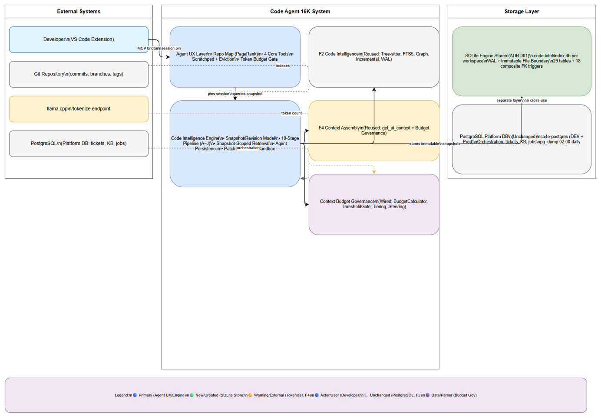
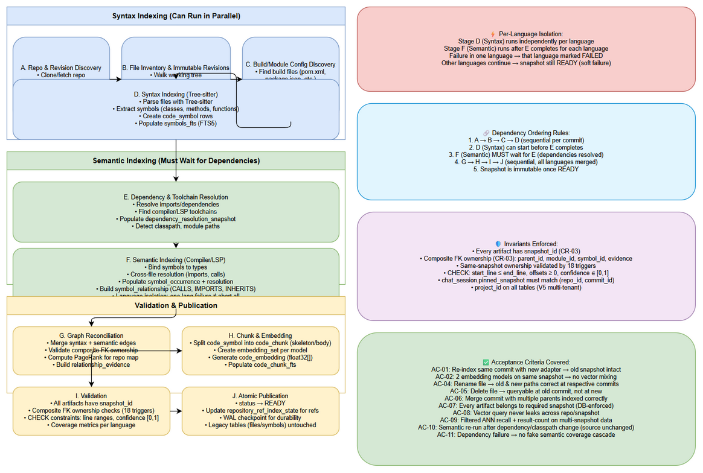
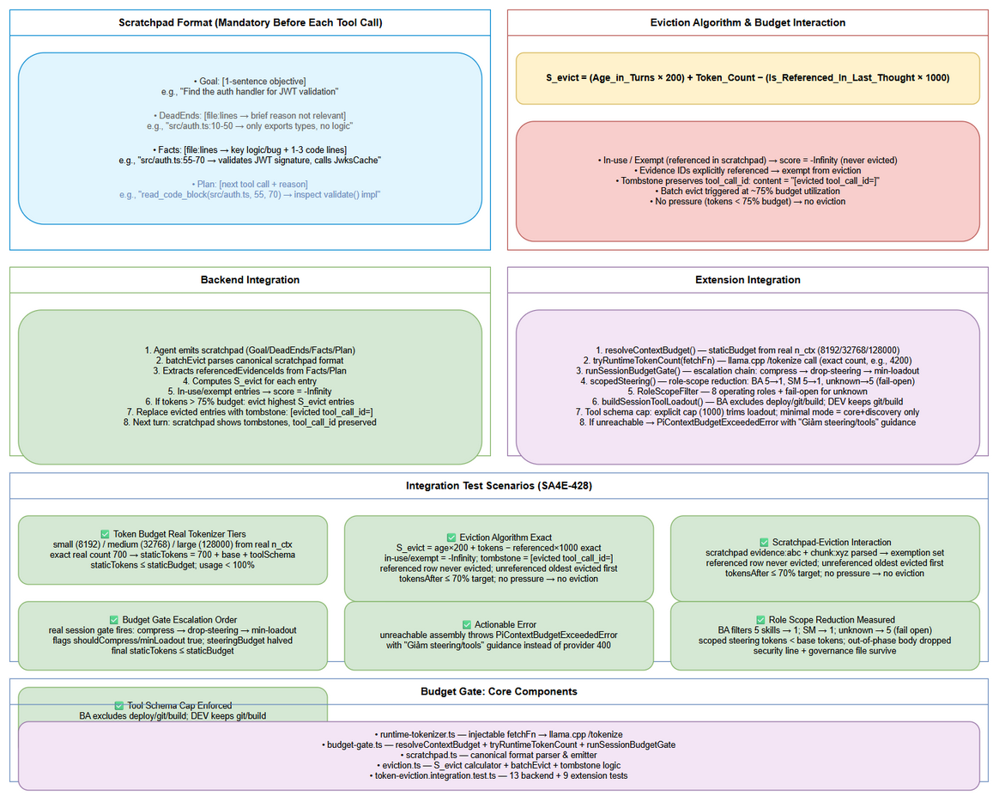
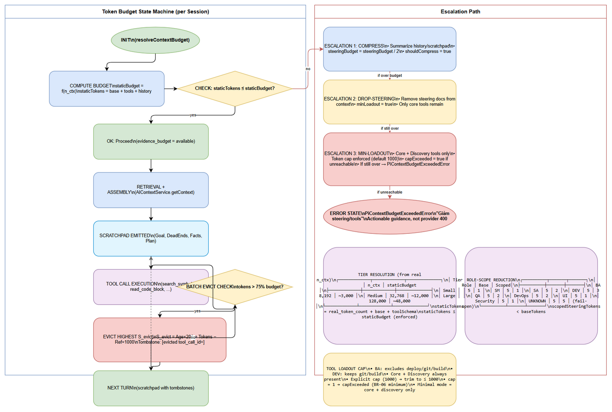
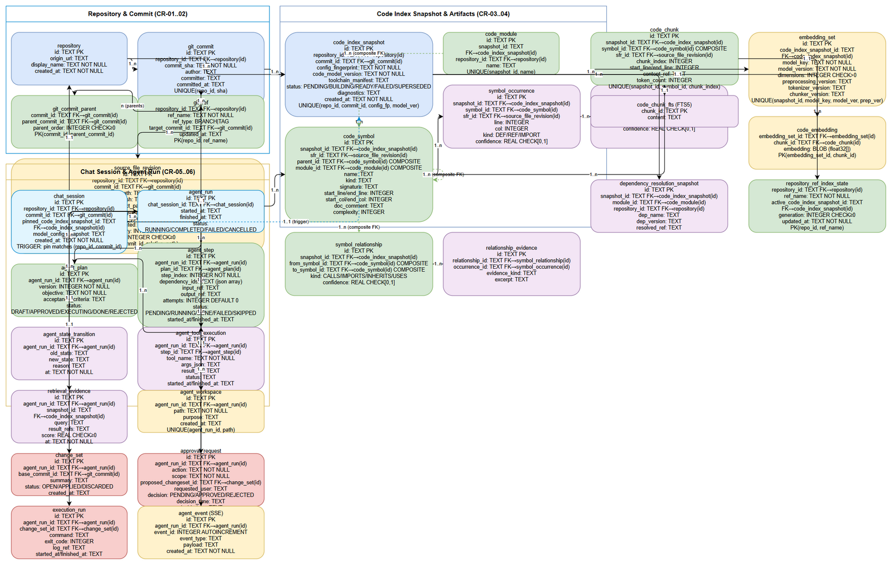
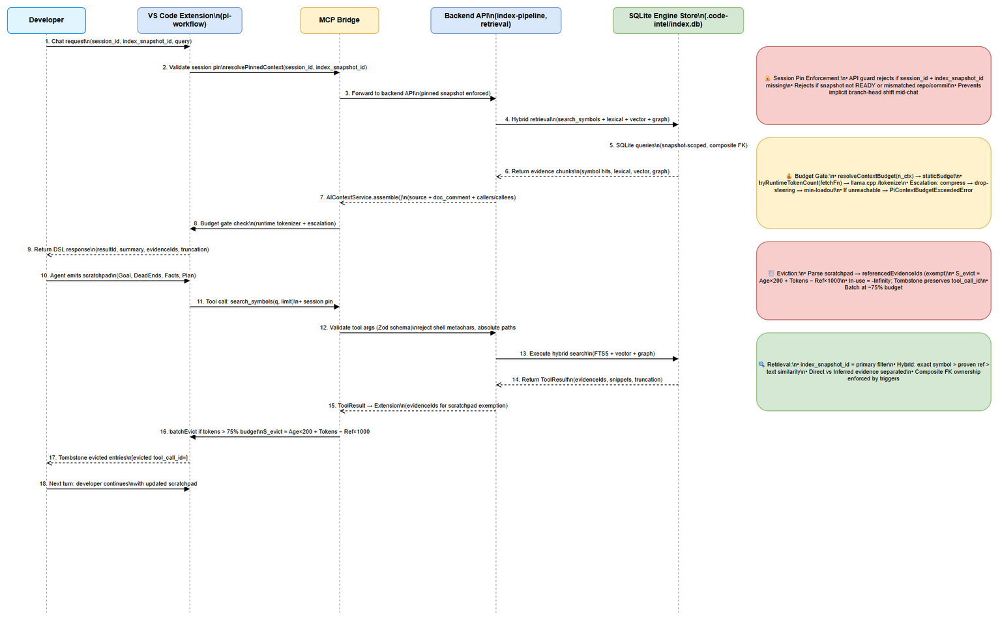

# Functional Specification Document (FSD)

## SA4E-411: [EPIC] Code Agent 16K — Deterministic Code Intelligence + Agent UX

---

## Document Information

| Field | Value |
|-------|-------|
| Jira Ticket | SA4E-411 |
| Title | [EPIC] Code Agent 16K — Deterministic Code Intelligence + Agent UX |
| Author | BA Agent (+ TA enrichment) |
| Version | 2.0 |
| Date | 2026-11-10 |
| Status | Complete — All 18 child stories implemented and In Review |

---

## 1. Introduction

### 1.1 Purpose

This FSD specifies the **functional requirements and use cases** for the Code Agent 16K epic, decomposed into 18 child stories (SA4E-412..429). It translates the Business Requirements (BRD) and Architecture (16K Doc) into testable functional specifications with traceability to implementation.

### 1.2 Scope

Functional areas covered:
- **Snapshot/Revision Data Model** (CR-01..06): Repository, commit, source revision, code index snapshot, artifact tables, embedding set, active pointer
- **Indexing Pipeline**: Dependency-before-semantic ordering, 10-stage pipeline (A–J), language isolation
- **Snapshot-Scoped Retrieval**: Hybrid search (lexical + vector + graph), exact/proven/inferred ranking, cross-snapshot isolation
- **Agent Persistence**: Plan/step/approval/transition/tool-execution/retrieval-evidence/workspace
- **Patch Protocol & Security**: Staged patch (stage → approve → apply), sandbox validation, base-hash revalidation
- **Agent UX**: Repo map (PageRank), AST skeleton/body chunking, 4 core tools, scratchpad/eviction, runtime token budget
- **Hardening**: Agent state recovery, SSE durable log + replay, API pinned-snapshot enforcement
- **Validation**: 17 AC acceptance suite, token/eviction integration, SA4E regression gate

### 1.3 Document Conventions

- **Requirement IDs**: `FR-<area>-<nn>` (e.g., `FR-SNAP-01`, `FR-TOOL-04`)
- **Traceability**: Each FR maps to child story, 16K Doc section, and acceptance test
- **Priority**: MUST HAVE / SHOULD HAVE / COULD HAVE (MoSCoW)

### 1.4 Definitions and Acronyms

| Term | Definition |
|------|------------|
| `code_index_snapshot_id` | Primary filter for all retrieval; identifies an immutable index generation |
| Composite FK | FK referencing `(id, snapshot_id)` pair on parent table to enforce same-snapshot ownership |
| `S_evict` | Eviction priority score formula: `Age_in_Turns × 200 + Token_Count – Is_Referenced_In_Last_Thought × 1000` |
| Tombstone | Evicted scratchpad entry preserving `tool_call_id` with content = `[evicted tool_call_id=<id>]` |
| Staged Patch | Two-phase: `stage()` (validate only) → `applyAfterApproval()` (on APPROVED) |
| `Last-Event-ID` | SSE header for replay from specific event |
| `pinned_code_index_snapshot_id` | Chat session's bound snapshot; API enforces match |
| FTS5 | SQLite Full-Text Search 5 extension for lexical search |
| WAL | Write-Ahead Logging for SQLite durability |

### 1.5 References

| Document | Location |
|----------|----------|
| BRD (this epic) | `documents/SA4E-411/BRD.md` |
| Architecture (16K Doc) | `documents/architecture/16K_CODE_AGENT_ARCHITECTURE.md` |
| ADR-001 | `documents/SA4E-411/ADR-001-engine-storage-and-language-mvp.md` |
| TDD-01 Data Model | `documents/SA4E-411/TDD-01-data-model.md` |
| TDD (consolidated) | `documents/SA4E-411/TDD.md` |
| AC Matrix | `documents/SA4E-427/ACCEPTANCE-MATRIX.md` |
| Perf Baselines | `documents/SA4E-427/PERF-BASELINES.md` |

---

## 2. System Overview

### 2.1 Context Diagram

The system operates in three architectural layers:

```
┌─────────────────────────────────────────────────────────────────────┐
│                    AGENT UX LAYER (Phase 2–3)                       │
│  Repo Map (PageRank) → 4 Core Tools → Scratchpad/Eviction           │
│  Runtime Token Budget (real tokenizer) → SSE Durable Log            │
│  Agent State Recovery → Staged Patch → Pinned-Snapshot API          │
└─────────────────────────────────────────────────────────────────────┘
                              ↓ pins ↓ queries
┌─────────────────────────────────────────────────────────────────────┐
│              CODE INTELLIGENCE ENGINE (Phase 1)                     │
│  Snapshot/Revision Model → Dependency-Before-Semantic Ordering      │
│  Snapshot-Scoped Retrieval → Agent Persistence (plan/step/approval) │
│  Immutable Snapshots + Composite FK + Composite-FK Triggers         │
└─────────────────────────────────────────────────────────────────────┘
                              ↓ storage
┌─────────────────────────────────────────────────────────────────────┐
│                    SQLITE ENGINE STORE (ADR-001)                    │
│  .code-intel/index.db per workspace | WAL | Immutable file boundary │
└─────────────────────────────────────────────────────────────────────┘
```



### 2.2 Architecture Overview

| Layer | Components | Technology |
|-------|------------|------------|
| **Agent UX** | Repo Map, Core Tools, Scratchpad, Token Budget, SSE | TypeScript (extension), Kotlin (backend) |
| **Code Intelligence Engine** | Pipeline (A–J), Retrieval, Persistence, Patch, Sandbox | Kotlin/Ktor, SQLDelight, Koin |
| **Storage** | SQLite embedded per-workspace (`.code-intel/index.db`) | better-sqlite3 / sqlite-wasm, WAL mode |

### 2.3 External Interfaces

| Interface | Protocol | Purpose |
|-----------|----------|---------|
| VS Code Extension Host | MCP (Model Context Protocol) | Agent tools, chat, SSE stream |
| llama.cpp | HTTP `/tokenize` | Runtime token counting |
| Git Repository | CLI (libgit2) | Commit discovery, file revision, patch apply |
| PostgreSQL (platform) | SQL (dual-dialect migration) | Multi-tenant metadata, job queues |

---

## 3. Functional Requirements

### 3.1 Snapshot/Revision Data Model (CR-01..06) — Phase 1

#### 3.1.1 Repository & Commit (CR-01)

| ID | Requirement | Priority | 16K Doc | Child Story | Test |
|----|-------------|----------|---------|-------------|------|
| FR-SNAP-01 | Create `repository` table with `id` (uuid), `origin_url`, `display_name`, `created_at` | MUST | §10.1 | SA4E-413 | migration-v6.test.ts |
| FR-SNAP-02 | Create `git_commit` with `id` (uuid), `repository_id` FK, `commit_sha`, author/committer/committed_at; UNIQUE(repo, sha) | MUST | §10.1 | SA4E-413 | migration-v6.test.ts |
| FR-SNAP-03 | Create `git_commit_parent` for merge commits: `(commit_id, parent_commit_id, parent_order)` PK | MUST | §10.1 | SA4E-413 | AC-06 (merge commit) |
| FR-SNAP-04 | Create `git_ref` for mutable branch/tag refs: `(repository_id, ref_name)` PK, `target_commit_id` FK, `ref_type` BRANCH/TAG | MUST | §10.1 | SA4E-413 | migration-v6.test.ts |

#### 3.1.2 Source File Revisions (CR-02)

| ID | Requirement | Priority | 16K Doc | Child Story | Test |
|----|-------------|----------|---------|-------------|------|
| FR-SNAP-05 | Create `source_file_revision` with `id`, `repository_id`, `commit_id` FK, `relative_path`, `content_hash`, `language`, `file_type`, `is_generated`, `is_binary`, `line_count`; UNIQUE(commit_id, relative_path) | MUST | §10.2 | SA4E-413 | migration-v6.test.ts |
| FR-SNAP-06 | No mutable `repository_file` — path identity belongs to a revision; rename handled by indexer heuristic | MUST | §10.2 | SA4E-414 | AC-04 (rename) |

#### 3.1.3 Code Index Snapshot & Artifacts (CR-03)

| ID | Requirement | Priority | 16K Doc | Child Story | Test |
|----|-------------|----------|---------|-------------|------|
| FR-SNAP-07 | Create `code_index_snapshot` with `id`, `repository_id`, `commit_id`, `config_fingerprint`, `code_model_version`, `toolchain_manifest`, `status` (PENDING/BUILDING/READY/FAILED/SUPERSEDED), `diagnostics`, `created_at`; UNIQUE(repo, commit, config_fp, model_ver) | MUST | §10.3 | SA4E-413 | AC-01, AC-02 |
| FR-SNAP-08 | Create snapshot-scoped artifact tables: `code_symbol`, `symbol_occurrence`, `symbol_occurrence_resolution`, `symbol_relationship`, `relationship_evidence`, `code_chunk`, `dependency_resolution_snapshot` — all with `snapshot_id` FK | MUST | §10.3 | SA4E-413, 415 | AC-07, AC-08 |
| FR-SNAP-09 | Composite FK ownership: `code_symbol(parent_id, module_id)`, `code_chunk(symbol_id)`, `relationship_evidence` — all reference `(id, snapshot_id)` of parent table; enforced by SQLite triggers | MUST | §10.7 | SA4E-413 | AC-07 (DB-enforced) |

#### 3.1.4 Embedding Set (CR-04)

| ID | Requirement | Priority | 16K Doc | Child Story | Test |
|----|-------------|----------|---------|-------------|------|
| FR-SNAP-10 | Create `embedding_set` with `id`, `code_index_snapshot_id` FK, `model_key`, `model_version`, `dimensions`, `preprocessing_version`, `tokenizer_version`, `chunker_version`; UNIQUE(snapshot, model_key, model_ver, preprocessing_ver) | MUST | §10.4 | SA4E-413, 419 | AC-02 (two models) |
| FR-SNAP-11 | Create `code_embedding` with `embedding_set_id` FK, `chunk_id` FK, `embedding` BLOB (float32[] packed); PK(embedding_set_id, chunk_id) | MUST | §10.4 | SA4E-419 | AC-02 |

#### 3.1.5 Active Pointer (CR-05)

| ID | Requirement | Priority | 16K Doc | Child Story | Test |
|----|-------------|----------|---------|-------------|------|
| FR-SNAP-12 | Create `repository_ref_index_state` mapping `(repository_id, ref_name)` → `active_code_index_snapshot_id` + `generation` | MUST | §10.5 | SA4E-413 | migration-v6.test.ts |
| FR-SNAP-13 | Chat session pins commit + snapshot; trigger enforces `pinned_code_index_snapshot_id` belongs to session's `(repository_id, commit_id)` | MUST | §10.6, 10.7 | SA4E-416, 426 | AC-03, AC-26 |

#### 3.1.6 Chat Session & Agent Run (CR-06)

| ID | Requirement | Priority | 16K Doc | Child Story | Test |
|----|-------------|----------|---------|-------------|------|
| FR-SNAP-14 | Create `chat_session` with `id`, `repository_id`, `commit_id`, `pinned_code_index_snapshot_id`, `model_config_snapshot`, `created_at` | MUST | §10.6 | SA4E-416 | migration-v6.test.ts |
| FR-SNAP-15 | Create agent persistence tables: `agent_run`, `agent_plan` (version, objective, AC, status), `agent_step` (dependencies, input/output refs, attempts, timestamps), `agent_state_transition`, `agent_tool_execution`, `retrieval_evidence`, `agent_workspace` | MUST | §10.6, 15 | SA4E-416, 423 | AC-12 |
| FR-SNAP-16 | Create patch workflow tables: `change_set` (base_commit_id, summary, status OPEN/APPLIED/DISCARDED), `approval_request` (action, scope, proposed_changeset, decision PENDING/APPROVED/REJECTED), `execution_run` | MUST | §12, 13 | SA4E-417, 424 | AC-13, AC-14 |

#### 3.1.7 Invariants & Multi-Tenant

| ID | Requirement | Priority | 16K Doc | Child Story | Test |
|----|-------------|----------|---------|-------------|------|
| FR-SNAP-17 | All 16K tables include `project_id` (V5 multi-tenant); UNIQUE constraints include project_id where needed | MUST | §10.7 | SA4E-413 | migration-v6.test.ts |
| FR-SNAP-18 | CHECK constraints: `start_line <= end_line`, offsets ≥ 0, `confidence ∈ [0,1]`, status enums | MUST | §10.7 | SA4E-413 | migration-v6.test.ts |
| FR-SNAP-19 | Dual-dialect migration: SQLite DDL + PG via `ddl-translator.ts`; idempotent per-table (check pragma_table_info / information_schema) | MUST | §1, 3 | SA4E-413 | migration-v6.test.ts + PG smoke |

---

### 3.2 Indexing Pipeline (Dependency-Before-Semantic) — Phase 1

| ID | Requirement | Priority | 16K Doc | Child Story | Test |
|----|-------------|----------|---------|-------------|------|
| FR-IDX-01 | 10-stage pipeline: A) Repo/revision discovery → B) File inventory & immutable revisions → C) Build/module config discovery → D) Syntax indexing (Tree-sitter) → E) Dependency & toolchain resolution → F) Semantic indexing (compiler/LSP) → G) Graph reconciliation → H) Chunk & embedding → I) Validation → J) Atomic publication | MUST | §9 | SA4E-414 | index-pipeline tests |
| FR-IDX-02 | Syntax indexing (D) can run before dependency resolution (E); semantic (F) MUST run after E completes | MUST | §9 | SA4E-414 | pipeline order test |
| FR-IDX-03 | Per-language isolation: one language's failure never aborts others; publish capability/coverage metadata | MUST | §9 | SA4E-414 | index-pipeline.isolation.test.ts |
| FR-IDX-04 | Incremental: file revision `content_hash` + `file_index` mtime/content_hash for change detection; WAL durability | MUST | §9, F2 | SA4E-414 | index-operation-manager tests |



---

### 3.3 Snapshot-Scoped Retrieval — Phase 1

| ID | Requirement | Priority | 16K Doc | Child Story | Test |
|----|-------------|----------|---------|-------------|------|
| FR-RET-01 | All retrieval paths require `code_index_snapshot_id` as primary filter (lexical, vector, graph, exact symbol) | MUST | §11 | SA4E-415 | AC-07, AC-08 |
| FR-RET-02 | Hybrid ranking: exact definition > proven reference > text similarity; separate `direct` vs `inferred` evidence kinds | MUST | §11 | SA4E-415 | retrieval-types.ts |
| FR-RET-03 | Graph query: CALLERS/CALLEES/IMPLEMENTATIONS with cycle guard, node cap, snapshot filter, stable ordering | MUST | §11 | SA4E-415 | AC-07, AC-08 |
| FR-RET-04 | Vector query scoped by `embedding_set` (model + snapshot); filter-first contract preserved for future ANN | MUST | §11 | SA4E-415 | AC-08, AC-09 |
| FR-RET-05 | Build/config/test discovery as first-class retrieval category | MUST | §11 | SA4E-415 | acceptance-ac09-12.test.ts |

---

### 3.4 Agent Persistence & Recovery — Phase 1, 3

| ID | Requirement | Priority | 16K Doc | Child Story | Test |
|----|-------------|----------|---------|-------------|------|
| FR-AGT-01 | `agent_plan`: versioned objective + AC + status (DRAFT/APPROVED/EXECUTING/DONE/REJECTED) | MUST | §15 | SA4E-416 | AC-12 |
| FR-AGT-02 | `agent_step`: dependency_ids (json array), input/output refs, attempts, status (PENDING/RUNNING/DONE/FAILED/SKIPPED), timestamps | MUST | §15 | SA4E-416 | AC-12 |
| FR-AGT-03 | `agent_state_transition`: full state history (old_state, new_state, reason, timestamp) | MUST | §15 | SA4E-416, 423 | AC-12 |
| FR-AGT-04 | Durable event log (SSE): append before publish; `Last-Event-ID` replay; `agent_event` table (SA4E-425) | MUST | §15 | SA4E-425 | AC-16 |
| FR-AGT-05 | Recovery: `summarizeForResume()` returns objective, APPROVED plan, next step index, pending approval; fresh service instance resumes with zero in-memory state | MUST | §15 | SA4E-423 | AC-12 |

---

### 3.5 Patch Protocol & Security Sandbox — Phase 1, 3

| ID | Requirement | Priority | 16K Doc | Child Story | Test |
|----|-------------|----------|---------|-------------|------|
| FR-PAT-01 | Staged patch workflow: `stage()` validates (base hash, path, symlinks, size, ownership) WITHOUT applying; records `change_set` (OPEN) + `approval_request` (PENDING) + `execution_run` (validation) | MUST | §12, 13 | SA4E-417, 424 | AC-13, AC-14 |
| FR-PAT-02 | `applyAfterApproval()` ONLY on APPROVED decision: re-validates stale-base (base hash may drift), applies atomically via `PatchProtocol`; rejected apply keeps change_set OPEN | MUST | §12, 13 | SA4E-417, 424 | AC-13, AC-14 |
| FR-PAT-03 | Sandbox validation: reject absolute paths, `..`, symlink escape, NUL bytes, shell metachars; `--` separator; network denied by default; registry allowlist exact host match; container limits | MUST | §13 | SA4E-424 | AC-15 |
| FR-PAT-04 | Tool args schema validation (Zod); no shell concat; fixed executable + arg vector | MUST | §13 | SA4E-424 | AC-15, sandbox.test.ts |

---

### 3.6 Agent UX: Repository Map, Chunking, Core Tools — Phase 2

| ID | Requirement | Priority | 16K Doc | Child Story | Test |
|----|-------------|----------|---------|-------------|------|
| FR-UX-01 | Dynamic Repository Map: build AST call graph → edge weight `W(A→B, s) = Multiplier(s) × sqrt(freq) × ln(N/(df+1))` → personalize by query match → PageRank(α=0.85) → binary-search pack into ~1,500 tokens DSL | MUST | §6 | SA4E-418 | repo-map tests |
| FR-UX-02 | AST Skeleton/Body Chunking: skeleton (class/interface, fields, signatures, no body) for embedding; body on demand; lib code → .d.ts/header signatures only | MUST | §5 | SA4E-419 | chunking tests |
| FR-UX-03 | `search_symbols`: hybrid BM25 + vector, lightweight signature + line range, session-pinned snapshot | MUST | §7 | SA4E-420 | core-tools tests |
| FR-UX-04 | `get_file_skeleton`: class structure, fields, signatures (no body), session-pinned | MUST | §7 | SA4E-420 | core-tools tests |
| FR-UX-05 | `read_code_block`: specific lines, max 120 lines/turn, session-pinned | MUST | §7 | SA4E-420 | core-tools tests |
| FR-UX-06 | `query_call_graph`: CALLERS/CALLEES/IMPLEMENTATIONS, session-pinned | MUST | §7 | SA4E-420 | core-tools tests |
| FR-UX-07 | Tool output DSL (not raw JSON): result ID, summary, snippets, evidence IDs, truncation flag, next-page cursor | MUST | §7 | SA4E-420 | tool-context.ts |

---

### 3.7 Scratchpad & Context Eviction — Phase 2

| ID | Requirement | Priority | 16K Doc | Child Story | Test |
|----|-------------|----------|---------|-------------|------|
| FR-EV-01 | Scratchpad format (mandatory before each tool call): XML with Goal, DeadEnds, Facts, Plan | MUST | §8 | SA4E-421 | token-eviction.integration.test.ts |
| FR-EV-02 | Eviction priority: `S_evict = Age_in_Turns × 200 + Token_Count – Is_Referenced_In_Last_Thought × 1000` | MUST | §8 | SA4E-421 | token-eviction.integration.test.ts |
| FR-EV-03 | In-use/exempt items score = -Infinity; tombstone preserves `tool_call_id` with content `[evicted tool_call_id=<id>]` | MUST | §8 | SA4E-421 | token-eviction.integration.test.ts |
| FR-EV-04 | Batch evict at ~75% budget; no pressure → no eviction | MUST | §8 | SA4E-421 | token-eviction.integration.test.ts |



---

### 3.8 Runtime Token Budget (Real Tokenizer) — Phase 2

| ID | Requirement | Priority | 16K Doc | Child Story | Test |
|----|-------------|----------|---------|-------------|------|
| FR-TOK-01 | Runtime tokenizer: injectable `fetchFn` → llama.cpp `/tokenize` endpoint; real count replaces estimate | MUST | §4 | SA4E-422 | acceptance-ac17.test.ts |
| FR-TOK-02 | Budget formula: `available_input_tokens = model_n_ctx - max_output - safety - system_prompt - tool_schemas - history - user_msg - framing - tool_results_must_remain` | MUST | §4 | SA4E-422 | budget-gate tests |
| FR-TOK-03 | Tier resolution: small (8,192) / medium (32,768) / large (128,000) from real `n_ctx`; staticTokens ≤ staticBudget | MUST | §4 | SA4E-422 | budget-gate-decisions/test.ts |
| FR-TOK-04 | Escalation order: compress → drop-steering → min-loadout; flags `shouldCompress`/`minLoadout` true; steeringBudget halved | MUST | §4 | SA4E-422, 428 | budget-gate-escalation.test.ts |



---

### 3.9 SSE Durable Event Log & Replay — Phase 3

| ID | Requirement | Priority | 16K Doc | Child Story | Test |
|----|-------------|----------|---------|-------------|------|
| FR-SSE-01 | SSE transport over durable event log (`agent_event` table); each event has monotonically increasing `event_id` | MUST | §15 | SA4E-425 | sse-stream tests |
| FR-SSE-02 | Replay via `Last-Event-ID` header: returns combined sequence with 0 duplicates, 0 gaps | MUST | §15 | SA4E-425 | AC-16 |
| FR-SSE-03 | Gap detection: `SseGapError` thrown if client requests replay from non-existent ID | MUST | §15 | SA4E-425 | sse-stream tests |
| FR-SSE-04 | Retention: configurable; reconnect + replay stress tested | MUST | §15 | SA4E-425 | sse-stream tests |

---

### 3.10 API Pinned index_snapshot_id Enforcement — Phase 3

| ID | Requirement | Priority | 16K Doc | Child Story | Test |
|----|-------------|----------|---------|-------------|------|
| FR-API-01 | All chat/search API endpoints MUST receive both `session_id` and `index_snapshot_id` | MUST | §17 | SA4E-426 | pinned-snapshot-guard tests |
| FR-API-02 | Reject with 400 if `index_snapshot_id` missing, mismatched with session pin, or not READY | MUST | §17 | SA4E-426 | AC-17 (backend) |

---

### 3.11 Acceptance Criteria Test Suite — Phase 4

| ID | Requirement | Priority | 16K Doc | Child Story | Test |
|----|-------------|----------|---------|-------------|------|
| FR-AC-01 | 17 AC tests covering all §19 criteria + SA4E integration checks | MUST | §19 | SA4E-427 | ACCEPTANCE-MATRIX.md |
| FR-AC-02 | Backend: 3 files, 16 tests (`acceptance-ac01-08`, `ac09-12`, `ac13-16`); Extension: 1 file, 1 test (AC-17) | MUST | §19 | SA4E-427 | `npm run test:ac` |
| FR-AC-03 | Shared fixture: 2 repos, 5 commits (merge + delete), 8 snapshots (6 READY, 2 PENDING), 2 embedding models on 1 snapshot | MUST | §19 | SA4E-427 | ac-fixtures.ts |
| FR-AC-04 | Gate command: `npm run test:ac` (root = backend && extension); CI threshold < 10s | MUST | §19 | SA4E-427 | PERF-BASELINES.md |

---

### 3.12 Token/Eviction Integration Tests — Phase 4

| ID | Requirement | Priority | 16K Doc | Child Story | Test |
|----|-------------|----------|---------|-------------|------|
| FR-INT-01 | Backend integration: scratchpad → `referencedEvidenceIds` → `batchEvict` (parse canonical, exempt refs, verify score/tombstone/target/no-overflow) | MUST | §4, 8 | SA4E-428 | token-eviction.integration.test.ts |
| FR-INT-02 | Extension integration: `resolveContextBudget` + `tryRuntimeTokenCount` + `runSessionBudgetGate` + `scopedSteering` + `RoleScopeFilter` + `buildSessionToolLoadout` composed per scenario | MUST | §4, 8 | SA4E-428 | token-eviction.integration.test.ts |
| FR-INT-03 | Scenarios: real tokenizer tiers (exact count 700), eviction algorithm exact, scratchpad interaction, budget gate escalation order, actionable error, role-scope reduction (5→1 skills), tool schema cap (explicit 1000 trim) | MUST | §4, 8 | SA4E-428 | SA4E-428 STATUS.json |
| FR-INT-04 | Gate: `npm run test:token` (root = backend && extension) | MUST | §4, 8 | SA4E-428 | STATUS.json |

---

### 3.13 SA4E Regression Test Suite — Phase 4

| ID | Requirement | Priority | 16K Doc | Child Story | Test |
|----|-------------|----------|---------|-------------|------|
| FR-REG-01 | Backend regression: migration V6 additive proof (legacy files/symbols/FTS5/triggers/relationships intact, FK pragma=1, host-file export on disconnect); F4 AIContextService assembly on V6 DB; legacy symbol vs snapshot retrieval isolation | MUST | §19 tail | SA4E-429 | sa4e-regression.test.ts (backend) |
| FR-REG-02 | Extension regression: 7-phase canonical order + PhaseRouter transitions + abort HALTED; 9-agent role matrix, prompt existence, SM coordinator guard, no create/forbid overlap, critical cross-agent guards, role-scope 8 roles + fail-open | MUST | §19 tail | SA4E-429 | sa4e-regression.test.ts (extension) |
| FR-REG-03 | Gate `npm run test:regression` composes: SM E2E, F12 connection, SA4E-155 enrichment, context budget, F2 indexer, F4 context, role boundaries — backend 11 files/63 tests, extension 20 files/155 tests | MUST | §19 tail | SA4E-429 | STATUS.json |
| FR-REG-04 | Root `npm run build` exit 0; root `npm test` exit 0 (backend 500 files/3825 passed/19 skipped; extension 443 files/3469 passed/6 skipped) | MUST | §19 tail | SA4E-429 | STATUS.json |

---

## 4. Data Model

### 4.1 Entity Relationship Summary

The V6 additive migration creates 29 new tables (28 F2 legacy tables unchanged). Key hierarchies:

```
repository 1──n git_commit 1──n git_commit_parent (n-n parent, parent_order)
repository 1──n git_ref (BRANCH|TAG → target_commit_id, mutable)
repository 1──n source_file_revision (UNIQUE commit_id+relative_path)
repository 1──n code_index_snapshot (UNIQUE repository_id+commit_id+config_fingerprint+code_model_version)
repository 1──n repository_ref_index_state (UNIQUE repository_id+ref_name → active snapshot)
code_index_snapshot 1──n [artifacts]: code_symbol, symbol_occurrence,
    symbol_occurrence_resolution, symbol_relationship, relationship_evidence,
    code_chunk, dependency_resolution_snapshot
code_index_snapshot 1──n embedding_set 1──n code_embedding (n-1 code_chunk)
repository 1──n chat_session (pin commit + snapshot) 1──n agent_run
agent_run 1──n {agent_plan, agent_step, agent_state_transition,
    agent_tool_execution, retrieval_evidence, agent_workspace,
    change_set, approval_request, execution_run}
```

### 4.2 Key Tables

| Table | Primary Key | Key Constraints | Purpose |
|-------|-------------|-----------------|---------|
| `repository` | `id` (uuid) | — | Root tenant for all code intelligence data |
| `git_commit` | `id` (uuid) | UNIQUE(repository_id, commit_sha) | Immutable commit record |
| `git_commit_parent` | (commit_id, parent_commit_id) | parent_order ≥ 0 | Merge commit parent tracking |
| `git_ref` | (repository_id, ref_name) | ref_type ∈ {BRANCH,TAG} | Mutable branch/tag pointers |
| `source_file_revision` | `id` | UNIQUE(commit_id, relative_path) | Immutable file revision per commit |
| `code_index_snapshot` | `id` | UNIQUE(repo, commit, config_fp, model_ver) | Immutable index generation boundary |
| `code_symbol` | `id` | Composite FK to parent/module via (id, snapshot_id) | Symbol definitions scoped to snapshot |
| `symbol_occurrence` | `id` | confidence ∈ [0,1] | Symbol references (DEF/REF/IMPORT) |
| `code_chunk` | `id` | FTS5 shadow table `code_chunk_fts` | Chunks for embedding/retrieval |
| `embedding_set` | `id` | UNIQUE(snapshot, model_key, model_ver, preprocessing_ver) | Embedding model configuration |
| `code_embedding` | (embedding_set_id, chunk_id) | embedding BLOB (float32[]) | Vector embeddings per chunk/model |
| `chat_session` | `id` | pinned_snapshot must match (repo, commit) | Agent chat bound to immutable snapshot |
| `agent_plan` | `id` | status ∈ {DRAFT,APPROVED,EXECUTING,DONE,REJECTED} | Versioned agent objective |
| `agent_step` | `id` | dependency_ids (JSON array) | Step execution with dependencies |
| `change_set` | `id` | status ∈ {OPEN,APPLIED,DISCARDED} | Staged patch changeset |
| `approval_request` | `id` | decision ∈ {PENDING,APPROVED,REJECTED} | Human approval gate |
| `agent_event` | `event_id` (monotonic) | — | SSE durable event log |

### 4.3 Invariants (Enforced by Triggers)

1. **Same-snapshot ownership**: All artifact tables reference `(id, snapshot_id)` of parent via composite FK triggers (`ai_*`, `au_*`)
2. **Chat session pin consistency**: Trigger validates `pinned_code_index_snapshot_id` belongs to session's `(repository_id, commit_id)`
3. **CHECK constraints**: `start_line <= end_line`, offsets ≥ 0, `confidence ∈ [0,1]`, enum status values
4. **Multi-tenant**: All 16K tables include `project_id` (V5); UNIQUE constraints include project_id where applicable



### 4.4 Migration Strategy

- **File**: `backend/src/engine/db/migration-v6.ts` + `migration-v6-pg.ts`
- **Pattern**: Idempotent per-table (check `pragma_table_info` / `information_schema`)
- **Dual-dialect**: SQLite DDL source; PG via `database/migration/ddl-translator.ts`
- **FTS5**: `code_chunk_fts` (content-less shadow, external content = `code_chunk`) — SQLite only

---

## 5. Integration Specifications

### 5.1 External System Interfaces

| System | Interface | Protocol | Authentication | Direction |
|--------|-----------|----------|----------------|-----------|
| VS Code Extension | Agent Tools / Chat / SSE | MCP (JSON-RPC over stdio/WS) | Extension host token | Bidirectional |
| llama.cpp | Tokenizer | HTTP `/tokenize` | None (local) | Backend → llama.cpp |
| Git Repository | Repo operations | libgit2 / CLI | SSH/HTTPS credentials | Backend → Git |
| PostgreSQL (platform) | Metadata / Jobs | SQL (pg) | Platform DB credentials | Backend → PG |

### 5.2 Core Agent Tools API (SA4E-420)

All tools require mandatory session pinning: `repository_id`, `commit_id`, `index_snapshot_id`.

| Tool | Input Schema | Output Schema | Session Pin Required |
|------|--------------|---------------|---------------------|
| `search_symbols` | `{ q: string, kind?: string, path_filter?: string, limit?: number }` | `{ resultId, summary, snippets[], evidenceIds[], truncated, cursor? }` | YES |
| `get_file_skeleton` | `{ file_path: string }` | `{ resultId, summary, snippets[], evidenceIds[], truncated }` (class/interface structure, signatures, no body) | YES |
| `read_code_block` | `{ file_path: string, start_line: number, end_line: number }` | `{ resultId, summary, snippets[], evidenceIds[], truncated }` (max 120 lines) | YES |
| `query_call_graph` | `{ symbol_id: string, direction: 'CALLERS' \| 'CALLEES' \| 'IMPLEMENTATIONS' }` | `{ resultId, summary, snippets[], evidenceIds[], truncated }` | YES |

**Output DSL Format** (compact, not raw JSON):
```
[FOUND 3 SYMBOLS | BUDGET_USED: 82 tokens]
1. [METHOD] PaymentService#processTransaction | src/service/PaymentService.java:45-92 (body: 420 tok)
   Sig: @Transactional public Receipt processTransaction(OrderDto order)
```

### 5.3 Retrieval Service API (SA4E-415)

```typescript
interface SnapshotRetrievalService {
  pinOrThrow(snapshotId: string, repositoryId: string): Promise<SnapshotInfo>;
  symbolByName(snapshotId: string, name: string): Promise<SymbolHit[]>;
  lexicalSearch(snapshotId: string, query: string, limit: number): Promise<LexicalHit[]>;
  vectorSearch(embeddingSetId: string, queryEmbedding: Buffer, limit: number): Promise<VectorHit[]>;
  graphQuery(snapshotId: string, symbolId: string, direction: Direction): Promise<RelationshipHit[]>;
}
```

**Mandatory Filter**: Every query requires `code_index_snapshot_id` as primary filter.

### 5.4 Patch Protocol API (SA4E-417, 424)

```typescript
interface PatchProtocol {
  stage(patch: StructuredPatch): Promise<{ changeSetId: string; approvalId: string }>;
  applyAfterApproval(changeSetId: string, approvalId: string): Promise<ExecutionRun>;
}
```

**Validation at Stage & Apply**:
- Base revision hash matches current workspace (stale-base rejection)
- Target path within workspace (no escape, no `..`, symlink check)
- Patch size limits enforced
- Workspace ownership verified

### 5.5 SSE Stream API (SA4E-425)

```typescript
interface SSEStream {
  append(event: AgentEvent): Promise<number>; // returns event_id
  replay(lastEventId: number): AsyncIterable<AgentEvent>;
  // throws SseGapError if gap detected
}
```

**Replay Guarantees**: No duplicates, no gaps, ordered by `event_id`.

### 5.6 API Guard (SA4E-426)

```typescript
function resolvePinnedContext(
  sessionId: string,
  indexSnapshotId: string
): Promise<{ snapshot: SnapshotInfo; repositoryId: string }>;
// Throws 400 if missing, mismatched, or not READY
```

---

## 6. Processing Logic

### 6.1 Indexing Pipeline Execution (SA4E-414)

**10-Stage Pipeline (A→J)**:

```
A: Repo & Revision Discovery
   ↓ (repository_id, commit_sha)
B: File Inventory & Immutable Revisions
   ↓ (source_file_revision rows)
C: Build/Module Config Discovery
   ↓ (code_module, dependency_resolution_snapshot)
D: Syntax Indexing (Tree-sitter)
   ↓ (code_symbol, symbol_occurrence)
E: Dependency & Toolchain Resolution
   ↓ (resolved classpath, toolchain_manifest)
F: Semantic Indexing (Compiler/LSP)
   ↓ (symbol_relationship, symbol_occurrence_resolution)
G: Graph Reconciliation
   ↓ (relationship_evidence, call graph)
H: Chunk & Embedding
   ↓ (code_chunk, embedding_set, code_embedding)
I: Validation
   ↓ (diagnostics, coverage metadata)
J: Atomic Publication
   ↓ (repository_ref_index_state update)
```

**Dependency-Before-Semantic Rule**: Stage E (dependency resolution) MUST complete before Stage F (semantic indexing) for each language.

**Per-Language Isolation**:
```
for each language in [java, typescript, ...]:
  run stages D→F independently
  on failure: mark capability=FAILED, continue other languages
  publish capability/coverage metadata per language
```

### 6.2 Snapshot-Scoped Retrieval Flow (SA4E-415)

```
Client Request
     │
     ▼
Validate index_snapshot_id exists & READY
     │
     ├─► Exact Symbol Lookup (symbolByName)
     ├─► Lexical Search (BM25 on code_chunk_fts)
     ├─► Vector Search (exact cosine on code_embedding via embedding_set)
     └─► Graph Query (CALLERS/CALLEES/IMPLEMENTATIONS with cycle guard)
     │
     ▼
Merge & Rank Results:
  1. Exact definition (DIRECT evidence)
  2. Proven reference (DIRECT evidence)
  3. Text similarity (INFERRED evidence)
     │
     ▼
Return Ranked Results (snapshot-scoped)
```

### 6.3 Agent Chat Turn Processing (SA4E-420, 421, 422)

```
User Message → Extension
     │
     ▼
resolveContextBudget() — compute available_input_tokens (FR-TOK-02)
     │
     ├─► Tier Resolution (SYSTEM→CRITICAL→HIGH→MEDIUM→LOW)
     ├─► Steering/Tool Loadout Selection (scopedSteering, RoleScopeFilter)
     └─► Token Budget Gate (runSessionBudgetGate)
     │
     ▼
Agent Loop:
  1. Emit Scratchpad (Goal, DeadEnds, Facts, Plan) — FR-EV-01
  2. Tool Call (search_symbols, get_file_skeleton, read_code_block, query_call_graph)
  3. Tool Result → retrieval_evidence persisted
  4. batchEvict() if tokens > 75% budget — FR-EV-04
     ├─ Parse scratchpad for referencedEvidenceIds (exempt)
     ├─ Compute S_evict for each entry — FR-EV-02
     ├─ In-use items score = -Infinity
     └─ Tombstone evicted entries — FR-EV-03
  5. Next Turn
```



### 6.4 Staged Patch Workflow (SA4E-417, 424)

```
Agent: stage(patch)
     │
     ▼
Validate: base_hash, path, symlinks, size, ownership
     │
     ├─ PASS: Create change_set (OPEN) + approval_request (PENDING) + execution_run (validation)
     └─ FAIL: Return validation errors
     │
     ▼
Human Review → approval_request.decision = APPROVED
     │
     ▼
Agent: applyAfterApproval(changeSetId, approvalId)
     │
     ▼
Re-validate: base_hash (stale-base check)
     │
     ├─ MATCH: Atomic apply via PatchProtocol → change_set (APPLIED)
     └─ MISMATCH: Reject → change_set stays OPEN
```

### 6.5 SSE Reconnect & Replay (SA4E-425)

```
Client: SSE connect → receives events 1..N
     │
     ▼ (network disconnect after event K)
Client: Reconnect with Last-Event-ID: K
     │
     ▼
Server: replay(K) from agent_event table
     │
     ├─ Events K+1..N returned in order
     ├─ 0 duplicates, 0 gaps guaranteed
     └─ SseGapError if requested ID not found
```

### 6.6 Token Budget Escalation (SA4E-422, 428)

```
Budget Check → available_input_tokens < required
     │
     ├─ Escalation 1: Compress (summarize history, trim steering)
     ├─ Escalation 2: Drop Steering (steeringBudget halved, minLoadout flag)
     └─ Escalation 3: Min Loadout (only SYSTEM/CRITICAL tools, role-scope reduced 5→1)
```

---

## 7. Security Requirements

### 7.1 Security Boundaries

| Boundary | Enforcement | Story |
|----------|-------------|-------|
| Tool args schema | Zod validation; reject shell metachars, absolute paths, `..`, NUL | SA4E-424 |
| Patch base hash | Validated at `stage()` AND re-validated at `applyAfterApproval()` (stale-base) | SA4E-424 |
| Patch path | No workspace escape; symlink check; `--` separator | SA4E-424 |
| Network | Deny by default; registry allowlist exact host match | SA4E-424 |
| Container | Rootless, non-root, capability/mount/process/memory/CPU/disk limits | SA4E-424 |
| API snapshot pin | 400 if `session_id` + `index_snapshot_id` missing/mismatched/not READY | SA4E-426 |
| Role boundaries | 9-agent matrix enforced (SM coordinator-only, no create/forbid overlap) | SA4E-429 |

### 7.2 Patch Security

- **Staged workflow**: Working tree unchanged until `applyAfterApproval()` on APPROVED decision
- **Stale-base protection**: Base hash re-validated at apply time; drift = rejection
- **Path traversal**: Absolute paths, `..`, symlinks rejected at stage AND apply
- **Size limits**: Configurable max patch size enforced
- **Ownership**: Workspace ownership verified before any write

### 7.3 Sandbox Policy

- **Tool execution**: Fixed executable + structured arg vector (no shell concatenation)
- **Zod schema validation**: All tool args validated against schema before execution
- **Network**: Deny by default; allowlist registry with exact host match
- **Container limits**: CPU, memory, disk, process count, capabilities restricted
- **Rootless**: Non-root user, no privileged capabilities

### 7.4 API Security

- **Pinned snapshot enforcement**: All chat/search endpoints require `session_id` + `index_snapshot_id`
- **Mismatch detection**: Returns 400 with clear error if session pin ≠ requested snapshot
- **Status check**: Snapshot must be READY (not PENDING/BUILDING/FAILED/SUPERSEDED)

---

## 8. Non-Functional Specifications

| Category | Requirement | Target | Verification |
|----------|-------------|--------|--------------|
| **Performance** | AC suite runtime | < 10s | Measured 1.6–1.7s backend + ~0.5s extension |
| **Performance** | Single AC test | < 2s | Max measured 71ms (AC-01 pipeline) |
| **Performance** | Build | `npm run build` exit 0 | All 18 stories verify |
| **Performance** | Full test suite | `npm test` exit 0 | Backend 500f/3825p/19s; Ext 443f/3469p/6s |
| **Security** | Patch validation | Base hash + path traversal + symlink + shell + network | SA4E-424 sandbox + patch validation |
| **Security** | Tool args | Schema validation; no shell concat | SA4E-424 |
| **Reliability** | SSE replay | 0 duplicates, 0 gaps | SA4E-425/427 AC-16 verified with disconnect/replay |
| **Reliability** | Agent resume | Fresh instance from zero in-memory state | SA4E-423/427 AC-12 verified |
| **Reliability** | Agent state | `summarizeForResume()` reconstructs context | SA4E-423 |
| **Compatibility** | TypeScript compilation | `tsc --noEmit` clean | All 18 stories verify |
| **Compatibility** | Test gates | `test:ac`, `test:token`, `test:regression` pass | CI/CD pipeline |
| **Usability** | Session pinning | Mandatory; no implicit branch-head shift | SA4E-426 API enforcement |
| **Usability** | Token budget | Real tokenizer (llama.cpp) not estimates | SA4E-422/427 AC-17 |
| **Regression** | SA4E integration | SM pipeline, F12, enrichment, budget, F2, F4, role boundaries | SA4E-429 gate |

---

## 9. Error Handling & Logging

### 9.1 Error Codes

| Code | HTTP Status | Context | Description |
|------|-------------|---------|-------------|
| `SNAPSHOT_NOT_FOUND` | 404 | Retrieval, API | Requested `index_snapshot_id` does not exist |
| `SNAPSHOT_NOT_READY` | 400 | API | Snapshot status ≠ READY |
| `SNAPSHOT_MISMATCH` | 400 | API | `chat_session.pinned_code_index_snapshot_id` ≠ requested |
| `STALE_BASE_HASH` | 409 | Patch | Base commit hash drifted since stage |
| `PATH_TRAVERSAL` | 400 | Patch, Sandbox | Path contains `..`, absolute, or symlink escape |
| `SANDBOX_VIOLATION` | 400 | Tool execution | Shell metachars, NUL, network violation |
| `SSE_GAP_DETECTED` | 400 | SSE replay | Requested `Last-Event-ID` not in log |
| `BUDGET_EXCEEDED` | 413 | Token budget | Required tokens exceed available after escalation |
| `VALIDATION_FAILED` | 400 | Pipeline, Migration | Schema/constraint violation |

### 9.2 Logging

| Component | Log Format | Level | Destination |
|-----------|------------|-------|-------------|
| Indexing Pipeline | Structured JSON | INFO/WARN/ERROR | Console + `agent_event` (SSE) |
| Retrieval | Structured JSON | DEBUG/INFO | Console |
| Agent Persistence | Structured JSON | INFO/ERROR | Console + `agent_event` table |
| Patch Protocol | Structured JSON | INFO/WARN/ERROR | Console + `agent_event` table |
| SSE Stream | Structured JSON | INFO/ERROR | Console + `agent_event` table |
| Token Budget | Structured JSON | DEBUG/INFO/WARN | Console |

### 9.3 Durable Event Log (`agent_event` table)

- **Append-before-publish**: Event written to `agent_event` table before SSE broadcast
- **Monotonic `event_id`**: Auto-increment integer for ordering
- **Replay support**: `Last-Event-ID` header returns events after specified ID
- **Gap detection**: `SseGapError` thrown if client requests non-existent ID

---

## 10. Testing Considerations

### 10.1 Test Gates

| Gate | Command | Scope | Threshold |
|------|---------|-------|-----------|
| Build | `npm run build` | root (backend + extension) | exit 0 |
| Unit Test | `npm test` | root | exit 0 (backend 500f/3825p/19s; ext 443f/3469p/6s) |
| AC Suite | `npm run test:ac` | backend (16) + extension (1) | < 10s |
| Token/Eviction | `npm run test:token` | backend (1) + extension (1) | pass |
| Regression | `npm run test:regression` | backend 11f/63t + ext 20f/155t | pass |

### 10.2 Acceptance Criteria Coverage (17 ACs)

| AC | Criterion | Test File |
|----|-----------|-----------|
| AC-01 | Re-index same commit with new adapter doesn't corrupt old snapshot | ac01-08 |
| AC-02 | Support 2 embedding models for same snapshot without mixing vectors | ac01-08 |
| AC-03 | Chat pinned to old commit still queries after branch moves | ac01-08 |
| AC-04 | Rename file: both old & new paths correct at respective commits | ac01-08 |
| AC-05 | Delete file: queryable at old commit, not at new | ac01-08 |
| AC-06 | Index merge commit with multiple parents | ac01-08 |
| AC-07 | Every artifact belongs to required snapshot (DB-enforced) | ac01-08 |
| AC-08 | Vector query never returns chunk from different repo/snapshot | ac01-08 |
| AC-09 | Filtered ANN recall + result-count on multi-snapshot dataset | ac09-12 |
| AC-10 | Semantic re-run after dependency/classpath change | ac09-12 |
| AC-11 | Dependency failure doesn't cascade to fake semantic coverage | ac09-12 |
| AC-12 | Resume agent after restart from plan/step persist | ac09-12 |
| AC-13 | Patch rejects stale base hash or path traversal | ac13-16 |
| AC-14 | Original working tree unchanged before approval | ac13-16 |
| AC-15 | Sandbox: no workspace escape, no unrestricted network | ac13-16 |
| AC-16 | SSE reconnect + replay → no duplicate/missing events | ac13-16 |
| AC-17 | Real tokenizer prompt/tool counting under runtime budget | ac17 (ext) |

### 10.3 Integration Test Scenarios (SA4E-428)

- Tier budgets (SYSTEM/CRITICAL/HIGH/MEDIUM/LOW) with real token counts
- Escalation order verification (SYSTEM→CRITICAL→HIGH→MEDIUM→LOW)
- Role-scope reduction under budget pressure
- Tool schema token cap enforcement (explicit 1000 trim)
- Scratchpad interaction with eviction
- Budget gate escalation order
- Actionable error messages

### 10.4 Regression Coverage (SA4E-429)

- SM full pipeline (orchestration, agent coordination)
- F12 (feature)
- Enrichment pipeline
- Context budget governance (`BudgetCalculator`/`ThresholdGate`/tiering/steering)
- F2 Code Intelligence (indexer, retrieval, graph)
- F4 Context Assembly (`get_ai_context`/edit/curated)
- Role boundaries (9-agent matrix enforcement)

### 10.5 Shared Test Fixtures

- 2 repos, 5 commits (merge + delete)
- 8 snapshots (6 READY, 2 PENDING)
- 2 embedding models on 1 snapshot
- Location: `backend/src/engine/acceptance/__tests__/ac-fixtures.ts`

---

## 11. Appendix

### 11.1 Reference Documents

| Document | Location |
|----------|----------|
| BRD (this epic) | `documents/SA4E-411/BRD.md` |
| Architecture (16K Doc) | `documents/architecture/16K_CODE_AGENT_ARCHITECTURE.md` |
| ADR-001 | `documents/SA4E-411/ADR-001-engine-storage-and-language-mvp.md` |
| TDD-01 Data Model | `documents/SA4E-411/TDD-01-data-model.md` |
| TDD (consolidated) | `documents/SA4E-411/TDD.md` |
| AC Matrix | `documents/SA4E-427/ACCEPTANCE-MATRIX.md` |
| Perf Baselines | `documents/SA4E-427/PERF-BASELINES.md` |
| Regression Evidence | `documents/SA4E-429/STATUS.json` |

### 11.2 Diagram Index

| # | Diagram | Image | Source (editable) |
|---|---------|-------|-------------------|
| 1 | System Context (External Systems + Agent UX + Engine + Storage) | `diagrams/system-context.png` | `diagrams/system-context.drawio` |
| 2 | Agent Chat Sequence (18 Steps: Chat → Pin → Retrieval → Budget → Scratchpad → Tool Call → Evict) | `diagrams/sequence-agent-chat.png` | `diagrams/sequence-agent-chat.drawio` |
| 3 | Token Budget State Machine (INIT → COMPUTE → CHECK → OK → Retrieval → Scratchpad → Tool Call → Evict → Next Turn + Escalation) | `diagrams/state-token-budget.png` | `diagrams/state-token-budget.drawio` |
| 4 | Architecture Overview (4-layer) | `diagrams/architecture-overview.png` | `diagrams/architecture-overview.drawio` |
| 5 | Snapshot/Revision ER Diagram | `diagrams/snapshot-revision-er.png` | `diagrams/snapshot-revision-er.drawio` |
| 6 | Pipeline Ordering (A–J) | `diagrams/pipeline-ordering.png` | `diagrams/pipeline-ordering.drawio` |
| 7 | Agent UX Token Budget (formula view) | `diagrams/token-budget.png` | `diagrams/token-budget.drawio` |
| 8 | Scratchpad & Eviction (format + algorithm) | `diagrams/scratchpad-eviction.png` | `diagrams/scratchpad-eviction.drawio` |

*All diagrams stored in `documents/SA4E-411/diagrams/`. Source `.drawio` files are the editable format; `.png` files are rendered exports (re-export from `.drawio` if needed).*

### 11.3 Traceability Matrix (Requirement → Child Story → Test)

| Req Area | Child Story | Key Test Files | AC Covered |
|----------|-------------|----------------|------------|
| Snapshot Model | SA4E-413 | migration-v6.test.ts, migration-v6-pg.ts | AC-01,02,03,04,05,06,07 |
| Pipeline Order | SA4E-414 | index-pipeline.order/isolation.test.ts | AC-10,11 |
| Retrieval | SA4E-415 | snapshot-retrieval tests, acceptance-ac01-08/09-12 | AC-07,08,09 |
| Agent Persistence | SA4E-416, 423 | agent-persistence tests, acceptance-ac09-12 AC-12 | AC-12 |
| Patch/Sandbox | SA4E-417, 424 | staged-patch/sandbox tests, acceptance-ac13-16 | AC-13,14,15 |
| Repo Map | SA4E-418 | repo-map tests | — |
| Chunking | SA4E-419 | chunking/embedding tests | AC-02 |
| Core Tools | SA4E-420 | core-tools tests | — |
| Scratchpad/Eviction | SA4E-421 | token-eviction.integration.test.ts | — |
| Token Budget | SA4E-422 | budget-gate tests, acceptance-ac17.test.ts | AC-17 |
| SSE | SA4E-425 | sse-stream tests, acceptance-ac13-16 AC-16 | AC-16 |
| API Pin | SA4E-426 | pinned-snapshot-guard tests | — |
| AC Suite | SA4E-427 | 3 backend + 1 extension test files | AC-01..17 |
| Token/Eviction Integration | SA4E-428 | 2 integration test files | — |
| Regression | SA4E-429 | 2 regression test files + composed gate | AC-18 |

### 11.4 Child Story Status Summary

| Ticket | Title | Phase | Status | Commit |
|--------|-------|-------|--------|--------|
| SA4E-412 | [Phase 0] Scope Decision: SQLite vs PostgreSQL, Language MVP | 0 | done | f599de04 |
| SA4E-413 | [Phase 1] CR-01..06: Snapshot/Revision Data Model Redesign | 1 | in-review | edb96c66 |
| SA4E-414 | [Phase 1] CR-01..06: Dependency-Before-Semantic Indexing Order | 1 | in-review | 0285134e |
| SA4E-415 | [Phase 1] CR-01..06: Snapshot-Scoped Retrieval Implementation | 1 | in-review | 6733271f |
| SA4E-416 | [Phase 1] CR-01..06: Agent Plan/Step/Approval Persistence | 1 | in-review | 5c11b4f8 |
| SA4E-417 | [Phase 1] CR-01..06: Patch Protocol & Isolation Hardening | 1 | in-review | b94cb915 |
| SA4E-418 | [Phase 2] Dynamic Repository Map (PageRank + AST Graph) | 2 | in-review | cc2ecf06 |
| SA4E-419 | [Phase 2] AST Skeleton/Body Chunking & Embedding Strategy | 2 | in-review | 7b95a52f |
| SA4E-420 | [Phase 2] 4 Core Agent Tools | 2 | in-review | 34b7c8dd |
| SA4E-421 | [Phase 2] Scratchpad Format & Context Eviction Algorithm | 2 | in-review | cd7d6dc4 |
| SA4E-422 | [Phase 2] Token Budget Runtime Calculator (Real Tokenizer) | 2 | in-review | 2bd396fb |
| SA4E-423 | [Phase 3] Agent State Persistence Hardening | 3 | in-review | f5a2aa55 |
| SA4E-424 | [Phase 3] Security Sandbox & Patch Validation | 3 | in-review | 6514c9fc |
| SA4E-425 | [Phase 3] SSE Durable Event Log & Replay | 3 | in-review | ae5aa60e |
| SA4E-426 | [Phase 3] API Pinned index_snapshot_id Enforcement | 3 | in-review | 17a819f3 |
| SA4E-427 | [Phase 4] 17 Acceptance Criteria Test Suite | 4 | in-review | 4a74a11f |
| SA4E-428 | [Phase 4] Token/Eviction Integration Tests | 4 | in-review | 7976e7af |
| SA4E-429 | [Phase 4] SA4E Regression Test Suite | 4 | in-review | 04f1f077 |

### 11.5 Known Deferred Gaps

| Gap | Story | Status |
|-----|-------|--------|
| CoreAgentTools registration into MCP `tools/list` | SA4E-420 | Deferred to e2e |
| tiktoken plug-in for non-llama.cpp providers | SA4E-422 | Deferred |
| AC-09 exact SQLite cosine scan (no ANN) | SA4E-427 | Per ADR-001; HNSW/pgvector path open |

### 11.6 Glossary

| Term | Definition |
|------|------------|
| Immutable Snapshot | An index generation that is never mutated; identified by `code_index_snapshot.id` |
| Composite FK | Foreign key referencing `(id, snapshot_id)` pair to enforce same-snapshot ownership |
| PageRank Repo Map | Dynamic relevance graph over AST symbols, personalized by query, packed to token budget |
| Scratchpad | Structured agent working memory (Goal, DeadEnds, Facts, Plan) emitted before each tool call |
| Tombstone | Evicted scratchpad entry preserving `tool_call_id` with content = `[evicted tool_call_id=<id>]` |
| S_evict | Eviction priority score = Age_in_Turns × 200 + Token_Count – Is_Referenced × 1000 |
| Runtime Token Budget | Token limit computed from actual model `n_ctx` + tokenizer count, not fixed table |
| Staged Patch | Two-phase workflow: `stage()` validates without applying; `applyAfterApproval()` only on APPROVED |
| Pinned Snapshot | Chat session binds to `pinned_code_index_snapshot_id`; API rejects mismatched requests |

---