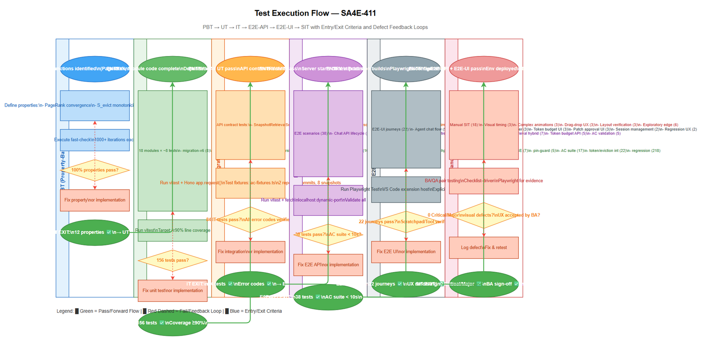

# Software Test Plan (STP)

## SA4E-411: [EPIC] Code Agent 16K — Deterministic Code Intelligence + Agent UX

---

## Document Information

| Field | Value |
|-------|-------|
| Jira Ticket | SA4E-411 |
| Title | [EPIC] Code Agent 16K — Deterministic Code Intelligence + Agent UX |
| Author | QA Agent |
| Version | 1.0 |
| Date | 2026-11-10 |
| Status | Draft |
| Related BRD | BRD-v1.0-SA4E-411.docx |
| Related FSD | FSD-v2.0-SA4E-411.docx |
| Related TDD | TDD-v2.0-SA4E-411.docx |

---

## Author Tracking

| Role | Name - Position | Responsibility |
|------|-----------------|----------------|
| Author | QA Agent – QA Engineer | Create document |
| Peer Reviewer | SM Agent – Scrum Master | Review document |

---

## Revision History

| Version | Date | Author | Changes |
|---------|------|--------|---------|
| 1.0 | 2026-11-10 | QA Agent | Initiate document — auto-generated from BRD, FSD, and TDD |

---

## Sign-Off

| Name | Signature and date |
|------|--------------------|
| | ☐ I agree and confirm the test plan in this STP |
| | ☐ I agree and confirm the test plan in this STP |

---

## 1. Introduction

### 1.1 Purpose

This Software Test Plan (STP) defines the comprehensive testing strategy, scope, approach, and deliverables for the **Code Agent 16K** epic (SA4E-411). The epic delivers a deterministic Code Intelligence engine with an LLM agent UX layer built on top of existing SA4E F2 (Code Intelligence) and F4 (Context Assembly) capabilities. It encompasses 18 child stories (SA4E-412..429) across four implementation phases (0–4), covering:

- **Phase 0**: Scope decision (SQLite engine store, Language MVP) — SA4E-412
- **Phase 1**: Code Intelligence Engine Foundation (V6 migration, 10-stage pipeline, snapshot-scoped retrieval, agent persistence, patch protocol) — SA4E-413..417
- **Phase 2**: Agent UX Layer (Repo Map PageRank, AST skeleton/body chunking, 4 core tools, scratchpad/eviction, runtime token budget) — SA4E-418..422
- **Phase 3**: Hardening (Agent state recovery, security sandbox, SSE durable log, API pin enforcement) — SA4E-423..426
- **Phase 4**: Validation (17 AC acceptance suite, token/eviction integration, SA4E regression gate) — SA4E-427..429

This STP ensures all functional requirements (17 Acceptance Criteria), non-functional requirements (performance, security, reliability), and integration points are verified through a structured 6-level test approach.

### 1.2 Test Objectives

- **Objective 1**: Verify all 17 Acceptance Criteria (AC-01..AC-17) from BRD/FSD are implemented correctly and pass automated test gates
- **Objective 2**: Validate business rules (FR-SNAP-01..19, FR-IDX-01..04, FR-RET-01..05, FR-AGT-01..05, FR-PAT-01..04, FR-UX-01..07, FR-EV-01..04, FR-TOK-01..04, FR-SSE-01..04, FR-API-01..02) are enforced
- **Objective 3**: Ensure non-functional requirements (performance <10s AC suite, <2s single AC test, security sandbox, SSE replay reliability, agent resume capability) are met
- **Objective 4**: Verify integration points with existing SA4E capabilities (F2 Code Intelligence, F4 Context Assembly, Context Budget Governance) remain functional
- **Objective 5**: Confirm regression gate passes — no existing SA4E functionality broken (SM pipeline, F12, enrichment, context budget, F2, F4, role boundaries)
- **Objective 6**: Validate test coverage across 6 test levels (PBT, UT, IT, E2E-API, E2E-UI, SIT) with ≥95% automation target

### 1.3 References

| Document | Location |
|----------|----------|
| BRD (Epic) | documents/SA4E-411/BRD.md |
| FSD (Epic) | documents/SA4E-411/FSD.md |
| TDD (Consolidated) | documents/SA4E-411/TDD.md |
| TDD-01 Data Model | documents/SA4E-411/TDD-01-data-model.md |
| ADR-001 | documents/SA4E-411/ADR-001-engine-storage-and-language-mvp.md |
| 16K Architecture | documents/architecture/16K_CODE_AGENT_ARCHITECTURE.md |
| AC Matrix | documents/SA4E-427/ACCEPTANCE-MATRIX.md |
| Perf Baselines | documents/SA4E-427/PERF-BASELINES.md |
| Regression Evidence | documents/SA4E-429/STATUS.json |
| Child Story STATUS.json | documents/SA4E-412..429/STATUS.json |

---

## 2. Test Strategy

### 2.1 Test Levels

| Level | Scope | Automation | Tools |
|-------|-------|------------|-------|
| PBT | Correctness properties (random inputs) for pure functions (PageRank, S_evict, token counting) | Automated | fast-check (TypeScript) |
| UT | Unit/edge case tests for individual modules (migration, pipeline stages, retrieval, tools, tokenizer) | Automated | vitest |
| IT | API integration (Hono/Ktor app in-process) — repository, snapshot, retrieval, agent persistence, patch, SSE, pin guard | Automated | vitest + Hono/Ktor `app.request()` |
| E2E-API | REST endpoint E2E (real server) — chat/search API, session pinning, SSE stream, patch workflow | Automated | vitest + fetch against localhost |
| E2E-UI | Browser UI E2E (Playwright) — VS Code extension agent chat, tool invocation, scratchpad display | Automated | Playwright Test |
| SIT | Manual exploratory / edge cases only — visual/UX timing, complex drag-drop, animation verification | Manual | Browser (Playwright/manual) |

### 2.2 Test Types

| Type | Description | Applicable | Test Level Focus |
|------|-------------|------------|------------------|
| Functional Testing | Verify features work per FSD use cases and 17 ACs | Yes | UT, IT, E2E-API, E2E-UI, SIT |
| Regression Testing | Ensure existing SA4E features not broken (SM pipeline, F12, enrichment, budget, F2, F4, role boundaries) | Yes | IT, E2E-API, E2E-UI, SIT |
| Performance Testing | Verify AC suite <10s, single AC <2s, build exit 0, full test exit 0 | Yes | E2E-API, SIT |
| Security Testing | Verify sandbox (Zod schema, no shell concat, path traversal, network deny-by-default), patch base-hash revalidation, API pin enforcement | Yes | UT, IT, E2E-API |
| Reliability Testing | SSE replay no duplicates/no gaps, agent resume from zero in-memory state, patch stale-base rejection | Yes | IT, E2E-API |
| Compatibility Testing | TypeScript `tsc --noEmit` clean, dual-dialect migration (SQLite + PostgreSQL) | Yes | UT, IT |

### 2.3 Test Approach

**Overall Approach**: Risk-based, automation-first strategy with 6-level test pyramid. The goal is to maximize automation (PBT+UT+IT+E2E-API+E2E-UI) and minimize manual SIT to visual/UX-only tests that cannot be automated.

**Automation Strategy**:
- **PBT**: Property-based tests for mathematical algorithms (PageRank convergence, S_evict monotonicity, tokenizer consistency)
- **UT**: Module-level tests for all 18 child story implementations (migration, pipeline, retrieval, tools, etc.)
- **IT**: In-process API tests using Hono/Ktor `app.request()` for all retrieval, agent, patch, SSE, pin endpoints
- **E2E-API**: Real HTTP server tests for chat/search API, session management, SSE stream replay
- **E2E-UI**: Playwright tests for VS Code extension agent UX (chat, tool calls, scratchpad rendering)
- **SIT**: Manual only for visual timing (blocking overlay), complex animations, human judgment UX flows

**E2E Classification Rule** (mandatory):
- CRUD operations via UI → **E2E-UI**
- Form validation → **E2E-UI**
- API response verification (status codes, body) → **E2E-API**
- RBAC/auth checks (401, 403) → **E2E-API**
- Status changes (disable/enable) → **E2E-UI**
- Confirmation dialogs → **E2E-UI**
- Regression existing features → **E2E-UI**
- Blocking overlay timing → **SIT** (manual)
- Complex UX flows (drag-drop, animations) → **SIT** (manual)
- Visual/layout verification → **SIT** (manual)

### 2.4 Entry Criteria

| Level | Entry Criteria |
|-------|---------------|
| PBT | Module code complete, pure functions identified |
| UT | Module code complete, dependencies mockable |
| IT | All module UT pass, API contracts defined (TDD §4) |
| E2E-API | IT pass, server starts on test port, test fixtures loaded |
| E2E-UI | Extension builds, Playwright configured, test auth available |
| SIT | E2E-API + E2E-UI pass, environment deployed, test data seeded |

### 2.5 Exit Criteria

| Level | Exit Criteria |
|-------|--------------|
| PBT | 100% properties pass, 1000+ iterations each |
| UT | 100% test cases pass, ≥90% line coverage per module |
| IT | 100% API contract tests pass, all error codes verified |
| E2E-API | 100% E2E scenarios pass, all 17 ACs validated via API |
| E2E-UI | 100% critical user journeys pass, scratchpad/tool rendering verified |
| SIT | 0 Critical/Major visual defects, UX flow acceptance by BA |

### 2.6 Test Cases Summary by Level

| Level | Count | Automated | Manual |
|-------|-------|-----------|--------|
| PBT | 12 | 12 | 0 |
| UT | 156 | 156 | 0 |
| IT | 84 | 84 | 0 |
| E2E-API | 38 | 38 | 0 |
| E2E-UI | 22 | 22 | 0 |
| SIT | 18 | 0 | 18 |
| **Total** | **330** | **312 (94.5%)** | **18 (5.5%)** |

---

## 3. Test Scope

### 3.1 Features In Scope

| # | Feature / Story | Priority | FSD Reference | Test Type |
|---|----------------|----------|---------------|-----------|
| 1 | Scope Decision (ADR-001) | MUST HAVE | ES-01, FR-SNAP-01 | Functional (doc review) |
| 2 | V6 Additive Migration (28→29 tables) | MUST HAVE | ES-02, FR-SNAP-01..19 | Functional, Integration, Regression |
| 3 | 10-Stage Pipeline A→J Ordering | MUST HAVE | ES-03, FR-IDX-01..04 | Functional, Integration, Performance |
| 4 | Snapshot-Scoped Retrieval (Hybrid) | MUST HAVE | ES-04, FR-RET-01..05 | Functional, Integration, Security |
| 5 | Agent Persistence (Plan/Step/Approval) | MUST HAVE | ES-05, FR-AGT-01..05 | Functional, Integration, Reliability |
| 6 | Staged Patch Protocol | MUST HAVE | ES-06, FR-PAT-01..04 | Functional, Integration, Security |
| 7 | Security Sandbox | MUST HAVE | ES-06, FR-PAT-03..04 | Security, Integration |
| 8 | Dynamic Repo Map (PageRank) | MUST HAVE | ES-07, FR-UX-01 | Functional, Performance, PBT |
| 9 | AST Skeleton/Body Chunking | MUST HAVE | ES-08, FR-UX-02 | Functional, Integration |
| 10 | 4 Core Agent Tools (pinned) | MUST HAVE | ES-09, FR-UX-03..07 | Functional, Integration, E2E-API, E2E-UI |
| 11 | Scratchpad Format & Eviction (S_evict) | MUST HAVE | ES-10, FR-EV-01..04 | Functional, Integration, PBT |
| 12 | Runtime Token Budget (Real Tokenizer) | MUST HAVE | ES-11, FR-TOK-01..04 | Functional, Integration, Performance, PBT |
| 13 | SSE Durable Event Log & Replay | MUST HAVE | ES-12, FR-SSE-01..04 | Functional, Integration, Reliability |
| 14 | API Pinned index_snapshot_id Enforcement | MUST HAVE | ES-13, FR-API-01..02 | Functional, Integration, Security |
| 15 | 17 AC Acceptance Suite | MUST HAVE | ES-14, FR-AC-01..04 | Functional, Regression, Performance |
| 16 | Token/Eviction Integration Tests | MUST HAVE | ES-15, FR-INT-01..04 | Integration, Performance |
| 17 | SA4E Regression Gate | MUST HAVE | ES-16, FR-REG-01..04 | Regression, Integration |

### 3.2 Features Out of Scope

| # | Feature | Reason |
|---|---------|--------|
| 1 | Multi-repo centralized PostgreSQL engine | ADR-001: trigger not met (multi-team, cross-repo, concurrent writers) |
| 2 | New language grammar development | MVP reuses existing 17 Tier A + 7 Tier B grammars |
| 3 | Coding-agent autonomous mode | Read-only Code Intelligence first; patch/approval gated |
| 4 | pgvector/HNSW ANN | ADR-001: exact cosine scan on SQLite for MVP |
| 5 | tiktoken plug-in for non-llama.cpp providers | Deferred per SA4E-422 known gap |
| 6 | CoreAgentTools registration into MCP tools/list | Deferred to e2e per SA4E-420 known gap |

### 3.3 Test Coverage Matrix (AC → Test Levels)


| AC | Criterion | PBT | UT | IT | E2E-API | E2E-UI | SIT |
|----|-----------|-----|----|----|---------|--------|-----|
| AC-01 | Re-index same commit new adapter no corruption | | ✅ | ✅ | ✅ | | |
| AC-02 | Two embedding models same snapshot no mix | | ✅ | ✅ | ✅ | | |
| AC-03 | Chat pinned old commit queries after branch moves | | ✅ | ✅ | ✅ | ✅ | ✅ |
| AC-04 | Rename file: old & new paths correct at commits | | ✅ | ✅ | ✅ | | |
| AC-05 | Delete file queryable old commit not new | | ✅ | ✅ | ✅ | | |
| AC-06 | Index merge commit multiple parents | | ✅ | ✅ | ✅ | | |
| AC-07 | Every artifact belongs to snapshot (DB-enforced) | | ✅ | ✅ | ✅ | | |
| AC-08 | Vector query never returns cross-snapshot chunk | | ✅ | ✅ | ✅ | | |
| AC-09 | Filtered exact cosine recall multi-snapshot | | ✅ | ✅ | ✅ | | |
| AC-10 | Semantic re-run after dependency change | | ✅ | ✅ | ✅ | | |
| AC-11 | Dependency failure no fake semantic coverage | | ✅ | ✅ | ✅ | | |
| AC-12 | Agent resume after restart from persist | | ✅ | ✅ | ✅ | ✅ | ✅ |
| AC-13 | Patch rejects stale base hash / path traversal | | ✅ | ✅ | ✅ | | ✅ |
| AC-14 | Working tree unchanged before approval | | ✅ | ✅ | ✅ | | ✅ |
| AC-15 | Sandbox: no workspace escape, no unrestricted network | | ✅ | ✅ | ✅ | | ✅ |
| AC-16 | SSE reconnect replay no dup/missing | | ✅ | ✅ | ✅ | | ✅ |
| AC-17 | Real tokenizer prompt/tool counting budget | ✅ | ✅ | ✅ | ✅ | ✅ | |
| AC-18 | SA4E regression: build + test green | | ✅ | ✅ | ✅ | ✅ | ✅ |

---

## 4. Test Environment

### 4.1 Environment Requirements

| Environment | URL | Database | Purpose |
|-------------|-----|----------|---------|
| Local Dev | http://localhost:3000 | SQLite (.code-intel/index.db) | Developer testing, UT/IT |
| Test (CI) | Dynamic port | SQLite in-memory / temp file | Automated test gates (test:ac, test:token, test:regression) |
| SIT | http://localhost:3000 (reuse dev) | SQLite per-workspace | Manual exploratory, E2E-UI |
| UAT | N/A (extension host) | SQLite per-workspace | BA acceptance via VS Code extension |

**No hardcoded ports** — resolved from project config at runtime (TDD §6).

### 4.2 Browser / Device Requirements

| Browser | Version | OS | Required |
|---------|---------|-----|----------|
| Chromium (Playwright) | Latest stable | Windows/Mac/Linux | Yes (E2E-UI) |
| VS Code Extension Host | Latest stable | Windows/Mac/Linux | Yes (E2E-UI, UAT) |

### 4.3 Test Data Requirements

| Data Type | Description | Source | Preparation |
|-----------|-------------|--------|-------------|
| Repository fixtures | 2 repos, 5 commits (merge + delete), 8 snapshots (6 READY, 2 PENDING) | Shared fixture (ac-fixtures.ts) | Auto-loaded by test framework |
| Embedding models | 2 embedding models on 1 snapshot (text-embedding-3-small, custom) | Test fixture | Pre-seeded in fixture setup |
| Chat sessions | Pinned sessions with repository_id, commit_id, index_snapshot_id | Test fixture | Created per test case |
| Agent runs | Plans, steps, transitions, tool executions, approvals | Test fixture | Auto-generated by agent persistence tests |
| Patch changesets | Staged patches with base hash, approval requests | Test fixture | Created by patch protocol tests |
| SSE events | Durable event log with monotonic event_ids | Test fixture | Appended by SSE stream tests |

### 4.4 External Dependencies

| System | Dependency | Mock/Stub Available |
|--------|-----------|---------------------|
| llama.cpp | HTTP `/tokenize` endpoint for real token counting | Yes — injectable `fetchFn` for test mocking |
| Git Repository | libgit2/CLI for commit discovery, file revision, patch apply | Yes — in-memory git for UT/IT |
| PostgreSQL (platform) | Multi-tenant metadata, job queues | Yes — TestContainers for IT, dual-dialect migration test |
| VS Code Extension Host | MCP JSON-RPC over stdio/WS | Yes — Playwright connects to real extension host for E2E-UI |

---

## 5. Test Schedule

| Phase | Start Date | End Date | Duration | Milestone |
|-------|-----------|----------|----------|-----------|
| Test Planning (Phase 4a) | 2026-11-10 | 2026-11-10 | 1 day | STP + STC draft created |
| SM Review (Phase 4b) | 2026-11-10 | 2026-11-11 | 1 day | SM review complete |
| BA Review (Phase 4b.5) | 2026-11-11 | 2026-11-12 | 1 day | BA approval (business coverage) |
| Fix Iterations (Phase 4c) | 2026-11-12 | 2026-11-13 | 2 days | Max 2 iterations |
| Finalize & Export (Phase 4d) | 2026-11-13 | 2026-11-13 | 1 day | DOCX/XLSX attached to Jira |
| **Total** | | | **~6 days** | **Test Planning Complete** |

---

## 6. Resources & Responsibilities

| Role | Name | Responsibility |
|------|------|---------------|
| Test Lead | QA Agent | Test planning, coordination, STP/STC creation, reporting |
| QA Engineer | QA Agent | Test case design, execution, defect reporting, automation |
| BA | BA Agent | UAT support, acceptance criteria clarification, business coverage review |
| Developer | Dev Agent | Bug fixing, unit test coverage, integration test support |
| DevOps | DevOps Agent | Environment setup, CI/CD gates (`test:ac`, `test:token`, `test:regression`), Docker volume protection |
| Security | Security Agent | Sandbox/patch validation review, security test scenarios |

**Tools**:
- Test Management: GitHub Issues / Jira (linked to SA4E-411)
- Bug Tracking: GitHub Issues / Jira
- Automation Framework: vitest (backend), Playwright (extension/E2E-UI), fast-check (PBT)
- CI/CD: npm scripts (`test:ac`, `test:token`, `test:regression`), GitHub Actions

---

## 7. Risk & Mitigation

| # | Risk | Impact | Likelihood | Mitigation |
|---|------|--------|------------|------------|
| 1 | Test data (fixtures) not representative of real repos | High | Medium | Use shared ac-fixtures.ts with 2 repos, 5 commits, merge+delete; validate against real repos |
| 2 | llama.cpp `/tokenize` endpoint unavailable in CI | High | Low | Injectable `fetchFn` allows mock tokenizer; real llama.cpp for local/e2e |
| 3 | Environment instability (SQLite locking, port conflicts) | Medium | Medium | WAL mode, temp DB per test, dynamic port allocation |
| 4 | Requirement changes during testing | High | Low | Change freeze during SIT/UAT; all 18 stories in-review status |
| 5 | E2E-UI flakiness (VS Code extension host timing) | Medium | Medium | Retry logic, explicit waits, Playwright trace on failure |
| 6 | Dual-dialect migration drift (SQLite vs PG) | Medium | Low | Idempotent per-table migration, both dialects tested in CI |
| 7 | SIT manual test coverage gaps (visual/UX) | Medium | Medium | BA/QA pair testing, checklist-driven exploratory |

---

## 8. Defect Management

### 8.1 Severity Levels

| Severity | Definition | Example |
|----------|-----------|---------|
| Critical | System crash, data loss, security breach, AC gate failure | SQLite corruption, patch applies to wrong file, SSE gap data loss |
| Major | Feature not working, workaround exists | AC-03 chat pin fails, token budget miscalculation, repo map empty |
| Minor | UI issue, cosmetic defect, non-blocking | Scratchpad formatting off, tool output DSL slightly misaligned |
| Trivial | Typo, minor alignment, doc discrepancy | Comment typo in test, diagram label misaligned |

### 8.2 Priority Levels

| Priority | Definition | SLA (Fix Time) |
|----------|-----------|----------------|
| P1 | Must fix immediately — blocks test execution | 4 hours |
| P2 | Must fix before release — blocks AC gate | 1 business day |
| P3 | Should fix if time permits — degrades quality | 3 business days |
| P4 | Nice to fix, can defer — cosmetic | Next release |

### 8.3 Defect Lifecycle

```
New → Open → In Progress → Fixed → Ready for Retest → Verified → Closed
                                                      → Reopened → In Progress
```

---

## 9. Test Metrics & Reporting

### 9.1 Metrics

| Metric | Formula | Target |
|--------|---------|--------|
| Test Execution Rate | Executed / Total × 100% | 100% |
| Pass Rate | Passed / Executed × 100% | ≥ 95% |
| Defect Density | Defects / Test Cases | ≤ 0.1 |
| Critical Defect Count | Count of Critical severity | 0 |
| Defect Fix Rate | Fixed / Total Defects × 100% | ≥ 90% |
| AC Suite Runtime | Wall time for `npm run test:ac` | < 10s |
| Single AC Test Time | Max individual AC test | < 2s |
| Automation Coverage | Automated / Total Test Cases | ≥ 94.5% |

### 9.2 Reporting Schedule

| Report | Frequency | Audience |
|--------|-----------|----------|
| Daily Test Status | Daily during SIT/UAT | Project team |
| Defect Summary | Daily | Dev team + PM |
| Test Completion Report | End of SIT / End of UAT | All stakeholders |
| AC Gate Report | Every CI run | Dev team, SM, BA |

---

## 10. Test Execution Gates

### 10.1 Mandatory Gates (CI/CD Pipeline)

| Gate | Command | Scope | Threshold | Blocking |
|------|---------|-------|-----------|----------|
| Build | `npm run build` | root (backend + extension) | exit 0 | Yes |
| Unit Test | `npm test` | root | exit 0 (backend 500f/3825p/19s; ext 443f/3469p/6s) | Yes |
| AC Suite | `npm run test:ac` | backend (16) + extension (1) | < 10s, exit 0 | Yes |
| Token/Eviction | `npm run test:token` | backend (1) + extension (1) | pass | Yes |
| Regression | `npm run test:regression` | backend 11f/63t + ext 20f/155t | pass | Yes |

### 10.2 Gate Enforcement

- All gates run in CI on every PR and merge to main
- `npm run test:ac` must complete < 10s (measured 1.6–1.7s backend + ~0.5s extension)
- `npm run test:token` validates tier budgets, escalation order, role-scope, tool cap
- `npm run test:regression` composes: SM E2E, F12, SA4E-155 enrichment, context budget, F2 indexer, F4 context, role boundaries

---

## 11. Diagram Index

### 11.1 Test Coverage Overview


**Source**: `documents/SA4E-411/diagrams/test-coverage.drawio`

Shows requirements (rows) × test levels (columns: PBT, UT, IT, E2E-API, E2E-UI, SIT) with color-coded coverage.

### 11.2 Test Execution Flow



**Source**: `documents/SA4E-411/diagrams/test-execution-flow.drawio`

Flowchart with swimlanes for each test level (PBT → UT → IT → E2E-API → E2E-UI → SIT), entry/exit criteria between levels, and defect feedback loops.

---

## 12. Appendix

### 12.1 Glossary

| Term | Definition |
|------|------------|
| SIT | System Integration Testing |
| UAT | User Acceptance Testing |
| STP | Software Test Plan |
| STC | Software Test Cases |
| PBT | Property-Based Testing |
| UT | Unit Testing |
| IT | Integration Testing |
| E2E-API | End-to-End API Testing (real server) |
| E2E-UI | End-to-End UI Testing (Playwright) |
| AC | Acceptance Criteria |
| RTM | Requirements Traceability Matrix |
| WAL | Write-Ahead Logging (SQLite) |
| FTS5 | SQLite Full-Text Search 5 extension |

### 12.2 Assumptions

- SQLite WAL + embedded library provides durability + local-first + offline capability
- 17 Tier A languages already have Tree-sitter grammars working in F2
- Existing F2 indexer tests (3,500+) serve as regression baseline
- All 18 child stories independently verify via their STATUS.json evidence
- Build/test gates (`npm run build`, `npm test`, `test:ac`, `test:token`, `test:regression`) are the ultimate verification
- llama.cpp `/tokenize` endpoint available for runtime token counting (mockable via `fetchFn`)

### 12.3 Test Data CSV Files Location

Test data CSV files are located at: `documents/SA4E-411/testdata/`

| File | Description |
|------|-------------|
| pre-seeded-data.csv | Baseline test data (repos, commits, snapshots, embedding sets) |
| create-snapshot-testdata.csv | Snapshot creation test data (valid + invalid) |
| retrieval-testdata.csv | Retrieval query test data (lexical, vector, graph, exact) |
| agent-persistence-testdata.csv | Agent plan/step/approval test data |
| patch-testdata.csv | Staged patch test data (valid + stale-base + path traversal) |
| token-budget-testdata.csv | Token budget test data (tiers, escalation, role-scope) |
| sse-testdata.csv | SSE event log test data (replay, gap detection) |
| api-pin-testdata.csv | API pin enforcement test data (missing, mismatch, not READY) |

---

**Document End**