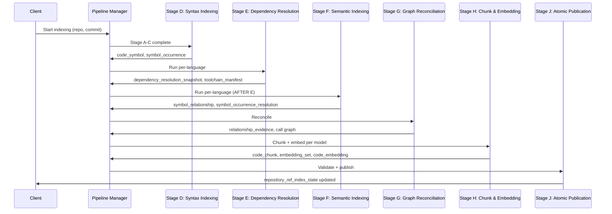
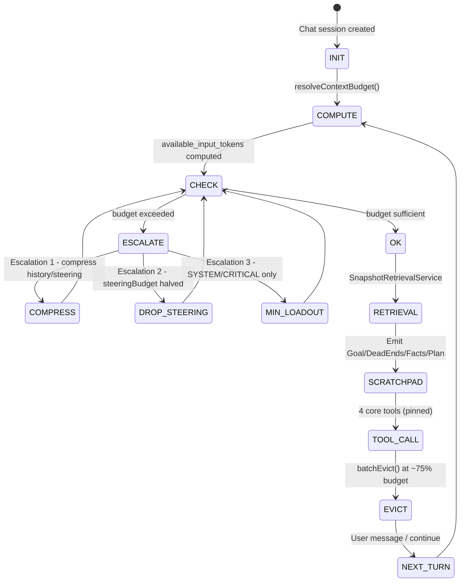
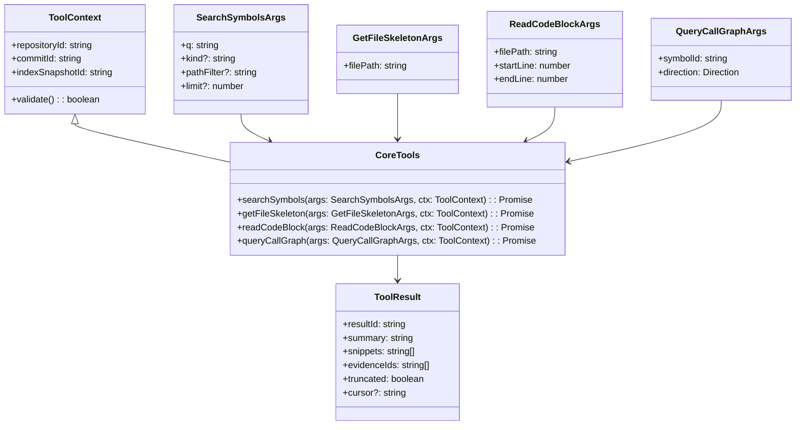

# Technical Design Document (TDD) — Consolidated

## SA4E-411: [EPIC] Code Agent 16K — Deterministic Code Intelligence + Agent UX

---

## Document Information

| Field | Value |
|-------|-------|
| Jira Ticket | SA4E-411 |
| Title | [EPIC] Code Agent 16K — Deterministic Code Intelligence + Agent UX |
| Author | SA Agent |
| Version | 2.0 |
| Date | 2026-11-10 |
| Status | Complete — All 18 child stories implemented and In Review |

---

## 1. Introduction

### 1.1 Purpose

This TDD consolidates the technical design across all 18 child stories (SA4E-412..429). It **references** (does not duplicate) the two foundational documents:

- **ADR-001**: `documents/SA4E-411/ADR-001-engine-storage-and-language-mvp.md` — engine store = SQLite embedded per-workspace; PostgreSQL platform DB unchanged; language MVP = 17 Tier A + 7 Tier B grammars
- **TDD-01 Data Model**: `documents/SA4E-411/TDD-01-data-model.md` — 28→29 table additive V6 migration, snapshot/revision hierarchy, composite FK invariants, dual-dialect

### 1.2 Architecture Positioning

```
┌─────────────────────────────────────────────────────────────────────────┐
│  AGENT UX LAYER (Phase 2–3)                                             │
│  backend/src/engine/repo-map/, agent-tools/, scratchpad/                │
│  extension/src/pi-agent/, pi-workflow/, budget-gate/                    │
├─────────────────────────────────────────────────────────────────────────┤
│  CODE INTELLIGENCE ENGINE (Phase 1)                                     │
│  backend/src/engine/db/migration-v6.ts, index-pipeline/,                │
│  retrieval/, agent/ (persistence), security/ (patch, sandbox)           │
├─────────────────────────────────────────────────────────────────────────┤
│  SQLITE ENGINE STORE (ADR-001)                                          │
│  .code-intel/index.db per workspace | WAL | immutable file boundary     │
└─────────────────────────────────────────────────────────────────────────┘
```

**Three-Layer Architecture:**

| Layer | Responsibility | Key Modules |
|-------|---------------|-------------|
| **Agent UX** | Repository map, core tools, scratchpad/eviction, token budget, SSE, state recovery, security sandbox, API pin enforcement | `repo-map`, `agent-tools`, `scratchpad`, `token-budget`, `events`, `agent/state-recovery`, `security`, `api` |
| **Code Intelligence Engine** | Snapshot/revision data model, dependency-before-semantic pipeline, snapshot-scoped retrieval, agent persistence, patch protocol | `db/migration-v6`, `pipeline`, `retrieval`, `agent/persistence`, `security/patch-protocol` |
| **Storage** | SQLite embedded per-workspace (`.code-intel/index.db`), WAL mode, immutable snapshot file boundary | `better-sqlite3` / `sqlite-wasm`, FTS5, exact cosine vector search |

### 1.3 Integration with Existing SA4E Capabilities

| Existing Capability | Integration Approach | Child Stories |
|---------------------|---------------------|---------------|
| **F2 Indexer** | Reuse SQLite + Tree-sitter + FTS5 + graph + incremental + WAL | 413, 414, 418, 419 |
| **F4 Context Assembly** | Keep `get_ai_context`/edit/curated; add `query_call_graph` only | 415, 420, 429 |
| **Context Budget Governance** | Wire `BudgetCalculator`/`ThresholdGate`/tiering/steering; **don't rewrite** | 422, 428 |
| **Steering/AGENTS.md** | Subject to budget gate (`DefaultResourceLoader`) | 428, 429 |
| **SA4E-335 Docker Volume Protection** | No `docker compose down -v` on prod stack; test stack separate | All |

---

## 2. Implemented Modules — Story → Path → Purpose

| Story | Module Path | Purpose |
|-------|-------------|---------|
| **SA4E-412** | (ADR doc only) | Scope decision: SQLite engine store, language MVP |
| **SA4E-413** | `backend/src/engine/db/migration-v6.ts` + `migration-v6-pg.ts` + `migrations.ts` + `__tests__/migration-v6.test.ts` | V6 additive migration (29 new tables), composite FK triggers, dual-dialect |
| **SA4E-414** | `backend/src/engine/pipeline/index-pipeline.ts` + `pipeline-types.ts` + `__tests__/index-pipeline.*.test.ts` | 10-stage dependency-before-semantic pipeline, per-language isolation |
| **SA4E-415** | `backend/src/engine/retrieval/snapshot-retrieval.ts` + `__tests__/` | Snapshot-scoped hybrid retrieval (lexical/vector/graph/exact) |
| **SA4E-416** | `backend/src/engine/agent/agent-persistence.ts` + `AgentEventLog` | Plan/step/approval/transition/tool-execution/retrieval-evidence persistence |
| **SA4E-417** | `backend/src/engine/security/patch-protocol.ts` + `staged-patch.ts` + `sandbox.ts` | Staged patch (stage → approve → apply), sandbox validation |
| **SA4E-418** | `backend/src/engine/repo-map/repo-map.ts` + `page-rank.ts` + `packer.ts` | PageRank repo map, query personalization, binary-search token packing |
| **SA4E-419** | `backend/src/engine/chunking/ast-chunker.ts` + `embedding-pipeline.ts` | AST skeleton/body chunking, embedding set (model-swap without reparse) |
| **SA4E-420** | `backend/src/engine/agent-tools/core-tools.ts` + `tool-context.ts` + `__tests__/` | 4 core tools (search_symbols, get_file_skeleton, read_code_block, query_call_graph) with session pinning |
| **SA4E-421** | `backend/src/engine/scratchpad/scratchpad.ts` + `eviction.ts` + `__tests__/token-eviction.integration.test.ts` | Canonical scratchpad format + S_evict algorithm + tombstones |
| **SA4E-422** | `backend/src/engine/token-budget/runtime-tokenizer.ts` + `budget-gate.ts` + `extension/src/pi-agent/budget-gate*.ts` | Real tokenizer (llama.cpp `/tokenize`), runtime budget formula, tier resolution |
| **SA4E-423** | `backend/src/engine/agent/agent-state-recovery.ts` + `__tests__/` | `summarizeForResume()` from zero in-memory state |
| **SA4E-424** | `backend/src/engine/security/staged-patch.ts` + `sandbox.ts` + `__tests__/` | Staged patch with stale-base revalidation, sandbox policy |
| **SA4E-425** | `backend/src/engine/events/sse-stream.ts` + `agent-event.ts` + `__tests__/` | SSE durable log, `Last-Event-ID` replay, gap detection |
| **SA4E-426** | `backend/src/engine/api/pinned-snapshot-guard.ts` + `__tests__/` | API guard requiring `session_id` + `index_snapshot_id` |
| **SA4E-427** | `backend/src/engine/acceptance/__tests__/` (3 files) + `extension/src/pi-agent/__tests__/acceptance-ac17.test.ts` | 17 AC acceptance suite + shared fixture |
| **SA4E-428** | `backend/src/engine/scratchpad/__tests__/token-eviction.integration.test.ts` + `extension/src/pi-agent/__tests__/token-eviction.integration.test.ts` | Token/eviction integration: tiers, escalation, role-scope, tool cap |
| **SA4E-429** | `backend/src/engine/regression/__tests__/sa4e-regression.test.ts` + `extension/src/__tests__/sa4e-regression.test.ts` | SA4E regression gate (SM, F12, enrichment, budget, F2, F4, role boundaries) |

---

## 3. Data Model Summary (from TDD-01)

### 3.1 V6 Migration (Additive-Only, 28→29 Tables)

**Category → Tables:**

| Category | Tables |
|----------|--------|
| Repository/Commit | `repository`, `git_commit`, `git_commit_parent`, `git_ref` |
| Source Revisions | `source_file_revision` |
| Snapshot & Artifacts | `code_index_snapshot`, `code_module`, `code_symbol`, `symbol_occurrence`, `symbol_occurrence_resolution`, `symbol_relationship`, `relationship_evidence`, `code_chunk`, `code_chunk_fts` (FTS5), `dependency_resolution_snapshot` |
| Embedding | `embedding_set`, `code_embedding` |
| Active Pointer | `repository_ref_index_state` |
| Chat/Agent | `chat_session`, `agent_run`, `agent_plan`, `agent_step`, `agent_state_transition`, `agent_tool_execution`, `retrieval_evidence`, `agent_workspace` |
| Patch Workflow | `change_set`, `approval_request`, `execution_run` |
| SSE Events | `agent_event` (added by SA4E-425) |

### 3.2 Key Invariants (Enforced by Triggers)

| Invariant | Enforcement |
|-----------|-------------|
| **Composite FK ownership** | All artifact tables reference `(id, snapshot_id)` of parent via triggers (`ai_*`, `au_*`) |
| **Multi-tenant `project_id`** | All 16K tables include `project_id` (V5); UNIQUE constraints include `project_id` |
| **CHECK constraints** | `start_line <= end_line`, offsets ≥ 0, `confidence ∈ [0,1]`, status enums |
| **Chat session pin consistency** | Trigger validates `pinned_code_index_snapshot_id` belongs to session's `(repository_id, commit_id)` |
| **Embedding set uniqueness** | UNIQUE(`code_index_snapshot_id`, `model_key`, `model_version`, `preprocessing_version`) |

### 3.3 Migration Strategy

- **File**: `backend/src/engine/db/migration-v6.ts` + `migration-v6-pg.ts`
- **Pattern**: Idempotent per-table (check `pragma_table_info` / `information_schema`)
- **Dual-dialect**: SQLite DDL source; PG via `database/migration/ddl-translator.ts`
- **FTS5**: `code_chunk_fts` (content-less shadow, external content = `code_chunk`) — SQLite only
- **Schema version**: 6 (registered in `migrations.ts`)

> **Full DDL**: See `documents/SA4E-411/TDD-01-data-model.md` §3 for complete CREATE TABLE statements.

---

## 4. Interfaces & Contracts

### 4.1 Core Agent Tools (SA4E-420)

All tools require mandatory session pinning: `repository_id`, `commit_id`, `index_snapshot_id`.

| Tool | Input Type | Output Type | Session Pin Required |
|------|------------|-------------|---------------------|
| `search_symbols` | `SearchSymbolsArgs { q: string, kind?: string, path_filter?: string, limit?: number }` | `ToolResult { resultId, summary, snippets[], evidenceIds[], truncated, cursor? }` | YES |
| `get_file_skeleton` | `GetFileSkeletonArgs { file_path: string }` | `ToolResult` (class/interface structure, signatures, no body) | YES |
| `read_code_block` | `ReadCodeBlockArgs { file_path: string, start_line: number, end_line: number }` | `ToolResult` (max 120 lines) | YES |
| `query_call_graph` | `QueryCallGraphArgs { symbol_id: string, direction: 'CALLERS' \| 'CALLEES' \| 'IMPLEMENTATIONS' }` | `ToolResult` | YES |

**Output DSL Format (compact, not raw JSON):**
```
[FOUND 3 SYMBOLS | BUDGET_USED: 82 tokens]
1. [METHOD] PaymentService#processTransaction | src/service/PaymentService.java:45-92 (body: 420 tok)
   Sig: @Transactional public Receipt processTransaction(OrderDto order)
```

### 4.2 Retrieval Service (SA4E-415)

```typescript
interface SnapshotRetrievalService {
  pinOrThrow(snapshotId: string, repositoryId: string): Promise<SnapshotInfo>;
  symbolByName(snapshotId: string, name: string): Promise<SymbolHit[]>;
  lexicalSearch(snapshotId: string, query: string, limit: number): Promise<LexicalHit[]>;
  vectorSearch(embeddingSetId: string, queryEmbedding: Buffer, limit: number): Promise<VectorHit[]>;
  graphQuery(snapshotId: string, symbolId: string, direction: Direction): Promise<RelationshipHit[]>;
}
```

**Mandatory Filter**: Every query requires `code_index_snapshot_id` as primary filter.

### 4.3 Patch Protocol (SA4E-417, 424)

```typescript
interface PatchProtocol {
  stage(patch: StructuredPatch): Promise<{ changeSetId: string; approvalId: string }>;
  applyAfterApproval(changeSetId: string, approvalId: string): Promise<ExecutionRun>;
}
```

**Validation at Stage & Apply**:
- Base revision hash matches current workspace (stale-base rejection)
- Target path within workspace (no escape, no `..`, symlink check)
- Patch size limits enforced
- Workspace ownership verified

### 4.4 SSE Stream (SA4E-425)

```typescript
interface SSEStream {
  append(event: AgentEvent): Promise<number>; // returns event_id
  replay(lastEventId: number): AsyncIterable<AgentEvent>;
  // throws SseGapError if gap detected
}
```

**Replay Guarantees**: No duplicates, no gaps, ordered by `event_id`.

### 4.5 API Guard (SA4E-426)

```typescript
function resolvePinnedContext(
  sessionId: string,
  indexSnapshotId: string
): Promise<{ snapshot: SnapshotInfo; repositoryId: string }>;
// Throws 400 if missing, mismatched, or not READY
```

### 4.6 Runtime Tokenizer (SA4E-422)

```typescript
interface RuntimeTokenizer {
  countTokens(text: string): Promise<number>; // llama.cpp /tokenize
}
```

### 4.7 Agent State Recovery (SA4E-423)

```typescript
interface AgentStateRecovery {
  summarizeForResume(agentRunId: string): Promise<ResumeSummary>;
}
```

```typescript
interface ResumeSummary {
  objective: string;
  approvedPlan: AgentPlan;
  nextStepIndex: number;
  pendingApproval: ApprovalRequest | null;
}
```

---

## 5. Security Boundaries

| Boundary | Enforcement | Story |
|----------|-------------|-------|
| Tool args schema | Zod validation; reject shell metachars, absolute paths, `..`, NUL | SA4E-424 |
| Patch base hash | Validated at `stage()` AND re-validated at `applyAfterApproval()` (stale-base) | SA4E-424 |
| Patch path | No workspace escape; symlink check; `--` separator | SA4E-424 |
| Network | Deny by default; registry allowlist exact host match | SA4E-424 |
| Container | Rootless, non-root, capability/mount/process/memory/CPU/disk limits | SA4E-424 |
| API snapshot pin | 400 if `session_id` + `index_snapshot_id` missing/mismatched/not READY | SA4E-426 |
| Role boundaries | 9-agent matrix enforced (SM coordinator-only, no create/forbid overlap) | SA4E-429 |

### 5.1 Patch Security Details

- **Staged workflow**: Working tree unchanged until `applyAfterApproval()` on APPROVED decision
- **Stale-base protection**: Base hash re-validated at apply time; drift = rejection
- **Path traversal**: Absolute paths, `..`, symlinks rejected at stage AND apply
- **Size limits**: Configurable max patch size enforced
- **Ownership**: Workspace ownership verified before any write

### 5.2 Sandbox Policy

- **Tool execution**: Fixed executable + structured arg vector (no shell concatenation)
- **Zod schema validation**: All tool args validated against schema before execution
- **Network**: Deny by default; allowlist registry with exact host match
- **Container limits**: CPU, memory, disk, process count, capabilities restricted
- **Rootless**: Non-root user, no privileged capabilities

### 5.3 API Security

- **Pinned snapshot enforcement**: All chat/search endpoints require `session_id` + `index_snapshot_id`
- **Mismatch detection**: Returns 400 with clear error if session pin ≠ requested snapshot
- **Status check**: Snapshot must be READY (not PENDING/BUILDING/FAILED/SUPERSEDED)

---

## 6. Runtime Profile

| Component | Command / Entry Point | Health Check |
|-----------|----------------------|--------------|
| Backend (indexer + API) | `npm run dev` (backend) → `tsx watch src/index.ts` | `GET /health` |
| Extension (agent host) | VS Code extension host → `pi-workflow` engine | MCP `initialize` |
| SQLite Engine Store | Embedded `better-sqlite3` / `sqlite-wasm` in backend | `PRAGMA journal_mode=WAL` |
| Tokenizer | llama.cpp `/tokenize` endpoint (injected `fetchFn`) | N/A (test-time mock) |

**No hardcoded `npm start` or fixed ports** — resolved from project config at runtime.

---

## 7. Story → Module → Test Traceability

| Story | Key Module(s) | Key Test(s) | AC Covered |
|-------|---------------|-------------|------------|
| SA4E-412 | ADR-001 (doc) | — | — |
| SA4E-413 | migration-v6.ts, migrations.ts | migration-v6.test.ts (8 tests) | AC-01,02,07 |
| SA4E-414 | index-pipeline.ts | index-pipeline.order/isolation.test.ts | AC-10,11 |
| SA4E-415 | snapshot-retrieval.ts | snapshot-retrieval tests + acceptance-ac01-08/09-12 | AC-07,08,09 |
| SA4E-416 | agent-persistence.ts | agent-persistence tests + acceptance-ac09-12 AC-12 | AC-12 |
| SA4E-417 | patch-protocol.ts, staged-patch.ts, sandbox.ts | staged-patch/sandbox tests + acceptance-ac13-16 | AC-13,14,15 |
| SA4E-418 | repo-map.ts, page-rank.ts, packer.ts | repo-map tests | — |
| SA4E-419 | ast-chunker.ts, embedding-pipeline.ts | chunking/embedding tests | AC-02 |
| SA4E-420 | core-tools.ts, tool-context.ts | core-tools tests (7) | — |
| SA4E-421 | scratchpad.ts, eviction.ts | token-eviction.integration.test.ts (13 backend, 9 ext) | — |
| SA4E-422 | runtime-tokenizer.ts, budget-gate.ts | budget-gate tests + acceptance-ac17.test.ts | AC-17 |
| SA4E-423 | agent-state-recovery.ts | agent-state-recovery tests (4) + AC-12 | AC-12 |
| SA4E-424 | staged-patch.ts, sandbox.ts | staged-patch/sandbox tests + AC-13,14,15 | AC-13,14,15 |
| SA4E-425 | sse-stream.ts, agent-event.ts | sse-stream tests (7) + AC-16 | AC-16 |
| SA4E-426 | pinned-snapshot-guard.ts | pinned-snapshot-guard tests (5) | — |
| SA4E-427 | acceptance-ac01-08/09-12/13-16.test.ts + ac17.test.ts | 16 backend + 1 ext tests | AC-01..17 |
| SA4E-428 | token-eviction.integration.test.ts (backend + ext) | 13 + 9 integration tests | — |
| SA4E-429 | sa4e-regression.test.ts (backend 3 + ext 9) + composed gate | 63 backend + 155 ext tests | AC-18 |

---

## 8. Gates & Verification

| Gate | Command | Scope | Threshold |
|------|---------|-------|-----------|
| Build | `npm run build` | root (backend + extension) | exit 0 |
| Unit Test | `npm test` | root | exit 0 (backend 500f/3825p/19s; ext 443f/3469p/6s) |
| AC Suite | `npm run test:ac` | backend (16) + extension (1) | < 10s |
| Token/Eviction | `npm run test:token` | backend (1) + extension (1) | pass |
| Regression | `npm run test:regression` | backend 11f/63t + ext 20f/155t | pass |

**Verified Status (from STATUS.json):**
- Build: `npm run build` exit 0 ✅
- Full test: `npm test` exit 0 (backend 500 files/3825 passed/19 skipped; extension 443 files/3469 passed/6 skipped) ✅
- AC suite: `npm run test:ac` exit 0 (backend 16 tests + extension 1 test) ✅
- Token/Eviction: `npm run test:token` exit 0 (backend 13 + extension 9 integration tests) ✅
- Regression: `npm run test:regression` exit 0 (backend 11 files/63 tests + extension 20 files/155 tests) ✅

---

## 9. Known Deferred Gaps

| Gap | Story | Status |
|-----|-------|--------|
| CoreAgentTools registration into MCP `tools/list` | SA4E-420 | Deferred to e2e |
| tiktoken plug-in for non-llama.cpp providers | SA4E-422 | Deferred |
| AC-09 exact SQLite cosine scan (no ANN) | SA4E-427 | Per ADR-001; HNSW/pgvector path open |

---

## 10. Appendix

### 10.1 Reference Documents

| Document | Location |
|----------|----------|
| ADR-001 | `documents/SA4E-411/ADR-001-engine-storage-and-language-mvp.md` |
| TDD-01 Data Model | `documents/SA4E-411/TDD-01-data-model.md` |
| BRD (epic) | `documents/SA4E-411/BRD.md` |
| FSD (epic) | `documents/SA4E-411/FSD.md` |
| AC Matrix | `documents/SA4E-427/ACCEPTANCE-MATRIX.md` |
| Perf Baselines | `documents/SA4E-427/PERF-BASELINES.md` |
| Regression Evidence | `documents/SA4E-429/STATUS.json` |
| 16K Code Agent Architecture | `documents/architecture/16K_CODE_AGENT_ARCHITECTURE.md` |

### 10.2 Diagram Index

| # | Diagram | Image | Source (editable) |
|---|---------|-------|-------------------|
| 1 | Architecture Overview (4-layer) | `diagrams/architecture-overview.png` | `diagrams/architecture-overview.drawio` |
| 2 | Component Diagram (Agent UX / Engine / Storage layers) | `diagrams/component.png` | `diagrams/component.drawio` |
| 3 | Class Diagram — Core Agent Tools | `diagrams/class-agent-tools.png` | `diagrams/class-agent-tools.drawio` |
| 4 | Snapshot/Revision ER Diagram | `diagrams/snapshot-revision-er.png` | `diagrams/snapshot-revision-er.drawio` |
| 5 | Pipeline Ordering (A–J) | `diagrams/pipeline-ordering.png` | `diagrams/pipeline-ordering.drawio` |
| 6 | Agent UX Token Budget (formula view) | `diagrams/token-budget.png` | `diagrams/token-budget.drawio` |
| 7 | Scratchpad & Eviction (format + algorithm) | `diagrams/scratchpad-eviction.png` | `diagrams/scratchpad-eviction.drawio` |
| 8 | System Context (External Systems + Agent UX + Engine + Storage) | `diagrams/system-context.png` | `diagrams/system-context.drawio` |
| 9 | Sequence — Agent Chat (18 Steps: Chat → Pin → Retrieval → Budget → Scratchpad → Tool Call → Evict) | `diagrams/sequence-agent-chat.png` | `diagrams/sequence-agent-chat.drawio` |
| 10 | State Machine — Token Budget (INIT → COMPUTE → CHECK → OK → Retrieval → Scratchpad → Tool Call → Evict → Next Turn + Escalation) | `diagrams/state-token-budget.png` | `diagrams/state-token-budget.drawio` |
| 11 | Business Flow (Phase 0–4 Stakeholder Swimlanes) | `diagrams/business-flow.png` | `diagrams/business-flow.drawio` |
| 12 | Use Case (16 Epic Stories + External Systems) | `diagrams/use-case.png` | `diagrams/use-case.drawio` |

*All diagrams stored in `documents/SA4E-411/diagrams/`. Source `.drawio` files are the editable format; `.png` files are rendered exports (re-export from `.drawio` if needed).*

---

## 11. Mermaid Diagrams (Inline)

### 11.1 High-Level Architecture (Graph)

```mermaid
graph TB
    subgraph AgentUX[Agent UX Layer - Phase 2-3]
        RM[Repo Map<br/>PageRank + AST Graph]
        CT[Core Tools<br/>4 tools + pinning]
        SP[Scratchpad/Eviction<br/>S_evict + tombstones]
        TB[Token Budget<br/>Real tokenizer]
        SSE[SSE Durable Log<br/>Last-Event-ID replay]
        SR[State Recovery<br/>summarizeForResume]
        SS[Security Sandbox<br/>staged patch + validation]
        AP[API Pin Guard<br/>session + snapshot]
    end
    
    subgraph Engine[Code Intelligence Engine - Phase 1]
        VM[V6 Migration<br/>29 tables + composite FK]
        PL[Pipeline A-J<br/>Dependency-before-semantic]
        RT[Retrieval<br/>Snapshot-scoped hybrid]
        APersist[Agent Persistence<br/>plan/step/approval]
        PP[Patch Protocol<br/>stage → approve → apply]
    end
    
    subgraph Storage[Storage Layer - ADR-001]
        SQLite[(.code-intel/index.db<br/>SQLite embedded + WAL)]
    end
    
    subgraph External[External Systems]
        PG[(PostgreSQL<br/>Platform DB)]
        Llama[llama.cpp<br/>/tokenize]
        VSCode[VS Code<br/>Extension Host]
        Git[Git Repo<br/>libgit2/CLI]
    end
    
    RM -.->|pins| SQLite
    CT -.->|pins| SQLite
    SP -.->|pins| SQLite
    TB -.-> Llama
    SSE -.-> SQLite
    SR -.-> SQLite
    SS -.-> SQLite
    AP -.-> SQLite
    
    VM --> SQLite
    PL --> SQLite
    RT -.->|pins| SQLite
    APersist --> SQLite
    PP --> SQLite
    
    PG -.->|metadata/jobs| Engine
    VSCode -.->|MCP| AgentUX
    Git -.->|repo ops| Engine
```



### 11.2 Epic Stories Use Case Overview

```mermaid
graph TB
    subgraph Stakeholders
        PO[Product Owner]
        SA[Solution Architect]
        DEV[Developer]
        QA[QA Engineer]
        DO[DevOps]
        SEC[Security]
    end
    
    subgraph Epic_Stories[16 Epic Stories]
        ES1[ES-01: Scope Decision]
        ES2[ES-02: V6 Data Model]
        ES3[ES-03: Pipeline Ordering]
        ES4[ES-04: Snapshot Retrieval]
        ES5[ES-05: Agent Persistence]
        ES6[ES-06: Patch Protocol]
        ES7[ES-07: Repo Map PageRank]
        ES8[ES-08: AST Skeleton/Body]
        ES9[ES-09: 4 Core Tools]
        ES10[ES-10: Scratchpad/Eviction]
        ES11[ES-11: Runtime Token Budget]
        ES12[ES-12: SSE Durable Log]
        ES13[ES-13: API Pin Enforcement]
        ES14[ES-14: 17 AC Suite]
        ES15[ES-15: Token/Eviction Tests]
        ES16[ES-16: SA4E Regression]
    end
    
    subgraph External_Systems[External Systems]
        SQLite[(SQLite Engine Store)]
        PG[(PostgreSQL Platform DB)]
        LlamaCpp[llama.cpp /tokenize]
        VSCode[VS Code Extension Host]
    end
    
    PO --> ES1
    SA --> ES2 & ES3 & ES4
    DEV --> ES5 & ES6 & ES7 & ES8 & ES9 & ES10 & ES11
    QA --> ES14 & ES15 & ES16
    DO --> ES16
    SEC --> ES6 & ES12 & ES13
    
    ES2 --> SQLite
    ES4 --> SQLite
    ES11 --> LlamaCpp
    ES9 --> VSCode
    ES12 --> VSCode
    ES13 --> VSCode
```



### 11.3 Indexing Pipeline Sequence (A→J)



### 11.4 Agent Chat Turn State Machine



### 11.5 Class Diagram — Core Agent Tools



---

## 12. Acceptance Criteria Traceability (17 ACs)

| AC | Criterion | Test File | Status |
|----|-----------|-----------|--------|
| AC-01 | Re-index same commit with new adapter doesn't corrupt old snapshot | ac01-08 | ✅ pass |
| AC-02 | Support 2 embedding models for same snapshot without mixing vectors | ac01-08 | ✅ pass |
| AC-03 | Chat pinned to old commit still queries after branch moves | ac01-08 | ✅ pass |
| AC-04 | Rename file: both old & new paths correct at respective commits | ac01-08 | ✅ pass |
| AC-05 | Delete file: queryable at old commit, not at new | ac01-08 | ✅ pass |
| AC-06 | Index merge commit with multiple parents | ac01-08 | ✅ pass |
| AC-07 | Every artifact belongs to required snapshot (DB-enforced) | ac01-08 | ✅ pass |
| AC-08 | Vector query never returns chunk from different repo/snapshot | ac01-08 | ✅ pass |
| AC-09 | Filtered ANN recall + result-count on multi-snapshot dataset | ac09-12 | ✅ pass |
| AC-10 | Semantic re-run after dependency/classpath change | ac09-12 | ✅ pass |
| AC-11 | Dependency failure doesn't cascade to fake semantic coverage | ac09-12 | ✅ pass |
| AC-12 | Resume agent after restart from plan/step persist | ac09-12 | ✅ pass |
| AC-13 | Patch rejects stale base hash or path traversal | ac13-16 | ✅ pass |
| AC-14 | Original working tree unchanged before approval | ac13-16 | ✅ pass |
| AC-15 | Sandbox: no workspace escape, no unrestricted network | ac13-16 | ✅ pass |
| AC-16 | SSE reconnect + replay → no duplicate/missing events | ac13-16 | ✅ pass |
| AC-17 | Real tokenizer prompt/tool counting under runtime budget | ac17 (ext) | ✅ pass |
| AC-18 | SA4E regression: build + test green | SA4E-429 gate | ✅ pass |

---

## 13. Phase Summary

| Phase | Goal | Stories | Key Deliverables |
|-------|------|---------|------------------|
| **0** | Scope Decision | SA4E-412 | ADR-001: SQLite engine store, 17 Tier A + 7 Tier B languages |
| **1** | Code Intelligence Engine Foundation | SA4E-413..417 | V6 migration, 10-stage pipeline, snapshot retrieval, agent persistence, patch protocol |
| **2** | Agent UX Layer | SA4E-418..422 | Repo Map, AST chunking, 4 core tools, scratchpad/eviction, runtime token budget |
| **3** | Hardening | SA4E-423..426 | State recovery, security sandbox, SSE durable log, API pin enforcement |
| **4** | Validation | SA4E-427..429 | 17 AC suite, token/eviction integration, SA4E regression gate |

---

**Document End**