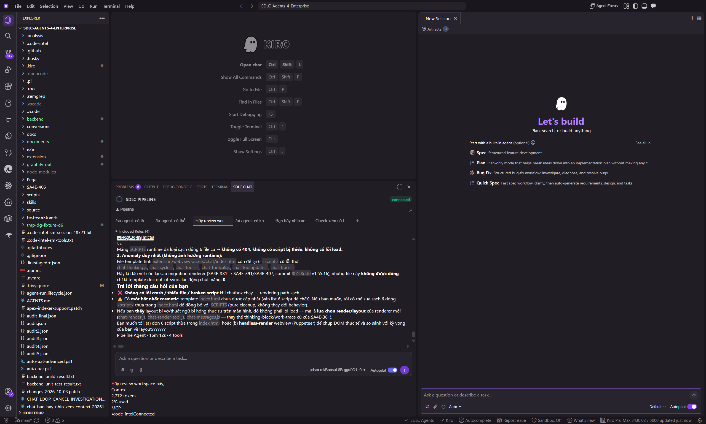
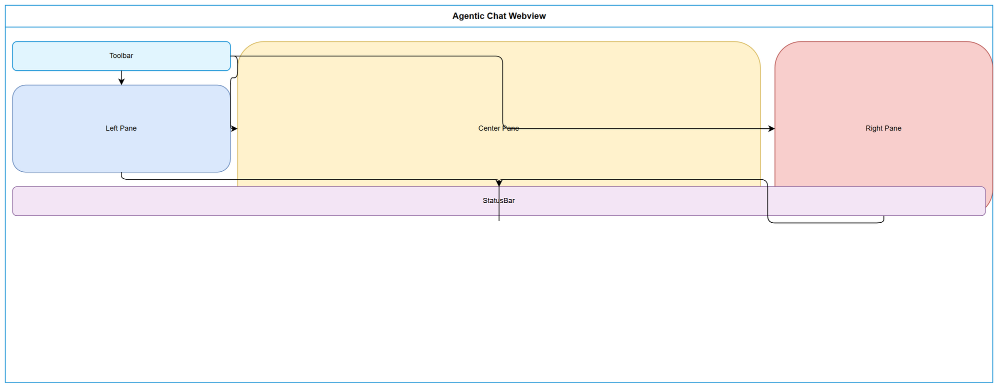
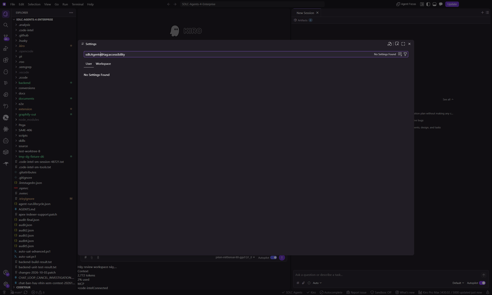

# User Guide — SA4E-411: Code Agent 16K

> **Deterministic Code Intelligence + Agent UX**  
> Version: 2.0 | Date: 2026-11-15 | Epic: SA4E-411

---

## Table of Contents

1. [Overview](#1-overview)
2. [Installation & Prerequisites](#2-installation--prerequisites)
3. [Quick Start](#3-quick-start)
4. [Configuration Reference](#4-configuration-reference)
5. [User Interface Guide](#5-user-interface-guide)
6. [How to Use Agent Chat](#6-how-to-use-agent-chat)
7. [How to Use Code Intelligence Tools](#7-how-to-use-code-intelligence-tools)
8. [Administration](#8-administration)
9. [Troubleshooting](#9-troubleshooting)
10. [FAQ](#10-faq)

---

## 1. Overview

### 1.1 What is SA4E-411?

SA4E-411 delivers **Code Agent 16K** — a deterministic Code Intelligence engine with an LLM-powered Agent UX layer, built on the existing SA4E platform (F2 Code Intelligence + F4 Context Assembly).

**What it does:**
- Creates immutable, versioned snapshots of your codebase at specific commits
- Provides 4 core agent tools for code exploration (symbol search, file skeleton, code block reading, call graph queries)
- Enforces runtime token budgets using exact tokenizer counts (llama.cpp `/tokenize`)
- Manages agent context with structured scratchpad and LRU eviction
- Implements staged patch workflow with human approval gates
- Streams agent events via durable SSE with gap-free replay

**Who it's for:**
- Developers working in VS Code/Kiro who need precise, context-aware code assistance
- Teams requiring deterministic agent behavior with audit trails
- Organizations needing security-sandboxed code modifications

**Quick capabilities list:**
| Capability | Description |
|------------|-------------|
| Immutable Snapshots | Every index run = read-only snapshot; chat sessions pin to prevent drift |
| Snapshot-Scoped Retrieval | All queries filtered by `index_snapshot_id` — results provably from one snapshot |
| 4 Core Agent Tools | `search_symbols`, `get_file_skeleton`, `read_code_block`, `query_call_graph` |
| Runtime Token Budget | Real tokenizer (llama.cpp) — no estimates; tier resolution with escalation |
| Scratchpad & Eviction | Structured working memory (Goal, DeadEnds, Facts, Plan) + S_evict algorithm |
| Staged Patch Workflow | `stage()` validates → human approval → `applyAfterApproval()` re-validates & applies |
| SSE Durable Event Log | `agent_event` table + `Last-Event-ID` replay; zero duplicates, zero gaps |
| API Pin Enforcement | All endpoints require `session_id` + `index_snapshot_id`; 400 on mismatch |

---

## 2. Installation & Prerequisites

### 2.1 System Requirements

| Requirement | Version / Detail |
|-------------|------------------|
| **Node.js** | 22.23.4 (LTS) |
| **VS Code / Kiro** | 1.85.0+ |
| **llama.cpp server** | Running with `/tokenize` endpoint (for runtime token counting) |
| **Git** | 2.40+ (for repository indexing) |
| **PostgreSQL** | 15+ (platform DB — metadata, job queues; NOT engine store) |

### 2.2 Install the Extension

**Option A: VS Code Marketplace**
1. Open VS Code Extensions view (`Ctrl+Shift+X`)
2. Search "SDLC Agents 4 Enterprise"
3. Click **Install**

**Option B: From Source (Development)**
```bash
cd extension
npm install
npm run compile
# Press F5 in VS Code to launch Extension Development Host
```

**Option C: Package & Install**
```bash
cd extension
npm run package:prod
# Install the generated .vsix via "Install from VSIX..."
```

### 2.3 Backend Server

The backend runs as a standalone Node.js process (Hono + MCP):

```bash
cd backend
npm install
npm run dev          # Development (tsx watch)
# OR
npm run build && npm start  # Production
```

**Default endpoints:**
- MCP Wrapper: `http://127.0.0.1:9181` (configurable via `sdlcAgents.mcp.serverPort`)
- Backend API: `http://127.0.0.1:48721` (configurable via `sdlcAgents.backend.url`)
- Health check: `GET /health`

### 2.4 llama.cpp Tokenizer Server

Required for **runtime token budget** (exact counts, not estimates):

```bash
# Example: Start llama.cpp server with tokenize endpoint
./llama-server -m models/your-model.gguf --port 8080 --embedding
```

Configure in extension settings:
- `sdlcAgents.llm.ollama.baseUrl` → `http://localhost:11434` (default)
- Or set custom base URL for your llama.cpp instance

---

## 3. Quick Start

### 3.1 Open the SDLC Agents Panel

1. Click the **SDLC Agents 4 Enterprise** icon in the Activity Bar (left sidebar)
2. The sidebar tree shows:
   - **Backend Target** — connection status, login/logout
   - **Knowledge Base** — Dashboard, Graph, Tags, Quality, Analytics
   - **MCP Wrapper Server** — status, config
   - **Quick Actions** — Inject All Agents, Show Status, Index Workspace

### 3.2 Connect to Backend

1. In the sidebar, expand **Backend Target**
2. Click **Login** (or `sdlcAgents.login` command)
3. Enter credentials (SSO/PKCE or API token per your org setup)
4. Status changes to **Logged in as \<username\>**

### 3.3 Open Agentic Chat

1. Click **Open Agentic Chat** in the sidebar (or run `sdlcAgents.openAgenticChat`)
2. A webview panel opens with the **3-pane chat interface**:
   - **Left Pane** — Agent selector, session management
   - **Center Pane** — Chat messages, tool calls, approvals
   - **Right Pane** — Context badges, token budget, scratchpad

### 3.4 Index Your Workspace

1. Run **Index Workspace** from Quick Actions (or `sdlcAgents.indexWorkspace`)
2. The indexer runs the 10-stage pipeline (A→J) and creates a `code_index_snapshot`
3. Wait for status **READY** (check via `sdlcAgents.showIndexStatus`)

### 3.5 Start Chatting

1. Select an agent (SM, BA, TA, SA, QA, DEV, DevOps, Security, UI)
2. Type a message — the agent will:
   - Resolve context budget (real tokenizer)
   - Retrieve from pinned snapshot
   - Emit scratchpad (Goal, DeadEnds, Facts, Plan)
   - Call tools (search_symbols, get_file_skeleton, read_code_block, query_call_graph)
   - Evict context if >75% budget
   - Stream response via SSE

---

## 4. Configuration Reference

All settings are in **VS Code Settings** (`Ctrl+,`) → search `sdlcAgents`.

### 4.1 Backend Connection

| Setting | Type | Default | Description |
|---------|------|---------|-------------|
| `sdlcAgents.backend.url` | string | `http://127.0.0.1:48721` | Remote Kiro backend server URL |
| `sdlcAgents.backend.allowInsecureRemote` | boolean | `false` | Allow HTTP for non-loopback URLs (⚠️ unencrypted) |
| `sdlcAgents.backend.ssoEnabled` | boolean | `false` | Enable SSO/PKCE authentication |
| `sdlcAgents.backend.ssoProviderUrl` | string | `""` | OAuth2 SSO provider URL |
| `sdlcAgents.backend.toolCallTimeout` | number | `300000` | MCP tool call timeout (ms) |
| `sdlcAgents.backend.chatTimeout` | number | `0` | Wall-clock timeout per chat turn (0 = disabled, loop guard only) |
| `sdlcAgents.turn.maxToolRepeats` | number | `4` | Stop turn when identical tool call repeats N times |
| `sdlcAgents.backend.healthCheckInterval` | number | `30000` | Health check interval (ms) |
| `sdlcAgents.backend.rateLimitRpm` | number | `6000` | Client-requested RPM (server clamps to its hard cap) |
| `sdlcAgents.backend.indexRetryRounds` | number | `5` | Retry rounds for failed index file persistence |

### 4.2 MCP Wrapper Server

| Setting | Type | Default | Description |
|---------|------|---------|-------------|
| `sdlcAgents.mcp.serverPort` | number | `9181` | Local MCP wrapper server port |
| `sdlcAgents.mcp.maxBodyBytes` | number | `67108864` | Max HTTP body size (bytes) — clamped to [1 MiB, 100 MiB] |
| `sdlcAgents.mcp.enabled` | boolean | `true` | Enable/disable MCP wrapper on startup |
| `sdlcAgents.mcp.serverUrl` | string | `""` | Override URL for MCP wrapper (empty = use port) |

### 4.3 Pega Integration

| Setting | Type | Default | Description |
|---------|------|---------|-------------|
| `sdlcAgents.pega.endpoint` | string | `http://localhost:8080/prweb` | Pega Platform REST API endpoint |
| `sdlcAgents.pega.useCatalogExport` | boolean | `true` | Use Rule Catalog Export API (fast) vs legacy BFS crawl |
| `sdlcAgents.pega.appName` | string | `""` | Pega application name for rule resolution |
| `sdlcAgents.pega.appVersion` | string | `""` | Pega application version (e.g., "01.01.01") |
| `sdlcAgents.pega.username` | string | `""` | Pega Operator ID |
| `sdlcAgents.pega.developerShortName` | string | `""` | Developer short name for branch naming |
| `sdlcAgents.pega.dedupMaxInMemory` | number | `100000` | Max dedup keys in memory during indexing |
| `sdlcAgents.pega.fetchBatchSize` | number | `50` | Rules fetched per batch |
| `sdlcAgents.pega.ingestConcurrency` | number | `5` | Concurrent ingest requests |
| `sdlcAgents.pega.ingestChannelCapacity` | number | `0` | Buffer between fetch/ingest (0 = auto 2× concurrency) |

### 4.4 LLM Provider

| Setting | Type | Default | Description |
|---------|------|---------|-------------|
| `sdlcAgents.llm.provider` | enum | `anthropic` | `anthropic`, `openai`, `ollama`, `lmstudio`, `openrouter`, `onnx`, `kiro` |
| `sdlcAgents.llm.model` | string | `""` | Override model for selected provider |
| `sdlcAgents.llm.fallbackModels` | array | `[]` | Fallback model IDs (retried on transient 5xx/timeout) |
| `sdlcAgents.llm.anthropic.baseUrl` | string | `""` | Custom Anthropic base URL |
| `sdlcAgents.llm.openai.baseUrl` | string | `""` | Custom OpenAI base URL |
| `sdlcAgents.llm.ollama.baseUrl` | string | `http://localhost:11434` | Ollama/llama.cpp server URL |
| `sdlcAgents.llm.lmstudio.baseUrl` | string | `""` | LM Studio server URL |
| `sdlcAgents.llm.openrouter.baseUrl` | string | `""` | OpenRouter base URL |
| `sdlcAgents.llm.kiro.model` | string | `auto` | Kiro gateway model selection |

### 4.5 Proxy

| Setting | Type | Default | Description |
|---------|------|---------|-------------|
| `sdlcAgents.proxy.mode` | enum | `system` | `none`, `system`, `manual`, `curl`, `powershell` |
| `sdlcAgents.proxy.host` | string | `""` | Proxy hostname/IP (manual mode) |
| `sdlcAgents.proxy.port` | number | `8080` | Proxy port (manual mode) |
| `sdlcAgents.proxy.bypass` | string | `localhost,127.0.0.1,::1` | Comma-separated bypass list (supports wildcards) |

### 4.6 Workspace

| Setting | Type | Default | Description |
|---------|------|---------|-------------|
| `sdlcAgents.workspace.configPath` | string | `.code-intel/orchestration.json` | Orchestration config path (relative to workspace root) |
| `sdlcAgents.workspace.workspaceRoots` | array | `[]` | Allowlist of workspace roots for file_path tools (mirrors backend MCP_WORKSPACE_ROOTS) |
| `sdlcAgents.workspace.worktreeAutoTrust` | boolean | `true` | Auto-trust verified git worktrees (env MCP_WORKTREE_AUTOTRUST=0 disables) |

### 4.7 Jira

| Setting | Type | Default | Description |
|---------|------|---------|-------------|
| `sdlcAgents.jira.connectionType` | enum | `cloud` | `cloud` (email + API token) or `server` (username + PAT) |
| `sdlcAgents.jira.syncState` | object | `{}` | Internal: last sync dates per project |
| `sdlcAgents.jira.lastProject` | string | `""` | Last selected Jira project key |
| `sdlcAgents.jira.attachmentChecksums` | object | `{}` | Internal: Jira attachment dedup cache |

---

## 5. User Interface Guide

### 5.1 Primary Screens

The extension provides **three primary user-facing screens**:

| Screen | Access Method | Purpose |
|--------|---------------|---------|
| **Sidebar Tree View** | Activity Bar icon "SDLC Agents 4 Enterprise" | Navigation, status, quick actions |
| **Agentic Chat Webview** | `sdlcAgents.openAgenticChat` command | Main agent interaction interface |
| **Settings Panel** | `sdlcAgents.openSettings` command | Configuration management |

---

### 5.2 Sidebar Tree View



#### Key Elements

| # | Element | Type | Description |
|---|---------|------|-------------|
| 1 | **Activity Bar Icon** | Button | Opens/closes sidebar; badge shows KB system status (⚠️ if inactive) |
| 2 | **Backend Target** | Tree Section | Shows backend URL, authentication status, login/logout command |
| 3 | **Knowledge Base** | Tree Section | Dashboard, Graph, Tags, Quality, Analytics commands |
| 4 | **MCP Wrapper Server** | Tree Section | Server status (Running/Starting/Crashed/Stopped), port, config commands |
| 5 | **Quick Actions** | Tree Section | Inject All Agents, Show Status, Index Workspace, Open KB in Browser |

#### User Actions

| Step | Action | Expected Result |
|------|--------|-----------------|
| 1 | Click Activity Bar icon | Sidebar expands showing tree sections |
| 2 | Expand "Backend Target" | Shows backend URL and auth state (Login Required / Logged in as \<user\>) |
| 3 | Click "Login" | Opens authentication flow; on success shows "Logged in as \<username\>" |
| 4 | Expand "Knowledge Base" | Shows 5 command items: Dashboard, Graph, Tags, Quality, Analytics |
| 5 | Click "Dashboard" | Opens KB Dashboard webview |
| 6 | Expand "MCP Wrapper Server" | Shows status (Running/Starting/Crashed/Stopped), port, Edit Config, Change Config |
| 7 | Click "Show Status" | Opens status panel with build/test/AC verification results |
| 8 | Click "Index Workspace" | Triggers 10-stage indexing pipeline; shows progress in output channel |

---

### 5.3 Agentic Chat Webview (3-Pane Layout)


#### Layout Structure



#### Key Elements — Toolbar

| # | Element | Type | Description |
|---|---------|------|-------------|
| 1 | **Agent Selector** | Dropdown | Choose agent: SM, BA, TA, SA, QA, DEV, DevOps, Security, UI |
| 2 | **Session Tabs** | Tab Bar | Switch between chat sessions; shows session ID, pinned snapshot |
| 3 | **New Session** | Button (+) | Create new chat session (prompts for repository/commit/snapshot) |
| 4 | **Model Picker** | Dropdown | Select LLM model/provider (from configured profiles) |
| 5 | **Settings** | Button (gear) | Open settings panel |

#### Key Elements — Left Pane

| # | Element | Type | Description |
|---|---------|------|-------------|
| 1 | **Agent List** | Tree | Available agents with role descriptions; click to switch |
| 2 | **Session List** | Tree | Existing chat sessions; shows repository, commit, snapshot status |
| 3 | **New Session Button** | Button | Start new session with repository/commit/snapshot picker |

#### Key Elements — Center Pane

| # | Element | Type | Description |
|---|---------|------|-------------|
| 1 | **ChatHeader** | Bar | Session ID, pinned snapshot, model, token budget summary |
| 2 | **ServiceOfflineWarning** | Banner | Shows if backend/MCP unavailable |
| 3 | **ChatMessageList** | List | Scrollable message history with virtual scrolling |
| 4 | **User Message** | Bubble | Right-aligned, user avatar, timestamp |
| 5 | **Assistant Message** | Bubble | Left-aligned, agent avatar, token stream via RAF batching |
| 6 | **Tool Call Block** | Card | Tool name, args (collapsible), status (pending/running/done/failed) |
| 7 | **Tool Result Block** | Card | Result summary, snippets, evidence IDs, budget used, truncation flag |
| 8 | **Approval Request** | Modal | Tool requires approval — shows tool, args, risk; buttons: Approve / Deny / Approve Session / Approve Pattern |
| 9 | **ChatInput** | Textarea | Multi-line input; Enter = send, Shift+Enter = newline; slash commands (`/`) |
| 10 | **Slash Command Autocomplete** | Popup | Shows available commands: `/inject`, `/status`, `/index`, `/context`, etc. |

#### Key Elements — Right Pane

| # | Element | Type | Description |
|---|---------|------|-------------|
| 1 | **Context Badges** | Chips | Active context items: steering docs, skills, file refs, symbol refs |
| 2 | **Token Budget Display** | Gauge | Used / Available tokens; color-coded (green/yellow/red) |
| 3 | **Budget Tier** | Badge | Current tier: SYSTEM / CRITICAL / HIGH / MEDIUM / LOW |
| 4 | **Escalation Flags** | Badges | `shouldCompress`, `minLoadout`, `steeringBudget halved` |
| 5 | **Scratchpad** | Panel | Current agent scratchpad (Goal, DeadEnds, Facts, Plan) — updates before each tool call |
| 6 | **Tool Results** | List | Recent tool results with evidence IDs and token counts |

#### Key Elements — StatusBar

| # | Element | Type | Description |
|---|---------|------|-------------|
| 1 | **Backend Connection** | Indicator | Green (connected), Yellow (connecting), Red (disconnected) |
| 2 | **MCP Status** | Indicator | Wrapper server status |
| 3 | **Tokens Used** | Counter | Current turn token consumption |
| 4 | **Budget Tier** | Badge | Active tier with remaining budget |
| 5 | **Escalation State** | Badges | Active escalation flags |

---

### 5.4 Settings Panel



#### Key Elements

| # | Element | Type | Description |
|---|---------|------|-------------|
| 1 | **Settings Search** | Input | Filter settings by keyword |
| 2 | **Category Tabs** | Tabs | Backend, MCP, Pega, LLM, Proxy, Workspace, Jira |
| 3 | **Setting Rows** | Form | Each setting: label, description, input (text/number/boolean/dropdown) |
| 4 | **Reset to Default** | Button | Revert individual setting to default |
| 5 | **Provider Profiles Table** | Table | LLM provider profiles (id, label, provider, model, baseUrl, test status) |
| 6 | **Test Provider** | Button | Test connection to LLM provider; updates `lastTestStatus` |
| 7 | **Save** | Button | Persist all changes |

#### User Actions

| Step | Action | Expected Result |
|------|--------|-----------------|
| 1 | Open Settings (`sdlcAgents.openSettings`) | Settings panel opens in webview |
| 2 | Navigate tabs | Each tab shows relevant settings group |
| 3 | Modify backend URL | Change `sdlcAgents.backend.url`; click Save; reconnects automatically |
| 4 | Add LLM provider profile | Click "Add Profile" in Provider Profiles table; fill form; click Test |
| 5 | Set active provider | Select provider in `sdlcAgents.llm.provider` dropdown; Save |
| 6 | Configure Pega | Enter endpoint, username, appName/Version; Save; test with "Fetch Pega Context" |
| 7 | Change MCP port | Modify `sdlcAgents.mcp.serverPort`; Save; requires window reload |
| 8 | Enable proxy | Set `sdlcAgents.proxy.mode` to `manual`/`curl`/`powershell`; configure host/port |

---

## 6. How to Use Agent Chat

This section provides task-oriented steps for common Agent Chat workflows.

### 6.1 Start a Chat Session

**Prerequisites:** Backend connected, workspace indexed, at least one READY snapshot exists.

| Step | Action | Expected Result |
|------|--------|-----------------|
| 1 | Open Agentic Chat (`sdlcAgents.openAgenticChat`) | Webview opens; ChatHeader shows "No session" |
| 2 | Click **+ New Session** in Toolbar or Left Pane | Repository picker opens (shows indexed repositories) |
| 3 | Select a repository | Commit picker opens for that repository |
| 4 | Select a commit (branch/tag/SHA) | Snapshot picker opens (shows only READY snapshots) |
| 5 | Select a snapshot | Chat session created and bound to that snapshot; appears in Left Pane and Session Tabs |
| 6 | Verify ChatHeader | Shows session ID, pinned snapshot ID, model, budget summary |

**Notes:**
- A session can only pin to a snapshot with status `READY`
- Multiple sessions can pin to the same snapshot
- Sessions persist in backend across VS Code restarts

### 6.2 Select / Switch Agents

| Step | Action | Expected Result |
|------|--------|-----------------|
| 1 | Click **Agent Selector** dropdown in Toolbar | List of 9 agents appears with role descriptions |
| 2 | Select desired agent (SM, BA, TA, SA, QA, DEV, DevOps, Security, UI) | Agent avatar updates in ChatHeader; agent-specific system prompt loads |
| 3 | Or click agent in **Left Pane → Agent List** | Same effect; useful for seeing all agents at once |

**Agent roles:**
- **SM** — Orchestration, pipeline coordination, status reporting
- **BA** — BRD/FSD creation, requirements analysis, Jira integration
- **TA** — FSD enrichment, architecture review, technology selection
- **SA** — TDD creation, data model design, API contracts
- **QA** — STP/STC creation, test execution, quality gates
- **DEV** — Code implementation, unit/integration tests, UG writing
- **DevOps** — CI/CD, DPG/RLN, Docker, deployment
- **Security** — Security review, vulnerability assessment, pentest
- **UI** — Wireframes, mockups, design specifications

### 6.3 Use Slash Commands

| Step | Action | Expected Result |
|------|--------|-----------------|
| 1 | Type `/` in ChatInput | Autocomplete popup shows available commands |
| 2 | Select or type command | Command executes immediately |
| 3 | Observe result | Output appears in Center Pane (or modal for some commands) |

**Common slash commands:**
| Command | Purpose |
|---------|---------|
| `/inject` | Inject agent/skill/steering into context |
| `/status` | Show backend/index/session status |
| `/index` | Trigger workspace indexing |
| `/context` | Show current context budget breakdown |
| `/budget` | Show token budget details |
| `/scratchpad` | Show current scratchpad content |
| `/approve` | Approve pending patch (if any) |
| `/help` | List all available commands |

### 6.4 Manage Sessions

| Task | Steps |
|------|-------|
| **Switch sessions** | Click session in Session Tabs (Toolbar) or Left Pane → Session List; context loads instantly |
| **Close session** | Right-click session tab → **Close**; session persists in backend (not deleted) |
| **Rename session** | Right-click session tab → **Rename**; enter new display name |
| **Resume after restart** | Open Agentic Chat → previous sessions appear in Left Pane; click to resume; `summarizeForResume()` reconstructs context from persisted `agent_plan`/`agent_step` |
| **Delete session permanently** | Not available via UI; requires backend API call (admin only) |

### 6.5 Handle Approval Requests

When an agent stages a patch requiring approval:

| Step | Action | Expected Result |
|------|--------|-----------------|
| 1 | **PermissionGuard modal** appears in Center Pane | Shows tool name, arguments, risk assessment, diff preview |
| 2 | Review the proposed change | Check file path, hunks, base hash |
| 3 | Click **Approve** | `approval_request.decision = APPROVED`; agent proceeds to `applyAfterApproval()` |
| 4 | Or click **Deny** | `approval_request.decision = DENIED`; change_set stays OPEN; no apply |
| 5 | Or click **Approve Session** | Auto-approve all future patches in this session |
| 6 | Or click **Approve Pattern** | Auto-approve patches matching a file/path pattern |

**After approval:** Agent re-validates base hash (stale-base check). If workspace hasn't changed → atomic apply. If drifted → `STALE_BASE_HASH` error; re-stage with current base hash.

---

## 7. How to Use Code Intelligence Tools

The 4 core agent tools are exposed via MCP and require **session pinning** (`repository_id`, `commit_id`, `index_snapshot_id`). The agent automatically injects these from the pinned session.

### 7.1 Search Symbols (`search_symbols`)

**Purpose:** Find symbols (classes, methods, functions, interfaces) by name/keyword across the pinned snapshot.

**How to use:**
1. In chat, ask: *"Find payment processing methods"* or *"Search for class UserService"*
2. Agent calls `search_symbols` with your query
3. Results returned in compact DSL format:

```
[FOUND 5 SYMBOLS | BUDGET_USED: 142 tokens]
1. [METHOD] PaymentService#processTransaction | src/service/PaymentService.java:45-92
   Sig: @Transactional public Receipt processTransaction(OrderDto order)
2. [METHOD] StripeClient#charge | src/payment/StripeClient.ts:12-58
   Sig: public ChargeResponse charge(PaymentRequest request)
...
```

**Parameters:**
| Parameter | Type | Required | Description |
|-----------|------|----------|-------------|
| `q` | string | Yes | Search query (keyword or exact name) |
| `kind` | enum | No | Filter: CLASS, INTERFACE, METHOD, FUNCTION, VARIABLE, etc. |
| `path_filter` | string | No | Glob pattern to restrict search (e.g., `src/service/**`) |
| `limit` | number | No | Max results (default: 20) |

**Tips:**
- Use exact names for precise matches: `search_symbols({ q: "PaymentService#processTransaction" })`
- Combine with `kind` to narrow: `search_symbols({ q: "process", kind: "METHOD" })`
- Results ranked: Exact definition (DIRECT) > Proven reference (DIRECT) > Text similarity (INFERRED)

### 7.2 Get File Skeleton (`get_file_skeleton`)

**Purpose:** Get class/interface structure — signatures only, no method bodies.

**How to use:**
1. Ask: *"Show me the PaymentService structure"* or *"What methods does OrderController have?"*
2. Agent calls `get_file_skeleton` with file path
3. Returns structure:

```
[FILE_SKELETON | BUDGET_USED: 89 tokens]
class PaymentService {
  @Autowired private Validator validator;
  @Autowired private StripeClient stripe;
  @Transactional public Receipt processTransaction(OrderDto order);
  private Receipt validateAndCharge(OrderDto order);
  public Refund refundTransaction(String transactionId);
}
```

**Parameters:**
| Parameter | Type | Required | Description |
|-----------|------|----------|-------------|
| `file_path` | string | Yes | Relative path from repository root (e.g., `src/service/PaymentService.java`) |

**Tips:**
- Use after `search_symbols` to explore a symbol's containing file
- Much cheaper than `read_code_block` (no body tokens)
- Shows imports, annotations, field declarations, method signatures

### 7.3 Read Code Block (`read_code_block`)

**Purpose:** Read specific lines of a file (max 120 lines per turn).

**How to use:**
1. Ask: *"Show me the processTransaction implementation"* or *"Read lines 45-92 of PaymentService.java"*
2. Agent calls `read_code_block` with file path and line range
3. Returns code:

```
[CODE_BLOCK | BUDGET_USED: 420 tokens]
  45: @Transactional
  46: public Receipt processTransaction(OrderDto order) {
  47:     validator.validate(order);
  48:     return validateAndCharge(order);
  49: }
  ...
```

**Parameters:**
| Parameter | Type | Required | Description |
|-----------|------|----------|-------------|
| `file_path` | string | Yes | Relative path from repository root |
| `start_line` | number | Yes | 1-based start line |
| `end_line` | number | Yes | 1-based end line (max `start_line + 119`) |

**Tips:**
- Always use after `get_file_skeleton` to read specific method bodies
- Max 120 lines per call — for larger files, request in chunks
- Token cost = actual tokenizer count of returned lines

### 7.4 Query Call Graph (`query_call_graph`)

**Purpose:** Traverse call relationships — CALLERS (who calls this), CALLEES (what this calls), IMPLEMENTATIONS (interface implementations).

**How to use:**
1. Ask: *"What calls processTransaction?"* or *"Show me the call graph for PaymentService"*
2. Agent calls `query_call_graph` with symbol_id and direction
3. Returns graph:

```
[CALL_GRAPH | BUDGET_USED: 67 tokens]
CALLERS:
  1. OrderController#createOrder (src/controller/OrderController.java:28)
  2. PaymentScheduler#retryFailed (src/scheduler/PaymentScheduler.java:112)
CALLEES:
  1. Validator#validate (src/validation/Validator.java:15)
  2. StripeClient#charge (src/payment/StripeClient.ts:12)
```

**Parameters:**
| Parameter | Type | Required | Description |
|-----------|------|----------|-------------|
| `symbol_id` | string | Yes | Fully qualified symbol (e.g., `PaymentService#processTransaction`) |
| `direction` | enum | Yes | `CALLERS`, `CALLEES`, or `IMPLEMENTATIONS` |

**Tips:**
- Get `symbol_id` from `search_symbols` or `get_file_skeleton` results
- Cycle guard prevents infinite recursion (max depth: 10)
- Node cap: 500 nodes per query

---

## 8. Administration

### 8.1 Adding MCP Servers

The extension includes a local MCP wrapper server (port 9181 by default). To add external MCP servers:

1. Open Settings (`sdlcAgents.openSettings`)
2. Configure orchestration in `.code-intel/orchestration.json`:
```json
{
  "mcpServers": {
    "my-server": {
      "command": "npx",
      "args": ["my-mcp-server"],
      "env": { "API_KEY": "..." }
    }
  }
}
```
3. Reload window (`Ctrl+Shift+P` → "Developer: Reload Window")

### 8.2 Monitoring Health

| Check | Command / Endpoint |
|-------|-------------------|
| Backend health | `GET http://127.0.0.1:48721/health` |
| MCP wrapper | `GET http://127.0.0.1:9181/health` |
| Extension status | `sdlcAgents.status` command |
| Index status | `sdlcAgents.showIndexStatus` command |
| Agent run status | Check `agent_run` table in SQLite |

### 8.3 Hot-Reload Configuration

Most settings apply immediately on **Save** in Settings panel. Exceptions requiring reload:
- `sdlcAgents.mcp.serverPort` → Window reload
- `sdlcAgents.mcp.enabled` → Window reload
- `sdlcAgents.workspace.workspaceRoots` → Window reload

### 8.4 Database Backup

**Production (PostgreSQL):**
```bash
cd backend
npm run db:backup          # pg_dump to backend/backups/ (retention: 7)
# Automated: Task Scheduler "SA4E-PG-Backup" runs daily at 02:00
```

**Test Stack (separate project/volume):**
```bash
npm run db:test:up         # Starts test Postgres (sa4e-test project)
npm run db:test:down       # Stops test Postgres
npm run db:backup:test     # Backup test DB if running
```

### 8.5 Docker Volume Protection (SA4E-335)

| ❌ FORBIDDEN on prod stack | ✅ ALLOWED |
|---------------------------|------------|
| `docker compose down -v` | `docker compose down` (keeps volumes) |
| `docker compose down --volumes` | Test stack: `npm run db:test:up/down` |
| `docker volume rm ...` | Backup: `npm run db:backup` |
| `docker volume prune` | |
| `docker system prune` | |
| `docker rm -f sa4e-postgres` | |

---

## 9. Troubleshooting

### 9.1 Common Issues

| Issue | Cause | Resolution |
|-------|-------|------------|
| **Sidebar shows "KB System Inactive"** | Backend/MCP not running | Start backend (`npm run dev` in backend/); check MCP wrapper port 9181 |
| **"Login Required" persists** | Auth failed / token expired | Run `sdlcAgents.logout` then `sdlcAgents.login`; check SSO config |
| **Chat shows "Service Offline"** | Backend unreachable | Verify `sdlcAgents.backend.url`; check firewall/proxy; run health check |
| **Token budget always exceeded** | llama.cpp not reachable | Verify `sdlcAgents.llm.ollama.baseUrl`; start llama.cpp server with `/tokenize` |
| **Index stuck at PENDING/BUILDING** | Indexer error | Check backend logs; run `npm run test:ac` to verify pipeline |
| **Tool calls fail with "SNAPSHOT_MISMATCH"** | Session pinned to different snapshot | Create new session with correct snapshot; or re-index workspace |
| **SSE reconnect fails** | Gap in event log | Check `agent_event` table; restart session to get fresh `Last-Event-ID` |
| **Patch rejected: "STALE_BASE_HASH"** | Workspace changed since stage | Re-stage patch with current base hash |
| **Pega indexing returns 0 rules** | Wrong endpoint/credentials | Verify `sdlcAgents.pega.endpoint`, `username`; test with catalog export |

### 9.2 Error Codes Reference

| Code | HTTP Status | Context | Description |
|------|-------------|---------|-------------|
| `SNAPSHOT_NOT_FOUND` | 404 | Retrieval, API | Requested `index_snapshot_id` does not exist |
| `SNAPSHOT_NOT_READY` | 400 | API | Snapshot status ≠ READY |
| `SNAPSHOT_MISMATCH` | 400 | API | `chat_session.pinned_code_index_snapshot_id` ≠ requested |
| `STALE_BASE_HASH` | 409 | Patch | Base commit hash drifted since stage |
| `PATH_TRAVERSAL` | 400 | Patch, Sandbox | Path contains `..`, absolute, or symlink escape |
| `SANDBOX_VIOLATION` | 400 | Tool execution | Shell metachars, NUL, network violation |
| `SSE_GAP_DETECTED` | 400 | SSE replay | Requested `Last-Event-ID` not in log |
| `BUDGET_EXCEEDED` | 413 | Token budget | Required tokens exceed available after escalation |
| `VALIDATION_FAILED` | 400 | Pipeline, Migration | Schema/constraint violation |

### 9.3 Log Locations

| Component | Log Destination |
|-----------|-----------------|
| Backend | Console (structured JSON) + `agent_event` table |
| Extension | VS Code Output Channel "SDLC Agents" |
| MCP Wrapper | Console (structured JSON) |
| Indexer | Console + `agent_event` (SSE) |
| Token Budget | Console (DEBUG/INFO/WARN) |

---

## 10. FAQ

### General

**Q: Why SQLite instead of PostgreSQL for the engine store?**
A: ADR-001 decided on SQLite embedded per-workspace for local-first, offline capability, zero-config deployment, and WAL durability. PostgreSQL remains the platform DB for multi-tenant metadata and job queues. Migration to PostgreSQL engine store triggers only when: (a) multi-team collaboration, (b) cross-repo search, (c) concurrent writers.

**Q: Can I use multiple embedding models on the same snapshot?**
A: Yes (AC-02). `embedding_set` is decoupled from snapshot — create multiple `embedding_set` rows with different `model_key`/`model_version` pointing to the same `code_index_snapshot_id`. Vectors stored in `code_embedding` linked to `embedding_set_id`.

**Q: What happens when I switch git branches?**
A: Pinned chat sessions are unaffected (AC-03). The `chat_session` binds to `pinned_code_index_snapshot_id` which references a specific commit. New sessions can pick the new branch's snapshot.

### Token Budget

**Q: Why use real tokenizer instead of estimates?**
A: Estimates are inaccurate (especially for code). Real llama.cpp `/tokenize` gives exact counts for prompt, tools, history, enabling precise budget decisions and tier escalation.

**Q: What triggers budget escalation?**
A: When `available_input_tokens < required_tokens` after tier resolution. Escalation order: Compress → Drop Steering → Min Loadout.

**Q: Can I disable token budget?**
A: No — it's mandatory for deterministic agent behavior. However, you can increase model context (`n_ctx`) by using a larger model.

### Scratchpad & Eviction

**Q: Why is scratchpad mandatory before every tool call?**
A: It forces explicit reasoning (Goal, DeadEnds, Facts, Plan), creates traceability, and provides `referencedEvidenceIds` for eviction immunity.

**Q: What are tombstones?**
A: Evicted entries replaced with `[evicted tool_call_id=<id>]` — preserves tool call traceability without consuming tokens.

**Q: Can I prevent eviction of specific context?**
A: Yes — reference the `evidenceIds` in your scratchpad (Facts/Plan). Referenced evidence is IMMUNE from eviction.

### Patch Protocol

**Q: Why staged patch (stage → approve → apply)?**
A: Safety. `stage()` validates without touching working tree. Human approval required. `applyAfterApproval()` re-validates base hash (stale-base protection) before atomic apply.

**Q: What if base hash drifts between stage and apply?**
A: `applyAfterApproval()` rejects with `STALE_BASE_HASH` (409). Re-stage with current base hash.

### Testing & Verification

**Q: How do I verify the installation?**
A: Run the test gates:
```bash
npm run build           # Must exit 0
npm test                # Must exit 0 (backend 500f/3825p; ext 443f/3469p)
npm run test:ac         # 17 AC tests < 10s
npm run test:token      # Token/eviction integration
npm run test:regression # SA4E regression gate
```

**Q: What are the 17 Acceptance Criteria?**
A: AC-01..17 covering: re-index isolation, dual embeddings, pinned chat, rename/delete tracking, merge commits, snapshot ownership, vector isolation, filtered cosine, semantic re-run, dependency failure isolation, agent resume, patch stale-base, working tree unchanged, sandbox escape/network, SSE replay, real tokenizer budget.

---

## Appendix: Diagrams Reference

All diagrams in `documents/SA4E-411/diagrams/`:

| # | Diagram | Source | Description |
|---|---------|--------|-------------|
| 1 | Architecture Overview | `architecture-overview.drawio` | 4-layer system architecture |
| 2 | Component Diagram | `component.drawio` | Agent UX / Engine / Storage layers |
| 3 | Class Diagram — Core Tools | `class-agent-tools.drawio` | ToolContext, CoreTools, args/result types |
| 4 | Snapshot/Revision ER | `snapshot-revision-er.drawio` | V6 data model entity relationships |
| 5 | Pipeline Ordering (A–J) | `pipeline-ordering.drawio` | 10-stage dependency-before-semantic pipeline |
| 6 | Token Budget Formula | `token-budget.drawio` | Runtime budget calculation visual |
| 7 | Scratchpad & Eviction | `scratchpad-eviction.drawio` | Format + S_evict algorithm |
| 8 | System Context | `system-context.drawio` | External systems + all layers |
| 9 | Agent Chat Sequence | `sequence-agent-chat.drawio` | 18-step chat turn sequence |
| 10 | Token Budget State Machine | `state-token-budget.drawio` | INIT→COMPUTE→CHECK→OK→... + Escalation |
| 11 | Business Flow | `business-flow.drawio` | Phase 0–4 stakeholder swimlanes |
| 12 | Use Case | `use-case.drawio` | 16 epic stories + external systems |
| 13 | Test Execution Flow | `test-execution-flow.drawio` | Test pipeline stages |
| 14 | Test Coverage | `test-coverage.drawio` | Coverage targets by layer |
| 15 | Rollback Flow | `rollback-flow.drawio` | Snapshot rollback procedure |
| 16 | Deployment Flow | `deployment-flow.drawio` | CI/CD deployment pipeline |
| 17 | **Chat Layout (3-Pane)** | `ug-chat-layout.drawio` | Agentic Chat Webview 3-pane layout |
| 18 | **Patch Workflow** | `ug-patch-workflow.drawio` | Staged patch: stage → approve → apply |
| 19 | **Turn Processing Flow** | `ug-turn-processing.drawio` | Agent turn: budget → tier → loop → evict |
| 20 | **Token Budget Formula** | `ug-token-budget-formula.drawio` | Formula breakdown + tier escalation |

**Note:** Diagrams 1–16 are `.drawio` sources (architecture/design diagrams). Diagrams 17–20 are new `.drawio` sources created for this UG. The 3 UI screenshots in Section 5 (sidebar-tree-view.png, agentic-chat-webview.png, settings-panel.png) were **captured from the running build** per UG Evidence Policy.

---

## Appendix: Verification Evidence

| Gate | Command | Status | Evidence |
|------|---------|--------|----------|
| Build | `npm run build` | ✅ PASS | `STATUS.json` verification |
| Full Test | `npm test` | ✅ PASS | Backend 500f/3825p/19s; Ext 443f/3469p/6s |
| AC Suite | `npm run test:ac` | ✅ PASS | 16 backend + 1 ext tests < 10s |
| Token/Eviction | `npm run test:token` | ✅ PASS | 13 backend + 9 ext integration tests |
| Regression | `npm run test:regression` | ✅ PASS | Backend 11f/63t + Ext 20f/155t |

---

**Document End** — SA4E-411 User Guide v2.0