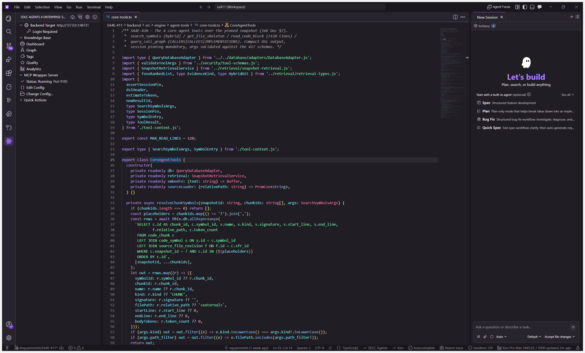
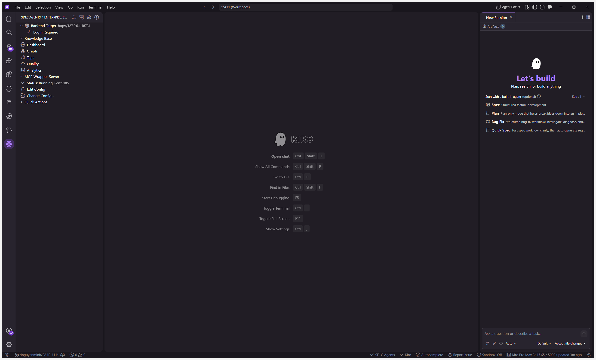

# User Guide — Lấy ngữ cảnh code chính xác cho agent (Code Agent 16K)

> **Dành cho:** Lập trình viên dùng extension **SDLC Agents 4 Enterprise** trong Kiro
> **Ticket:** SA4E-411 · **Phiên bản tài liệu:** 3.0 (viết lại) · **Phiên bản extension:** 1.55.21
> **Build đã verify:** extension 1.55.21 build từ branch `dnguyenminh/SA4E-411` · **Ngày chụp ảnh:** 2026-11-16
> **Trạng thái UAT:** **Chờ PO review**

## 1. Tính năng này là gì?

Khi bạn hỏi agent về một đoạn code, câu trả lời phải bám đúng phiên bản code bạn đang mở, và chỉ cần
đúng phần code liên quan chứ không phải cả repository. Extension **SDLC Agents 4 Enterprise** lập chỉ mục
workspace của bạn, ghim một mốc code cho mỗi phiên làm việc, và cho phép bạn lấy ngữ cảnh của một tên
symbol (hàm, lớp, phương thức) để dán vào cuộc trò chuyện với agent.

Trong tài liệu này bạn dùng một lệnh duy nhất: **SDLC Agents: Get AI Context for Symbol**.

> **Phạm vi:** tài liệu này chỉ hướng dẫn thao tác trên Kiro. Thiết kế bên trong, cấu hình hệ thống và danh
> sách trường dữ liệu nằm ở TDD.

## 2. Chuẩn bị

| Bước | Thao tác | Kết quả mong đợi |
|------|----------|------------------|
| 1 | Mở Kiro và mở thư mục project bạn muốn làm việc | Thanh bên trái có biểu tượng **SDLC Agents 4 Enterprise** |
| 2 | Chỉ lần đầu với project mới: chạy `SDLC Agents: Index Source Code` | Chỉ mục code của workspace được tạo |

## 3. Luồng chính

### Bước 1 — Mở panel SDLC Agents và xác nhận extension đang kết nối

Bấm biểu tượng **SDLC Agents 4 Enterprise** trên thanh bên trái. Panel hiện ra với dòng **Backend Target**
ở trên cùng và mục **MCP Wrapper Server** ở dưới.

**Key Elements (ảnh trên):**

| Thành phần | Vị trí trên ảnh | Ý nghĩa |
|-----------|------------------|---------|
| Tiêu đề **SDLC AGENTS 4 ENTERPRISE: SDLC AGENTS** | Đầu panel bên trái | Bạn đang ở đúng panel của extension |
| Nút **SDLC Agents: Show Status** | Góc trên bên phải của panel | Xem nhanh extension đã sẵn sàng chưa |
| Dòng **Backend Target** + địa chỉ | Dòng đầu tiên của cây panel | Máy chủ extension đang dùng (ảnh: `http://127.0.0.1:48731`) |
| Mục **MCP Wrapper Server** → **Status: Running Port …** | Nhóm cuối trong panel | Cầu nối giữa Kiro và máy chủ đã chạy |
| Dòng **Logged in as admin** hoặc **Login Required** | Ngay dưới **Backend Target** | Bạn đã đăng nhập hay chưa |

**User Actions:**

| Bước | Thao tác | Kết quả mong đợi |
|------|----------|------------------|
| 1 | Bấm biểu tượng **SDLC Agents 4 Enterprise** trên thanh bên trái | Panel mở ra bên trái |
| 2 | Nhìn dòng **Backend Target** | Thấy địa chỉ backend — ghi lại địa chỉ này |
| 3 | Nhìn mục **MCP Wrapper Server** | Thấy `Running` |
| 4 | Nhìn dòng ngay dưới **Backend Target** | `Logged in as admin` hoặc `Login Required` |

> **Nếu thấy `Login Required`:** bấm vào chính dòng đó, đăng nhập, rồi làm tiếp. Các chức năng cần tài
> khoản sẽ không lấy được dữ liệu cho tới khi bạn đăng nhập.

### Bước 2 — Đưa con trỏ vào đúng tên symbol

Mở file chứa symbol bạn cần. Nhanh nhất là dùng hộp **Go to File** và lọc theo tên symbol: nhấn `Ctrl+P`,
gõ `@` rồi tên symbol (ví dụ `@CoreAgentTools`), chọn đúng kết quả. Kiro mở file và đặt con trỏ ngay tại
tên symbol đó; thanh breadcrumb trên editor hiện tên symbol và số dòng/cột, ví dụ
`Line 25, column 14: export class CoreAgentTools {`.

**User Actions:**

| Bước | Thao tác | Kết quả mong đợi |
|------|----------|------------------|
| 1 | Nhấn `Ctrl+P` | Hộp **Go to File** mở ra ở giữa màn hình |
| 2 | Gõ `@CoreAgentTools` (thay bằng symbol của bạn) | Danh sách lọc ra các symbol khớp |
| 3 | Chọn một kết quả | File mở trong editor, con trỏ nằm ngay trên tên symbol |
| 4 | Kiểm tra breadcrumb phía trên editor | Hiện đúng tên symbol kèm số dòng/cột |

> **Sai symbol là lỗi phổ biến nhất.** Lệnh lấy ngữ cảnh theo **tên đang được con trỏ chọn**, không theo
> file bạn đang mở. Nếu breadcrumb không hiện tên symbol mong muốn, hãy đặt lại con trỏ.

### Bước 3 — Chạy lệnh và lấy ngữ cảnh

Mở hộp lệnh bằng `Ctrl+Shift+P`, gõ `Get AI Context for Symbol`, chọn lệnh **SDLC Agents: Get AI Context
for Symbol**. Kiro tìm symbol theo con trỏ hiện tại, dựng ngữ cảnh và chép sẵn vào clipboard; một thông báo
xanh xác nhận hiện ở góc dưới bên phải.

**Key Elements (ảnh trên):**

| Thành phần | Vị trí trên ảnh | Ý nghĩa |
|-----------|------------------|---------|
| Breadcrumb **… › agent-tools › core-tools.ts › CoreAgentTools** | Dải đường dẫn trên editor | Xác nhận symbol đang chọn là gì |
| Dòng **Line 25, column 14: export class CoreAgentTools {** | Ngay dưới breadcrumb | Con trỏ đang đứng đúng trên tên symbol |
| Thông báo xanh **Info: Context for "CoreAgentTools" copied to clipboard.** | Góc dưới bên phải | Lệnh thành công, ngữ cảnh đã nằm trong clipboard |
| Dòng **Backend Target http://127.0.0.1:48731** | Panel bên trái | Máy chủ đã trả lời là máy chủ bạn đang dùng |

**User Actions:**

| Bước | Thao tác | Kết quả mong đợi |
|------|----------|------------------|
| 1 | Nhấn `Ctrl+Shift+P` | Hộp lệnh mở ra, tiền tố `>` đã có sẵn |
| 2 | Gõ `Get AI Context for Symbol` | Danh sách lọc còn lệnh **SDLC Agents: Get AI Context for Symbol** |
| 3 | Chọn lệnh đó | Hộp lệnh đóng, lệnh bắt đầu chạy |
| 4 | Chờ thông báo ở góc dưới bên phải | Thấy `Context for "CoreAgentTools" copied to clipboard.` |
| 5 | Dán vào cuộc trò chuyện với agent (`Ctrl+V`) | Agent nhận được phần ngữ cảnh của symbol đó |

> **Ngữ cảnh gồm những gì?** Phần định nghĩa, chú thích, chữ ký hàm, nơi symbol được dùng và các symbol
> liên quan — đúng những phần liên quan tới con trỏ, không phải cả file. Muốn lấy cho symbol khác thì
> đặt lại con trỏ (Bước 2) rồi chạy lại lệnh; mỗi lần chạy sẽ chép ngữ cảnh mới vào clipboard.

## 4. Luồng phụ — Gọi lệnh khi chưa mở file nào

Nếu bạn gọi lệnh mà không có file nào đang mở trong editor, Kiro báo bạn biết bằng một thông báo cảnh báo
thay vì im lặng. Đây là trạng thái bình thường — không phải lỗi hệ thống.

**Key Elements (ảnh trên):**

| Thành phần | Vị trí trên ảnh | Ý nghĩa |
|-----------|------------------|---------|
| Thông báo vàng **Warning: No active editor. Open a file first.** | Góc dưới bên phải | Lệnh cần một file đang mở để biết bạn trỏ vào symbol nào |
| Nhãn **source: SDLC Agents 4 Enterprise** | Trong thông báo | Thông báo đến từ extension này, không phải từ Kiro |
| Vùng editor trống | Giữa màn hình | Không còn tab file nào đang mở |
| Dòng **Backend Target http://127.0.0.1:48731** | Panel bên trái | Extension vẫn kết nối bình thường |

**User Actions:**

| Bước | Thao tác | Kết quả mong đợi |
|------|----------|------------------|
| 1 | Đóng tab file đang mở (hoặc bấm vào một mục khác trong panel bên trái) | Vùng editor trống, không còn file active |
| 2 | Nhấn `Ctrl+Shift+P` → gõ `Get AI Context for Symbol` → chọn lệnh | Lệnh chạy |
| 3 | Đọc thông báo ở góc dưới bên phải | Thấy `No active editor. Open a file first.` |
| 4 | Mở lại một file, đặt con trỏ lên symbol, chạy lại lệnh | Thông báo thành công thay cho cảnh báo |

## 5. Xử lý sự cố

| Hiện tượng bạn thấy | Nguyên nhân | Cách xử lý |
|---------------------|-------------|------------|
| `No active editor. Open a file first.` | Chưa có file nào đang mở | Mở một file, đặt con trỏ lên tên symbol, chạy lại lệnh |
| Thông báo báo không tìm thấy symbol | Symbol chưa có trong chỉ mục workspace | Chạy `SDLC Agents: Index Source Code`, đợi xong rồi thử lại |
| Ngữ cảnh trả về không đúng ý | Con trỏ đang ở tên khác (ví dụ tên biến) | Kiểm tra breadcrumb, đặt lại con trỏ đúng tên symbol rồi chạy lại |
| Panel báo `Login Required` | Chưa đăng nhập vào backend | Bấm vào dòng `Login Required`, đăng nhập, rồi thử lại |
| `Backend Target` hiển thị địa chỉ khác với bạn cần | Extension đang dùng cấu hình backend khác | Mở `Settings` → `SDLC Agents` → sửa ô **Backend URL**, rồi reload window |
| `MCP Wrapper Server` không ở trạng thái `Running` | Cầu nối chưa lên | Đợi vài giây rồi reload window; nếu vẫn lỗi, dùng `Change Config…` trong panel |

## 6. FAQ

**Hỏi: Tính năng này có gửi code của tôi đi đâu không?**
Đáp: Không. Toàn bộ việc lập chỉ mục và tìm ngữ cảnh diễn ra trên máy của bạn; ngữ cảnh được chép vào
clipboard và bạn tự quyết định dán vào đâu.

**Hỏi: Tôi có phải chạy lệnh lập chỉ mục mỗi lần sửa code không?**
Đáp: Không. Chỉ cần chạy `SDLC Agents: Index Source Code` cho project lần đầu, hoặc khi bạn vừa thêm
một nhóm file mới. Những thay đổi nhỏ sau đó không cần chạy lại thủ công.

**Hỏi: Lệnh dùng file nào?**
Đáp: File đang mở và tên symbol con trỏ đang chọn. Muốn lấy ngữ cảnh của symbol khác thì đặt lại con trỏ.

**Hỏi: Tại sao phải bật `Running` cho `MCP Wrapper Server`?**
Đáp: Đó là cầu nối để lệnh trong Kiro gọi được máy chủ. Nếu mục này không `Running` thì mọi lệnh cần
máy chủ đều không chạy được.

**Hỏi: Tôi có phải cài lại extension không?**
Đáp: Không, trừ khi bạn đổi phiên bản extension. Kiểm tra phiên bản hiện tại ở `Settings` → `Extensions`
→ `SDLC Agents 4 Enterprise`.

## 7. Tài liệu liên quan

| Tài liệu | Nội dung |
|----------|----------|
| [`BRD.md`](BRD.md) | Yêu cầu nghiệp vụ của ticket SA4E-411 |
| [`FSD.md`](FSD.md) | Đặc tả chức năng và quy tắc nghiệp vụ |
| [`TDD.md`](TDD.md) | Thiết kế kỹ thuật (sơ đồ kiến trúc nằm ở đây) |
| [`STC.md`](STC.md) | Bộ test case dùng để kiểm chứng hành vi |
| [`QA-VERIFICATION-SA4E-411.md`](QA-VERIFICATION-SA4E-411.md) | Báo cáo kiểm chứng chất lượng của QA |
