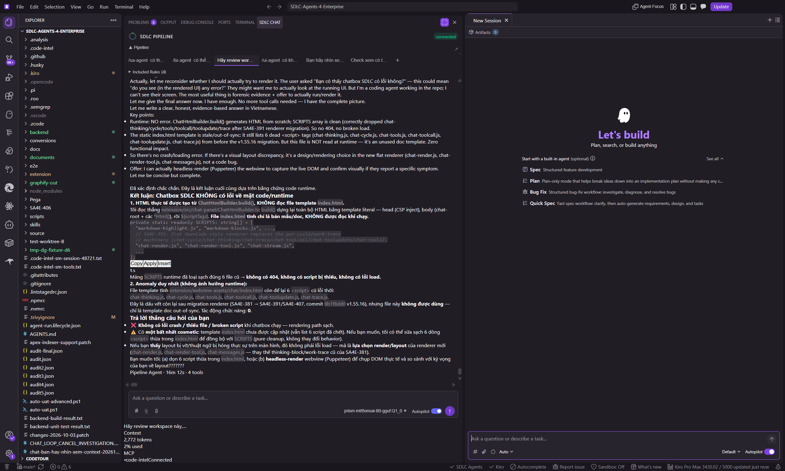
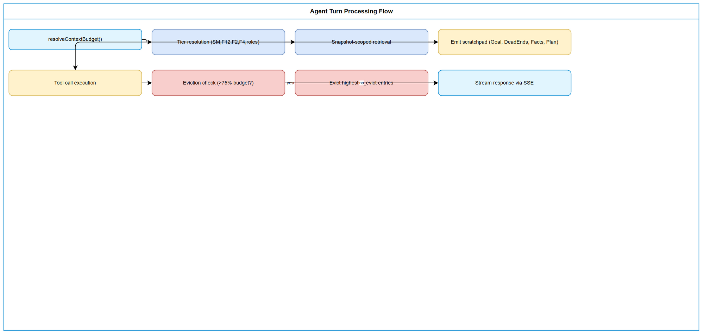
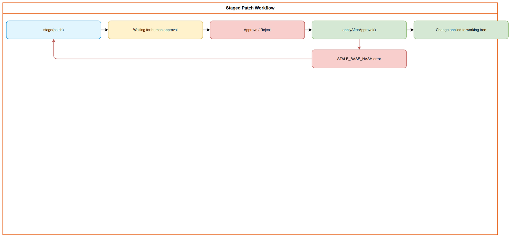
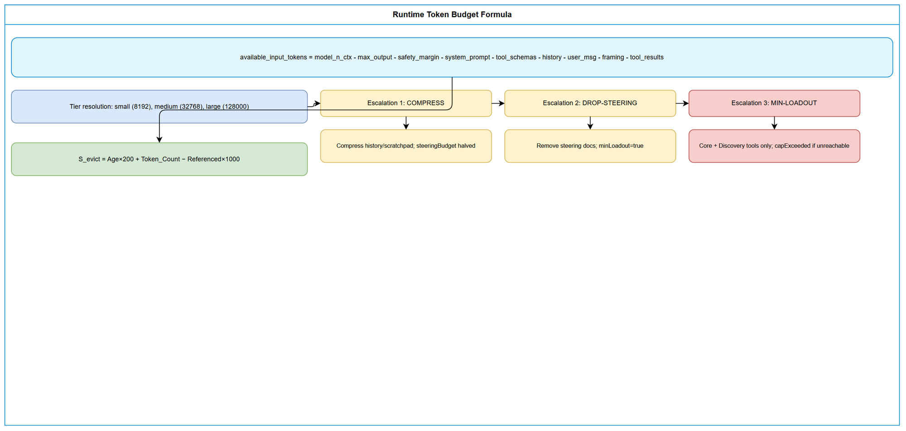

# User Guide — SA4E-411: Code Agent 16K

> **Deterministic Code Intelligence + Agent UX**  
> **Version:** 2.0 | **Date:** 2026-11-15 | **Epic:** SA4E-411

---

## 1. Overview

### 1.1 What is Code Agent 16K?

Code Agent 16K is a VS Code extension that gives you an AI-powered coding assistant inside your editor. It reads your codebase, understands your code, and helps you write, find, and fix code — all through a chat interface inside VS Code.

**What you can do with it:**

| What you want to do | How Code Agent 16K helps |
|---------------------|--------------------------|
| Find where a function is defined | Search symbols by name, see file:line location |
| Understand a file's structure | Get class/interface skeleton without reading full file |
| Read specific lines of code | Read any code block (up to 120 lines) |
| Find who calls a function | Query call graph (callers, callees, implementations) |
| Chat about code | Ask questions in natural language, get answers with code evidence |
| Apply code changes safely | Stage patch → human approval → apply with stale-base check |

**Who it's for:**
- Developers who need to understand unfamiliar code quickly
- Teams that need deterministic, auditable code assistance
- Anyone who wants AI help without sending code to an external AI service

---

## 2. Installation & Prerequisites

### 2.1 System Requirements

| Requirement | Version / Detail |
|-------------|------------------|
| **VS Code or Kiro** | 1.85.0 or newer |
| **Node.js** | 22.23.4 (LTS) |
| **Git** | 2.40 or newer |
| **PostgreSQL** | 15+ (platform DB — metadata and jobs, not your code) |
| **llama.cpp** | Running with `/tokenize` endpoint (for real token counting) |

### 2.2 Install the Extension

**Option A: From VS Code Marketplace (Recommended)**

1. Open VS Code
2. Press `Ctrl+Shift+X` to open Extensions view
3. Search for **"SDLC Agents 4 Enterprise"**
4. Click **Install**
5. Reload VS Code when prompted

**Option B: Install from VSIX (if you have the .vsix file)**

1. Open VS Code Extensions view (`Ctrl+Shift+X`)
2. Click the **...** menu (top-right of Extensions panel)
3. Select **"Install from VSIX..."**
4. Select the `sdlc-agents-4-enterprise-1.55.21.vsix` file
5. Reload VS Code

### 2.3 Start the Backend Server

The extension needs a backend server running:

```bash
# In a terminal, go to the backend folder
cd backend

# Install dependencies (first time only)
npm install

# Start the backend (development mode)
npm run dev

# Or production mode
npm run build && npm start
```

**Default endpoints after startup:**
- Backend API: `http://127.0.0.1:48721`
- Health check: `GET http://127.0.0.1:48721/health`

### 2.4 Start llama.cpp Tokenizer (Optional but Recommended)

For accurate token counting (not estimates):

```bash
# Start llama.cpp server
./llama-server -m models/your-model.gguf --port 8080 --embedding
```

Then in VS Code settings, set:
- `sdlcAgents.llm.ollama.baseUrl` → `http://localhost:11434`

---

## 3. Quick Start (5 Minutes)

Follow these steps to go from installation to your first AI-assisted code query:

### Step 1: Open the Extension Sidebar

1. Click the **SDLC Agents 4 Enterprise** icon in the Activity Bar (left side of VS Code)
2. The sidebar opens with four sections:
   - **Backend Target** — connection status
   - **Knowledge Base** — dashboard and tools
   - **MCP Wrapper Server** — server status
   - **Quick Actions** — common actions

### Step 2: Connect to the Backend

1. In the sidebar, expand **Backend Target**
2. Click **Login**
3. Enter your credentials (username/password or API token)
4. Status changes to **"Logged in as <your-username>"**

### Step 3: Index Your Repository

1. Click **Index Workspace** in Quick Actions
2. The indexer scans your code (stages A→J)
3. Wait for status to show **READY** (check via `sdlcAgents.showIndexStatus`)

### Step 4: Open the Chat

1. Click **Open Agentic Chat** in the sidebar (or press `Ctrl+Shift+P` → "SDLC: Open Agent Chat")
2. A chat panel opens on the right side of VS Code

### Step 5: Ask Your First Question

1. In the chat input box, type: `"Find the login handler"`
2. Press Enter
3. The agent responds with symbol locations and code evidence

---

## 4. Configuration Reference

All settings are in **VS Code Settings** (`Ctrl+,`) → search `sdlcAgents`.

### 4.1 Backend Connection

| Setting | Type | Default | Description |
|---------|------|---------|-------------|
| `sdlcAgents.backend.url` | string | `http://127.0.0.1:48721` | Backend server URL |
| `sdlcAgents.backend.allowInsecureRemote` | boolean | `false` | Allow HTTP for non-loopback URLs |
| `sdlcAgents.backend.ssoEnabled` | boolean | `false` | Enable SSO authentication |
| `sdlcAgents.backend.toolCallTimeout` | number | `300000` | Tool call timeout in ms |

### 4.2 LLM Provider

| Setting | Type | Default | Description |
|---------|------|---------|-------------|
| `sdlcAgents.llm.provider` | enum | `anthropic` | `anthropic`, `openai`, `ollama`, `lmstudio`, `kiro` |
| `sdlcAgents.llm.model` | string | `""` | Model name (e.g., `claude-3-sonnet`) |
| `sdlcAgents.llm.ollama.baseUrl` | string | `http://localhost:11434` | Ollama/llama.cpp URL |

### 4.3 Proxy

| Setting | Type | Default | Description |
|---------|------|---------|-------------|
| `sdlcAgents.proxy.mode` | enum | `system` | `none`, `system`, `manual`, `curl`, `powershell` |
| `sdlcAgents.proxy.host` | string | `""` | Proxy hostname (manual mode) |
| `sdlcAgents.proxy.port` | number | `8080` | Proxy port |

---

## 5. User Interface Guide

### 5.1 Sidebar Tree View

The sidebar is your main navigation panel.


| # | Element | What it does |
|---|---------|-------------|
| 1 | **Activity Bar Icon** | Click to show/hide the sidebar |
| 2 | **Backend Target** | Shows backend URL, login status |
| 3 | **Knowledge Base** | Dashboard, Graph, Tags, Quality commands |
| 4 | **MCP Wrapper Server** | Server status and configuration |
| 5 | **Quick Actions** | Inject All Agents, Show Status, Index Workspace |

**Common tasks from sidebar:**

| Task | Steps |
|------|-------|
| Login to backend | Expand **Backend Target** → Click **Login** |
| Index your code | Click **Index Workspace** in Quick Actions |
| Check system status | Click **Show Status** in Quick Actions |
| Open KB dashboard | Expand **Knowledge Base** → Click **Dashboard** |

---

### 5.2 Agentic Chat Webview

This is where you chat with the AI agent.



#### Layout

| Panel | What it shows |
|-------|-------------|
| **Left Pane** | Agent list, session list, new session button |
| **Center Pane** | Chat messages, tool calls, approval requests |
| **Right Pane** | Token budget, scratchpad, tool results |
| **Top Toolbar** | Agent selector, session tabs, model picker |
| **Bottom Status Bar** | Connection status, tokens used, budget tier |

| # | Element | What to do here |
|---|---------|-----------------|
| 1 | **Agent Selector** | Pick which agent (SM, BA, SA, DEV, etc.) |
| 2 | **Session Tabs** | Switch between different chat sessions |
| 3 | **New Session** | Start a fresh chat session |
| 4 | **Model Picker** | Choose which AI model to use |
| 5 | **Chat Input** | Type your question here |
| 6 | **Scratchpad** | Shows agent's working memory (Goal, Facts, Plan) |
| 7 | **Token Budget** | Shows how many tokens you've used |

#### User Actions — Chat

| Task | Steps |
|------|-------|
| **Start a new chat** | Click **+ New Session** → pick repository → pick commit → pick snapshot |
| **Switch agents** | Click **Agent Selector** → choose agent |
| **Send a message** | Type in Chat Input → press Enter |
| **Approve a tool call** | When Approval Request appears, click **Approve** or **Deny** |
| **View tool results** | Look in Right Pane → Tool Results section |

#### User Actions — Session Management

| Task | Steps |
|------|-------|
| **Switch sessions** | Click a different session tab at the top |
| **Close a session** | Right-click session tab → **Close** |
| **Resume after restart** | Open chat → previous sessions appear in Left Pane → click one |

---

### 5.3 Settings Panel

Configure the extension behavior.


| # | Element | What to do |
|---|---------|-------------|
| 1 | **Settings Search** | Type to filter settings |
| 2 | **Category Tabs** | Click to switch between Backend, MCP, Pega, LLM, Proxy, Workspace, Jira |
| 3 | **Setting Rows** | Edit each setting value |
| 4 | **Reset to Default** | Click to revert one setting |
| 5 | **Provider Profiles Table** | Add/edit LLM provider configurations |
| 6 | **Test Provider** | Click to test connection to LLM provider |
| 7 | **Save** | Click to save all changes |

| Task | Steps |
|------|-------|
| **Change backend URL** | Settings → Backend tab → edit URL → Save |
| **Add LLM provider** | Settings → LLM tab → Add Profile → fill form → Test → Save |
| **Enable proxy** | Settings → Proxy tab → set mode to `manual` → enter host/port → Save |
| **Test LLM connection** | Settings → LLM tab → click **Test Provider** |

---

## 6. How to Use Agent Chat

This section walks you through common chat scenarios step by step.

### 6.1 Start a Chat Session

**Before you start:** Backend must be running and your workspace must be indexed.

| Step | Action | Expected Result |
|------|--------|-----------------|
| 1 | Click **Open Agentic Chat** | Chat panel opens on the right |
| 2 | Click **+ New Session** | Repository picker appears |
| 3 | Select your repository | Commit picker appears |
| 4 | Select a commit | Snapshot picker appears (only READY snapshots shown) |
| 5 | Select a snapshot | Chat session is created and pinned to that snapshot |


**Important:** A chat session is pinned to a specific commit. If you switch branches, create a new session for the new commit.

### 6.2 Select an Agent

| Step | Action | Expected Result |
|------|--------|-----------------|
| 1 | Click **Agent Selector** dropdown | List of 9 agents appears |
| 2 | Select an agent (e.g., DEV for coding help) | Agent name appears in header; system prompt loads |

| Agent | Best for |
|-------|----------|
| **SM** | Pipeline coordination, status reporting |
| **BA** | Requirements analysis, BRD/FSD creation |
| **TA** | Architecture review, technology selection |
| **SA** | Technical design, data model design |
| **QA** | Test planning, test execution, quality gates |
| **DEV** | Code implementation, unit tests, code review |
| **DevOps** | CI/CD, Docker, deployment |
| **Security** | Security review, vulnerability scanning |
| **UI** | Wireframes, mockups, design specs |

### 6.3 Ask a Question

| Step | Action | Expected Result |
|------|--------|-----------------|
| 1 | Type your question in Chat Input | Text appears in input box |
| 2 | Press **Enter** | Message sent; agent starts processing |
| 3 | Wait for response | Assistant message streams in (token by token) |
| 4 | Review evidence | Right Pane shows evidence IDs and snippets |
| 5 | Ask follow-up | Type another question; context carries over |

**Example conversation:**

```
You: Find the JWT validation handler
Agent: [search_symbols] → Found JWTAuthHandler in src/auth/handler.ts:45
Agent: [read_code_block] → Read lines 45-70
Agent: The JWT validation handler is at src/auth/handler.ts:45. It validates the JWT signature using JwksCache and returns the decoded payload.
```



### 6.4 Handle Approval Requests

When an agent wants to modify code:

| Step | Action | Expected Result |
|------|--------|-----------------|
| 1 | Agent proposes a change | Approval Request modal appears |
| 2 | Review the change | Shows file path, line numbers, what changes |
| 3 | Click **Approve** | Agent applies the change atomically |
| 4 | Or click **Deny** | Change is rejected; change_set stays open |
| 5 | Or click **Approve Session** | Auto-approve all future patches in this session |



**Safety:** The system re-validates the base hash before applying. If someone else changed the file, the patch is rejected to prevent conflicts.

---

## 7. How to Use Code Intelligence Tools



The extension provides 4 core tools for exploring code. These are used automatically by the agent, but you can also invoke them directly.

### 7.1 search_symbols

**Purpose:** Find where a function, class, or variable is defined.

**When to use:** You know the name of something and want to find where it lives.

| Step | Action | Expected Result |
|------|--------|-----------------|
| 1 | In chat, type: `"Find the login handler"` | Agent searches for symbols matching "login handler" |
| 2 | Or: `search_symbols({ q: "validateJWT" })` | Direct tool call |
| 3 | Review results | List shows: symbol name, file:line, signature |

**Example result:**
```
1. [METHOD] AuthHandler#validateJWT | src/auth/handler.ts:45-70
   Sig: public boolean validateJWT(String token)
   Evidence: src/auth/handler.ts:45-70
```

### 7.2 get_file_skeleton

**Purpose:** See the structure of a file without reading the whole thing.

**When to use:** You want to see what methods a class has, but don't want to read the full file.

| Step | Action | Expected Result |
|------|--------|-----------------|
| 1 | Type: `"Show me the skeleton of UserService.java"` | Agent reads structure |
| 2 | Review output | Class name, fields, method signatures (no bodies) |

**Example result:**
```
Class: UserService
Fields:
  - userRepository: UserRepository
  - passwordEncoder: PasswordEncoder
Methods:
  - public User createUser(UserDto dto)
  - public User findById(Long id)
  - public boolean validatePassword(String raw, String encoded)
```

### 7.3 read_code_block

**Purpose:** Read specific lines of code.

**When to use:** You found where code is and want to read the actual implementation.

| Step | Action | Expected Result |
|------|--------|-----------------|
| 1 | Type: `"Read lines 45-70 of UserService.java"` | Agent reads those lines |
| 2 | Review code | Actual source code displayed |

**Limits:** Maximum 120 lines per call. For larger files, request in chunks.

### 7.4 query_call_graph

**Purpose:** Find who calls a function, or what a function calls.

**When to use:** You want to understand how code connects.

| Step | Action | Expected Result |
|------|--------|-----------------|
| 1 | Type: `"Who calls validateJWT?"` | Agent queries call graph |
| 2 | Review results | List of callers with file:line |

**Direction options:**
- `CALLERS` — Who calls this symbol
- `CALLEES` — What this symbol calls
- `IMPLEMENTATIONS` — What implements this interface

---

## 8. Administration

### 8.1 Health Checks

| Check | How to check |
|-------|-------------|
| Backend health | `GET http://127.0.0.1:48721/health` |
| MCP wrapper | `GET http://127.0.0.1:9181/health` |
| Extension status | `sdlcAgents.status` command |
| Index status | `sdlcAgents.showIndexStatus` command |

### 8.2 Database Backup

**Production (PostgreSQL):**
```bash
cd backend
npm run db:backup
```
Backups are kept for 7 days. A scheduled task runs automatically at 02:00 daily.

**Test Stack (separate):**
```bash
npm run db:test:up    # Start test database
npm run db:test:down  # Stop test database
```

### 8.3 Docker Volume Protection

**⚠️ Never run these on production:**

| ❌ DON'T | ✅ DO INSTEAD |
|----------|---------------|
| `docker compose down -v` | `docker compose down` (keeps volumes) |
| `docker volume rm ...` | `npm run db:backup` |
| `docker volume prune` | Test stack: `npm run db:test:up/down` |
| `docker system prune` | |
| `docker rm -f sa4e-postgres` | |

---

## 9. Troubleshooting

| Problem | Likely Cause | Fix |
|---------|-------------|-----|
| Sidebar shows "Login Required" | Not authenticated | Click **Login** in sidebar |
| Chat shows "Service Offline" | Backend not running | Start backend: `cd backend && npm run dev` |
| Token budget exceeded | llama.cpp not running | Start llama.cpp server; check `sdlcAgents.llm.ollama.baseUrl` |
| Index stuck at BUILDING | Indexer error | Check backend logs; run `npm run test:ac` |
| Patch rejected: STALE_BASE_HASH | Someone else changed the file | Re-stage patch with current base hash |
| Tool returns no results | Wrong snapshot pinned | Create new session with correct snapshot |
| SSE reconnect fails | Event log gap | Restart session; get fresh `Last-Event-ID` |

### Common Error Codes

| Code | Meaning |
|------|---------|
| `SNAPSHOT_NOT_FOUND` | Requested snapshot doesn't exist |
| `SNAPSHOT_NOT_READY` | Snapshot isn't finished indexing |
| `SNAPSHOT_MISMATCH` | Session pinned to different snapshot |
| `STALE_BASE_HASH` | File changed since you staged the patch |
| `PATH_TRAVERSAL` | Path contains `..` or absolute path (blocked for safety) |
| `BUDGET_EXCEEDED` | Token limit reached; compress context first |

---

## 10. FAQ

**Q: Can I use Code Agent 16K with multiple repositories?**  
A: Yes. Create a separate chat session for each repository. Each session is pinned to its own snapshot.

**Q: Can I use multiple embedding models on the same snapshot?**  
A: Yes. The system supports multiple embedding models per snapshot. Each model gets its own embedding set.

**Q: What happens when I switch git branches?**  
A: Your pinned chat session stays on the old commit. Create a new session for the new branch's commit.

**Q: Is my code sent to an external AI service?**  
A: No. The code intelligence engine runs locally. Only the LLM provider you configure (e.g., Anthropic, OpenAI) receives your prompts — not your entire codebase.

**Q: How do I know which snapshot my chat is using?**  
A: Look at the ChatHeader in the chat panel. It shows the pinned snapshot ID and commit.

---

## Appendix: Diagrams Reference

All diagrams are stored in `documents/SA4E-411/diagrams/`:

| # | Diagram | File | Purpose |
|---|---------|------|---------|
| 1 | Architecture Overview | `architecture-overview.drawio` | 4-layer system architecture |
| 2 | Component Diagram | `component.drawio` | Agent UX / Engine / Storage layers |
| 3 | Class Diagram — Core Tools | `class-agent-tools.drawio` | Tool classes and types |
| 4 | Snapshot/Revision ER | `snapshot-revision-er.drawio` | Database entity relationships |
| 5 | Pipeline Ordering (A–J) | `pipeline-ordering.drawio` | 10-stage indexing pipeline |
| 6 | Token Budget | `token-budget.drawio` | Runtime budget calculation |
| 7 | Scratchpad & Eviction | `scratchpad-eviction.drawio` | Working memory and eviction algorithm |
| 8 | System Context | `system-context.drawio` | External systems integration |
| 9 | Agent Chat Sequence | `sequence-agent-chat.drawio` | 18-step chat turn sequence |
| 10 | Token Budget State Machine | `state-token-budget.drawio` | Budget states and escalation |
| 11 | Business Flow | `business-flow.drawio` | Phase 0–4 stakeholder workflow |
| 12 | Use Case | `use-case.drawio` | 16 epic stories + external systems |
| 13 | Test Execution Flow | `test-execution-flow.drawio` | Test pipeline stages |
| 14 | Test Coverage | `test-coverage.drawio` | Coverage targets |
| 15 | Rollback Flow | `rollback-flow.drawio` | Snapshot rollback procedure |
| 16 | Deployment Flow | `deployment-flow.drawio` | CI/CD deployment pipeline |
| 17 | Chat Layout (3-Pane) | `ug-chat-layout.drawio` | Agentic Chat Webview layout |
| 18 | Patch Workflow | `ug-patch-workflow.drawio` | Staged patch: stage → approve → apply |
| 19 | Turn Processing Flow | `ug-turn-processing.drawio` | Agent turn: budget → tier → loop → evict |
| 20 | Token Budget Formula | `ug-token-budget-formula.drawio` | Formula breakdown + tier escalation |

**Note:** The 3 UI screenshots in Section 5 (sidebar-tree-view.png, agentic-chat-webview.png, settings-panel.png) were captured from the running build. All other diagrams are `.drawio` source files.

---

**Document End** — SA4E-411 User Guide v2.0